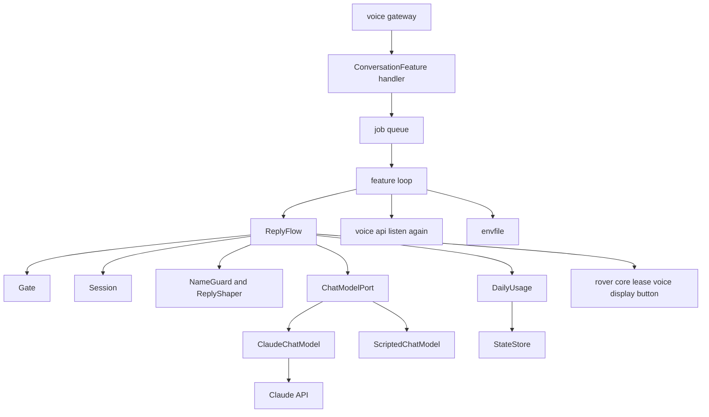
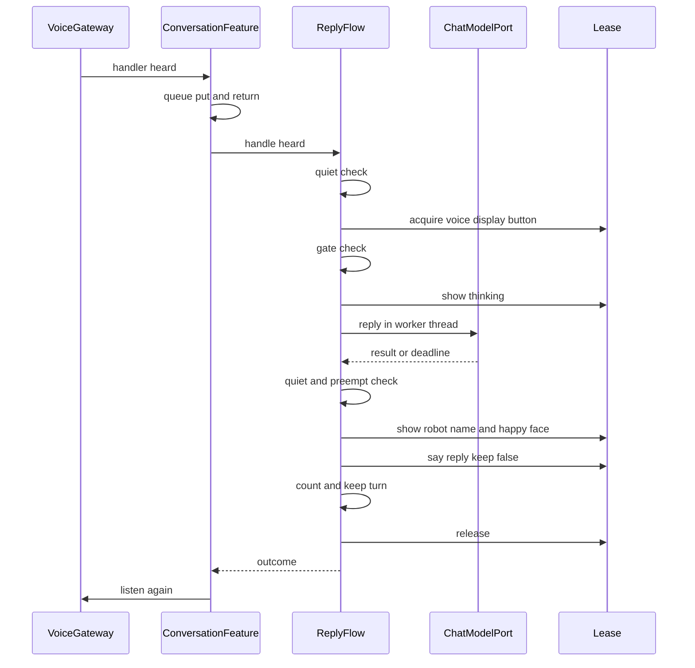
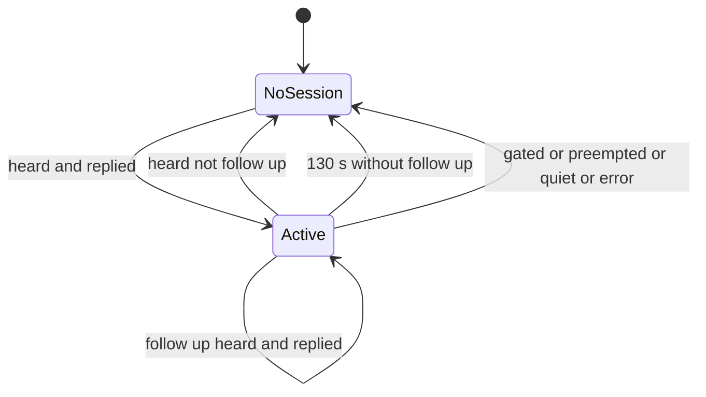

# Design Document: conversation（おしゃべり）

## Overview
おしゃべりは、`voice-gateway` がどの語句にも当てはめられなかった言葉を受け取ります。外部の会話の AI（Claude API）に、子ども向けの決まりで 1〜2 文の返事を作らせ、声で話します。話し終えたら、入口に続けて聞くよう頼みます。子どもがすぐボタンを押せば、話の流れを覚えたまま続けられます。

利用者は 4 歳前後の子どもと保護者です。保護者は、呼び名を外部に送らないこと、時間帯と 1 日の回数の上限、会話の中身を残さないことを求めます。開発者は、実機と API なしで流れと制限を確かめます。

`rover-core` の機能を足す口（エントリーポイント `osekkai.features`）に `conversation` として登録します。基盤も入口も書き換えません。

### Goals
- 当てはまらなかった言葉に、やさしい 1〜2 文の返事を声で返す。続けて話せる（最大 10 往復）
- 呼び名を外部に送らない。会話の中身・返事の音声・鍵をログや保存先に残さない
- 時間帯と 1 日の回数の上限を、再起動しても守る。記録が読めないときは止める側に倒す
- 通信の失敗・混雑・時間切れ・拒否のどれでも、やさしい決まった言葉で答え、ロボットは止まらない
- 偽の会話の AI で、開発 PC だけで流れと制限を確かめられる

### Non-Goals
- 聞き取り・振り分け・続けて聞くときのボタンの待ち（`voice-gateway`）
- 声の合成と LCD の仕組み（`rover-core`）
- 会話からほかの機能を呼ぶこと、会話の保存や保護者への報告
- モデルの切り替えの設定（モデルと effort はアダプタの定数）

## Boundary Commitments

### This Spec Owns
- 当てはまらない言葉の受け手としての登録と、1 回の返事の流れ（受け取り → 門の判定 → 問い合わせ → 話す → 数える → 続けて聞くを頼む）
- 子ども向けの決まりの文（system prompt）と、決まった言葉・LCD の文字
- 呼び名の目印への置き換え（送る前）と、目印から呼び名への戻し（話す前）
- 返事の整え（記号を除き、2 文・120 文字まで）
- 会話のやりとり（ロボットの中の記憶だけ）と、それを捨てる時
- 1 日の回数の記録（機能の保存先の `usage.json`）と、時間帯・時刻・上限・鍵の門
- 鍵のファイル（`~/.config/osekkai/env`）を読むことと、その持ち主と権限の確かめ
- Claude API のアダプタと、PC 用の台本の偽物
- self-check の項目 `conversation.setup`、設定の節 `conversation:`、手順書 `docs/conversation.md`

### Out of Boundary
- 聞き取り・振り分け・続けて聞く待ち（`voice-gateway`）。おしゃべりは `osekkai.voice.api` の口だけを使う
- 声の合成・再生とキャッシュ、LCD、資源の調停、静かな状態、時計、保存の仕組み（`rover-core`）
- 鍵のファイルを作ること（`device-deployment` の初期設定が案内し、人が置く）
- ほかの機能の呼び出し、会話の記録の保存

### Allowed Dependencies
- `osekkai.core`: `feature`（`FeatureSpec`・`FeatureContext`）、`config.FeatureConfig`、`types`（`Priority`・`Resource`・`Face`・`ResourceBusy`・`LeaseRevoked`・`SpeechFailed`・`DeviceUnavailable`）、`arbiter.Lease`、`storage.StateStore`、`clock.Clock`、`paths.Paths`、`lcd_text.center`、`selfcheck`
- `osekkai.voice.api`（`register_fallback`・`listen_again`・`Heard`・`FallbackTaken`）
- `osekkai.adapters.fake.console.typed_input_active`（PC の偽の返事を選ぶときだけ）
- 外部ライブラリ `anthropic>=2.6,<3`: `features/conversation/adapters/claude.py` の関数の中だけで読み込む
- 依存の向き: `texts`・`config`・`ports` → `privacy`・`session`・`usage`・`gate`・`envfile` → `flow` → `feature`。`adapters/*` は `ports` と `texts` だけを読む。`checks` は `config`・`envfile`・`adapters.claude.anthropic_available` だけを読む

### Revalidation Triggers
- `voice-gateway` の受け手の口（`register_fallback`・`listen_again`・`Heard`）の形が変わる、または「続けて聞く待ちの終わり」を知らせる口ができる
- `rover-core` の `VoiceHandle.say(keep=...)` の意味、`StateStore.load` の壊れたファイルの扱い、優先度の帯が変わる
- 配置の道具が入れる extras（`PIP_EXTRAS`）や鍵のファイルの置き場所が変わる
- Claude API のモデル・effort・fallback・preserved thinking の決まりが変わる（claude-api のスキルで確かめ直す）
- 日課（`SCHEDULED`）より上の優先度の機能が増える

## Architecture

### Existing Architecture Analysis
- 機能は `features/<name>/` に置き、`FeatureSpec` で名前・優先度・資源・設定のモデル・self-check を申告する（`presence`・`routine` と同じ）
- 入口は資源を返してから受け手の口を呼ぶ。受け手はすぐに戻り、自分のスレッドで仕事をする
- 声は `lease.voice.say(text, keep=False)` で、合成した声を再生の後に消せる
- ハードのライブラリは、機能の中の `adapters/` の関数の中だけで読み込む（読み込みの向きのテストで縛っている）

### Architecture Pattern & Boundary Map



- **Pattern**: ポートとアダプタ。判定（門・整え・置き換え・数え）は純粋な関数と小さな型にし、声と画面は借りた資源越しに行う
- **New components rationale**: 会話の AI を差し替えられるようにポートを置く（10.1）。回数と門は再起動とテストのため独立させる

### Technology Stack

| Layer | Choice / Version | Role in Feature | Notes |
|-------|------------------|-----------------|-------|
| 会話の AI | Claude API、`anthropic` 2.6 以上 3 未満（Python SDK） | 返事を作る | 新しい依存。extras `conversation` に入れ、配置の道具が実機に入れる |
| モデル | `claude-opus-5-5`、`output_config={"effort": "low"}` | 短い返事を速く安く作る | `thinking`・`temperature` は渡さない |
| 拒否の代わり | beta `server-side-fallback-2026-07-01`、`fallbacks="default"` | 拒否の種類ごとに代わりのモデルで作り直す | すべて断ったときだけ `stop_reason == "refusal"` |
| 保存 | `StateStore`（基盤） | 1 日の回数 | JSON、原子的に書く |
| 設定 | pydantic v2（基盤の `FeatureConfig`） | 節 `conversation:` | |

## File Structure Plan

### Directory Structure
```
src/osekkai/features/conversation/
├── __init__.py          # ConversationFeature を公開する（エントリーポイントの先）
├── config.py            # ConversationConfig（9.3、9.5）
├── texts.py             # 子ども向けの決まりの文、決まった言葉、LCD の文字
├── ports.py             # ChatModelPort、Turn、ChatResult（Replied・Refused・Failed）、FailureKind
├── privacy.py           # NameGuard（呼び名 ⇄ 目印）と shape_reply（記号を除き 2 文・120 文字）
├── session.py           # Session（やりとりの列、往復の上限、最後に使った時刻）
├── usage.py             # DailyUsage（1 日の回数の読み書き、読めないときは止める側）
├── gate.py              # 門の判定（鍵・時刻・時間帯・上限）と within_hours
├── envfile.py           # 鍵のファイルを読む（持ち主と権限を確かめる。値はログに出さない）
├── flow.py              # ReplyFlow（1 回の返事の流れ）と ConversationIO
├── feature.py           # ConversationFeature（登録、待ち行列、資源、続けて聞く、やりとりを捨てる）
├── checks.py            # self-check の項目 conversation.setup
└── adapters/
    ├── __init__.py
    ├── claude.py        # ClaudeChatModel（anthropic を関数の中で読み込む）、anthropic_available
    └── scripted.py      # ScriptedChatModel（PC で鍵がないときの偽の返事）

tests/features/conversation/
├── conversation_fakes.py                  # 偽の会話の AI・偽の IO・偽の anthropic のモジュール
├── test_conversation_config.py
├── test_conversation_privacy.py
├── test_conversation_session.py
├── test_conversation_usage.py
├── test_conversation_gate.py
├── test_conversation_envfile.py
├── test_conversation_flow.py
├── test_conversation_feature.py
├── test_conversation_claude_adapter.py
├── test_conversation_scripted.py
├── test_conversation_checks.py
├── test_conversation_registration.py
├── test_conversation_import_direction.py
└── test_conversation_journey.py           # 偽の時計・偽の AI で、受け取りから続けて話す・上限まで

docs/conversation.md                       # 鍵の置き方、設定、データの扱い、費用の目安、実機確認
```

### Modified Files
- `pyproject.toml` — extras `conversation = ["anthropic>=2.6,<3"]`、エントリーポイント `conversation = "osekkai.features.conversation:ConversationFeature"`
- `deploy/rover_deploy/releases.py` — `PIP_EXTRAS = "pi,voice,conversation"`
- `tests/deploy/test_releases.py` — extras の期待値
- `config/osekkai.example.yaml`、`src/osekkai/core/example_config.yaml` — 節 `conversation:` を `presence:` の後、`routine` の節（最後に置く決まり）の前に足す。2 つは同じ内容
- `tests/test_cli_selfcheck.py` — `CONVERSATION_NAMES = ["conversation.setup"]` を名前の順で `ALL_NAMES` に足す
- `tests/features/test_features_import_direction.py` — `FEATURE_ADAPTER_LIBS` に `osekkai.features.conversation.adapters.claude: {"anthropic"}`
- `deploy/rover_deploy/provision.py` の secrets の案内の文 — 鍵の名前（`ANTHROPIC_API_KEY`）を 1 行足す（中は読まない決まりは変えない）

## System Flows

### 1 回の返事


- 門で止まったとき（鍵がない・時刻が確かでない・時間帯の外・上限）は、決まった言葉を話して資源を返し、続けて聞くは頼まない
- 静かな状態・中断・資源を借りられないときは、話さず数えず、続けて聞くも頼まない
- 返事・拒否・失敗のときは、話して資源を返した後に続けて聞くを頼む（1.6、6.6）

### 会話（セッション）の状態

- 続けての言葉でない言葉は、前のやりとりを捨ててから新しい会話として扱う（2.3）
- 続けての言葉でも、やりとりがない（捨てた後）なら新しい会話として扱う

## Requirements Traceability

| Requirement | Summary | Components | Interfaces | Flows |
|-------------|---------|------------|------------|-------|
| 1.1 | 返事を求め、ｶﾝｶﾞｴﾁｭｳ を出す | ReplyFlow, texts | `ConversationIO.show`, `ChatModelPort.reply` | 1 回の返事 |
| 1.2 | ﾛｰﾊﾞｰ と喜んだ顔で話す | ReplyFlow, texts | `ConversationIO.show/say` | 1 回の返事 |
| 1.3 | 1〜2 文、記号なしで求める | texts（決まりの文） | `SYSTEM_PROMPT` | — |
| 1.4 | 2 文・120 文字まで | privacy.shape_reply | `shape_reply` | — |
| 1.5 | 空なら決まった言葉 | ReplyFlow, texts | `SAY_EMPTY` | — |
| 1.6 | 話し終えたら続けて聞くを頼む | ConversationFeature | `listen_again` | 1 回の返事 |
| 2.1 | やりとりを踏まえる | Session, ReplyFlow | `Session.turns_with` | セッション |
| 2.2 | 押されなければ捨てる | ConversationFeature, Session | `Session.expired` | セッション |
| 2.3 | 続けてでない言葉は新しい会話 | ReplyFlow | `Heard.follow_up` | セッション |
| 2.4 | 10 往復まで、古いものから使わない | Session | `max_turns` | — |
| 2.5 | 記憶の中だけ | Session | — | — |
| 3.1 | 子ども向けの決まり | texts, ClaudeChatModel | `SYSTEM_PROMPT` | — |
| 3.2 | 拒否なら決まった言葉 | ClaudeChatModel, ReplyFlow | `Refused`, `SAY_REFUSED` | — |
| 3.3 | 子どもの言葉を読み上げない | ReplyFlow | 話すのは決まった言葉か返事だけ | — |
| 4.1 | 呼び名は設定から、送らない | ConversationConfig, NameGuard | `call_name`, `call_name_variants` | — |
| 4.2 | 子どもの言葉の呼び名を目印に | NameGuard | `NameGuard.mask` | — |
| 4.3 | 返事の目印を呼び名に | NameGuard | `NameGuard.fill` | — |
| 4.4 | 目印を書くよう求める | texts | `SYSTEM_PROMPT` | — |
| 5.1 | 時間帯の外 | gate | `GateReason.OUT_OF_HOURS` | 1 回の返事 |
| 5.2 | 時刻が確かでない | gate | `GateReason.CLOCK_UNSYNCED` | 1 回の返事 |
| 5.3 | 上限に達した | gate, DailyUsage | `GateReason.LIMIT` | 1 回の返事 |
| 5.4 | 話した返事だけ数える | ReplyFlow, DailyUsage | `DailyUsage.add_one` | 1 回の返事 |
| 5.5 | 再起動で引き継ぎ、日付で 0 | DailyUsage | `usage.json` | — |
| 5.6 | 読めなければ上限とみなす | DailyUsage | `UsageState.blocked` | — |
| 6.1 | つながらない | ClaudeChatModel, ReplyFlow | `FailureKind.CONNECTION` | — |
| 6.2 | 混み合っている | ClaudeChatModel, ReplyFlow | `FailureKind.BUSY` | — |
| 6.3 | そのほかの誤り | ClaudeChatModel, ReplyFlow | `FailureKind.OTHER` | — |
| 6.4 | 20 秒で待つのをやめる | ReplyFlow, ClaudeChatModel | 締め切り、`FailureKind.TIMEOUT` | 1 回の返事 |
| 6.5 | 思いがけない誤りは会話だけ終える | ConversationFeature | 例外の囲い | セッション |
| 6.6 | 失敗した問いを残さず、続けて聞く | ReplyFlow, Session | `Session.add` は返事のときだけ | 1 回の返事 |
| 7.1 | 優先の高い機能に譲る | ReplyFlow, ConversationFeature | `on_preempt`、`LeaseRevoked` | セッション |
| 7.2 | 静かな状態では求めない | ReplyFlow | `ctx.is_quiet` | 1 回の返事 |
| 7.3 | 待つ間に静かになったら話さない | ReplyFlow | `ctx.is_quiet` | 1 回の返事 |
| 7.4 | 借りられなければ話さず数えない | ReplyFlow | `ResourceBusy` | 1 回の返事 |
| 8.1 | 言葉・返事・呼び名・鍵を出さない | 全部品（ログの決まり）、checks | 固定の文言 | — |
| 8.2 | 返事の音声を残さない | ReplyFlow | `say(keep=False)` | — |
| 8.3 | 鍵は外の本人だけの場所から | envfile | `read_setup` | — |
| 8.4 | ログは決まった文言・回数・時間・種類 | ReplyFlow, ConversationFeature | — | — |
| 8.5 | 送るのは決まりの文とやりとりだけ | ReplyFlow, ClaudeChatModel | `ChatModelPort.reply(system, turns)` | — |
| 9.1 | 無効なら受け手にならない | 基盤の登録（`enabled`）、ConversationFeature | `register_fallback` | — |
| 9.2 | 鍵がなければ決まった言葉 | gate, ConversationFeature | `GateReason.NOT_SET_UP` | 1 回の返事 |
| 9.3 | 設定の誤りは開始しない | ConversationConfig、基盤 | pydantic の検証 | — |
| 9.4 | self-check で鍵を確かめる | checks | `conversation.setup` | — |
| 9.5 | 設定で変えられる | ConversationConfig | 各項目 | — |
| 10.1 | 偽の AI で PC で確かめる | ports, テストの偽物 | `ChatModelPort` | — |
| 10.2 | ハードなしで鍵がなければ偽の返事 | ScriptedChatModel, ConversationFeature | `choose_chat_model` | — |

## Components and Interfaces

| Component | Domain | Intent | Req Coverage | Key Dependencies | Contracts |
|-----------|--------|--------|--------------|------------------|-----------|
| ConversationConfig | 設定 | 節 `conversation:` の項目と範囲 | 4.1, 5.1, 5.3, 2.4, 6.4, 9.3, 9.5 | FeatureConfig (P0) | State |
| texts | 言葉 | 決まりの文・決まった言葉・LCD | 1.1–1.3, 1.5, 3.1, 3.2, 4.4, 5.1–5.3, 6.1–6.3, 9.2 | — | — |
| ports | ポート | 会話の AI の口と結果の型 | 6.1–6.4, 8.5, 10.1 | — | Service |
| NameGuard / shape_reply | 判定 | 呼び名の置き換えと返事の整え | 1.4, 3.3, 4.1–4.3 | — | Service |
| Session | 判定 | やりとりの列 | 2.1–2.5, 6.6 | Clock (P1) | State |
| DailyUsage | 記録 | 1 日の回数 | 5.3–5.6 | StateStore (P0), Clock (P0) | State |
| gate | 判定 | 決まった言葉で終える理由 | 5.1–5.3, 5.6, 9.2 | — | Service |
| envfile | 鍵 | 鍵のファイルを読む | 8.1, 8.3, 9.2, 9.4 | Paths (P0) | Service |
| ReplyFlow | 流れ | 1 回の返事 | 1.x, 2.1, 2.3, 3.2, 3.3, 5.4, 6.x, 7.x, 8.2, 8.4, 8.5 | ChatModelPort (P0), ConversationIO (P0) | Service |
| ConversationFeature | 機能 | 登録・待ち行列・資源・続けて聞く | 1.6, 2.2, 6.5, 7.1, 9.1, 9.2, 10.2 | voice.api (P0), FeatureContext (P0) | Service |
| ClaudeChatModel | アダプタ | Claude API の呼び出し | 3.1, 3.2, 6.1–6.4, 8.5 | anthropic (External, P0) | Service |
| ScriptedChatModel | アダプタ | PC の偽の返事 | 10.2 | — | Service |
| checks | self-check | `conversation.setup` | 8.1, 9.4 | envfile (P0) | Service |

### 判定と記録

#### ConversationConfig
**Responsibilities & Constraints**
- `FeatureConfig` を継ぐ。範囲の外の値は pydantic の誤りになり、基盤が誤りの場所と理由だけをログに出して開始しない（9.3）
- 時刻は音声の入口と同じ書き方（引用符で囲む `"HH:MM"`）。始めと終わりが同じなら誤り

##### State Management
```python
class ConversationConfig(FeatureConfig):
    call_name: str = ""                    # 空なら「きみ」（4.1）
    call_name_variants: list[str] = []     # 聞き取りが書く別の形（漢字など）。目印に置き換える（4.2）
    hours: tuple[time, time] = (time(7, 0), time(21, 30))   # 始めを含み、終わりを含まない（5.1）
    daily_limit: int = Field(default=60, ge=1, le=500)      # 5.3
    max_turns: int = Field(default=10, ge=1, le=30)         # 2.4
    reply_timeout_seconds: float = Field(default=20.0, ge=5.0, le=60.0)  # 6.4
```

#### NameGuard と shape_reply（`privacy.py`）
##### Service Interface
```python
NAME_MARK: Final = "{name}"
DEFAULT_CALL_NAME: Final = "きみ"

class NameGuard:
    def __init__(self, call_name: str, variants: Sequence[str]) -> None: ...
    def mask(self, text: str) -> str: ...   # 呼び名と別の形を {name} に。かなの違いは同じとみなす
    def fill(self, text: str) -> str: ...   # {name} を呼び名に（空なら「きみ」）

def shape_reply(text: str) -> str: ...      # 記号・絵文字・箇条書きの頭を除き、2 文・120 文字まで
```
- `mask`: 照合はカタカナをひらがなにそろえた文字列で行い、置き換えは元の文字列の同じ位置に行う。長い形から先に置き換える。呼び名が空なら置き換えない（「きみ」は置き換えない）
- `fill`: `{name}` のほか、全角の `｛name｝` も呼び名にする
- `shape_reply`: 文の区切りは「。」「！」「？」「!」「?」。2 文の後ろを捨て、120 文字を超えたら 120 文字で切る。絵文字（Unicode の So の区分）、`*`・`#`・`•`・行の頭の `-` を除く。結果が空白だけなら空文字

#### Session（`session.py`）
##### State Management
```python
@dataclass(frozen=True)
class Turn:
    role: Literal["user", "assistant"]
    text: str                       # 呼び名は目印のまま（呼び名を記憶にも持たない）

class Session:
    def __init__(self, max_turns: int, now: float) -> None: ...
    def turns_with(self, user_text: str) -> list[Turn]: ...  # 今までの往復 + 新しい問い
    def add(self, user_text: str, reply_text: str, now: float) -> None: ...  # 1 往復を足す。上限を超えたら古いものから捨てる
    def touch(self, now: float) -> None: ...  # 往復は足さずに、最後に使った時刻だけを進める
    def expired(self, now: float) -> bool: ...  # 最後に使ってから FORGET_AFTER_S（130 秒）たったか
```
- 足すのは返事を話せたときだけ（拒否・空・失敗の問いは足さない。6.6）。拒否・空・失敗を話し終えたときは `touch` で時刻だけを進める（続けて聞く間に前のやりとりを捨てないため）
- 返事は整えた後、呼び名に戻す前の文（目印のまま）を残す
- ファイルにも外部にも出さない。捨てるときは参照を外すだけ（2.5）
- 思考のブロックは残さず、文字だけを残す（research.md の決定。先頭を捨てても API に断られない）

#### DailyUsage（`usage.py`）
##### State Management
- 保存先: 機能の保存先の `usage.json`（`{"version": 1, "date": "YYYY-MM-DD", "count": int, "blocked": bool}`）
```python
class DailyUsage:
    @classmethod
    def load(cls, store: StateStore, clock: Clock) -> DailyUsage: ...
    def reached(self, today: date, limit: int) -> bool: ...   # 上限に達したか、読めない日か
    def add_one(self, today: date) -> int: ...                # 1 つ足して保存し、その日の回数を返す
```
- 読む前に `usage.json` があるかを見る。あったのに `load` が `None`（壊れて退避された）、読み出しで `OSError`、形・版が違うときは「読めない」とし、その日を `blocked: true` で書き直す（5.6）。ログには記録の名前と理由の種類だけを出す
- 日付が保存の日付と違えば、その日の 0 から数える（5.5）。日付は時刻が確かなときだけ使う（門で先に確かめる）
- 保存に失敗しても、記憶の中の回数で守る（ログは例外の型の名前だけ）

#### gate（`gate.py`）
##### Service Interface
```python
class GateReason(Enum):
    NOT_SET_UP = "not_set_up"        # 9.2
    CLOCK_UNSYNCED = "clock_unsynced"  # 5.2
    OUT_OF_HOURS = "out_of_hours"    # 5.1
    LIMIT = "limit"                  # 5.3、5.6

def within_hours(now: time, hours: tuple[time, time]) -> bool: ...
def check_gate(*, ready: bool, synchronized: bool, now: datetime,
               hours: tuple[time, time], usage_reached: bool) -> GateReason | None: ...
```
- 判定の順は表のとおり（鍵 → 時刻 → 時間帯 → 上限）。言葉は `texts.GATE_REPLIES[reason]`

#### envfile（`envfile.py`）
##### Service Interface
```python
VARIABLE_NAME: Final = "ANTHROPIC_API_KEY"

class SetupProblem(Enum):
    NO_FILE = "no_file"
    NOT_PRIVATE = "not_private"    # 持ち主が本人でない、またはほかの人が読み書きできる
    NOT_WRITTEN = "not_written"    # 名前の行がないか、値が空
    UNREADABLE = "unreadable"

def read_setup(paths: Paths) -> str | SetupProblem: ...
```
- 場所は `Paths().config_dir / "env"`（リポジトリの外。8.3）。行は「名前=値」、`#` で始まる行と空行は飛ばす。値の前後の空白と引用符を除く
- 持ち主が `os.getuid()` で、権限に `0o077` が立っていないときだけ値を返す
- 値・行の中身は、ログにも例外の文にも出さない（8.1）。問題は `SetupProblem` の名前だけで伝える

### 流れ

#### ReplyFlow（`flow.py`）
**Responsibilities & Constraints**
- 1 回の言葉を受けて、外部へ送る・話す・数える・やりとりに残すまでを行う。資源を借りるのはこの部品だけ
- 子どもの言葉そのものは話さない。話すのは `texts` の決まった言葉か、整えた返事だけ（3.3）
- 外部の会話の AI に渡すのは、決まりの文と目印に置き換えたやりとりだけ（8.5）

**Dependencies**
- Inbound: ConversationFeature — 言葉を 1 つずつ渡す (P0)
- Outbound: ChatModelPort (P0)、ConversationIO（借りた資源の声と画面）(P0)、DailyUsage (P0)、Session (P1)
- External: なし（アダプタの先）

##### Service Interface
```python
class Outcome(Enum):
    REPLIED = "replied"        # 返事・空の言葉・拒否の言葉を話した（数えた）
    FAILED = "failed"          # 失敗の言葉を話した（数えない）
    GATED = "gated"            # 門の言葉を話して終えた
    DROPPED = "dropped"        # 静かな状態・中断・借りられない。話さず数えない

class ConversationIO(Protocol):
    def show(self, line1: str, line2: str) -> None: ...
    def say(self, text: str, *, keep: bool) -> None: ...   # LeaseRevoked・SpeechFailed を投げうる

class ReplyFlow:
    def __init__(self, ctx: FeatureContext, config: ConversationConfig, model: Callable[[], ChatModelPort | None],
                 usage: DailyUsage, names: NameGuard, stopped: Callable[[], bool]) -> None: ...
    def handle(self, heard: Heard, session: Session | None) -> tuple[Outcome, Session | None]: ...
```
- 手順:
  1. `heard.follow_up` が偽、またはやりとりが切れていれば、新しい会話にする（2.3）
  2. 静かな状態なら DROPPED（7.2）。資源（声・画面・ボタン）を 2 秒まで待って借りる。借りられなければ DROPPED（7.4）。借りた後に静かな状態をもう一度見る
  3. 門を判定する。止まれば決まった言葉を `keep=True` で話して GATED、会話を捨てる
  4. 「ｶﾝｶﾞｴﾁｭｳ」と普通の顔を出し、目印に置き換えた問いを添えて、別のスレッドで問い合わせる。`reply_timeout_seconds` を過ぎたら `Failed(TIMEOUT)` とし、遅れて届いた結果は捨てる（6.4）
  5. 止める旗・中断・静かな状態なら、話さずに DROPPED（7.1、7.3）
     - 話している途中に中断が来たときは、基盤の決まりどおり今の発話を言い終えてから資源を返し、続けて聞くは頼まない（7.1）。言い終えた返事・拒否は話した回なので 1 回数える（5.4）が、やりとりには足さない。話し終えた後に静かな状態・止める旗に気づいたときも同じ
  6. 結果から言葉を決める: `Replied` は整えて（空なら `SAY_EMPTY`）呼び名に戻す、`Refused` は `SAY_REFUSED`、`Failed` は種類ごとの言葉（CONNECTION → 6.1、BUSY → 6.2、OTHER と TIMEOUT → 6.3）
  7. 「ﾛｰﾊﾞｰ」と喜んだ顔（失敗のときは普通の顔）を出して話す。AI の返事は `keep=False`（8.2）、決まった言葉は `keep=True`
  8. 話し終えたら、`Replied`・`Refused` は 1 回数える（5.4）。`Replied` で中身があれば、やりとりに 1 往復を足す。そうでなく話し終えたときは `Session.touch` で時刻だけを進める
- ログ: 「返事を話しました（今日 N 回目、M ms）」「失敗の言葉を話しました: <種類>」「門で止めました: <理由>」など、決まった文言と数・種類の名前だけ（8.4）

#### ConversationFeature（`feature.py`）
**Responsibilities & Constraints**
- `FeatureSpec(name="conversation", priority=Priority.INTERACTIVE, resources={VOICE, DISPLAY, BUTTON}, config_model=ConversationConfig, checks=CONVERSATION_CHECKS)`
- `run(stop)` の始めに `register_fallback("conversation", self._on_heard, alive=lambda: not stop.is_set())`。`FallbackTaken` なら記録して止める旗を待つ。`finally` で外す。設定で無効なら基盤が開始しないので、受け手にならない（9.1）
- `_on_heard` は待ち行列（大きさ 1）に入れてすぐ戻る。いっぱいなら捨てて記録する
- ループは 1 秒ごとに待ち行列を見て、やりとりが `expired` なら捨てる（2.2）
- 言葉ごとに `ReplyFlow.handle` を呼ぶ。思いがけない例外は型の名前だけを記録し、やりとりを捨てて次へ進む（6.5）
- 結果が REPLIED か FAILED なら、資源を返した後に `listen_again("conversation")` を呼ぶ（1.6、6.6）
- 会話の AI は初めて使うときに選ぶ（`choose_chat_model`）

##### Service Interface
```python
def choose_chat_model(paths: Paths) -> ChatModelPort | None: ...
```
- 鍵を読め、`anthropic` を読み込めれば `ClaudeChatModel`
- そうでなく、端末の偽物が動いていれば（`typed_input_active()`）`ScriptedChatModel`（10.2）
- どちらでもなければ `None`。門は NOT_SET_UP になり「いまは おはなし できないんだ。また あとで ね」と答える（9.2）。ログには `SetupProblem` の名前か「ライブラリがない」だけを出す

### アダプタ

#### ports（`ports.py`）
```python
class FailureKind(Enum):
    CONNECTION = "connection"
    BUSY = "busy"
    TIMEOUT = "timeout"
    OTHER = "other"

@dataclass(frozen=True)
class Replied:
    text: str
@dataclass(frozen=True)
class Refused: ...
@dataclass(frozen=True)
class Failed:
    kind: FailureKind

ChatResult = Replied | Refused | Failed

class ChatModelPort(Protocol):
    def reply(self, system: str, turns: Sequence[Turn], timeout_s: float) -> ChatResult: ...
```
- 前提: `turns` は user で始まり、user と assistant が交互で、user で終わる
- 事後: API の誤りは例外にせず `Failed` で返す。返すまでの長さは `timeout_s` 程度（流れの側の締め切りが上限を守る）

#### ClaudeChatModel（`adapters/claude.py`）
**Contracts**: Service [x]

- `anthropic` は関数の中で読み込む。`anthropic_available()` は `importlib.util.find_spec` で確かめる
- クライアント: `anthropic.Anthropic(api_key=<読んだ値>, timeout=timeout_s, max_retries=0)`。環境変数やプロファイルには頼らない
- 呼び出し:
```python
client.beta.messages.create(
    model="claude-opus-5-5",
    max_tokens=2048,                      # 思考の分を含む。返事は短いが、切れないように余裕を持つ
    system=[{"type": "text", "text": system, "cache_control": {"type": "ephemeral"}}],
    messages=[{"role": t.role, "content": t.text} for t in turns],
    output_config={"effort": "low"},
    betas=["server-side-fallback-2026-07-01"],
    fallbacks="default",
)
```
- 結果: `stop_reason == "refusal"` を先に見て `Refused`。そうでなければ `type == "text"` のブロックをつないで `Replied`（`fallback` などほかの種類は読まない）
- 例外の対応（上から順に捕まえる）: `APITimeoutError` → TIMEOUT、`APIConnectionError` → CONNECTION、`RateLimitError`・`OverloadedError` → BUSY、`APIStatusError` → OTHER、そのほかの `Exception` → OTHER
- ログ: 拒否のときは「拒否されました」と `stop_details.category`（決まった種類の名前）だけ。誤りは例外の型の名前だけ。返事・問い・鍵は出さない

#### ScriptedChatModel（`adapters/scripted.py`）
- 鍵がない PC で、決まった返事を順に返す（例:「そうなんだ！{name}は すごいね」）。目印を含めて、呼び名の差し込みも確かめられるようにする。外へは何も送らない

### self-check

#### checks（`checks.py`）
- 項目 `conversation.setup`（名前に `key`・`token`・`secret` などを入れない）
- 設定が使えない・無効 → SKIPPED（理由: 設定が使えない／無効）
- `anthropic` がない → SKIPPED（理由: 会話のライブラリがない）
- `read_setup` が問題を返す → OK と理由（鍵のファイルがない／本人だけが読めるようにしていない／鍵が書かれていない／読めない）。版を戻しても直らないので FAILED にしない（9.4）
- 鍵がある → OK
- 値は読んでも返さず、理由は決まった文言だけ（8.1）

## Data Models

### Logical Data Model
- `usage.json`（機能の保存先、1 つだけ）:
  - `version`: 1
  - `date`: その日の日付（地域の時刻、`YYYY-MM-DD`）
  - `count`: その日に話した返事の数（0 以上）
  - `blocked`: 記録が読めなかった日なら true（その日は上限に達したとみなす）
- 会話のやりとり（`Session`）は記憶の中だけ。保存しない
- 返事の音声は、再生の後に消える一時ファイルだけ（基盤の `keep=False`）

## Error Handling

### Error Strategy
- 外部の誤りはアダプタで `Failed` に変え、流れは決まった言葉で答える。ロボット全体は止めない
- 流れの中の思いがけない例外は、機能のループで型の名前だけを記録し、やりとりを捨てて次の言葉を待つ（6.5）

### Error Categories and Responses
| 起きたこと | 言葉 | 数える | 続けて聞く |
|---|---|---|---|
| つながらない | ごめんね、いま インターネットに つながらないみたい | しない | 頼む |
| 混み合っている（429・529） | ちょっと つかれちゃった。すこし まってから また はなそうね | しない | 頼む |
| そのほかの誤り・20 秒の時間切れ | ごめんね、いま うまく かんがえられないみたい | しない | 頼む |
| 拒否 | そのはなしは ちょっと むずかしいな。べつの おはなし しよう | する | 頼む |
| 返事が空 | うーん、なんて いおうかな | する | 頼む |
| 鍵がない・時刻が確かでない | いまは おはなし できないんだ。また あとで ね | しない | 頼まない |
| 時間帯の外 | いまは ねる じかんだよ。また あした おはなし しようね | しない | 頼まない |
| 上限・記録が読めない | きょうは いっぱい おはなし したね。また あした ね | しない | 頼まない |
| 静かな状態・中断・借りられない | （話さない） | しない | 頼まない |
| 話す途中の失敗（`SpeechFailed` など） | （記録だけ） | しない | 頼まない |

### Monitoring
- journal に、決まった文言・その日の回数・かかった時間（ms）・誤りや門の種類の名前だけを出す

## Testing Strategy

### Unit Tests
- `privacy`: 呼び名がひらがな・カタカナ・別の形（漢字）で入っていても `{name}` になり、呼び名の空・「きみ」は置き換えない（4.1、4.2）。`fill` で全角の目印も戻す（4.3）。3 文の返事が 2 文に、130 文字が 120 文字に、絵文字と箇条書きの頭が消える（1.4）
- `session`: 11 往復目で最初の往復が消える（2.4）。130 秒で `expired`（2.2）。`turns_with` が交互の形になる
- `usage`: 再起動（読み直し）で回数を引き継ぎ、日付が変わると 0（5.5）。壊れたファイル・読めないファイル・版の違いで `reached` が真になり、`blocked` が書き残される（5.6）
- `gate`: 日をまたぐ時間帯の境目（始めを含み終わりを含まない）、時刻が確かでない、上限ちょうど、鍵なしの順（5.1–5.3、9.2）
- `envfile`: 権限 0600 で読める。0644 や持ち主が違うと `NOT_PRIVATE`、名前の行がないと `NOT_WRITTEN`。ログと例外の文に偽の値（10 文字未満の `hidden` など）が出ない（8.1、8.3）

### Integration Tests
- `ReplyFlow` と偽の会話の AI・偽の IO・偽の時計: 返事の前に「ｶﾝｶﾞｴﾁｭｳ」、話す前に「ﾛｰﾊﾞｰ」と喜んだ顔、AI の返事は `keep=False`（1.1、1.2、8.2）。偽の AI が受け取ったやりとりに呼び名がない（4.2、8.5）
- 失敗の種類ごとの言葉、時間切れ（偽の AI が締め切りより長く止まる）、拒否、空の返事。数える・数えないとやりとりに残す・残さない（5.4、6.1–6.4、6.6）
- 静かな状態のとき AI を呼ばない。返事を待つ間に静かになったら話さない。借りられないとき・話す前に中断されたとき数えない（7.1–7.4）
- `ConversationFeature`: 受け手の登録と外し、言葉の後の `listen_again`、門のときは頼まない、思いがけない例外の後も次の言葉に答える（1.6、6.5、9.1）
- `ClaudeChatModel` と偽の `anthropic` のモジュール（SDK と同じ親子関係の例外の型）: 呼び出しの引数（モデル・effort・beta・fallbacks・キャッシュ・`max_retries=0`）、`refusal` の扱い、例外の対応（3.2、6.1–6.4）

### E2E（偽の時計・偽の AI・偽の資源）
- 話しかける → 返事 → 続けて話す（前のやりとりを踏まえる）→ 押さずに 130 秒 → 次は新しい会話（2.1–2.3）
- 60 回話した後は上限の言葉、再起動しても上限、日付が変わると話せる（5.3–5.5）
- 端末の偽物で鍵がないとき、台本の返事が端末に出る（10.2）

### 実機確認（子どもが使っていない時間に、保護者の了承を得て）
- 鍵を置いた後の self-check、1 回の返事、続けて 3 回以上話して API に断られないこと、時間帯の外の言葉、Wi-Fi を切ったときの言葉、journal に言葉・呼び名・鍵が出ないこと

## Security Considerations
- 鍵はリポジトリの外の `~/.config/osekkai/env`（0600、本人の持ち物）からだけ読み、`api_key` で明示して渡す。持ち主か権限が違えば使わない
- 呼び名は外部に送らない。目印の置き換えは送る直前に行い、やりとりの記憶にも目印のまま残す
- ログ・self-check・状態のファイルに、子どもの言葉・返事・呼び名・鍵を出さない
- gitleaks の誤検知を避けるため、鍵の変数名やテストの偽の値に `key`・`token`・`secret`・`password` を入れず、テストの偽の値は 10 文字未満にする。文書の例は `ANTHROPIC_API_KEY=<ここに鍵>` の形にする

## Performance & Scalability
- 返事を待つのは最大 20 秒（設定で 5〜60 秒）。自動のやり直しはしない
- 決まりの文はキャッシュに入れ、2 回目からの入力の費用を下げる。費用の目安は 1 回およそ 1 円、上限 60 回で 1 日およそ 60 円まで（research.md）
