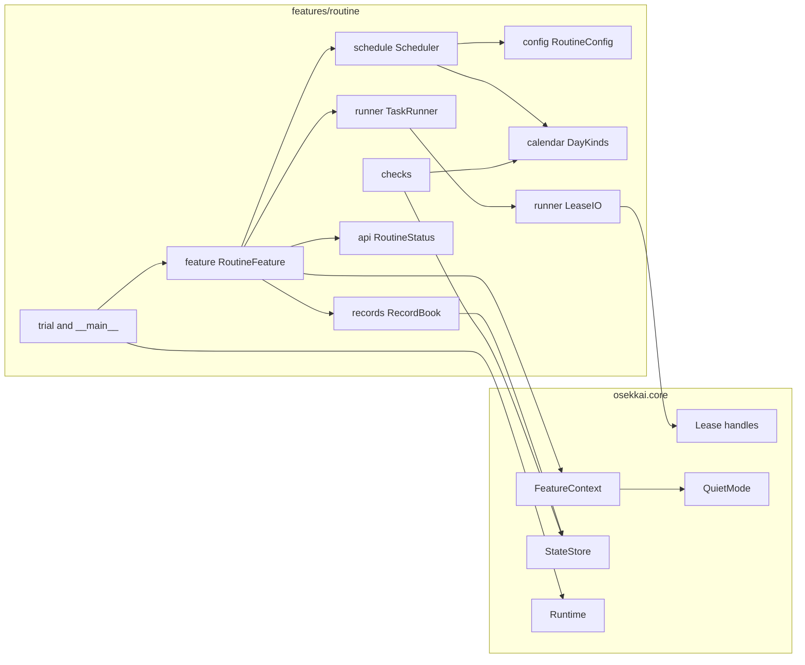
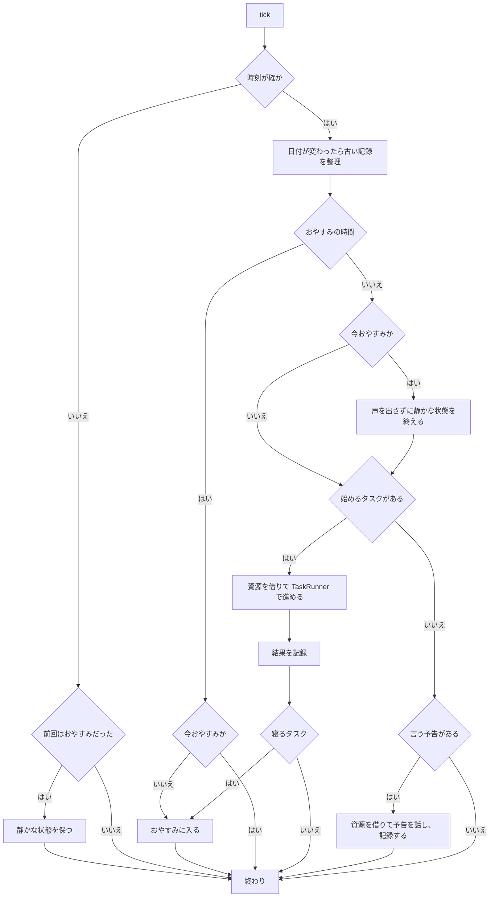
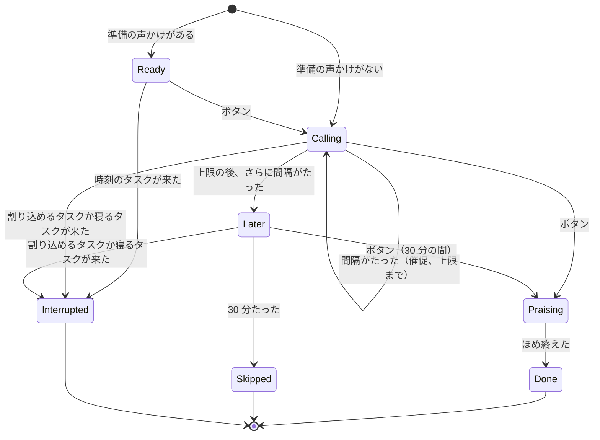
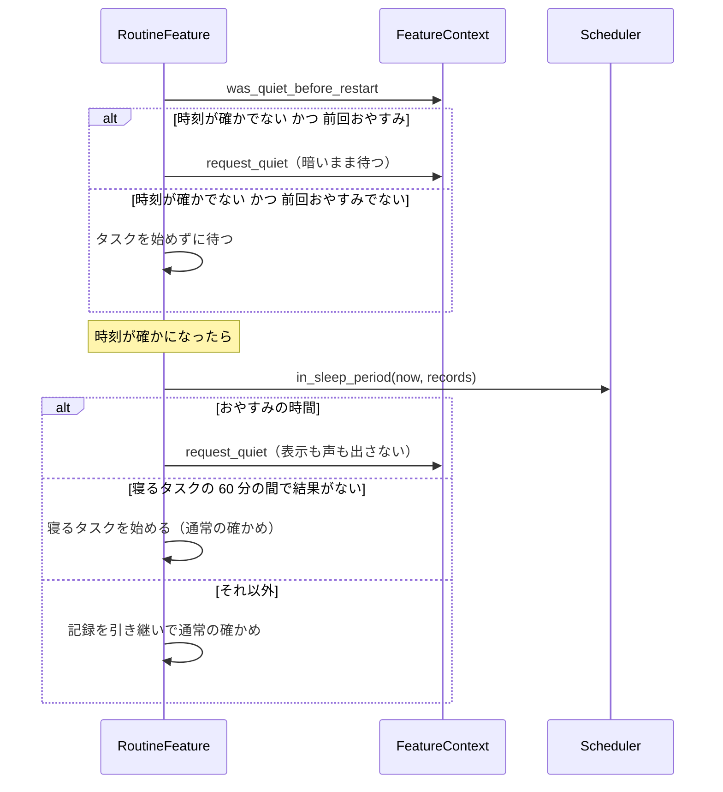

# Design Document

## Overview
**Purpose**: 日課（Daily Routine）は、4 歳前後の子どもに、決まった時刻に生活習慣の声をかけます。子どもができたらボタンを押し、ロボットがほめて星を 1 つ増やします。寝る時刻にはおやすみモードに入り、朝の起床時刻まで静かにします。

**Users**: 子どもは、声かけ・予告・催促に応えてボタンを押します。保護者は、設定ファイルでタスクと時刻を決め、試しのコマンドで言葉を確かめます。

**Impact**: `rover-core` の「機能を足す口」に、最初の機能（`routine`）を登録します。基盤のコードは書き換えず、依存（jpholiday）・エントリーポイント・設定の見本だけを足します。サンプルの次の問題を直します。
- おやすみモードに入らない
- おやすみの後のタスクがロボットを起こす
- 日付をまたぐ予告が壊れる
- おしゃべり中に予告を逃す
- 記録が壊れ、増え続ける
- 試しの実行で星が増える

### Goals
- 子どもから見た振る舞い（声かけ・予告・催促・あとで・ほめる・星・おやすみ）をサンプルと同じにする
- 寝る時刻には、ほかのタスクの状況にかかわらず、おやすみモードに入る。起床時刻まで起きない
- 判定（今日の種類・始めるもの・予告・割り込み・おやすみ）を、時計を差し替えて PC で確かめられる
- 記録は電源が切れても壊れず、古い日の記録は整理される。試しでは星と記録を変えない

### Non-Goals
- 声でタスクを終える操作（「できたよ」）。`voice-gateway` ができた後に、そのスペックで扱う
- ほかの機能が、おやすみモード中に声や画面を使わないこと（各機能のスペックで扱う）
- サンプルの個人の設定の自動の写し替え（保護者が手で写す。キーの名前はサンプルとほぼ同じ）
- 基盤に、機能ごとのコマンドの汎用の仕組みを作ること

## Boundary Commitments

### This Spec Owns
- `routine` の設定の形と検証（タスク・呼び名・追加の休日・起床時刻・記録を残す日数）
- 今日の種類の判定（土日・日本の祝日・追加の休日）
- タスクと予告を始める判定、割り込みの判定、おやすみの時間の判定（純粋な関数）
- タスクの進み方（準備 → 声かけ → 催促 → あとで → 結果）と、そのときの声・画面・LED・首・ダンス
- 日課の記録（日ごとの結果・予告・星の数）とその整理。保存先は基盤が決める `routine` の保存先
- おやすみモードに入る・保つ・出る判断（静かな状態の切り替えは基盤に求める）
- 待機画面の星の数の文字
- 試しのコマンド（`python -m osekkai.features.routine`）
- ほかの機能に向けた読み取り専用の状況（`osekkai.features.routine.api`）
- self-check の項目 `routine.holidays`・`routine.quiet_hours`・`routine.records`

### Out of Boundary
- 資源の調停・中断の知らせ・取り上げ（`rover-core` の `Arbiter`）
- 静かな状態の画面とバックライトの切り替え、その保存（`rover-core` の `QuietMode`）
- 時刻の同期の判定（`rover-core` の `Clock.is_synchronized`）
- 設定ファイルの読み込み・誤りの表示（`rover-core` の `ConfigLoader` と `Runtime`）
- ダンスでタイヤを回すかどうかの許可の判断（`rover-core` の `core.motion.allow_drive_in_dance`）
- 起動の声（`rover-core` の `startup_voice_hours`）
- ほかの機能を止める判断（日課は優先度を申告するだけ）

### Allowed Dependencies
- `osekkai.core` の公開の口: `feature`（`FeatureSpec`・`FeatureContext`）、`arbiter.Lease` と口、`config.FeatureConfig`、`selfcheck`（`Check`・`CheckContext`・`CheckResult`）、`storage.StateStore`、`clock.Clock`、`types`、`lcd_text`、`paths`
- 試しの入口（`features/routine/__main__.py` と `trial.py`）だけは、組み立ての口として `osekkai.__main__.build_devices`・`osekkai.core.runtime.Runtime`・`osekkai.core.registry.FeatureRegistry`・`osekkai.core.instance_lock`・`osekkai.core.clock.SystemClock` を使ってよい（あわせて `osekkai.__main__` の `HardwareUnavailable`・`NO_PI_ADAPTER_MESSAGE`、`osekkai.core.config.ConfigLoader`・`osekkai.core.logging_setup`・`ExitCode` も使う）
- 外の依存: `jpholiday>=1.0.2,<2`（`calendar.py` の中だけで、遅れて読み込む）、pydantic v2
- 禁止: `osekkai.adapters` の直接の読み込み（試しの入口も `build_devices` を通す）、ハードのライブラリ、ほかの機能のパッケージ

依存の向き（左から右だけ）:
`config` → `calendar` → `records` → `schedule` → `runner` → `feature` → `trial`／`__main__`。`api` はどこからも読まれてよく、`api` は `osekkai.core.types` 以外を読まない。

### Revalidation Triggers
- `RoutineStatus` の形（`api.py`）を変えたとき: `daruma-game`・`presence` を確かめ直す
- 優先度（85）を変えたとき: ほかの機能の優先度との関係を確かめ直す
- 静かな状態の使い方（いつ求め、いつ終えるか）を変えたとき: `presence`・`voice-gateway`・`conversation` を確かめ直す
- `rover-core` の `FeatureContext`・`Lease` の口・`StateStore`・`Runtime.start/shutdown` が変わったとき: 日課を確かめ直す
- 設定のキーの名前を変えたとき: 保護者の手順書（`docs/routine.md`）と設定の見本を直す

## Architecture

### Existing Architecture Analysis
- 機能は `FeatureSpec` を持つクラスで、`run(stop)` が専用のスレッドで呼ばれる。`run()` が例外で終わると、その機能は止まったまま（作り直されない）
- 資源は `ctx.acquire()` で借り、`Lease` の口（`voice`・`display`・`led`・`button`・`neck`・`drive`）で使う。日課より上の優先度の機能はないので、日課が求めると下位の機能は中断を知らされる（発話は言い終えてから）
- `lease.button.wait_press(timeout)` は本物の時間で待つ。偽の時計を進めても縮まない
- 静かな状態は基盤の 1 つの真偽値で、最後に求めた方が勝つ。起動は必ず静かでない状態から始まる

### Architecture Pattern & Boundary Map



**Architecture Integration**:
- Selected pattern: 純粋な判定（`Scheduler`）と薄い実行（`TaskRunner`）。実行は日課の 1 本のスレッドだけで行う
- Domain/feature boundaries: 時刻と記録から「何をするか」を決めるのは `Scheduler`。資源を触るのは `TaskRunner`（`RoutineIO` 越し）と `RoutineFeature`（おやすみの表示）だけ。記録の形を知るのは `RecordBook` だけ
- Existing patterns preserved: 機能の契約、資源は借りて返す、時計の差し替え、原子的な保存、ログに値を出さない
- New components rationale: 下の Components を参照
- Steering compliance: 判定と操作を分ける。基盤を書き換えない。個人の値はリポジトリの外

### Technology Stack

| Layer | Choice / Version | Role in Feature | Notes |
|-------|------------------|-----------------|-------|
| CLI | argparse（標準） | 試しのコマンド | `python -m osekkai.features.routine` |
| Feature | Python 3.11 以上 | 判定・実行 | 新しい構文は 3.11 まで |
| Config | pydantic v2 | 設定の検証 | `FeatureConfig` を継ぐ |
| Calendar | jpholiday 1.0.2 以上 2 未満（MIT） | 祝日の判定 | 遅れて読み込む。なければ土日だけ（2.6） |
| Storage | `rover-core` の `StateStore` | 記録と星 | 原子的な保存 |

## File Structure Plan

### Directory Structure
```
src/osekkai/features/
├── __init__.py                 # 機能のパッケージ（空）
└── routine/
    ├── __init__.py             # RoutineFeature を外に出す（エントリーポイントの先）
    ├── config.py               # RoutineConfig・TaskConfig・WakeTimes と、設定の検証（1.x）
    ├── calendar.py             # DayKind と、今日の種類の判定。jpholiday の包み（2.x）
    ├── schedule.py             # Scheduler: 始めるタスク・予告・割り込み・おやすみの時間・次の予定（3.x、5.x、6.x、7.x）
    ├── records.py              # RecordBook: 結果・予告・星の保存と整理（8.x）と、試し用の NullRecordBook
    ├── runner.py               # TaskRunner（進み方 4.x）・RoutineIO（入出力の型）・LeaseIO（Lease で包んだ実体）・Texts（呼び名の差し込み）・TaskStopped（止める知らせ）
    ├── texts.py                # 決まった言葉と LCD の文字（「あとで…」「ｱﾄﾃﾞ ﾈ」「ﾔｯﾀﾈ!」「ｵﾔｽﾐ」）と呼び名の差し込み
    ├── feature.py              # RoutineFeature: 1 秒ごとの確かめ、資源を借りる、おやすみの出入り、起動の判定
    ├── api.py                  # RoutineStatus と current_status()（9.4、9.5）
    ├── checks.py               # self-check の項目 routine.holidays・routine.quiet_hours・routine.records（11.3）
    ├── trial.py                # 試しの実行: TrialFeature の組み立てと Runtime の起動・停止（10.x）
    └── __main__.py             # 試しのコマンドの引数（--try、--fast、--fake-hardware、--config）

tests/features/routine/
├── conftest.py                 # 根の clock の差し替えと kit の準備（中身は routine_fixtures.py・routine_kit.py）
├── routine_fixtures.py         # 偽の時計・一時の保存先・設定の組み立て
├── scripted_io.py              # 台本の入出力（ScriptedIO・ScriptedHooks）
├── routine_kit.py              # 本物の基盤の部品を偽のデバイスで組んだ Kit（feature と通しのテスト）
├── test_routine_config.py      # 1.x
├── test_routine_calendar.py    # 2.x
├── test_routine_schedule.py    # 3.x、5.x、6.x、7.x の判定
├── test_routine_records.py     # 8.x
├── test_routine_runner.py      # 4.x、3.7、5.3
├── test_routine_feature.py     # 偽の基盤の部品で、確かめの流れ・おやすみ・起動・待機画面（6.x、7.x、9.x）
├── test_routine_trial.py       # 10.x（模擬のデバイス）
└── test_routine_checks.py      # 11.3
tests/features/test_features_import_direction.py  # 機能のパッケージの読み込みの向き
docs/routine.md                 # 保護者の手順書: 設定の書き方、サンプルからの写し方、試しのコマンド
```

`tests/` には `__init__.py` がないので、テストのファイル名には `routine` を入れて、ほかのディレクトリと名前が重ならないようにします。

### Modified Files
- `pyproject.toml` — 依存に `jpholiday>=1.0.2,<2` を足す。`[project.entry-points."osekkai.features"]` に `routine = "osekkai.features.routine:RoutineFeature"` を足す（コメントの例を置き換える）
- `config/osekkai.example.yaml` と `src/osekkai/core/example_config.yaml` — `routine:` の節の見本をコメントで足す（2 つは同じ内容のまま）。見本の節は全部コメントにし、新しく作られた設定ファイルではタスクが 0 個になるようにする（いきなり声をかけ始めない）
- `README.md` — 機能の一覧に日課と `docs/routine.md` への案内を足す

## System Flows

### 1 秒ごとの確かめ（RoutineFeature.tick）



- 確かめの間隔は 1 秒（`stop.wait(1.0)`）。タスクの最中は `TaskRunner` が確かめの役を代わりに行う
- 日付が変わったかどうかは、前回の確かめの日付と比べる。起動のときにも 1 回整理する
- 1 回の確かめの中のどの例外も捕まえ、型の名前だけを記録して次の確かめに進む（`run()` を終わらせない）

### タスクの進み方（TaskRunner）



- 待ちは最大 1 秒ずつに区切り、区切りごとに `Scheduler.cut_in(...)` と `Scheduler.due_notice(...)` を聞く（発話の途中では聞かない）
- 予告があれば、その予告のタスクの表示を出してうなずき、予告を話して記録する。その後、今のタスクの表示に戻して待ちを続ける（3.7）。待ちの残りの時間は、予告の間も減る
- 準備の段階の割り込みは「時刻のタスク」なら何でも、声かけ・催促・あとでの段階は「割り込めるタスク」か「寝るタスク」だけ（5.1、5.2、6.1）。ほめる間は割り込まない（5.3）
- 催促の回数: 最初の声かけ + 催促 `max_reminders` 回。その後さらに `remind_min` 分待ってから、あとでに進む（4.4、4.13）

### 起動のとき



- 起動のときにおやすみに入るときは、「ｵﾔｽﾐ」の表示も首の動きもせず、静かな状態だけを求める（夜中に動かない）
- 再起動の前のタスクの途中は、記録に結果がないので、時刻の判定どおりに始め直す（7.7）

## Requirements Traceability

| Requirement | Summary | Components | Interfaces | Flows |
|-------------|---------|------------|------------|-------|
| 1.1, 1.2, 1.3, 1.4 | 設定の項目と既定値 | RoutineConfig, TaskConfig | `RoutineConfig` | — |
| 1.5, 1.6 | 呼び名の差し込み | texts | `fill_name()` | — |
| 1.7, 1.8 | 設定の誤り | RoutineConfig の検証 | `model_validator` | — |
| 1.9, 11.4 | 値をログに出さない | 全体 | ログの決まり | — |
| 2.1〜2.5 | 今日の種類 | calendar | `DayKinds.kind_of()` | — |
| 2.6 | 祝日の判定ができない | calendar, checks | `HolidaySource.available` | — |
| 3.1, 3.2, 3.10 | 時刻のタスク | Scheduler | `due_task()` | 確かめ |
| 3.3, 3.4 | 続きのタスク | Scheduler | `due_task()` | 確かめ |
| 3.5, 3.6 | 予告と日付またぎ | Scheduler, RoutineFeature | `due_notice()` | 確かめ |
| 3.7 | 待ちの間の予告 | TaskRunner | `TaskHooks.due_notice` | 進み方 |
| 3.8 | 下位の機能より先に | RoutineFeature（優先度 85） | `ctx.acquire()` | 確かめ |
| 3.9 | 時刻が確かでない | RoutineFeature | `clock.is_synchronized()` | 確かめ |
| 4.1〜4.8, 4.11〜4.13 | 進み方 | TaskRunner, LeaseIO, texts | `TaskRunner.run()` | 進み方 |
| 4.9, 4.10 | できた・ダンス | TaskRunner, LeaseIO, RecordBook | `RoutineIO.dance_and_say()` | 進み方 |
| 5.1〜5.4 | 割り込み | Scheduler, TaskRunner | `cut_in()` | 進み方 |
| 6.1 | 寝るタスクの割り込み | Scheduler | `cut_in()` | 進み方 |
| 6.2, 6.3, 6.8 | おやすみに入る | RoutineFeature | `_enter_sleep()` | 確かめ |
| 6.4, 6.5, 6.9 | おやすみを保つ | Scheduler, RoutineFeature | `in_sleep_period()` | 確かめ |
| 6.6, 6.7 | 起床 | Scheduler, RoutineFeature | `wake_time()` | 確かめ |
| 6.10 | 寝るタスクがない | Scheduler | `in_sleep_period()` | — |
| 7.1〜7.7 | 再起動 | RoutineFeature, Scheduler | `_boot()` | 起動 |
| 8.1〜8.3 | 記録と星 | RecordBook | `record_outcome()` | — |
| 8.4, 8.5, 8.8 | 壊れない記録 | RecordBook, StateStore | `load()` | — |
| 8.6, 8.7 | 整理 | RecordBook | `prune()` | 確かめ |
| 9.1〜9.3 | 待機画面の星 | RoutineFeature, texts | `ctx.set_idle_info()` | — |
| 9.4, 9.5 | ほかの機能への状況 | api, RoutineFeature | `current_status()` | — |
| 10.1〜10.7 | 試しのコマンド | trial, __main__, NullRecordBook | `run_trial()` | — |
| 11.1, 11.2 | PC でのテスト | Scheduler, TaskRunner（RoutineIO） | `Clock` の差し替え | — |
| 11.3 | self-check | checks | `routine.holidays`・`routine.quiet_hours`・`routine.records` | — |

## Components and Interfaces

| Component | Domain/Layer | Intent | Req Coverage | Key Dependencies | Contracts |
|-----------|--------------|--------|--------------|------------------|-----------|
| RoutineConfig | config | 設定の形と検証 | 1.1〜1.8, 8.6 | pydantic (P0) | State |
| DayKinds | calendar | 今日の種類 | 2.1〜2.6 | jpholiday (P1) | Service |
| Scheduler | schedule | 何をいつするかの判定 | 3.x, 5.x, 6.x, 7.x, 9.4 | RoutineConfig, DayKinds (P0) | Service |
| RecordBook | records | 記録と星 | 8.x, 3.5 | StateStore (P0) | State |
| TaskRunner | runner | 1 つのタスクの進み方 | 4.x, 3.7, 5.x | RoutineIO, Clock (P0) | Service |
| LeaseIO | runner | Lease の口で RoutineIO を実装 | 4.1, 4.9, 4.10 | Lease (P0) | Service |
| texts | texts | 決まった言葉と LCD の文字 | 1.5, 1.6, 4.4, 4.9, 6.3, 9.1, 9.2 | lcd_text (P1) | — |
| RoutineFeature | feature | 確かめの流れ・資源・おやすみ・起動 | 3.8, 3.9, 6.x, 7.x, 9.x | FeatureContext (P0) | Service, State |
| RoutineStatus | api | ほかの機能への状況 | 9.4, 9.5 | — | State |
| checks | checks | self-check | 2.6, 8.5, 11.3 | CheckContext (P0) | Service |
| Trial | trial, __main__ | 試しのコマンド | 10.x | Runtime, build_devices (P0) | Batch |

### config

#### RoutineConfig

| Field | Detail |
|-------|--------|
| Intent | `routine:` の節の項目・既定値・範囲・つながりの検証 |
| Requirements | 1.1, 1.2, 1.3, 1.4, 1.7, 1.8, 8.6 |

**Responsibilities & Constraints**
- サンプルと同じキーの名前を使う（保護者が写しやすいように）。子どもの呼び名と追加の休日は `routine:` の節の直下に置く
- 誤りの文言には、場所（キーのパスは基盤が付ける）と理由だけを入れ、値（タスクの名前・時刻・言葉）を入れない
- 検証は読み込みのときに 1 回だけ。誤りがあれば、基盤が日課を開始しない（`feature_errors`）

##### State Management
```python
DayFilter = Literal["weekday", "holiday", "everyday"]

class TaskConfig(BaseModel):
    model_config = ConfigDict(extra="forbid")  # タスクの中の知らない項目は誤り（書き間違いの検出）
    id: str = Field(pattern=r"^[a-z][a-z0-9_]*$", max_length=32)
    at: time | None = None           # "HH:MM"。at と after のどちらか 1 つ
    after: str | None = None         # 前のタスクの id
    days: DayFilter = "everyday"
    call: str = Field(min_length=1)
    praise: str = Field(min_length=1)
    lcd: str = Field(min_length=1, max_length=16)  # LCD の 1 行目。全角のかなも可（基盤が半角に変える）
    notice: str | None = None        # at のタスクだけ
    notice_min: int = Field(default=10, ge=1, le=120)
    ready: str | None = None
    remind_min: int = Field(default=5, ge=1, le=60)
    max_reminders: int = Field(default=2, ge=0, le=10)
    firm: bool = False
    sleep: bool = False

class WakeTimes(BaseModel):
    weekday: time | None = None
    holiday: time | None = None

class RoutineConfig(FeatureConfig):
    call_name: str = ""                       # 空なら「きみ」（1.6）
    extra_holidays: list[date] = []
    wake: WakeTimes = WakeTimes()
    keep_days: int = Field(default=90, ge=7, le=3650)  # 8.6
    tasks: list[TaskConfig] = []
```

- 検証（`model_validator(mode="after")`）で誤りにするもの（1.7、1.8）:
  - `id` の重複
  - `at` と `after` の両方がある、またはどちらもない
  - `after` が存在しない `id` を指す。`after` のつながりが輪になる
  - `notice` を `after` のタスクに書いた
  - 寝るタスクが `after` で始まる（寝るタスクは時刻のタスクに限る）
  - 同じ種類の日（平日・休日）に寝るタスクが 2 つ以上ある（`everyday` は両方に数える）
  - 寝るタスクが 1 つでもあるのに、平日か休日の起床時刻が決められない（`wake` の値も、その種類の日の時刻のタスクもない）。前の夜の寝るタスクの後、次の日がどちらの種類でも起床できるようにするため（1.8 の解釈）
  - 寝るタスクの時刻が、その種類の日の起床時刻より後でない
- `call_name` などの値はログに出さない（1.9）

### calendar

#### DayKinds

| Field | Detail |
|-------|--------|
| Intent | 日付から平日か休日かを決める |
| Requirements | 2.1, 2.2, 2.3, 2.4, 2.5, 2.6 |

##### Service Interface
```python
class DayKind(Enum):
    WEEKDAY = "weekday"
    HOLIDAY = "holiday"

class HolidaySource(Protocol):
    @property
    def available(self) -> bool: ...
    def is_holiday(self, day: date) -> bool: ...   # 使えないときは常に False

class JpHolidaySource:
    """jpholiday を初めて使うときに読み込む。読み込めなければ available は False。"""

class DayKinds:
    def __init__(self, extra_holidays: Iterable[date], holidays: HolidaySource) -> None: ...
    def kind_of(self, day: date) -> DayKind: ...
    def applies(self, task: TaskConfig, day: date) -> bool: ...  # 2.5
```
- 休日: 土日、`holidays.is_holiday(day)`、`extra_holidays` のどれか（2.1〜2.3）。それ以外は平日（2.4）
- 祝日の判定で例外が出たら、その日は祝日でないとして扱い、型の名前だけを記録する

### schedule

#### Scheduler

| Field | Detail |
|-------|--------|
| Intent | 現在時刻と記録から「始めるタスク」「言う予告」「割り込むタスク」「おやすみの時間か」「次の予定」を決める純粋な判定 |
| Requirements | 3.1〜3.6, 3.10, 5.1〜5.4, 6.1, 6.4, 6.5, 6.7, 6.8, 6.10, 7.1〜7.4, 9.4 |

**Responsibilities & Constraints**
- 入力は現在時刻（タイムゾーン付き）と記録の読み取り（`DayRecordView`）だけ。資源・時計・保存に触れない
- タスクの日付は「そのタスクが属する日」。予告は前の日の時刻になることがある（3.6）
- 定数: 時刻のタスクの窓 `START_WINDOW = 60 分`、続きのタスクの窓 `FOLLOW_WINDOW = 60 分`、あとでの受付 `LATER_WINDOW = 30 分`

##### Service Interface
```python
class Phase(Enum):
    READY = "ready"        # 準備の後のボタン待ち
    CALLING = "calling"    # 声かけ・催促の後のボタン待ち
    LATER = "later"
    PRAISING = "praising"

@dataclass(frozen=True)
class DueTask:
    task: TaskConfig
    day: date              # 記録を付ける日

@dataclass(frozen=True)
class DueNotice:
    task: TaskConfig
    day: date              # 予告するタスクの日（予告を言う日と違うことがある）

# DayRecordView と TaskResult は records.py に置く（下の records を参照）

class Scheduler:
    def __init__(self, config: RoutineConfig, kinds: DayKinds) -> None: ...
    def due_task(self, now: datetime, records: DayRecordView) -> DueTask | None: ...
    def due_notice(self, now: datetime, records: DayRecordView) -> DueNotice | None: ...
    def cut_in(self, now: datetime, records: DayRecordView,
               running: DueTask, phase: Phase) -> DueTask | None: ...
    def in_sleep_period(self, now: datetime, records: DayRecordView) -> bool: ...
    def sleep_task(self, day: date) -> TaskConfig | None: ...
    def wake_time(self, day: date, tz: tzinfo) -> datetime | None: ...   # tz は now.tzinfo
    def next_task_at(self, now: datetime, records: DayRecordView) -> datetime | None: ...
```

判定の決まり:
- **`due_task`**（3.1〜3.4、3.10、6.5）: 今日のタスクを設定の順に見て、最初に条件を満たすもの。おやすみの時間なら常に `None`
  - 時刻のタスク: 今日に当てはまり（`applies`）、結果がなく、`at ≤ now < at + 60 分`
  - 時刻のタスクの `at` がその日の起床時刻より前なら、そのタスクは始めない（おやすみの間に時刻が来たタスク。6.5）
  - 続きのタスク: 今日に当てはまり、結果がなく、前のタスクの結果が「できた」か「スキップ」で、`ended_at ≤ now < ended_at + 60 分`
  - 「今日は始めない」と決まったタスク（時刻のタスクで窓を過ぎた、続きのタスクで前が中断か始めないと決まった、または前の窓を過ぎた）の後ろは、つながりをたどって全部始めない（3.4）
- **`due_notice`**（3.5、3.6）: 今日と明日の、`notice` を持つ時刻のタスクを見る。予告の時刻 `combine(day, at) − notice_min` から `combine(day, at)` の間で、そのタスクの日に結果がなく、予告を言っていないもの。おやすみの時間なら `None`
- **`cut_in`**（5.1〜5.4、6.1）: `running` 以外で今始められる時刻のタスク（`due_task` と同じ条件）のうち、設定の順で最初に次を満たすもの
  - `phase == PRAISING` なら常に `None`（5.3）
  - 寝るタスクなら、どの段階でも割り込む（6.1）
  - `phase == READY` なら、時刻のタスクは割り込む（5.2）
  - `phase in (CALLING, LATER)` なら、割り込めるタスク（`firm`）だけ（5.1）。割り込めないタスクは、今のタスクが終わってから `due_task` で始まる（5.4）
- **`in_sleep_period`**（6.4、6.8、6.10、7.1、7.2）: 寝るタスクが 1 つもなければ常に偽。そうでなければ、次のどちらかなら真
  - 今日の起床時刻より前（前の夜の続き）
  - 今日の寝るタスクがあり、`now ≥ at` かつ（結果がある、または `now ≥ at + 60 分`）
- **`wake_time`**（6.7）: その日の種類の `wake` の値。なければ、その日に当てはまる時刻のタスクの最も早い時刻。どちらもなければ `None`。寝るタスクがあれば、設定の検証で必ず決まるようにしてある。寝るタスクがないときだけ `None` になりうるが、そのときはおやすみの時間がない
- **`next_task_at`**（9.4）: 今日の、まだ結果がなく、この後に時刻が来る時刻のタスクのうち最も早い時刻（おやすみの時間なら `None`）

### records

#### RecordBook

| Field | Detail |
|-------|--------|
| Intent | 日ごとの結果・予告・星の数を、基盤の保存先に壊れないように書く |
| Requirements | 8.1〜8.8, 3.5 |

**Responsibilities & Constraints**
- 記録の形を知るのはここだけ。`DayRecordView`（ここで定める）を形で満たす
- 1 回の変更ごとに `records` → `stars` の順で、基盤の `StateStore.save()`（原子的）で書く（8.4）
- 書けなかったら（`OSError`）、型の名前を記録し、覚えている内容は変えたまま続ける（次の書き込みでまとめて書く）

##### State Management
```python
class TaskResult(Enum):
    DONE = "done"
    SKIPPED = "skipped"
    INTERRUPTED = "interrupted"

class DayRecordView(Protocol):
    """判定の部品（schedule）が記録を読む口。RecordBook と NullRecordBook が形で満たす。"""
    def outcome(self, day: date, task_id: str) -> TaskResult | None: ...
    def ended_at(self, day: date, task_id: str) -> datetime | None: ...   # 続きのタスクの窓に使う
    def notice_said(self, day: date, task_id: str) -> bool: ...

class RecordBook:
    def __init__(self, store: StateStore, keep_days: int, clock: Clock) -> None: ...
    @classmethod
    def load(cls, store: StateStore, keep_days: int, clock: Clock) -> RecordBook: ...
    @property
    def stars(self) -> int: ...
    @property
    def recovered_from_corruption(self) -> bool: ...
    def record_outcome(self, day: date, task_id: str, result: TaskResult) -> None: ...  # DONE なら星 +1
    def record_notice(self, day: date, task_id: str) -> None: ...
    def prune(self, today: date) -> None: ...   # keep_days より古い日を消す。星は減らさない（8.7）

class NullRecordBook:
    """試しの実行用。何も覚えず、何も書かない（10.2）。stars は本番の記録を読んだ値を返すだけ。"""
```

- 保存の形（`~/.local/state/osekkai/routine/records.json`）:
```json
{
  "version": 1,
  "stars": 12,
  "days": {
    "2026-11-07": {
      "tasks": {"brush": {"result": "done", "ended_at": "2026-11-07T20:41:05+09:00"}},
      "notices": ["sleep"]
    }
  }
}
```
- 控え（`stars.json`）: `{"version": 1, "stars": 12}`
- 読み込み（8.5）: `records` が壊れていれば、基盤が `records.corrupt-<日時>.json` に退避して `None` を返す。そのときは `stars` の控えから星の数を続け（なければ 0）、日ごとの記録は空から始める。`recovered_from_corruption` を真にする
- 星の数は `max(records.stars, stars.stars)` を使う（片方だけ書けた後でも減らない）
- 中の値（タスクの名前を含む）はログに出さない。ログには「記録を書けなかった」「記録を退避した」と例外の型の名前だけを出す

### runner

#### TaskRunner

| Field | Detail |
|-------|--------|
| Intent | 1 つのタスクを、準備から結果まで進める |
| Requirements | 4.1〜4.9, 4.11〜4.13, 3.7, 5.1〜5.3, 6.1 |

**Responsibilities & Constraints**
- 資源には `RoutineIO` だけで触れる。時間は `Clock.monotonic()` で測る
- ボタンの待ちは最大 1 秒ずつ（`POLL_S = 1.0`）。区切りごとに `TaskHooks` を呼ぶ
- 押下は話す前に捨てる（`clear_presses`）が、話している間の押下は数える（4.8）。タスクが終わったら押下を捨てる（4.12）
- 例外 `LeaseRevoked` はそのまま外に出す（呼ぶ側が「中断」として扱う）。`SpeechFailed` は記録して、話せなかったものとして先に進む（画面とボタンで続けられる）

##### Service Interface
```python
class RoutineIO(Protocol):
    def show(self, line1: str, line2: str) -> None: ...
    def backlight(self, on: bool) -> None: ...
    def led(self, on: bool) -> None: ...
    def say(self, text: str) -> None: ...                 # 話し終わるまで戻らない
    def clear_presses(self) -> None: ...
    def wait_press(self, timeout: float) -> bool: ...     # 最大 timeout 秒
    def look_around(self) -> None: ...
    def nod(self, times: int) -> None: ...
    def sleepy(self) -> None: ...
    def dance_and_say(self, text: str) -> None: ...       # ダンスしながら話す（4.9、4.10）

@dataclass(frozen=True)
class Timings:
    remind_s: Callable[[TaskConfig], float]   # 既定は task.remind_min * 60
    later_s: float = 30 * 60

class TaskHooks(Protocol):
    def cut_in(self, phase: Phase) -> DueTask | None: ...
    def due_notice(self) -> DueNotice | None: ...
    def notice_said(self, notice: DueNotice) -> None: ...
    def should_stop(self) -> bool: ...                # 立っていれば待ちの区切りで TaskStopped を投げる
    def star_count_after_done(self) -> int: ...       # 「ﾔｯﾀﾈ!★N」に出す数

@dataclass(frozen=True)
class RunResult:
    result: TaskResult
    cut_by: DueTask | None   # 割り込んだタスク（中断のとき）

class TaskRunner:
    def __init__(self, io: RoutineIO, clock: Clock, texts: Texts, timings: Timings) -> None: ...
    def run(self, task: TaskConfig, hooks: TaskHooks, *, on_done: Callable[[], None]) -> RunResult: ...
```
- `run()` は、止める知らせ（`should_stop()`）が立つと、待ちの区切りで `TaskStopped` を投げる。呼ぶ側は結果を記録しない（再起動の後に始め直す。7.7）
- `on_done` は「できた」と決まった直後、ほめる表示の前に呼ぶ（呼ぶ側が記録して星を増やす。試しでは何もしない）
- 進み方の細部:
  - 始め（4.1）: `backlight(True)` → `show(lcd, CALL の顔)` → `look_around()` → `led(True)` → `clear_presses()` → `say(call)`
  - 準備（4.2）: `show(lcd, NORMAL の顔)` → `clear_presses()` → `say(ready)` → 押されるまで待つ（時間の上限なし。割り込みは `Phase.READY`）
  - 催促（4.3）: `remind_s` 待って押されなければ、もう一度 `show`・`look_around`・`led`・`say(call)`
  - あとで（4.4〜4.6）: `led(False)` → `show("ｱﾄﾃﾞ ﾈ", NORMAL の顔)` → `say(「あとで できたら ボタンを おしてね」)` → `later_s` 待つ
  - できた（4.7、4.9、4.11）: `led(False)` → `on_done()` → `show("ﾔｯﾀﾈ! ★N", HAPPY の顔)` → `dance_and_say(praise)` → 寝るタスクでなければ `nod(2)`
  - 中断（5.1、5.2、6.1）: `led(False)` して `RunResult(INTERRUPTED, cut_by)` を返す
  - スキップ（4.6）: `led(False)` して `RunResult(SKIPPED, None)` を返す

#### LeaseIO

| Field | Detail |
|-------|--------|
| Intent | `Lease` の口で `RoutineIO` を実装する |
| Requirements | 4.1, 4.9, 4.10 |

- `dance_and_say`: ダンスを短命のスレッドで `lease.neck.dance(drive=...)` として動かし（走行の口は DRIVE を借りているときだけ渡す）、呼んだスレッドで `lease.voice.say(text)` を話す。話し終えたらダンスのスレッドの終わりを最大 10 秒待つ。タイヤを回すかどうかは基盤の許可で決まる（4.10）
- `wait_press` は `lease.button.wait_press(timeout)`。ほかは同じ名前の口をそのまま呼ぶ
- 顔の文字（`Face.text()`）と星の文字（`chr(Glyph.STAR)`）は TaskRunner と texts が作り、LeaseIO は 2 行とも LCD の中央に置いて渡す（基盤の `lcd_text.center`。実機確認で決めた）

### texts

- 決まった言葉: `LATER_SPEECH = "あとで できたら ボタンを おしてね"`
- LCD の文字: `LCD_LATER = "ｱﾄﾃﾞ ﾈ"`、`lcd_done(stars) = f"ﾔｯﾀﾈ! {STAR}{min(stars, 999)}"`、`LCD_SLEEP = "ｵﾔｽﾐ"`
- 待機画面の文字（9.1、9.2）: `idle_info(stars) = f"{STAR}{min(stars, 999)}"`
- `fill_name(text, call_name)`（1.5、1.6）: `{name}` を呼び名（空なら「きみ」）に置き換える。ほかの `{...}` はそのまま残す（`str.format` を使わない）

### feature

#### RoutineFeature

| Field | Detail |
|-------|--------|
| Intent | 日課の機能。確かめの流れ・資源の借り方・おやすみの出入り・起動の判定・状況の公開 |
| Requirements | 3.5, 3.8, 3.9, 6.2〜6.6, 6.8, 6.9, 7.1〜7.7, 9.1, 9.3, 9.5 |

**Responsibilities & Constraints**
- `spec = FeatureSpec(name="routine", priority=Priority.SCHEDULED + 5, resources={VOICE, DISPLAY, LED, BUTTON, NECK, DRIVE}, config_model=RoutineConfig, checks=ROUTINE_CHECKS)`
- 資源はタスクと予告の間だけ借り、終わったら返す。ふだんとおやすみの間は何も持たない
- 借り方: `ctx.acquire(ALL, wait=5.0, on_preempt=...)`。日課より上の機能はないので、下位の機能は中断させられる。`ResourceBusy` なら次の確かめでやり直す（1 分の中で何度もやり直せる。3.8）
- 中断の知らせ（`on_preempt`）は来ない想定。来たら旗を立て、次の区切りで `LeaseRevoked` として扱う
- 状態: `_asleep: bool`（日課が求めた静かな状態か）、`_just_booted: bool`（起動の直後か。おやすみの表示を出さない）、`_last_day: date | None`、`_shown_stars`（待機画面に出した星の数）、`_book: RecordBook`（`__init__` で読む）
- おやすみの間は声を出さず、画面を点けない（6.4）。ボタンの待ち手にならないので、押下でおやすみは終わらない（6.9）

##### Service Interface
```python
IoFactory = Callable[[Lease], RoutineIO]

class RoutineFeature:
    spec: ClassVar[FeatureSpec]
    def __init__(self, ctx: FeatureContext, config: FeatureConfig, *,
                 io_factory: IoFactory = LeaseIO, holidays: HolidaySource | None = None,
                 sleep_show_s: float = 3.0) -> None: ...
    def run(self, stop: threading.Event) -> None: ...   # _boot() の後、1 秒ごとに tick()
    def tick(self) -> None: ...                         # テストから直接呼べる
```

- 基盤は `RoutineFeature(ctx, config)` だけで作る（キーワードの引数は既定値）。テストは `io_factory` に台本の入出力（`ScriptedIO`）を渡し、借りたリースの代わりにそれで声・画面・ボタンを動かす。こうすると `RoutineFeature` の流れも、偽の時計だけで本物の時間を待たずに確かめられる（11.1、11.2）
- **`_boot()`**（7.x）: 待機画面の星を出す。時刻が確かでなく `was_quiet_before_restart` なら `request_quiet()` して `_asleep = True`（7.5）。以後の判定は `tick()` に任せる（7.6）
- **`tick()`**（System Flows を参照）:
  1. 時刻が確かでなければ何もしない（3.9）
  2. 日付が変わったら `prune(today)`
  3. `in_sleep_period` が真で `_asleep` でなければ、静かに入る（起動の直後なら表示なし、そうでなければ 6.3 の表示つき。6.8 の「窓を過ぎた」も同じ）
  4. 偽で `_asleep` なら、`end_quiet()` して `_asleep = False`（6.6。声は出さない）
  5. `due_task` があればタスクを進める。結果を記録し、寝るタスクならおやすみに入る（6.2）
  6. なければ `due_notice` があれば予告を話す（3.5）
  7. 状況（`RoutineStatus`）と待機画面の星（9.1、9.3）を新しくする
- **おやすみに入る（6.2、6.3）**: タスクの資源を持ったまま `neck.sleepy()` → `show("ｵﾔｽﾐ", SLEEP の顔)` を 3 秒見せ → `request_quiet()` → 資源を返す。返す前に静かな状態にするので、待機画面が一瞬だけ光ることはない
- **起動の直後のおやすみ（7.1、7.2）**: 資源を借りず、`request_quiet()` だけ
- 1 回の `tick()` の中のどの例外も捕まえ、型の名前だけを記録する（機能を止めない）
- タスクの途中の思いがけない例外は、そのタスクを「中断」として記録する（1 秒ごとに始め直さない）

### api

#### RoutineStatus

| Field | Detail |
|-------|--------|
| Intent | ほかの機能が読む、日課の今の状況 |
| Requirements | 9.4, 9.5 |

##### State Management
```python
@dataclass(frozen=True)
class RoutineStatus:
    next_task_at: datetime | None   # 今日のこの後の最も早い時刻のタスク（9.4）
    in_task: bool                   # タスクか予告の最中（9.5）
    asleep: bool                    # おやすみモード（9.5）
    updated_at: datetime

def current_status() -> RoutineStatus | None: ...   # 日課が動いていなければ None
```
- プロセスの中に 1 つだけの値を、ロックで守って置き換える。日課の確かめのたびと、タスクと予告の始めと終わりに新しくする。日課の `run()` が終わるときに `None` に戻す
- 中身にタスクの名前・言葉・呼び名を入れない（時刻と真偽値だけ）

### checks

| 項目 | 確かめ | 結果の文言 |
|------|--------|-----------|
| `routine.holidays` | `JpHolidaySource().available` と、既知の祝日（元日）を祝日と判定できるか | よい／「祝日を判定できない」（2.6） |
| `routine.quiet_hours` | `report.core.startup_voice_hours` の終わりが、寝るタスクの最も早い時刻より後でないか。始まりが、起床時刻の最も遅い時刻より前でないか（`CheckContext.report` だけを見る） | よい／「起動の声の時間がおやすみの時間と重なる」（6.4、7.1） |
| `routine.records` | `paths.state_dir_for("routine")` の `records` を読めるか、`*.corrupt-*.json` と `records.other-version-*.json` が残っていないか、ディレクトリに書けるか（`os.access`。ファイルは書かない） | よい／「記録を読めない」「壊れた記録が残っている」「記録を書けない」（8.5） |

- `routine.quiet_hours` の理由: 基盤の起動の声（`_startup_voice`）は、時刻と時間帯だけを見て、静かな状態を見ない。寝る時刻が 20 時より前だと、夜の再起動で声が出る。基盤の振る舞いは変えず（範囲外）、保護者に時間帯を直してもらう。手順書（`docs/routine.md`）にも書く。基盤が静かな状態を見るように直すなら、`rover-core` の変更として扱う
- 設定が正しいかどうかは、基盤の `core.config` の項目が日課の節の誤りも含めて知らせる（11.3）
- どれもハードに触れない（`hardware=False`）。サービスが動いていても読むだけなので動かす
- だめ（FAILED）にするのは「祝日を判定できない」「記録を書けない」だけ。配置の道具（device-deployment）は、だめの項目が 1 つでもあると版を戻すので、版を戻しても直らないこと（「起動の声の時間がおやすみの時間と重なる」「記録を読めない」「壊れた記録が残っている」）は、よい（OK）に理由を添えて知らせる。日課の設定が誤っていて使えないときの `routine.quiet_hours` は「飛ばした」（設定の誤りは `core.config` が知らせる）

### Trial（trial.py・__main__.py）

| Field | Detail |
|-------|--------|
| Intent | 設定のタスクを 1 つだけ、時刻を待たずに、記録を変えずに動かす |
| Requirements | 10.1〜10.7 |

##### Batch / Job Contract
- Trigger: `python -m osekkai.features.routine --try <タスクの id> [--fast] [--fake-hardware] [--config PATH]`
- 流れ:
  1. 単一の実行のロックを取る。取れなければ「ロボットが動いています。止めてから試してください」と出して 75 で終える（10.6）
  2. 設定を読み、`routine` の節が誤りならその理由（基盤の文言）を出して 1 で終える。タスクの id がなければ、設定のタスクの id の一覧を出して 2 で終える（10.5）
  3. `build_devices`（`--fake-hardware` なら端末の模擬のデバイス。10.7）と `Runtime(..., registry=FeatureRegistry([TrialFeature]))` を作り、`start()` する
  4. `TrialFeature`（`spec` は `RoutineFeature` と同じ名前・優先度・資源・設定のモデル、`checks=()`）の `run()` は、資源を借りて `TaskRunner` でそのタスクだけを進める。記録は `NullRecordBook`、`on_done` は何もしない（10.2）。割り込みと予告の判定は「なし」を返す
  5. 寝るタスクなら、6.3 の表示（首・「ｵﾔｽﾐ」）を 3 秒見せて終える。静かな状態は求めない（10.3）
  6. 終わったら旗を立てる。入口は旗か Ctrl+C を待って `shutdown()` し、結果の種類（できた・スキップ・中断）を 1 行出して 0 で終える
- `--fast`（10.4）: 催促の間隔を 10 秒、あとでの受付を 30 秒にする
- 基盤の起動の声（8〜20 時）は試しでも流れる（基盤の振る舞いのまま）

## Data Models

### Domain Model
- **タスク**（`TaskConfig`）: 設定の 1 行。値の型で、変わらない
- **タスクの日**（`date`）: 記録を付ける日。予告は、言う日でなくタスクの日に付ける
- **結果**（`TaskResult`）: できた・スキップ・中断。1 つのタスクの日に 1 つだけ。上書きしない
- **星の数**: 「できた」の数の合計。減らない（8.3、8.7）
- **おやすみの時間**: 寝るタスクの後から、次の日の起床時刻まで（`Scheduler.in_sleep_period`）

不変の決まり:
- 1 つのタスクの日に、1 つのタスクの結果は最大 1 つ。結果のあるタスクは始めない
- 予告は、1 つのタスクの日に 1 回まで
- 星の数は、記録の整理でも、壊れた記録からの回復でも減らない（控えとの大きい方）

### Data Contracts & Integration
- 記録のファイル（`records.json`・`stars.json`）は日課だけが読み書きする。`version` が 1 でなければ、壊れた記録と同じに扱う（読まずに `records.other-version-<日時>.json` の名前で残し、上書きしない。self-check で「壊れた記録が残っている」）
- `RoutineStatus` はプロセスの中だけ。ファイルにしない

## Error Handling

### Error Strategy
- 設定の誤り: 読み込みのときに検証し、基盤が日課を開始しない（1.7、1.8）。ほかの機能は動く
- 1 回の確かめの中の例外: 捕まえて型の名前を記録し、次の確かめで続ける。日課を止めない
- 声が出せない（`SpeechFailed`）: 記録して、画面とボタンで進め方を続ける
- 資源を取り上げられた（`LeaseRevoked`）: そのタスクを「中断」にする。続きのタスクは始めない
- 記録を書けない（`OSError`）: 記録して、覚えている内容で続ける。次の書き込みでまとめて書く
- 記録が壊れていた: 退避（基盤）＋ 控えから星を戻す ＋ self-check で知らせる（8.5）
- 祝日を判定できない: 土日と追加の休日だけで判定し、self-check で知らせる（2.6）

### Monitoring
- ログ（`osekkai.features.routine`）に出すもの: タスクの id、結果、予告を言ったこと、おやすみに入った・出たこと、例外の型の名前、決まった理由の文言
- 出さないもの: 呼び名、言葉（声かけ・ほめる・予告）、LCD の文字、時刻の設定の値、記録の中身（1.9、11.4）

## Testing Strategy

偽の時計（`osekkai.adapters.fake.clock.FakeClock`）と、台本の入出力（`ScriptedIO`: 話した言葉・表示・LED を記録し、`wait_press` で偽の時計を進め、決めた時刻に押下を返す）を使います。テストの名前は振る舞いを日本語で書きます。

### Unit Tests
- `RoutineConfig`: 既定値（1.4）、`id` の重複・`after` の輪・存在しない `after`・寝るタスクが 2 つ・起床時刻が決められない・寝るタスクが起床時刻より前、をそれぞれ誤りにし、誤りの文言に値が入らない（1.7、1.8、1.9）
- `DayKinds`: 土日・振替休日を含む祝日・追加の休日・祝日を判定できないときの土日だけ（2.1〜2.6）
- `Scheduler.due_task`／`due_notice`: 窓の始まりと終わり、続きのタスクが前の中断や窓の過ぎで始まらない、0 時 5 分のタスクの予告が前の日の 23 時 55 分に出る、設定の順（3.1〜3.6、3.10）
- `Scheduler.cut_in`／`in_sleep_period`: 段階ごとの割り込みの表（準備は時刻のタスク、催促とあとでは割り込めるタスクと寝るタスク、ほめる間はなし）、寝る後と起床前のおやすみ、寝るタスクの窓を過ぎたらおやすみ、寝るタスクがなければおやすみなし（5.1〜5.4、6.1、6.4、6.8、6.10）
- `RecordBook`: できたで星が増える、予告の記録、`keep_days` より古い日を消しても星が減らない、壊れた `records` で控えから星を戻す、`records` だけ書けて `stars` が古いときも減らない（8.1〜8.7）

### Integration Tests（台本の入出力 + 偽の時計）
- `TaskRunner`: 声かけ → 催促 2 回 → あとで → 30 分でスキップ。声かけの回数が上限 + 1（4.3〜4.6、4.13）
- `TaskRunner`: 話している間の押下を「できた」に数え、ほめる表示に星の数が出て、寝るタスクでなければ 2 回うなずく（4.7〜4.9、4.11）
- `TaskRunner`: 催促中に割り込めるタスクの時刻が来ると中断、準備の待ちに割り込めないタスクが来ても中断、ほめる間は割り込まない（5.1〜5.3）
- `TaskRunner`: ボタン待ちの間に予告の時刻が来ると、予告を話して待ちに戻る（3.7）
- `RoutineFeature`（偽の基盤の部品: `Arbiter`・`QuietMode`・`IdleScreen` を偽のデバイスで組んだもの。`io_factory` に `ScriptedIO` を渡す）: 夜のタスクが長引いても寝るタスクの時刻に割り込んでおやすみに入り、起床時刻に声を出さずに戻る。おやすみ中のタスクの時刻には声を出さない（6.1〜6.6）
- `RoutineFeature`: 夜中の起動で暗いまま、起床前の起動で暗いまま、昼の起動で記録を引き継ぐ、時刻が確かでない起動で前回おやすみなら暗いまま（7.1〜7.6）

### E2E Tests
- 試しのコマンドを模擬のデバイスで動かし、`--fast` でスキップまで進み、星と記録のファイルが変わらない。動いているロックがあれば 75 で終える。ない id なら一覧を出す（10.1〜10.7）
- 機能の発見: エントリーポイントから `routine` が見つかり、`Runtime` の起動で開始され、待機画面に星が出る（9.1）
- 読み込みの向き: `osekkai.features` が `osekkai.adapters` とハードのライブラリを読まない。`trial` と `__main__` だけが `osekkai.__main__` を読む

### 実機確認（device-deployment の手順で、使っていない時間帯に行う）
- 試しのコマンドで、声・LCD の文字・LED・見回し・ダンス・おやすみの表示
- 本番で、寝るタスクの後に画面が消え、起床時刻に戻る（一晩）
- 再起動しても、夜は暗いまま起動する

## Security Considerations
- 子どもの呼び名・言葉・時刻はリポジトリの外の設定ファイルだけに置く。見本（`config/osekkai.example.yaml`）には個人の値を書かない
- ログ・self-check・試しのコマンドの出力に、呼び名・言葉・設定の値・記録の中身を出さない。試しのコマンドが出すのはタスクの id と結果の種類だけ
- 記録のディレクトリは基盤の保存の仕組み（0700）に任せる
