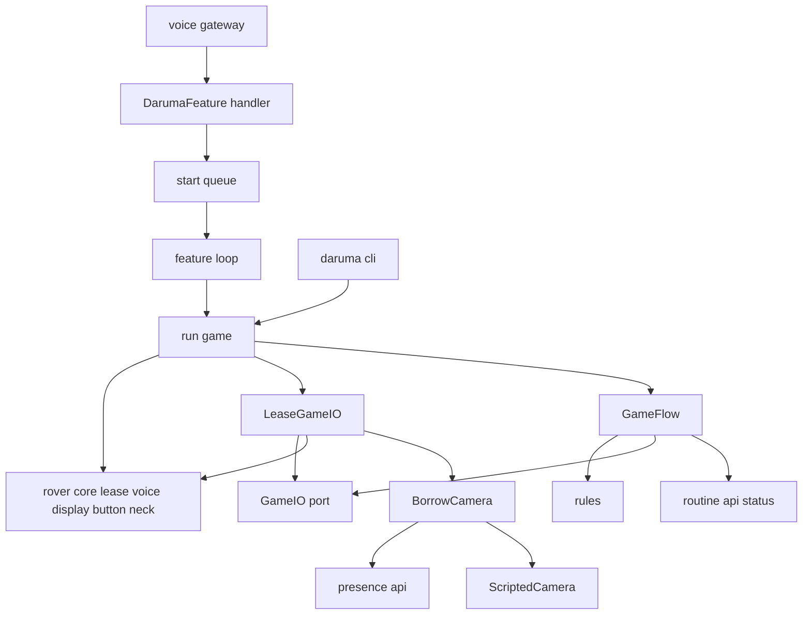
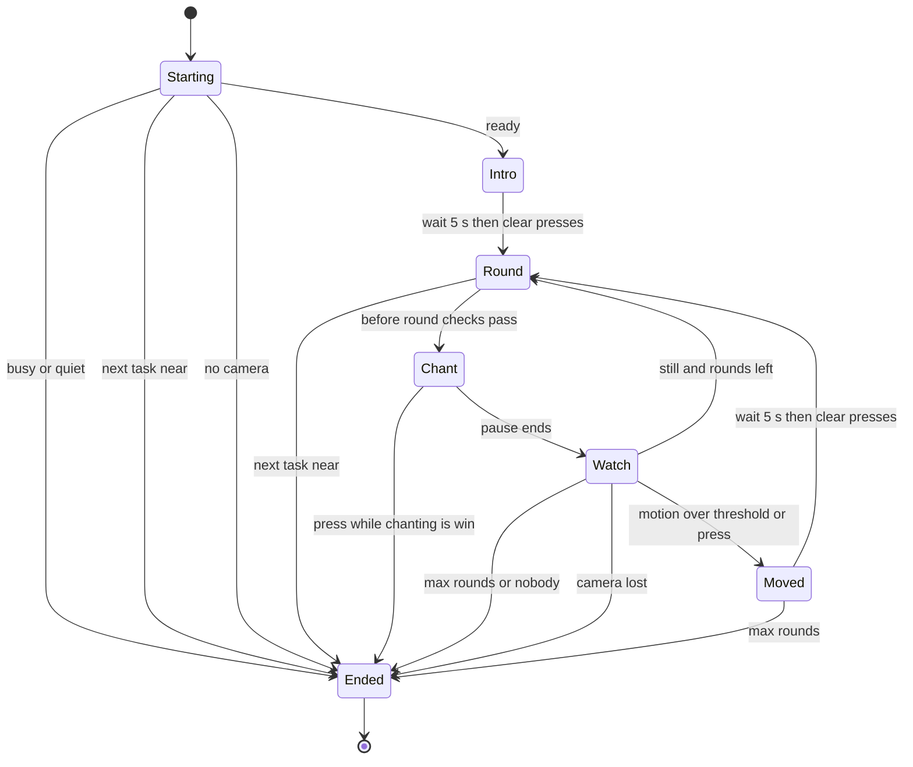
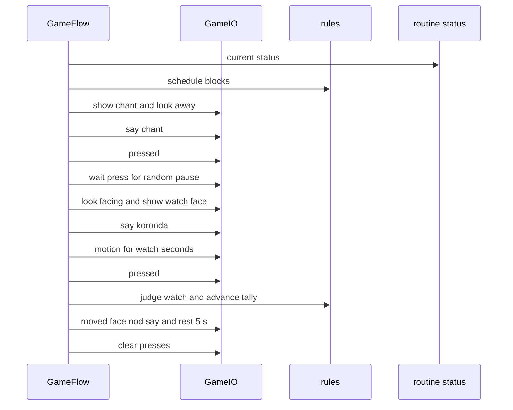

# Design Document: daruma-game（だるまさんがころんだ）

## Overview
だるまさんがころんだは、ロボットが鬼になって子どもと遊ぶ機能です。`voice-gateway` に「だるま」「転んだ」を登録し、言葉が届いたら遊びを 1 回始めます。首をそらして唱え、「ころんだ！」で振り向き、`presence` から借りたカメラで動きの量を見ます。唱える間にボタンを押せたら子どもの勝ちです。ロボットは走りません。

利用者は 4 歳前後の子どもと保護者です。保護者は、走らないこと、日課の前に自然に終わること、動きの判定の厳しさを部屋に合わせて変えられることを求めます。開発者は、偽の動きとボタンと固定した乱数で、遊びの流れを PC と CI で確かめます。

`rover-core` の機能を足す口（エントリーポイント `osekkai.features`）に `daruma` として登録します。基盤・入口・`presence`・日課は書き換えません。

### Goals
- サンプルと同じ遊び方（唱え言葉 3 種類、首の向き、0〜1.2 秒の間、2.5 秒見る、15 回まで）
- 「見ている間の押下は動いた」「唱える間の押下は勝ち」を、ルールとして守る
- 日課のタスクが近いとき・始まるとき・おやすみ・カメラの誤りのどれでも、やさしく終え、首を正面に戻し、資源とカメラを返す
- タイヤを回さない。資源の申告に走行（DRIVE）を入れないことで、形として守る
- 偽の口と固定の乱数で、すべての終わり方を PC で確かめられる

### Non-Goals
- 動きの量の計算とカメラの操作（`presence`）、動きの量そのものを確かめる道具（`presence --motion-test`）
- 聞き取りと振り分け（`voice-gateway`）、日課のタスクの判定（`daily-routine`）
- 星・遊びの記録・映像の保存
- 走ること、ステアリングを動かすこと

## Boundary Commitments

### This Spec Owns
- 始める言葉（「だるま」「転んだ」）の登録と、言葉を受けてから 1 回の遊びを始めるまで
- 1 回の遊びの流れ（始めの言葉 → 回の繰り返し → 終わりの言葉）と、その間の資源（VOICE・DISPLAY・BUTTON・NECK）とカメラの借り方・返し方
- 回の判定（勝ち・動いた・止まっていた）、回の数え方、終わり方の判定（`EndReason`）、次の予定が近いかの判定
- 決まった言葉・LCD の文字・首の角度・待つ長さ
- 設定の節 `daruma:`、self-check の項目 `daruma.camera`、手順書 `docs/daruma.md`
- 道具 `python -m osekkai.features.daruma --play` と `--judge-test`、PC の道具に使う台本の偽のカメラ

### Out of Boundary
- 動きの量の計算、カメラの開け閉め、貸している間に顔を探さないこと（`presence`）
- 押下の配達・チャタリングの除去・追加のボタン・首の角度の範囲・NECK を返したときに首を正面に戻すこと・発話・LCD・資源の調停（`rover-core`）
- 聞き取り・振り分け・聞ける時間帯・おやすみの間に言葉を渡さないこと（`voice-gateway`）
- 次のタスクの時刻とタスクの最中かの判定、タスクを始めるときに資源を取り上げること（`daily-routine`）
- 星・記録の保存。このスペックは保存先（`StateStore`）を使わない

### Allowed Dependencies
- `osekkai.core`: `feature`（`FeatureSpec`・`FeatureContext`）、`config.FeatureConfig`、`types`（`Priority`・`Resource`・`Face`・`Glyph`・`ResourceBusy`・`LeaseRevoked`・`SpeechFailed`・`DeviceUnavailable`）、`arbiter.Lease`、`clock.Clock`、`lcd_text.center`、`selfcheck`
- `osekkai.voice.api`（`register_words`・`Heard`）
- `osekkai.features.presence.api`（`borrow_camera`・`CameraLoan`・`CameraNotAvailable`・`CameraBusy`）
- `osekkai.features.routine.api`（`current_status`・`RoutineStatus`）
- 道具（`cli.py`）だけ: `osekkai.__main__.build_devices`、`core.runtime.Runtime`、`core.registry.FeatureRegistry`、`core.instance_lock.InstanceLock`、`core.clock.SystemClock`、`core.config.ConfigLoader`、`core.logging_setup`
- 依存の向き: `texts`・`config` → `rules` → `flow` → `camera`・`lease_io` → `feature` → `cli`。`checks` は `config` と `core.selfcheck` だけを読む。`osekkai.adapters`・ハードのライブラリ・ほかの機能の `api` 以外は読まない（読み込みの向きのテストで縛る）
- roadmap の依存の宣言に `daily-routine` を足す（今は `rover-core, voice-gateway, presence` だけ。structure.md の「依存は roadmap で宣言したものだけ」に合わせる）

### Revalidation Triggers
- `voice-gateway` の優先度が 56 以上になる、または入口が押下以外の理由で資源を借りるようになる（遊びの優先度 56 の前提）
- `ButtonRouter` が BUTTON の持ち主のほかにも押下を配るようになる、または `ButtonHandle` の `clear`・`has_press`・`wait_press` の意味が変わる
- `NeckHandle.dance()` が、走行の口を渡さなくてもステアリングかタイヤを動かすようになる。`nod`・`look` が角度を範囲に収めなくなる
- NECK のリースを返したときに、基盤が首を正面に戻さなくなる
- `presence.api` の `borrow_camera`・`motion` の形や例外、動きの量の測り方が変わる（既定のしきい値 0.01 の前提）
- `routine.api.RoutineStatus` の形、または「時刻が確かでない間は `next_task_at=None`」の決まりが変わる
- `VoiceHandle.say` が中断の知らせの後に話さなくなる（流れの確かめの重なりは害がない）

## Architecture

### Existing Architecture Analysis
- 機能は `features/<name>/` に置き、`FeatureSpec` で名前・優先度・資源・設定のモデル・self-check を申告する
- 押下は BUTTON のリースの持ち主に届く。持ち主がいなければ入口（優先度 55）の待ち手に届き、入口が資源を借りて聞き取る
- 入口は、言葉を渡す前に資源を返す。受け手はすぐに戻り、自分のスレッドで仕事をする
- 中断を知らされたリースは 2 秒まで有効で、`say` はその間も話せる。流れの側で確かめる（会話と同じ）
- NECK を返すと、基盤が首を正面に戻す。`dance()` は走行の口を渡さなければ首だけ
- `presence` は、カメラを貸している間は顔を探さず首も動かさない。PC ではカメラを持たない

### Architecture Pattern & Boundary Map



- **Pattern**: ポートとアダプタ。回の判定と終わり方は純粋な関数（`rules`）、1 回の遊びの流れ（`GameFlow`）は `GameIO` の口だけを使う。本物の口（`LeaseGameIO`）は借りたリースとカメラで動く
- **New components rationale**: `GameIO` は、ハードなしで流れを確かめるため（9.1）。`BorrowCamera` は、PC の道具で偽のカメラに替えるため（8.4）
- **Steering compliance**: 資源は借りて返す。優先度は帯から選ぶ。基盤に機能の名前を書かない。時計は `ctx.clock` を使う

### Technology Stack

| Layer | Choice / Version | Role in Feature | Notes |
|-------|------------------|-----------------|-------|
| 実行 | Python 3.11 以上 | 機能の本体 | 新しい依存はない |
| 設定 | pydantic v2（基盤の `FeatureConfig`） | 節 `daruma:` | |
| 乱数 | 標準の `random.Random` | 唱え言葉と間を選ぶ | 注入して、テストでは種を固定する |
| 資源・時計 | `rover-core` | 声・LCD・ボタン・首、時刻 | |
| カメラ | `presence.api` | 動きの量 | PC の道具は `ScriptedCamera` |

## File Structure Plan

### Directory Structure
```
src/osekkai/features/daruma/
├── __init__.py          # DarumaFeature を公開する（エントリーポイントの先）
├── __main__.py          # python -m osekkai.features.daruma（cli.main を呼ぶだけ）
├── config.py            # DarumaConfig（7.1、7.3）
├── texts.py             # 決まった言葉・LCD の文字・唱え言葉（Chant）・始める語句・首の角度・待つ長さ・say_with_name
├── rules.py             # 純粋な決まり: Rules、RoundKind、EndReason、Tally、judge_watch、advance、schedule_blocks、pick_chant、pick_pause
├── flow.py              # GameFlow（1 回の遊びの流れ）、GameIO（口の Protocol）、CameraLost、GameResult、END_SAYS
├── camera.py            # BorrowCamera の型、borrow_from_presence、ScriptedCamera（PC の道具用の偽のカメラ）
├── lease_io.py          # LeaseGameIO（借りたリースとカメラで GameIO を動かす。踊りながら話す）
├── feature.py           # DarumaFeature（語句の登録・待ち行列・遊びは 1 つだけ）、run_game（借りる → 流れ → 返す）
├── checks.py            # self-check の項目 daruma.camera
└── cli.py               # --play と --judge-test（ロック、75、--fake-hardware）

tests/features/daruma/
├── daruma_fakes.py                 # 偽の GameIO（回ごとの台本）、偽のリースの口、偽の日課の状況
├── test_daruma_config.py
├── test_daruma_texts.py
├── test_daruma_rules.py
├── test_daruma_flow.py
├── test_daruma_camera.py
├── test_daruma_lease_io.py
├── test_daruma_feature.py
├── test_daruma_checks.py
├── test_daruma_cli.py
├── test_daruma_registration.py
├── test_daruma_import_direction.py
└── test_daruma_journey.py          # 模擬のデバイスの基盤＋入口＋台本のカメラで、言葉から勝ちまで

docs/daruma.md                      # 遊び方、設定、しきい値の合わせ方、道具、データの扱い、実機確認
```

### Modified Files
- `pyproject.toml` — エントリーポイント `daruma = "osekkai.features.daruma:DarumaFeature"`
- `config/osekkai.example.yaml`、`src/osekkai/core/example_config.yaml` — 節 `daruma:` を `conversation:` の後、`routine` の節（最後に置く決まり）の前に足す。2 つは同じ内容
- `tests/test_cli_selfcheck.py` — `DARUMA_NAMES = ["daruma.camera"]` を名前の順（`conversation` の後、`presence` の前）で `ALL_NAMES` に足す
- `tests/features/test_features_import_direction.py` — `ENTRY_ALLOWLIST` に `osekkai.features.daruma.cli` を足す
- `README.md` — 状況の表と機能の表に `daruma` の行、設定の節の一文
- `.kiro/steering/roadmap.md` — daruma-game の依存に `daily-routine` を足す

## System Flows

### 1 回の遊びの状態

- どの状態でも、中断・静かな状態・止める旗に気づいたら、話さずに Ended に移る（4.4、4.5）
- Ended では、カメラを返し、首を正面に戻し、リースを返す（4.7）
- 同じ回で「回数を終えた」と「だれもいない」が重なったら、だれもいないの言葉にする

### 1 回の流れ

- 各手順の前に `interrupted()` を確かめる。中断なら、話している一言は言い終えてから（`say` は話し終わるまで戻らない）、次の手順をせずに終える
- 唱え言葉を話し終えた後の `pressed()` と、間の `wait_press()` で押されていたら勝ち。間が終わった後の押下は、見ている間の押下として、見終わった後の `pressed()` で拾う
- 「動いた」でなければ、待たずに次の回へ進む（2.9）

## Requirements Traceability

| Requirement | Summary | Components | Interfaces | Flows |
|-------------|---------|------------|------------|-------|
| 1.1 | 「だるま」「転んだ」で始める | DarumaFeature, texts | `register_words`、`START_PHRASES` | — |
| 1.2 | 始めの LCD と言葉 | GameFlow, texts | `GameIO.show/say` | 状態 Intro |
| 1.3 | 5 秒後に言い、押下を数えずに 1 回目 | GameFlow | `GameIO.rest`、`clear_presses` | 状態 Intro |
| 1.4 | カメラを使えなければ断る | GameFlow, LeaseGameIO | `GameIO.open_camera`、`EndReason.NO_CAMERA` | 状態 Starting |
| 1.5 | 次のタスクが近い・最中なら断る | rules, GameFlow | `schedule_blocks`、`EndReason.NEXT_TASK` | 状態 Starting |
| 1.6 | 資源を借りられなければ話さない | run_game | `ResourceBusy` → `EndReason.BUSY` | 状態 Starting |
| 2.1 | 唱え言葉をランダムに選び LCD に出す | rules, texts, GameFlow | `pick_chant`、`CHANTS` | 1 回の流れ |
| 2.2 | 首をそらしてから唱える | GameFlow, texts | `GameIO.look(AWAY)` | 1 回の流れ |
| 2.3 | 0〜1.2 秒の間 | rules, GameFlow | `pick_pause`、`GameIO.wait_press` | 1 回の流れ |
| 2.4 | 首を正面、ﾐﾃﾙﾖ!、ころんだ！ | GameFlow, texts | `GameIO.look(FACING)/show/say` | 1 回の流れ |
| 2.5 | 決めた長さ見る | GameFlow, LeaseGameIO | `GameIO.motion(watch_seconds)` | 1 回の流れ |
| 2.6 | しきい値を超えるか押下で動いた | rules | `judge_watch` | 1 回の流れ |
| 2.7 | ｳｺﾞｲﾀ!、うなずき、言葉 | GameFlow, LeaseGameIO | `GameIO.show/nod/say` | 状態 Moved |
| 2.8 | 5 秒待ち、その間の押下を数えない | GameFlow | `GameIO.rest`、`clear_presses` | 状態 Moved |
| 2.9 | 動いていなければ待たずに次 | GameFlow | — | 状態 Watch |
| 3.1 | 唱える間の押下で勝ち | GameFlow | `GameIO.pressed/wait_press` | 1 回の流れ |
| 3.2 | 本体と追加のボタンを同じに扱う | 基盤の `ButtonRouter`（両方を同じ待ち行列に入れる） | `ButtonHandle` | — |
| 3.3 | ハートの LCD、首だけで踊りながら話す | GameFlow, LeaseGameIO, texts | `GameIO.celebrate`、`dance()` | 状態 Chant |
| 3.4 | 呼び名は設定、なければ「きみ」 | DarumaConfig, texts | `call_name`、`say_with_name` | — |
| 3.5 | 星を増やさない | 境界（保存先を使わない） | — | — |
| 4.1 | 回数を終えたら終える | rules, GameFlow | `advance`、`EndReason.MAX_ROUNDS` | 状態 Watch |
| 4.2 | 続けて止まっていたら終える | rules, GameFlow | `Tally.still_streak`、`EndReason.NOBODY` | 状態 Watch |
| 4.3 | 次の回の前に次の予定を見る | rules, GameFlow | `schedule_blocks` | 状態 Round |
| 4.4 | 譲るときは言い終えて黙って返す | GameFlow, run_game | `interrupted()`、`on_preempt`、`EndReason.PREEMPTED` | 状態 全部 |
| 4.5 | おやすみになったら黙って終える | GameFlow, run_game | `ctx.is_quiet`、`EndReason.QUIET` | 状態 全部 |
| 4.6 | カメラの誤りの言葉で終える | GameFlow, LeaseGameIO | `CameraLost`、`EndReason.CAMERA_LOST` | 状態 Watch |
| 4.7 | 首を正面、カメラと資源を返す | run_game, LeaseGameIO | `LeaseGameIO.close`、`Lease.release` | 状態 Ended |
| 4.8 | 日課が動いていなければ予定なし | rules | `schedule_blocks(None, …)` | — |
| 4.9 | 遊びの間は 2 つ目を始めない | DarumaFeature | 待ち行列と `playing` の旗 | — |
| 5.1 | タイヤを回さない | DarumaFeature, LeaseGameIO | 資源に DRIVE を申告しない、`dance()` に走行の口を渡さない | — |
| 5.2 | 首は基盤の範囲の中だけ | 基盤の `MotionService`（角度を範囲に収める） | `NeckHandle.look` | — |
| 5.3 | 誤りはその遊びだけ終える | DarumaFeature, run_game | 例外の囲い、`EndReason.ERROR` | 状態 Ended |
| 6.1 | 押下を遊びだけに使う | run_game, DarumaFeature | BUTTON を借り続ける、優先度 56 | — |
| 6.2 | 見つけてあいさつを止める | LeaseGameIO, run_game | `borrow_camera`、NECK を借りる | — |
| 6.3 | 映像・動きの量を残さない | LeaseGameIO, GameFlow, cli | ログは種類と回の数だけ | — |
| 7.1 | 設定で変えられる | DarumaConfig | 各項目 | — |
| 7.2 | 無効なら登録しない | 基盤の登録（`enabled`）、DarumaFeature | `register_words` | — |
| 7.3 | 設定の誤りは開始しない | DarumaConfig、基盤 | pydantic の検証 | — |
| 7.4 | self-check で遊べるかを出す | checks | `daruma.camera` | — |
| 7.5 | 呼び名をログ・self-check に出さない | 全部品（ログの決まり）、checks | 固定の文言 | — |
| 8.1 | 遊びを始める道具 | cli | `--play` | — |
| 8.2 | 判定を確かめる道具 | cli, rules | `--judge-test`、`judge_watch` | — |
| 8.3 | 動いているときは始めない | cli | `InstanceLock`、終了コード 75 | — |
| 8.4 | 偽のカメラとボタンで動かせる | cli, camera | `--fake-hardware`、`ScriptedCamera` | — |
| 9.1 | 偽物と固定の乱数で流れを確かめる | GameFlow, rules, テストの偽物 | `GameIO`、`random.Random(seed)` | — |
| 9.2 | ハードなしで読み込める | 全部品 | ハードのライブラリを読まない | — |

## Components and Interfaces

| Component | Domain | Intent | Req Coverage | Key Dependencies | Contracts |
|-----------|--------|--------|--------------|------------------|-----------|
| DarumaConfig | 設定 | 節 `daruma:` の項目と範囲 | 3.4, 7.1, 7.3 | FeatureConfig (P0) | State |
| texts | 言葉 | 決まった言葉・LCD・唱え言葉・角度・長さ | 1.1–1.5, 2.1–2.8, 3.3, 3.4, 4.1–4.3, 4.6 | Glyph, Face (P2) | — |
| rules | 判定 | 回の判定・数え方・終わり方・次の予定 | 1.5, 2.1, 2.3, 2.6, 4.1–4.3, 4.8, 8.2 | RoutineStatus (P1) | Service |
| GameFlow | 流れ | 1 回の遊び | 1.2–1.5, 2.x, 3.1, 3.3, 4.1–4.6, 6.3, 9.1 | GameIO (P0), rules (P0) | Service |
| camera | アダプタ | カメラを借りる口と偽のカメラ | 1.4, 6.2, 8.4 | presence.api (P0) | Service |
| LeaseGameIO | アダプタ | 借りた資源とカメラで GameIO を動かす | 1.4, 2.5, 2.7, 3.3, 4.6, 4.7, 5.1, 6.2, 6.3 | Lease (P0), BorrowCamera (P0) | Service |
| DarumaFeature / run_game | 機能 | 登録・待ち行列・資源・終わりの後始末 | 1.1, 1.6, 4.4, 4.5, 4.7, 4.9, 5.1, 5.3, 6.1, 7.2 | voice.api (P0), FeatureContext (P0), routine.api (P1) | Service |
| checks | self-check | `daruma.camera` | 7.4, 7.5 | core.selfcheck (P0) | Service |
| cli | 道具 | `--play`、`--judge-test` | 8.1–8.4 | Runtime (P0), InstanceLock (P0) | Batch |

### 設定と言葉

#### DarumaConfig（`config.py`）
**Responsibilities & Constraints**
- `FeatureConfig` を継ぐ。範囲の外の値は pydantic の誤りになり、基盤が誤りの場所と理由だけをログに出して開始しない（7.3）。ほかの機能は動き続ける
- 呼び名は、ログ・self-check・例外の文に出さない（7.5）

##### State Management
```python
class DarumaConfig(FeatureConfig):
    call_name: str = ""                                          # 空なら「きみ」（3.4）
    threshold: float = Field(default=0.01, gt=0.0, lt=1.0)      # これより大きいと動いた（2.6）
    watch_seconds: float = Field(default=2.5, ge=1.0, le=10.0)  # 見る長さ（2.5）
    max_rounds: int = Field(default=15, ge=1, le=50)            # 4.1
    nobody_rounds: int = Field(default=5, ge=1, le=50)          # 続けて止まっていたら終える回数（4.2）
    end_before_task_min: int = Field(default=10, ge=0, le=120)  # 次のタスクの何分前に終えるか（1.5、4.3）
```
- `enabled`（基盤の項目）が偽なら、基盤が開始しないので言葉を登録しない（7.2）

#### texts（`texts.py`）
- 始める語句: `START_PHRASES = ("だるま", "転んだ")`（入口が正規化して含むかを見る。「だーるーま」も「だるま」になる）
- 唱え言葉: `Chant(speech, lcd)` の 3 つ — 「だーるーまーさーんーがー」/「ﾀﾞｰﾙｰﾏｰｻｰﾝｶﾞｰ」、「だるまさんが」/「ﾀﾞﾙﾏｻﾝｶﾞ」、「だるまさんがー」/「ﾀﾞﾙﾏｻﾝｶﾞｰ」（2.1）
- LCD: 始め「ﾀﾞﾙﾏｻﾝｶﾞ」「ｺﾛﾝﾀﾞ!」（1.2）、唱える間は 1 行目に唱え言葉・2 行目に普通の顔、「ﾐﾃﾙﾖ!」と呼びかけの顔（2.4）、「ｳｺﾞｲﾀ!」と呼びかけの顔（2.7）、勝ちは `chr(Glyph.HEART) + " ﾀｯﾁ! ｶﾁ! " + chr(Glyph.HEART)` と喜んだ顔（3.3。LCD の ROM に「♥」はないので、絵の文字のハートを使う）。2 行とも `center()` で中央に置く
- 言葉: 要件の文のとおり。`SAY_INTRO`（1.2）、`SAY_GO`（1.3、`{name}` を含む）、`SAY_KORONDA`（2.4）、`SAY_MOVED`（2.7）、`SAY_WIN`（3.3、`{name}` を含む）、`SAY_NO_CAMERA`（1.4）、`SAY_NEXT_TASK_BEFORE`（1.5「…また あとで あそぼうね」）、`SAY_NEXT_TASK`（4.3「…また あそぼうね」）、`SAY_MAX_ROUNDS`（4.1）、`SAY_NOBODY`（4.2）、`SAY_CAMERA_LOST`（4.6）
- `texts` はほかの部品を読まない（`rules` が `texts` を読むので、逆は作らない）。終わり方と言葉の対応の表 `END_SAYS: Mapping[EndReason, str]` は `flow.py` に置く。話さない終わり方（BUSY・PREEMPTED・QUIET・STOPPED・ERROR）は表に入れない。始める前の次の予定（1.5）は `SAY_NEXT_TASK_BEFORE` を流れが直接使う
- `say_with_name(template, call_name) -> str`: `{name}` を呼び名に（空なら「きみ」）
- 首の角度: `POSE_AWAY = (70.0, -30.0)`、`POSE_FACING = (0.0, 10.0)`（pan、tilt。範囲に収めるのは基盤。5.2）
- 長さ: `INTRO_WAIT_S = 5.0`（1.3）、`MOVED_WAIT_S = 5.0`（2.8）、`PAUSE_MAX_S = 1.2`（2.3）

### 判定

#### rules（`rules.py`）
**Responsibilities & Constraints**
- 純粋な関数と不変の型だけ。資源・時計・乱数の状態を持たない（乱数は引数で受ける）

##### Service Interface
```python
class RoundKind(Enum):
    WIN = "win"        # 唱える間に押された（3.1）
    MOVED = "moved"    # 見ている間にしきい値を超えたか押された（2.6）
    STILL = "still"    # 動きの量がしきい値以下で、押されなかった

class EndReason(Enum):
    WIN = "win"                  # 3.3
    MAX_ROUNDS = "max_rounds"    # 4.1
    NOBODY = "nobody"            # 4.2
    NEXT_TASK = "next_task"      # 1.5、4.3
    NO_CAMERA = "no_camera"      # 1.4
    CAMERA_LOST = "camera_lost"  # 4.6
    BUSY = "busy"                # 1.6（話さない）
    PREEMPTED = "preempted"      # 4.4（話さない）
    QUIET = "quiet"              # 4.5（話さない）
    STOPPED = "stopped"          # 基盤が止める（話さない）
    ERROR = "error"              # 5.3（話さない）

@dataclass(frozen=True)
class Rules:
    threshold: float
    watch_seconds: float
    max_rounds: int
    nobody_rounds: int
    end_before_task: timedelta
    @classmethod
    def from_config(cls, config: DarumaConfig) -> Rules: ...

@dataclass(frozen=True)
class Tally:
    rounds: int = 0          # 終えた回の数（勝ちの回は数えない）
    still_streak: int = 0    # 続けて STILL だった回の数

def judge_watch(motion: float, pressed: bool, threshold: float) -> RoundKind: ...   # MOVED か STILL
def advance(tally: Tally, kind: RoundKind, rules: Rules) -> tuple[Tally, EndReason | None]: ...
def schedule_blocks(status: RoutineStatus | None, now: datetime, margin: timedelta) -> bool: ...
def pick_chant(rng: random.Random) -> Chant: ...
def pick_pause(rng: random.Random) -> float: ...    # 0 以上 PAUSE_MAX_S 以下
```
- `judge_watch`: `pressed` が真、または `motion > threshold` なら MOVED（押下は動きの量より先に見る）。それ以外は STILL
- `advance`（MOVED・STILL だけを受ける。WIN は ValueError）:
  - `rounds` を 1 増やす。MOVED なら `still_streak = 0`、STILL なら 1 増やす
  - `still_streak >= nobody_rounds` なら NOBODY（4.2）。そうでなく `rounds >= max_rounds` なら MAX_ROUNDS（4.1）。どちらでもなければ None
- `schedule_blocks`（1.5、4.3、4.8）:
  - `status` が None（日課が動いていない）→ 偽
  - `status.in_task` → 真
  - `status.next_task_at` が None（今日のタスクがない、または日課が時刻を確かでないとしている）→ 偽
  - `status.next_task_at - now < margin` → 真（時刻を過ぎていても真）
  - 時刻が確かでない間は、日課がタスクを始めず `next_task_at=None` を出すので、遊びも止めない。確かになれば日課が時刻を出し、次の回の前に終える

### 流れ

#### GameFlow（`flow.py`）
**Responsibilities & Constraints**
- 1 回の遊びを、始めの確かめから終わりの言葉まで進める。資源は借りない（借りるのは `run_game`）
- 話す・出す・首・押下・待つの各手順の前に `interrupted()` を確かめ、何かあれば話さずに終える
- ログには、回の数・回の種類・終わり方の名前だけを出す。動きの量・呼び名・言葉は出さない（6.3、7.5）

**Dependencies**
- Inbound: run_game — 1 回の遊びを任せる (P0)
- Outbound: GameIO (P0)、rules (P0)、日課の状況の口 (P1)

##### Service Interface
```python
class CameraLost(Exception):
    """遊びの途中でカメラが使えなくなった（4.6）。"""

class GameIO(Protocol):
    def show(self, line1: str, line2: str) -> None: ...
    def say(self, text: str) -> None: ...              # 話し終わるまで戻らない。LeaseRevoked・SpeechFailed
    def look(self, pan: float, tilt: float) -> None: ...
    def home(self) -> None: ...                         # 首を正面に
    def nod(self) -> None: ...                          # 1 回うなずく（2.7）
    def celebrate(self, text: str) -> None: ...         # 首だけで踊りながら話す（3.3）
    def clear_presses(self) -> None: ...
    def pressed(self) -> bool: ...                      # 待ち行列に押下があるか（消費しない）
    def wait_press(self, seconds: float) -> bool: ...   # 押下を待つ。押されたら直ちに True
    def open_camera(self) -> bool: ...                  # カメラを借りる。借りられなければ False（1.4）
    def motion(self, seconds: float) -> float: ...      # 0〜1。カメラの誤りは CameraLost
    def rest(self, seconds: float) -> None: ...         # 待つ。中断・止める旗で早く戻る

@dataclass(frozen=True)
class GameResult:
    reason: EndReason
    rounds: int

class GameFlow:
    def __init__(self, rules: Rules, call_name: str, rng: random.Random,
                 status: Callable[[], RoutineStatus | None], now: Callable[[], datetime],
                 interrupted: Callable[[], EndReason | None], log: logging.Logger) -> None: ...
    def play(self, io: GameIO) -> GameResult: ...
```
- 手順:
  1. 次の予定が近ければ（`schedule_blocks`）`SAY_NEXT_TASK_BEFORE` を話して NEXT_TASK（1.5）
  2. `open_camera()` が偽なら `SAY_NO_CAMERA` を話して NO_CAMERA（1.4）
  3. 始めの LCD を出し、`SAY_INTRO` を話す。`rest(5)`。`SAY_GO` を話し、`clear_presses()`（1.2、1.3）
  4. 回ごと:
     1. 次の予定が近ければ `SAY_NEXT_TASK` を話して NEXT_TASK（4.3）
     2. `pick_chant` → LCD に唱え言葉 → `look(POSE_AWAY)` → 唱え言葉を話す（2.1、2.2）
     3. `pressed()` か `wait_press(pick_pause())` が真なら、勝ちの LCD を出し `celebrate(SAY_WIN)` で WIN（3.1、3.3）
     4. `look(POSE_FACING)` → 「ﾐﾃﾙﾖ!」と呼びかけの顔 → `SAY_KORONDA`（2.4）
     5. `motion(watch_seconds)`（2.5）。`CameraLost` なら `SAY_CAMERA_LOST` を話して CAMERA_LOST（4.6）
     6. `judge_watch(motion, pressed(), threshold)`（2.6）
     7. MOVED なら「ｳｺﾞｲﾀ!」と呼びかけの顔 → `nod()` → `SAY_MOVED` → `rest(5)` → `clear_presses()`（2.7、2.8）
     8. `advance`。終わり方が出たら、`END_SAYS` の言葉を話して終える。出なければ次の回（STILL は待たずに。2.9）
  5. 終わりの言葉を話し終えたら `home()`（4.7。返すときにも基盤が戻す）
- 例外: `LeaseRevoked` → PREEMPTED（話さない）。`SpeechFailed`・`DeviceUnavailable` → ERROR（型の名前だけを記録）。そのほかの例外は外に出し、`run_game` が ERROR にする
- 中断のときの決まり（4.4）: `say` は話し終わるまで戻らないので、話している一言は言い終える。その後の手順の前の `interrupted()` で止まり、終わりの言葉も話さない
- 呼び名は `say_with_name` で話す直前に差し込む。呼び名を含む文はログに出さない

#### 中断の確かめ（`interrupted`）
- `run_game` が作る。順に、止める旗 → STOPPED、中断の知らせ（`on_preempt` で立つ旗）→ PREEMPTED、`ctx.is_quiet` → QUIET。どれでもなければ None
- おやすみ（静かな状態）は日課の寝るタスクが出す。日課は資源も取り上げるので、ふつうは中断と静かな状態の両方が来る。どちらでも話さずに終える（4.4、4.5）

### アダプタ

#### camera（`camera.py`）
##### Service Interface
```python
BorrowCamera = Callable[[str, Callable[[], bool]], CameraLoan]   # (owner, alive) -> 借りたカメラ

def borrow_from_presence(owner: str, alive: Callable[[], bool]) -> CameraLoan: ...
class ScriptedCamera:
    def __init__(self, clock: Clock, values: Sequence[float] = (0.0, 0.004, 0.03)) -> None: ...
    def borrow(self, owner: str, alive: Callable[[], bool]) -> CameraLoan: ...
```
- `borrow_from_presence` は `presence.api.borrow_camera(owner, alive=alive)` を呼ぶだけ。`CameraNotAvailable`・`CameraBusy` はそのまま出す
- `ScriptedCamera` の貸し出しは `CameraLoan` の形。`motion(seconds)` は時計で `seconds` 秒待ち、列の値を順に（最後まで行ったら初めから）返す。しきい値 0.01 の上と下の両方の判定が出る。`frame`・`still` は使わないので `CameraNotAvailable` を出す。PC の道具（`--fake-hardware`）だけが使う（8.4）

#### LeaseGameIO（`lease_io.py`）
**Contracts**: Service [x]

**Responsibilities & Constraints**
- `GameIO` を、借りたリース（VOICE・DISPLAY・BUTTON・NECK）と借りたカメラで動かす
- `show` は `lease.display.show(center(l1), center(l2))`。`say` は `lease.voice.say(text)`（決まった言葉なので声を残してよい）
- `look`・`home`・`nod` は `lease.neck.look`・`home`・`nod(times=1)`
- `celebrate(text)`: `lease.neck.dance()`（走行の口を渡さない。首だけ。5.1）を短命のスレッド `daruma-dance` で動かしながら `say(text)`。話し終えたらスレッドを最大 3 秒待つ。踊りの `LeaseRevoked`・`DeviceUnavailable` はスレッドの中で型の名前だけを記録して捨てる
- `clear_presses`・`pressed`・`wait_press` は `lease.button.clear`・`has_press`・`wait_press(seconds)`
- `open_camera`: `borrow(OWNER, alive)`。`alive` は「止める旗が立っていない、かつリースが有効」。`CameraNotAvailable`・`CameraBusy` なら False
- `motion(seconds)`: 借りたカメラの `motion`。どの例外（`CameraNotAvailable`・`CameraNotBorrowed`・`TimeoutError`・そのほか）も `CameraLost` にする（型の名前だけを記録）。値は記録しない（6.3）
- `rest(seconds)`: 時計で 0.1 秒ずつ眠り、`interrupted()` が None でなくなったら直ちに戻る
- `close()`: カメラを返す（何度呼んでもよい）。presence は見るのを再び始める（4.7、6.2）
- 映像・静止画は求めない。動きの量も保存しない（6.3）

### 機能

#### DarumaFeature と run_game（`feature.py`）
**Responsibilities & Constraints**
- `FeatureSpec(name="daruma", priority=Priority.INTERACTIVE + 6, resources={VOICE, DISPLAY, BUTTON, NECK}, config_model=DarumaConfig, checks=DARUMA_CHECKS)`
  - 優先度 56 は、入口（55）より上、日課（80）より下。遊びの間、入口は遊びから資源を取り上げられない。入口が言葉を渡してから遊びが借りるまでのすき間に入口が資源を借りていても、遊びは入口に中断を知らせて資源を得る（入口は聞き取りを取り消してすぐ返す）。遊びが資源を求めるのは言葉を受けた直後と道具の中だけなので、入口のふつうの聞き取りを横取りしない（6.1）
  - DRIVE を申告しない。走行の口を作れないので、ステアリングもタイヤも動かない（5.1）
- `run(stop)` の始めに `register_words("daruma", 0, START_PHRASES, self._on_heard, alive=lambda: not stop.is_set())`。`finally` で外す
- `_on_heard` は入口のスレッドで呼ばれる。遊んでいる間（`playing` の旗）か待ち行列（大きさ 1）がいっぱいなら捨てて記録し、すぐ戻る（4.9）
- ループは 1 秒ごとに待ち行列を見て、言葉があれば `run_game` を呼ぶ。呼んでいる間は `playing` を立てる
- 思いがけない例外は、型の名前だけを記録して次の言葉を待つ。ロボットのほかの機能は止まらない（5.3）

##### Service Interface
```python
def run_game(ctx: FeatureContext, config: DarumaConfig, stop: threading.Event, *,
             borrow: BorrowCamera = borrow_from_presence,
             rng: random.Random | None = None,
             status: Callable[[], RoutineStatus | None] = current_status,
             io_factory: Callable[..., LeaseGameIO] = LeaseGameIO) -> GameResult: ...
```
- 手順:
  1. 静かな状態なら QUIET（資源も借りない）
  2. `ctx.acquire(RESOURCES, wait=2.0, on_preempt=preempted.set)`。`ResourceBusy` なら BUSY（話さない。1.6）
  3. `with lease:` の中で、`LeaseGameIO` を作り、`GameFlow(...).play(io)` を呼ぶ。`finally` で `io.close()`（カメラを返す）
  4. リースを返す（基盤が首を正面に戻す。4.7）。思いがけない例外は ERROR（型の名前だけ記録。5.3）
- ログ: 「遊びを始めました」「遊びを終えました: <終わり方>（<回> 回）」だけ

### self-check

#### checks（`checks.py`）
- 項目 `daruma.camera`（ハードの項目ではない。速く終わる）
- 遊びの設定が使えない・無効 → 飛ばした（理由: 設定を使えない／無効）
- presence の設定が使えない・無効 → よい＋理由（見つけてあいさつの設定を使えないので遊べない／見つけてあいさつが無効なので遊べない）
- サービスが動いていない（`ctx.service` が None）→ 飛ばした（理由: ロボットが動いていないので確かめない）。このときカメラのハードは `presence.camera` が確かめる
- サービスが動いていて、`presence` が開始した機能にない → よい＋理由（見つけてあいさつが動いていないので遊べない）
- サービスが動いていて、`presence` と `daruma` が開始している → よい
- 「だめ」にはしない。カメラのハードの問題は `presence.camera` の役目で、設定の問題は版を戻しても直らない（conversation・presence と同じ決まり）
- 理由は固定の文言だけ。呼び名・設定の値を入れない（7.5）

### 道具

#### cli（`cli.py`、`__main__.py`）
**Contracts**: Batch [x]

##### Batch / Job Contract
- **Trigger**: `python -m osekkai.features.daruma --play [--fake-hardware] [--config PATH]`、`python -m osekkai.features.daruma --judge-test [--seconds N] [--fake-hardware] [--config PATH]`（`N` は 1〜600、既定 30）
- **Input / validation**:
  - 単一の実行のロックを取る。取れなければ「ロボットが動いています。止めてから実行してください」を出して 75 で終える。デバイスにも保存にも触らない（8.3）
  - 設定を読む（`daruma` と `presence` の節）。誤り・無効なら場所と理由だけを出して 1
- **Output / destination**:
  - 基盤（`Runtime`）を、道具用の機能 1 つ（`DarumaFeature.spec` から `checks=()` にしたもの）と、`--fake-hardware` でなければ presence（`FeatureRegistry()` のエントリーポイントから名前で選ぶ。presence の本体は読み込まない）で動かす。取ったロックはそのまま渡す
  - `--play`: 道具用の機能が `run_game` を 1 回呼び、終わったら基盤を止める（8.1）。言葉の登録はしない。`--fake-hardware` では `ScriptedCamera` を使い、Enter キーがボタンの押下になる（8.4）。終わり方の名前を 1 行出す。終了コードは、NO_CAMERA・CAMERA_LOST・BUSY・ERROR なら 1、ほかは 0
  - `--judge-test`: NECK を借りて首を `POSE_FACING` に向け、カメラを借りて、`N` 秒の間、`motion(watch_seconds)` を繰り返す。1 回ごとに「`  2.5 秒  動きの量 0.012  うごいた`」の形の行を画面に出す（`judge_watch(amount, False, threshold)` で「うごいた」か「とまってる」。8.2）。カメラが使えなければ理由を出して 1
  - 画面への出力は開発者の画面で、ログではない。ログには動きの量を出さない（6.3）
- **Idempotency & recovery**: Ctrl+C で基盤を止める（首を正面に戻し、カメラを返す）。基盤がスレッドを見捨てたときは presence の道具と同じく待たずに終える。終了コード: 0 できた、1 できなかった、2 指定の誤り、75 ロボットが動いている

## Data Models
- 保存するデータはない。星・回の記録・映像・静止画・動きの量は、ファイルにもログにも残さない（3.5、6.3）
- 記憶の中だけの値: `Tally`（回の数と続けて止まっていた回の数）、借りたカメラ、中断の旗。遊びが終わると捨てる

## Error Handling

### Error Strategy
- 遊びの中で起きたことは、すべて `EndReason` のどれかにして終える。ロボットのほかの機能は止めない（5.3）
- どの終わり方でも、カメラを返し（`LeaseGameIO.close`）、リースを返す（基盤が首を正面に戻す）（4.7）

### Error Categories and Responses
| 起きたこと | 言葉 | 終わり方 |
|---|---|---|
| 資源を借りられない（日課などが使っている） | （話さない） | BUSY（1.6） |
| 次のタスクが近い・最中（始める前） | あ、つぎの よていの じかんが ちかいね。また あとで あそぼうね | NEXT_TASK（1.5） |
| カメラを借りられない | ごめんね、カメラが ないと あそべないんだ | NO_CAMERA（1.4） |
| 次のタスクが近い・最中（回の前） | あ、つぎの よていの じかんが ちかいね。また あそぼうね | NEXT_TASK（4.3） |
| 遊びの途中でカメラの誤り | ごめんね、カメラが うまく うごかないみたい。また あそぼうね | CAMERA_LOST（4.6） |
| 優先の高い機能が資源を求めた | （話している一言は言い終える。その後は話さない） | PREEMPTED（4.4） |
| 静かな状態になった | （話さない） | QUIET（4.5） |
| 基盤が止める | （話さない） | STOPPED |
| 声・首の失敗、思いがけない例外 | （話さない。型の名前だけ記録） | ERROR（5.3） |

### Monitoring
- journal に、決まった文言・回の数・回の種類・終わり方の名前・例外の型の名前だけを出す。動きの量・呼び名・聞き取った言葉は出さない（6.3、7.5）

## Testing Strategy

### Unit Tests
- `rules.judge_watch`: 動きの量がしきい値ちょうどは STILL、超えると MOVED。動きの量 0 でも押下があれば MOVED（2.6）
- `rules.advance`: 15 回目の MOVED で MAX_ROUNDS。STILL が 5 回続くと NOBODY、間に MOVED があれば数え直す。同じ回で両方なら NOBODY（4.1、4.2）
- `rules.schedule_blocks`: 状況が None は偽（4.8）、タスクの最中は真、`next_task_at` が None は偽、10 分ちょうどは偽で 9 分 59 秒は真、時刻を過ぎていれば真（1.5、4.3）
- `rules.pick_chant`・`pick_pause`: 種を固定すると同じ並び。間は 0〜1.2 秒の中（2.1、2.3）
- `DarumaConfig`: 既定値、範囲の外（しきい値 0・1、見る長さ 0.5、回数 0 など）で誤り、誤りの文に値が出ない（7.1、7.3）。`texts.say_with_name` が空の呼び名を「きみ」にする（3.4）

### Integration Tests（偽の GameIO・固定の乱数・偽の日課の状況）
- 勝ち: 唱えている間の押下、間の中の押下のどちらでも勝ちの LCD・踊りながらの言葉で終わる。間の後（見ている間）の押下は MOVED（2.6、3.1、3.3）
- 動いた: ｳｺﾞｲﾀ!・うなずき・言葉・5 秒の待ち・押下を消す、の順。待ちの間の押下で勝ちにならない（2.7、2.8）。STILL のときは待たない（2.9）
- 始め: LCD と言葉、5 秒、いくよー の後に押下を消す。始める前の押下で勝ちにならない（1.2、1.3）
- 終わり方ごとの言葉: 回数・だれもいない・次の予定（始める前と回の前で言葉が違う）・カメラなし・カメラの誤り（4.1–4.3、1.4、1.5、4.6）
- 中断: 唱え言葉を話している途中に中断の旗が立つと、その一言は言い終え、その後は何も話さず、首も動かさない（4.4）。静かな状態でも同じ（4.5）
- `LeaseGameIO`（偽のリースの口・偽のカメラ）: 踊りは走行の口なしで呼ばれる（5.1）、`motion` のどの例外も `CameraLost`、`close` でカメラを返す、ログに動きの量が出ない（4.6、4.7、6.3）
- `DarumaFeature`: 言葉で 1 回だけ遊び、遊んでいる間の言葉は捨てる（4.9）。無効の設定では語句を登録しない（7.2）。思いがけない例外の後も次の言葉で遊べる（5.3）。申告に DRIVE がない（5.1）
- `checks`: 設定・サービスの報告ごとの結果と理由。どの場合も「だめ」にならず、理由に呼び名が出ない（7.4、7.5）

### E2E（模擬のデバイスの基盤・入口・台本のカメラ）
- 入口に「だるまさん しよう」を渡す → 遊びが始まる → 唱えている間に押下 → 勝ちの言葉 → 首が正面、カメラと資源が返され、入口の待ち手に押下が届く状態に戻る（1.1、3.3、4.7）
- 遊んでいる間の押下で、入口の聞き取りが始まらない。入口が言葉を渡した直後の押下で入口が先に資源を借りても、遊びが資源を得る（6.1）
- 日課（偽の時計）がタスクを始めると、遊びは黙って資源を返し、日課の声かけが始まる（4.4）
- `--play --fake-hardware` と `--judge-test --fake-hardware --seconds 5` が、ハードなしで動いて 0 で終わる。ロックを持つ別のプロセスがあると 75（8.1–8.4、9.2）

### 実機確認（子どもが使っていない時間に、保護者の了承を得て）
- 話しかけて始まる、首の向き、唱え言葉と間、動いたときの言葉、ボタンで勝ちと首だけのダンス（タイヤが回らない）、終わった後に見つけてあいさつと音声の入口が戻る
- `--judge-test` で、部屋の明るさとしきい値が合っているか。journal に動きの量と呼び名が出ないこと

## Security Considerations
- 映像・静止画を求めず、動きの量も残さない。カメラは使い終わったらすぐ返す（6.3）
- 呼び名は設定から読み、話す直前に差し込む。ログ・self-check・例外の文に出さない（7.5）
- 安全: 走行の資源を申告しないので、ダンスでもタイヤとステアリングは動かない。首の角度は基盤が範囲に収める（5.1、5.2）

## Performance & Scalability
- 1 回はおよそ 唱え言葉 1〜3 秒＋間 0〜1.2 秒＋「ころんだ！」約 1 秒＋見る 2.5 秒。動いたときは＋言葉と 5 秒
- 動きの量は presence の見るスレッドが 1 秒に 12 回撮って測る。遊びの側で余計なスレッドは、踊りの短命のスレッドだけ
