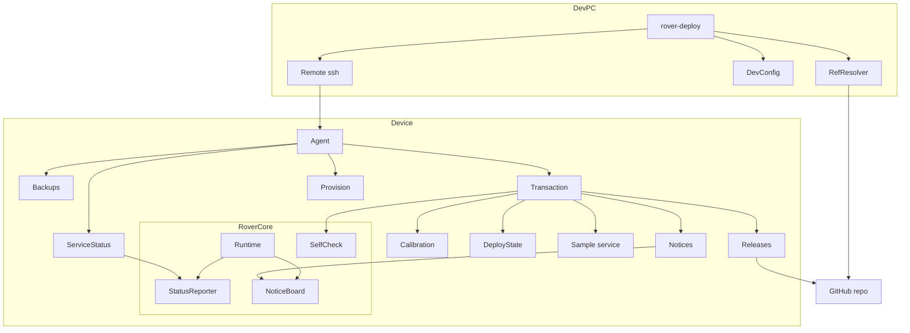
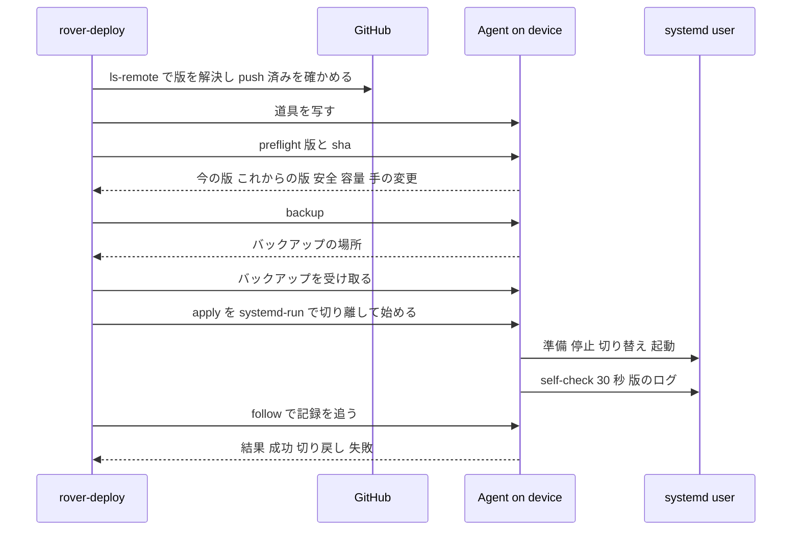
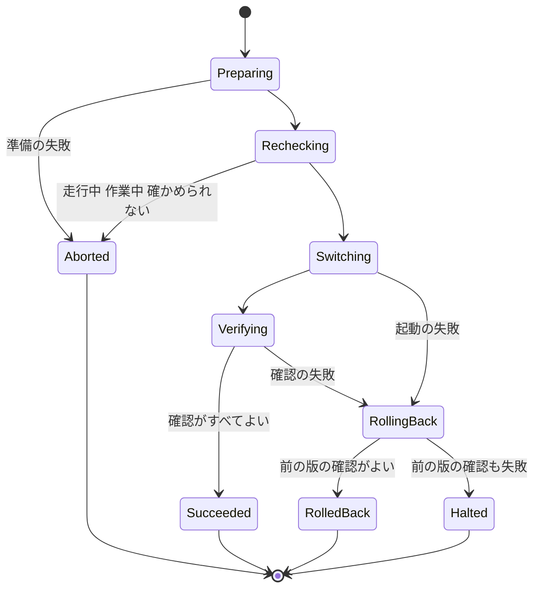

# Design Document

## Overview
**Purpose**: Device Deployment は、開発 PC から実機（Raspberry Pi 5、1 台）に OsekkaiRover の版を入れ、確かめ、だめなら戻す道具を提供する。あわせて、新しい SD カードから実機の環境を作り直す初期設定と、実機の準備を確かめる self-check を提供する。

**Users**: 保護者を兼ねる開発者が、子どもが使っていない時間に、開発 PC の端末から使う。保護者は、ロボットの LCD で入っている版を確かめる。

**Impact**: 今は、作業ブランチを試すたびに実機で手作業の切り替えをしている。この設計で、新しい基盤を `~/osekkai-rover/`（版ごとのディレクトリ）と `osekkai.service` に置き、サンプル（`~/works/OsekkaiRover`、`osekkai-rover.service`）には触れずに、試しの版と普段の版を 1 つのコマンドで行き来できるようにする。`rover-core` には、状態のファイル・外からの知らせ・self-check・安全停止の厳しい終了コードを足す。

### Goals
- 指定した版（タグかブランチ）を、安全なときだけ、バックアップしてから入れる。確かめて、だめなら自動で戻す
- 接続が切れても、実機の側で入れ替えを最後まで行うか、前の版に戻す
- 試しの版から普段の版（今はサンプル）に、1 つのコマンドで戻せる。戻し忘れを知らせる
- 新しい SD カードから、何度実行してもよい初期設定で環境を作れる
- 公開リポジトリに、接続先・バックアップ・記録を入れない

### Non-Goals
- CI からの自動の入れ替え、複数台への配置、OS のイメージ
- 個々の機能の self-check の中身（各機能が `FeatureSpec.checks` に足す）
- サンプルの星の記録と顔の特徴の移し替え（`daily-routine`、`presence`）
- 時間帯による入れ替えの制限（人が判断する）

## Boundary Commitments

### This Spec Owns
- 配置の道具 `deploy/rover-deploy` と `deploy/rover_deploy/`（開発 PC の側と実機の側の両方）
  - 版の解決、事前の確認、バックアップ、版のディレクトリの準備、切り替え、入れた後の確認、切り戻し、普段の版の記録、戻し忘れの知らせ、バックアップからの復元、初期設定
- 実機の配置の形（`~/osekkai-rover/` の構成、`~/.local/state/osekkai-deploy/` の状態と記録とバックアップ）
- systemd のユニット: `deploy/systemd/osekkai.service`（`osekkai-rover.service` から名前と置き場所を変える）と、戻し忘れのタイマー
- `rover-core` への追加（このスペックで作り、`rover-core` の設計の約束は変えない）:
  - 状態のファイル（`status.json`）を書く `StatusReporter` と、`MotionService.driving`
  - 外からの知らせ（`notice.json`）を待機画面に出す `NoticeBoard`
  - self-check の契約と実行（`core/selfcheck.py`）、基盤の確認の項目（`osekkai/checks.py`）、実機の軽い確かめ（`adapters/pi/probes.py`）、`FeatureSpec.checks`
  - CLI の `--self-check`、安全停止の `--strict`
- 手順書 `docs/deploy.md`

### Out of Boundary
- 停止の時の安全な処理そのもの（SIGTERM の扱い、`ExecStopPost` の安全停止の中身）は `rover-core` が持つ。ここは呼ぶだけ
- 機能ごとの確認の項目の中身
- サンプルのコード・仮想環境・ユニット・データの変更（読む・写す・止める・起動するだけ）
- サンプルの記録と顔の特徴の新しい保存先への移し替え
- 接続先（ssh の設定）そのもの。開発 PC の利用者が持つ

### Allowed Dependencies
- 開発 PC: Python 3.11 以上の標準ライブラリ、`git`、`ssh`・`scp`（利用者の `~/.ssh/config`）
- 実機の道具: システムの `python3`（3.11 以上）の標準ライブラリ、`git`、`systemctl --user`・`systemd-run --user`・`journalctl`、`tar`、`sudo`（初期設定だけ）、`apt-get`、`loginctl`、`raspi-config` を使わず `config.txt` を直す
- 道具は `osekkai` のパッケージを読み込まない。版の中のコマンド（`<版>/.venv/bin/python -m osekkai --self-check`、`-m osekkai.core.safe_stop --strict`）をサブプロセスで呼ぶ
- `rover-core` への追加は、基盤の依存の向き（`core` はアダプタと機能を知らない）を守る。`osekkai/checks.py` は `__main__` と同じ層で、アダプタを遅れて読み込んでよい

### Revalidation Triggers
- `status.json`・`notice.json` の形（`schema`）、置き場所（`$XDG_RUNTIME_DIR/osekkai/`）の変更 → 道具の `rover_deploy/service_status.py`・`notices.py` と、基盤の `core/status.py`・`core/notice.py` の両方を直し、共通の見本（`tests/fixtures/`）で確かめる
- 版のログの文言（`版: <git describe>`）の変更 → 入れた後の確認（4.1）が壊れる
- self-check の終了コードと `--json` の形の変更 → 入れた後の確認
- ユニットの名前・置き場所（`osekkai.service`、`~/osekkai-rover/current`）の変更 → 道具・手順書・初期設定
- `FeatureSpec.checks` の契約の変更 → 項目を足した機能すべて
- `pyproject.toml` の extras（`pi`）の変更 → 版の準備の `pip install`

## Architecture

### Existing Architecture Analysis
- `rover-core` は、単一の実行のロック（`$XDG_RUNTIME_DIR/osekkai/rover.lock`）、起動の版のログ（`版: <git describe --tags --always --dirty>`）、`ExecStopPost` の安全停止（ロックが空いているときだけ動く）を持つ。ユニットのファイルは、作業コピーの場所を前提にしていた
- 実機では、その場所とユニットの名前をサンプルが使っている（`research.md`）。サンプルは単一の実行のロックを使わず、`ExecStopPost` もない
- 資源の持ち主は `Arbiter.holder()` で分かる。基盤の内部の持ち主は `core.` で始まる（`core.idle`、`core.config`）

### Architecture Pattern & Boundary Map



**Architecture Integration**:
- Selected pattern: 版ごとのディレクトリとリンクの切り替え（`releases/<sha>` と `current`）。開発 PC は薄い指示役、実機の道具（Agent）が入れ替えの全体を持つ
- 境界: 道具は基盤のファイル（状態・知らせ）とコマンド（self-check・安全停止）だけで基盤とつながる。基盤は道具を知らない
- 守る形: ポートとアダプタ、`core` の依存の向き、ログに個人の値を出さない決まり、XDG の置き場所
- 新しい部品の理由: 安全の確認（状態のファイル）、LCD の版の表示と戻し忘れ（知らせ）、準備の確認（self-check）は、外から基盤の中を見る口がないため

### Technology Stack

| Layer | Choice / Version | Role in Feature | Notes |
|-------|------------------|-----------------|-------|
| CLI（開発 PC） | Python 3.11 以上の標準ライブラリ（`argparse`、`tomllib`、`subprocess`） | 版の解決、ssh の指示、バックアップの受け取り | 追加の依存なし |
| 道具（実機） | システムの `python3`（Trixie は 3.13）の標準ライブラリ | 入れ替え・切り戻し・初期設定 | 開発 PC から毎回 `~/osekkai-rover/tool/` に写す |
| 版の取得 | git（bare の写し ＋ worktree） | 版ごとのディレクトリ | 実機は GitHub から https で取る（公開リポジトリ） |
| 実行環境 | systemd のユーザーサービス、`systemd-run --user`、ユーザーのタイマー | サービス、切り離した入れ替え、戻し忘れの確認 | `Conflicts=` でサンプルと排他 |
| 依存関係 | `python3 -m venv --system-site-packages`、`pip install -e '.[pi]'` | 版ごとの仮想環境 | pip のキャッシュを使う |
| 保存 | JSON（状態・知らせ・記録）、`tar.gz`（バックアップ） | 道具の状態と記録 | 0700 のディレクトリ、0600 のファイル |
| 基盤への追加 | 既存の `osekkai`（PyYAML、pydantic v2、smbus2、lgpio） | 状態・知らせ・self-check | 新しい依存なし |

## File Structure Plan

### Directory Structure
```
deploy/
├── rover-deploy                 # 開発 PC の入口（python3 の実行ファイル）。rover_deploy.devcli を呼ぶ
├── rover_deploy/                # 道具のパッケージ（標準ライブラリだけ）
│   ├── __init__.py
│   ├── common.py                # 両側で使う型（Target、DeployResult、ExitCode、版の表示の文字列）と JSON の読み書き
│   ├── devcli.py                # 開発 PC: 引数、流れ（事前確認→バックアップ→受け取り→適用→追跡）、表示
│   ├── devconfig.py             # 開発 PC: 利用者の設定（接続先の別名、バックアップの置き場所）
│   ├── refs.py                  # 開発 PC: タグとブランチの解決、push 済みの確認（git ls-remote）
│   ├── remote.py                # 開発 PC: ssh で道具を写す・実行する・ファイルを受け取る・送る
│   ├── agent.py                 # 実機: サブコマンドの入口（preflight、backup、apply、follow、status、back の準備、restore、stop、self-check、remind、provision）
│   ├── system.py                # 実機: コマンドの実行の口（Runner）、systemctl・journalctl・git の薄い包み
│   ├── layout.py                # 実機: 置き場所（~/osekkai-rover、状態のディレクトリ、XDG、サンプルの場所）
│   ├── state.py                 # 実機: 道具の状態（state.json）と入れ替えの記録（log/<id>.jsonl）、ロック
│   ├── service_status.py        # 実機: どのサービスが動いているか、status.json の読み取り、安全の判定
│   ├── releases.py              # 実機: bare の写しの取得、worktree、仮想環境、current の切り替え、ユニットの入れ替え、古い版の削除
│   ├── backups.py               # 実機: バックアップの作成・世代の削除・一覧・復元、サンプルのバックアップ
│   ├── transaction.py           # 実機: 適用の流れ（停止→切り替え→起動→確認→切り戻し）
│   ├── verify.py                # 実機: 入れた後の確認（self-check、30 秒、版のログ）
│   ├── calibration.py           # 実機: picar-x.conf から config.yaml への調整値の移し替え
│   ├── notices.py               # 実機: notice.json を書く・消す、戻し忘れの確認
│   └── provision.py             # 実機: 初期設定の手順の並びと、各手順の「済んでいるか」「行う」
└── systemd/
    ├── osekkai.service          # 新しい基盤のユニット（osekkai-rover.service から改名・置き場所を変える）
    ├── osekkai-trial-reminder.service  # 戻し忘れの確認（agent remind）
    └── osekkai-trial-reminder.timer    # 起動の 10 分後と、その後 1 時間ごと

src/osekkai/
├── checks.py                    # 基盤の確認の項目を組み立てる（設定・保存先・時刻・LCD・声・再生先・HAT・ボタン・サーボ）
├── core/
│   ├── status.py                # StatusReporter: status.json を 1 秒ごとに書く
│   ├── notice.py                # NoticeBoard: notice.json を読み、出す行を返す
│   └── selfcheck.py             # Check・CheckResult・CheckContext・SelfCheckRunner（時間切れ、表示、JSON）
└── adapters/
    ├── pi/probes.py             # 実機の軽い確かめ（I2C の応答、GPIO の線、再生先、合成）
    └── fake/probes.py           # PC とテストの偽物

docs/deploy.md                   # 手順書（初期設定・入れ替え・普段の版に戻す・復元・self-check・失敗のとき）

tests/
├── deploy/                      # 道具のテスト（偽の Runner と一時ディレクトリ）
│   ├── test_refs.py
│   ├── test_devcli.py
│   ├── test_state.py
│   ├── test_service_status.py
│   ├── test_releases.py
│   ├── test_backups.py
│   ├── test_transaction.py
│   ├── test_verify.py
│   ├── test_calibration.py
│   ├── test_notices.py
│   └── test_provision.py
├── fixtures/                    # status.json・notice.json・self-check の JSON の見本（基盤と道具の両方のテストが読む）
└── core/
    ├── test_status.py
    ├── test_notice.py
    └── test_selfcheck.py
```

### Modified Files
- `deploy/systemd/osekkai-rover.service` → `deploy/systemd/osekkai.service` に改名。`WorkingDirectory`・`ExecStart`・`ExecStopPost` を `%h/osekkai-rover/current` に変える。`Conflicts=osekkai-rover.service`、`After=`・`Wants=pipewire-pulse.service` を足す
- `src/osekkai/core/runtime.py` — `StatusReporter` を起動・停止の順に加える。待機画面に `NoticeBoard` を渡す。版のログの文言を定数 `VERSION_LOG_PREFIX` にする
- `src/osekkai/core/motion.py` — 最後に送った速さを覚え、`driving` を返す
- `src/osekkai/core/idle.py` — 知らせがある間は、その行を待機画面の行の代わりに出す
- `src/osekkai/core/feature.py` — `FeatureSpec.checks: tuple[Check, ...] = ()` を足す
- `src/osekkai/core/safe_stop.py` — `--strict` のときは、失敗した段階があれば終了コード 1
- `src/osekkai/__main__.py` — `--self-check`、`--json`、`--no-hardware` を足し、`osekkai.checks` を呼ぶ
- `tests/test_systemd_unit.py` — 新しい名前と置き場所、`Conflicts=` を確かめる
- `tests/core/test_import_direction.py` — `core/status.py`・`notice.py`・`selfcheck.py` もアダプタを読まないことを確かめる（既存の仕組みで自動的に対象になる）
- `pyproject.toml` — `[tool.mypy] files` と `[tool.pytest.ini_options] pythonpath` に `deploy` を足す。ruff は既定で対象になる
- `README.md` — 実機への配置は `docs/deploy.md` を見るよう案内する
- `.kiro/steering/structure.md`・`tech.md` — `deploy/` の構成、道具の決まり（標準ライブラリだけ）を書き足す

## System Flows

### 入れ替え（タグかブランチ）



- 実機を変えるのは apply だけ。preflight・backup で中止したときは、実機は変わらない（1.3〜1.6、1.9、2.1〜2.4、3.2）
- バックアップを開発 PC に受け取れなければ、apply を始めない（3.3）。初めての入れ替えでは、サンプルのバックアップも受け取ってから始める（9.2）
- 接続が切れても apply は続く。開発 PC は終了コード 13 で終え、`rover-deploy status` で結果を見るよう案内する（4.5）

### 適用の状態の移り変わり



- Preparing: bare の写しの取得、worktree、仮想環境、`pip install`。今の版にも動いているサービスにも触れない。失敗したら作りかけの版のディレクトリを消して Aborted
- Rechecking: 停止の直前に、安全の確認をもう一度行う（preflight との間に走り出した場合に備える）
- Switching: 調整値の移し替え（初回）、動いているサービスの停止、`current` の切り替え、ユニットの入れ替え、知らせを書く、起動、普段の版なら有効にする
- Halted: 両方のユニットを止め、安全停止を `--strict` で行い、その結果を記録する（4.4）

### 普段の版に戻す
- 普段の版がサンプル: 安全の確認とバックアップの後、`osekkai.service` を止め（`ExecStopPost` で安全停止）、`osekkai-rover.service` を起動する。`Conflicts=` があるので、2 つは同時に動かない。確認は「30 秒動き続ける」だけ（サンプルには self-check も版のログもない）（5.3）
- 普段の版が新しい基盤の版: その版を対象にした適用と同じ流れ（5.1）

## Requirements Traceability

| Requirement | Summary | Components | Interfaces | Flows |
|-------------|---------|------------|------------|-------|
| 1.1 | タグを入れて動かす | RefResolver, Transaction, Releases | `resolve_ref`, `apply` | 入れ替え |
| 1.2 | ブランチの push 済みの最新を試しに入れる | RefResolver, Transaction | `resolve_ref` | 入れ替え |
| 1.3 | 版がないと中止 | RefResolver | `RefNotFound` | 入れ替え |
| 1.4 | push していないと中止 | RefResolver | `UnpushedCommits` | 入れ替え |
| 1.5 | 今の版と入れる版を先に表示 | DevCli, Agent preflight | `PreflightReport` | 入れ替え |
| 1.6 | 接続できないと中止 | Remote, DevCli | `RemoteUnreachable` | 入れ替え |
| 1.7 | 2 つ目の入れ替えを断る | DeployState lock, systemd-run の名前 | `DeployLock` | 入れ替え |
| 1.8 | 依存関係を入れてから起動 | Releases | `prepare` | 適用 |
| 1.9 | 手の変更があると中止 | Releases, Agent preflight | `dirty_paths` | 入れ替え |
| 1.10 | 結果と版の表示、終了コード | DevCli, Transaction | `ExitCode`, `DeployResult` | 入れ替え |
| 2.1 | 走行中は中止 | ServiceStatus, StatusReporter | `SafetyVerdict` | 適用 Rechecking |
| 2.2 | 作業中は機能の名前を出して中止 | ServiceStatus, StatusReporter | `SafetyVerdict.busy` | 適用 Rechecking |
| 2.3 | 確かめられなければ中止、止まっていれば進む | ServiceStatus | `SafetyVerdict` | 適用 Rechecking |
| 2.4 | 空き容量 | Agent preflight | `disk_free` | 入れ替え |
| 2.5 | 時間帯で断らない | ServiceStatus | 時刻を見ない | — |
| 3.1 | 切り替えの前にバックアップ | Backups | `create_backup` | 入れ替え |
| 3.2 | 作れなければ中止 | Backups, DevCli | `BackupFailed` | 入れ替え |
| 3.3 | 実機と開発 PC の両方 | Backups, Remote, DevConfig | `fetch_file` | 入れ替え |
| 3.4 | 本人だけが読める | Backups, Remote | 0700・0600 | — |
| 3.5 | 世代の数で古いものを消す | Backups | `prune` | — |
| 3.6 | 外の設定・記録・キャッシュを消さない | Releases, Transaction | 版のディレクトリだけを作る・消す | — |
| 3.7 | 指定して戻す | Backups, Agent restore | `restore_backup` | — |
| 4.1 | self-check・30 秒・版のログ | Verify, SelfCheck | `verify_release` | 適用 Verifying |
| 4.2 | 前の版と依存関係に戻す | Transaction, Releases | `rollback` | 適用 RollingBack |
| 4.3 | 戻した版も確かめ、失敗の項目を出す | Verify, DevCli | `VerifyReport` | 適用 RollingBack |
| 4.4 | 戻した版も失敗なら止めてモーターを確かめる | Transaction, safe_stop | `halt`, `--strict` | 適用 Halted |
| 4.5 | 接続が切れても最後まで | Agent, systemd-run | `start_detached_apply` | 入れ替え |
| 4.6 | 経過と結果を実機に記録 | DeployState | `DeployLog` | — |
| 5.1 | 普段の版に戻す | DevCli, Transaction | `back` | 普段の版に戻す |
| 5.2 | 普段の版を指定して記録 | DevCli, DeployState | `set_everyday` | — |
| 5.3 | サンプルを元どおり動かす | Transaction | `Target.sample` | 普段の版に戻す |
| 5.4 | 試しの版であることを表示 | Notices, DevCli status | `version_notice` | — |
| 5.5 | 戻し忘れを知らせる | Notices, reminder timer, DevCli | `remind` | — |
| 6.1 | 基盤の項目 | SelfCheck, BaseChecks, Probes | `base_checks` | — |
| 6.2 | 機能が項目を足す | SelfCheck, FeatureSpec | `FeatureSpec.checks` | — |
| 6.3 | だめがあれば失敗の終了コード | SelfCheckRunner | 終了コード 1 | — |
| 6.4 | 時間切れ | SelfCheckRunner | `Check.timeout_s` | — |
| 6.5 | 動かさない・鳴らさない | BaseChecks, Probes | 読むだけの確かめ | — |
| 6.6 | 個人の値を出さない | SelfCheckRunner | 固定の理由の文言 | — |
| 6.7 | 動いているサービスと取り合わない | SelfCheckRunner, StatusReporter | ロック、`ServiceSnapshot` | — |
| 6.8 | 単独でも入れ替えの一部でも | CLI, Verify, Agent | `--self-check`, `rover-deploy self-check` | — |
| 7.1 | LCD に版を数秒 | Notices, NoticeBoard, IdleScreen | `notice.json` | 適用 Switching |
| 7.2 | 版の確認 | DevCli status, Agent status | `StatusReport` | — |
| 7.3 | タグか、ブランチと短い識別子 | common | `version_label` | — |
| 8.1 | 初期設定の内容 | Provision | `PROVISION_STEPS` | — |
| 8.2 | 2 回目以降は足りない手順だけ | Provision | `Step.is_done` | — |
| 8.3 | 失敗で止まり、やり直し方を出す | Provision | `StepFailed` | — |
| 8.4 | 再起動が要ることを知らせる | Provision | `Step.needs_reboot` | — |
| 8.5 | 個人の設定を上書きしない | Provision | 既存なら飛ばす | — |
| 8.6 | 秘密を作らない、場所を出す | Provision | `secrets_guidance` | — |
| 8.7 | 対応していない OS は中止 | Provision | `check_os` | — |
| 8.8 | 最後に self-check | Provision | `run_self_check` | — |
| 9.1 | サンプルを変えない | Releases, layout, Transaction | サンプルは読む・写す・止める・起動するだけ | — |
| 9.2 | 初回にサンプルを開発 PC にバックアップ | Backups, DevCli | `create_sample_backup` | 入れ替え |
| 9.3 | 調整値の移し替え | Calibration | `migrate_calibration` | 適用 Switching |
| 9.4 | 新しい版の間はサンプルを止める | osekkai.service `Conflicts=` | ユニット | — |
| 9.5 | サンプルの間は新しい版を止める | `Conflicts=`, Transaction | ユニット | 普段の版に戻す |
| 10.1 | 接続先をリポジトリに書かない | DevConfig | 利用者の設定 | — |
| 10.2 | バックアップ・記録を作業コピーの外に | DevConfig, layout | 置き場所 | — |
| 10.3 | 秘密・名前・記録を出さない | 全部、SelfCheckRunner | 固定の文言、型の名前だけ | — |
| 11.1 | 手順書 | docs/deploy.md | — | — |
| 11.2 | 失敗のときと、モーターを止める方法 | docs/deploy.md | `rover-deploy stop` | — |
| 11.3 | 接続先の設定の仕方 | docs/deploy.md | DevConfig | — |

## Components and Interfaces

| Component | Domain/Layer | Intent | Req Coverage | Key Dependencies (P0/P1) | Contracts |
|-----------|--------------|--------|--------------|--------------------------|-----------|
| DevCli | 開発 PC | コマンドの入口と流れ、表示、終了コード | 1.5, 1.6, 1.10, 3.3, 4.3, 4.5, 5.1, 5.2, 5.5, 7.2, 9.2 | Remote (P0), RefResolver (P0) | Service |
| DevConfig | 開発 PC | 接続先の別名とバックアップの置き場所 | 3.3, 10.1, 10.2, 11.3 | tomllib (P1) | State |
| RefResolver | 開発 PC | タグ・ブランチの解決と push 済みの確認 | 1.1〜1.4, 7.3 | git (P0) | Service |
| Remote | 開発 PC | ssh・scp で道具を写し、実行し、ファイルをやり取りする | 1.6, 3.3, 3.4, 4.5 | ssh (P0) | Service |
| Agent | 実機 | サブコマンドの入口。JSON で結果を返す | 1.5, 1.7, 1.9, 2.4, 4.5, 6.8, 7.2 | 下の全部 (P0) | Service, Batch |
| DeployState | 実機 | 状態・記録・ロック | 1.7, 4.6, 5.2, 9.2, 9.3 | — | State |
| ServiceStatus | 実機 | 動いているサービスと安全の判定 | 2.1〜2.3, 2.5, 6.7 | status.json (P0), systemctl (P0) | Service |
| Releases | 実機 | 版のディレクトリ、依存、切り替え、ユニット | 1.1, 1.2, 1.8, 1.9, 3.6, 4.2, 9.1 | git (P0), venv (P0) | Service |
| Backups | 実機 | バックアップと復元 | 3.1〜3.7, 9.2 | tar (P0) | Service |
| Transaction | 実機 | 適用・確認・切り戻し・停止 | 1.1, 1.2, 1.10, 3.6, 4.1〜4.6, 5.1, 5.3, 9.4, 9.5 | Releases, Verify (P0) | Batch, State |
| Verify | 実機 | 入れた後の確認 | 4.1, 4.3 | self-check (P0), journalctl (P1) | Service |
| Calibration | 実機 | 調整値の移し替え | 9.3 | — | Service |
| Notices | 実機 | 知らせを書く・消す、戻し忘れ | 5.4, 5.5, 7.1 | notice.json (P1) | Service |
| Provision | 実機 | 初期設定 | 8.1〜8.8 | sudo・apt (P0) | Batch |
| StatusReporter | 基盤 | 状態のファイルを書く | 2.1〜2.3, 6.7 | Arbiter, MotionService (P0) | State |
| NoticeBoard | 基盤 | 知らせを待機画面に出す | 5.5, 7.1 | IdleScreen (P1) | State |
| SelfCheck | 基盤 | 確認の契約と実行 | 6.1〜6.8 | — | Service |
| BaseChecks / Probes | 起動の口・アダプタ | 基盤の確認の項目と実機の軽い確かめ | 6.1, 6.5, 6.7 | smbus2, lgpio, pactl, open_jtalk (P1) | Service |

### 共通の型（`rover_deploy/common.py`）

```python
class ExitCode(IntEnum):
    OK = 0              # 成功
    ABORTED = 10        # 中止。実機は変えていない
    ROLLED_BACK = 11    # 入れた版の確認が失敗し、前の版に戻した
    HALTED = 12         # 前の版の確認も失敗し、サービスを止めた（人の手が要る）
    UNKNOWN = 13        # 接続が切れて結果が分からない
    # 2 は argparse の使い方の誤り

@dataclass(frozen=True)
class Target:
    kind: Literal["sample", "release"]
    ref: str | None          # タグかブランチの名前（sample なら None）
    ref_kind: Literal["tag", "branch"] | None
    sha: str | None          # 40 桁

def version_label(target: Target) -> str:
    """7.3: タグなら "v0.2.0"、ブランチなら "feat/x@abc1234"、サンプルなら "sample"。"""

Outcome = Literal["succeeded", "aborted", "rolled_back", "halted"]

@dataclass(frozen=True)
class DeployResult:
    deploy_id: str           # "20261104T210000Z" の形
    outcome: Outcome
    running: Target | None   # 終わった後に動いている版
    failed_checks: tuple[str, ...]   # 失敗した確認の項目の名前と、固定の理由
```
- 実機と開発 PC の間は、Agent が標準出力に JSON を 1 つ書き、開発 PC が読む。人に向けた文言は開発 PC が作る

### 開発 PC

#### DevCli

| Field | Detail |
|-------|--------|
| Intent | `rover-deploy <サブコマンド>` の流れと表示 |
| Requirements | 1.5, 1.6, 1.10, 3.3, 4.3, 4.5, 5.1, 5.2, 5.5, 7.2, 9.2 |

**Responsibilities & Constraints**
- サブコマンド:
  - `deploy <tag|branch>`: 入れ替え（1）
  - `back`: 普段の版に戻す（5.1）
  - `everyday <tag|sample>`: 普段の版を記録する（5.2）。記録するだけで、入れ替えは `back` で行う
  - `status`: 動いている版・普段の版・最後の入れ替えの日時と結果・試しの版かと経過時間（7.2、5.4）
  - `self-check`: 実機で self-check を行い表示する（6.8）
  - `backups` / `restore <id>` / `restore --file <開発 PC のバックアップ>`: 一覧と復元（3.7）
  - `stop`: 動いているサービスを止め、安全停止を `--strict` で行う（11.2、サンプルが動いているときの入れ替えの前）
  - `log [id]`: 入れ替えの記録を表示する（4.6）
  - `provision [--ref <tag|branch>]`: 初期設定（8）。ssh に端末を割り当てる（`sudo` のため）
- `deploy` と `back` の流れ:
  1. 設定を読む。版を解決する（`deploy` だけ）
  2. 道具を写す（`Remote.push_tool`）。つながらなければ終了コード 10（1.6）
  3. `agent preflight` の結果で、今の版とこれからの版を表示する（1.5）。中止の理由があれば表示して 10
  4. `agent backup` でバックアップを作り、開発 PC に受け取る。初回はサンプルのバックアップも受け取り、受け取れたら `agent mark-sample-saved` で記録する（3.1〜3.3、9.2）。どれかが失敗したら 10
  5. `agent apply` を切り離して始め、`agent follow` で記録を流して表示する
  6. 結果（`DeployResult`）を表示し、`ExitCode` で終える（1.10、4.3）。追跡の途中で切れたら 13（4.5）
- どのサブコマンドでも、試しの版が `REMIND_AFTER` を超えて入っていれば、最初に警告を出す（5.5）
- 表示に、設定の値・記録の中身・秘密を出さない（10.3）。バックアップは場所と大きさだけを出す

**Contracts**: Service [x]

```python
def main(argv: Sequence[str] | None = None) -> int: ...
```

#### DevConfig

| Field | Detail |
|-------|--------|
| Intent | 利用者の設定を読む |
| Requirements | 3.3, 10.1, 10.2, 11.3 |

- 置き場所: `$OSEKKAI_DEPLOY_CONFIG`、なければ `~/.config/osekkai-deploy/config.toml`
- 項目:
  ```toml
  host = "rover"            # ssh の接続先（~/.ssh/config の別名を推奨）。必須
  backup_dir = "~/.local/share/osekkai-deploy/backups"  # 省略可
  repo_url = "https://github.com/<owner>/<repo>.git"     # 省略可。省略なら origin から https の形を作る
  ```
- `host` がなければ、設定の仕方を表示して終了コード 10。`backup_dir` が git の作業コピーの中なら拒む（10.2）

```python
@dataclass(frozen=True)
class DevConfig:
    host: str
    backup_dir: Path
    repo_url: str

def load_dev_config(env: Mapping[str, str], repo_root: Path) -> DevConfig: ...  # 誤りは ConfigError
```

#### RefResolver

| Field | Detail |
|-------|--------|
| Intent | 指定をタグかブランチに解決し、push 済みのコミットを返す |
| Requirements | 1.1〜1.4, 7.3 |

```python
def resolve_ref(name: str, repo_root: Path, run: Runner) -> Target: ...
# 例外: RefNotFound(name), UnpushedCommits(name, count), RemoteUnreachable
```
- `git ls-remote --tags --heads origin` で探す。タグは注釈付きの `^{}` の先のコミットを使う。両方にあればタグを選び、その旨を表示する
- ブランチ: 手元に同じ名前のブランチがあり、リモートにないコミットがあれば（`git rev-list --count origin/<b>..<b>`、先に `git fetch origin <b>`）`UnpushedCommits`（1.4）。手元のほうが遅れているだけなら、リモートの最新を使う（1.2）
- タグが手元だけにあって、リモートにないときは `RefNotFound`（push が要ると添える）（1.3）

#### Remote

| Field | Detail |
|-------|--------|
| Intent | ssh の操作をまとめる |
| Requirements | 1.6, 3.3, 3.4, 4.5 |

```python
class Remote:
    def __init__(self, host: str, run: Runner) -> None: ...
    def push_tool(self, package_dir: Path) -> None: ...          # tar を ssh の標準入力で送り ~/osekkai-rover/tool/ に展開
    def agent(self, *args: str, tty: bool = False) -> AgentReply: ...  # python3 -m rover_deploy.agent ...（JSON を読む）
    def stream(self, *args: str) -> Iterator[dict[str, object]]: ...  # follow の JSON 行
    def fetch(self, remote_path: str, local_path: Path) -> None: ...  # scp。umask 077、受け取った後に 0600
    def send(self, local_path: Path, remote_path: str) -> None: ...
```
- ssh は `-o BatchMode=yes -o ConnectTimeout=10` で呼ぶ（`provision` だけ `-t` で端末を割り当てる）。つながらなければ `RemoteUnreachable`
- 受け取ったファイルの置き場所は `backup_dir/<deploy_id>/`（0700）

### 実機の道具

#### Agent

| Field | Detail |
|-------|--------|
| Intent | 実機のサブコマンド。どれも JSON を 1 つ返す（`follow` は JSON 行） |
| Requirements | 1.5, 1.7, 1.9, 2.4, 4.5, 6.8, 7.2 |

**Batch / Job Contract**
- `preflight --target <json>`: 返す内容 `PreflightReport`。実機を変えない
  - 動いているサービスと版、`ServiceStatus.judge()` の結果（2.1〜2.3）
  - 空き容量 ≥ バックアップの元の合計 ＋ `RELEASE_SPACE_MB`（既定 500）（2.4）
  - `current` の worktree の手の変更（`git status --porcelain` の件数。ファイルの名前は出さない）（1.9）
  - ロックが取られていれば中止（1.7）。前の入れ替えが途中で終わっていれば中止し、`back` を案内する
- `backup`: ロックを取ってバックアップを作り、場所を返す。初回はサンプルのバックアップも作る
- `mark-sample-saved <deploy_id>`: 開発 PC が受け取れたことを記録する
- `apply --target <json> --deploy-id <id> [--everyday]`: 自分では動かず、`systemd-run --user --unit=osekkai-deploy --collect --property=KillMode=process python3 -m rover_deploy.agent run-apply ...` で切り離して始める。同じ名前のユニットがあれば断る（1.7、4.5）
- `run-apply ...`: `Transaction.run()`。ロックを取り、記録を書く
- `follow <id>`: 記録が `result` の行になるまで流す
- `status`、`self-check [--json]`、`backups`、`restore <id>`、`stop`、`remind`、`provision [--ref]`、`set-everyday <json>`
- `log [id]`: 入れ替えの記録を返す（id がなければ最新の 1 件。`--list` で一覧）

#### DeployState

| Field | Detail |
|-------|--------|
| Intent | 道具の状態・記録・ロック |
| Requirements | 1.7, 4.6, 5.2, 9.2, 9.3 |

**State Management**
- 置き場所: `~/.local/state/osekkai-deploy/`（0700）
  - `state.json`（0600。形は Data Models）、`deploy.lock`（`flock`）、`log/<deploy_id>.jsonl`、`backups/`
- 書き込みは一時ファイルから置き換える。ロックを持つのは backup・run-apply・restore・stop・provision の間
- 記録は最新 50 件を残す

```python
class DeployLock:
    def try_acquire(self) -> bool: ...   # LOCK_EX | LOCK_NB
    def release(self) -> None: ...

class DeployLog:
    def event(self, step: str, status: Literal["start", "ok", "failed", "skipped"], reason: str = "") -> None: ...
    def result(self, result: DeployResult) -> None: ...
```
- 記録の文言は、手順の名前と固定の理由と例外の型の名前だけ（10.3）

#### ServiceStatus

| Field | Detail |
|-------|--------|
| Intent | どのサービスが動いているかと、入れ替えてよいかの判定 |
| Requirements | 2.1〜2.3, 2.5, 6.7 |

```python
class Running(Enum):
    NONE = "none"; CORE = "core"; SAMPLE = "sample"; BOTH = "both"

@dataclass(frozen=True)
class SafetyVerdict:
    ok: bool
    running: Running
    reason: Literal["", "driving", "busy", "unknown", "sample_running"]
    busy: tuple[str, ...]   # 作業中の機能の名前（2.2）

def judge(running: Running, snapshot: ServiceSnapshot | None, main_pid: int | None,
          now_monotonic: float) -> SafetyVerdict: ...
```
- `NONE`: よい（2.3 の「止まっている」）
- `CORE`: `status.json` がない、形が違う、`pid` が `MainPID` と違う、`heartbeat` が `STATUS_STALE_S`（既定 5 秒）より古い → `unknown`。`driving` → `driving`（2.1）。`busy` が空でない → `busy`（2.2）。どれでもなければよい
- `SAMPLE`・`BOTH`: `sample_running`（サンプルは状態を出さないので確かめられない。2.3）。開発 PC は「使っていないことを確かめてから `rover-deploy stop`」を案内する
- 時刻は見ない（2.5）

#### Releases

| Field | Detail |
|-------|--------|
| Intent | 版のディレクトリを作り、切り替え、片付ける |
| Requirements | 1.1, 1.2, 1.8, 1.9, 3.6, 4.2, 9.1 |

```python
class Releases:
    def prepare(self, target: Target, repo_url: str) -> Path: ...
    def current(self) -> Path | None: ...              # current のリンクの先
    def switch(self, release_dir: Path) -> Path | None: ...  # 前のリンクの先を返す。リンクは一時名を作って rename
    def install_unit(self, release_dir: Path) -> None: ...   # <版>/deploy/systemd/osekkai.service を写し daemon-reload
    def dirty_count(self, release_dir: Path) -> int: ...
    def prune(self, keep: Collection[Path]) -> None: ...
```
- 置き場所: `~/osekkai-rover/repo.git`（bare の写し）、`releases/<sha の先頭 12 桁>/`（worktree、切り離した HEAD）、`releases/<…>/.venv`、`current`（リンク）
- `prepare`: `git fetch --prune --tags origin`、sha があることを確かめ、worktree を作り、`python3 -m venv --system-site-packages .venv`、`.venv/bin/pip install -e '.[pi]'`。同じ sha のディレクトリがあり、仮想環境ができていれば使い回す。途中で失敗したら、そのディレクトリを消す（今の版には触れない）
- 依存関係は版ごとの仮想環境にあるので、切り戻しはリンクとユニットを戻すだけで、依存関係も戻る（1.8、4.2）
- `prune`: 残すのは今・前・普段の版と、新しい順に `KEEP_RELEASES`（既定 3）。リポジトリの外の XDG のディレクトリには触れない（3.6）
- サンプルの場所（`~/works/OsekkaiRover`、`~/.venvs/osekkai`）には何も書かない（9.1）

#### Backups

| Field | Detail |
|-------|--------|
| Intent | 設定・記録・調整値のバックアップと復元 |
| Requirements | 3.1〜3.7, 9.2 |

```python
@dataclass(frozen=True)
class BackupInfo:
    backup_id: str      # deploy_id と同じ形
    path: Path
    size_bytes: int

def create_backup(layout: Layout, deploy_id: str) -> BackupInfo: ...          # 失敗は BackupFailed
def create_sample_backup(layout: Layout, deploy_id: str) -> BackupInfo | None: ...  # サンプルがなければ None
def prune(layout: Layout, keep: int = KEEP_BACKUPS) -> None: ...               # 既定 5 世代（3.5）
def list_backups(layout: Layout) -> list[BackupInfo]: ...
def restore_backup(layout: Layout, backup: Path, *, include_sample: bool) -> None: ...
```
- 中身（3.1）:
  - `~/.config/osekkai/`（設定、調整値、`env`）
  - `~/.local/state/osekkai/`（記録）
  - `~/.local/share/osekkai/` のうち、取り直せる素材（`voices/`、`models/`、`jtalk/`）を除いたもの
  - サンプルの `data/`（記録・調整値・顔の特徴）。`tts_cache/` は除く。サンプルが普段の版の間は、子どもの記録はここにある
- サンプルのバックアップ（9.2）: サンプルの作業コピー全体（`.git` とブランチ、`data/` を含む）、サンプルのユニットのファイル、サンプルの仮想環境の `pip freeze`。仮想環境そのものは写さない
- `tar.gz` を `umask 077` で作り、0600 にする（3.4）。置き場所は `~/.local/state/osekkai-deploy/backups/`（実機）と `backup_dir`（開発 PC）
- 復元（3.7）: 安全の確認 → 今の状態のバックアップ → 動いているサービスを止める → 中身を元の場所に戻す（サンプルの `data/` は `--include-sample` のときだけ）→ 止めたサービスを起動する。開発 PC のファイルからの復元は `Remote.send` で送ってから同じ流れ

#### Transaction

| Field | Detail |
|-------|--------|
| Intent | 適用の流れ。確認と切り戻しと停止を持つ |
| Requirements | 1.1, 1.2, 1.10, 3.6, 4.1〜4.6, 5.1, 5.3, 9.4, 9.5 |

**Batch / Job Contract**
- Trigger: `agent run-apply`（`systemd-run` で切り離して動く）
- Input: `Target`、`deploy_id`、`everyday: bool`（入れる版が普段の版か）
- Output: `DeployLog` の記録と、`state.json` の `last_deploy`・`current`・`previous`
- Idempotency & recovery: 始めに `state.json` に `in_progress = {deploy_id, previous}` を書き、終わったら消す。次の preflight で `in_progress` が残っていてロックが空いていれば「前の入れ替えが途中で終わった」として中止し、`back` を案内する

```python
class Transaction:
    def run(self, target: Target, deploy_id: str, *, everyday: bool) -> DeployResult: ...
    def halt(self) -> list[str]: ...   # 両方のユニットを止め、safe_stop --strict。失敗した段階を返す
```
- 手順（状態の移り変わりの図のとおり）:
  1. `Preparing`: 対象が版なら `Releases.prepare`
  2. `Rechecking`: `ServiceStatus.judge()`。よくなければ Aborted
  3. `Switching`:
     - 前の版を覚える（動いていたのがサンプルなら `Target.sample`、新しい基盤なら `current` の先）
     - 新しい基盤を初めて入れるなら `Calibration.migrate()`（9.3）
     - 動いているサービスを止める（`systemctl --user stop`。新しい基盤は `ExecStopPost` で安全停止する）
     - 対象が版: `Releases.switch`、`install_unit`、`Notices.version_notice`、`systemctl --user start osekkai.service`
     - 対象がサンプル: `systemctl --user start osekkai-rover.service`
     - 有効にするのは普段の版のユニットだけ（試しの版は有効にしない。再起動すれば普段の版に戻る）
  4. `Verifying`: `Verify`
  5. 失敗なら `RollingBack`: 前の版を同じ手順で起動し、`Verify` する（4.2、4.3）。新しい版の依存関係は、新しい版のディレクトリに残るだけで、前の版の仮想環境は変わっていない
  6. 前の版も失敗なら `Halted`: `halt()`（4.4）
- 動いているサービスの停止から起動までの間に、安全停止に頼らずモーターを止めておく必要はない（サービスの停止の約束は `rover-core` が持つ）
- 2 つのユニットは `Conflicts=` で同時に動かない（9.4、9.5）。加えて、起動の前に相手が止まっていることを `systemctl is-active` で確かめる

#### Verify

| Field | Detail |
|-------|--------|
| Intent | 入れた後の確認 |
| Requirements | 4.1, 4.3 |

```python
@dataclass(frozen=True)
class VerifyReport:
    ok: bool
    failed: tuple[str, ...]   # "self_check:lcd"、"alive"、"version_log" など

def verify_release(release_dir: Path, expected_describe: str, run: Runner, clock: Clock) -> VerifyReport: ...
def verify_sample(run: Runner, clock: Clock) -> VerifyReport: ...
```
- `verify_release`:
  - 起動を待つ（`ActiveState=active` まで、最大 `START_TIMEOUT_S` 既定 30 秒）
  - `<版>/.venv/bin/python -m osekkai --self-check --json` を行い、`failed` の項目を集める（サービスが動いているので、ハードの項目はサービスの報告になる）
  - `ALIVE_S`（30 秒）の間、`ActiveState=active` のまま、`MainPID` と `NRestarts` が変わらないこと
  - `journalctl _SYSTEMD_USER_UNIT=osekkai.service --since <起動の時刻> -o cat` に `版: <expected_describe>` があること。`expected_describe` は、その版のディレクトリで `git describe --tags --always --dirty` を行った結果（基盤と同じコマンド）
- `verify_sample`: 30 秒動き続けることだけ

#### Calibration

| Field | Detail |
|-------|--------|
| Intent | サンプルの首の調整値を、新しい版の設定に移す |
| Requirements | 9.3 |

```python
@dataclass(frozen=True)
class MigrationResult:
    status: Literal["migrated", "nothing_to_migrate", "already_set", "out_of_range", "unreadable"]

def migrate(sample_conf: Path, config_file: Path, example: Path) -> MigrationResult: ...
```
- 読むキー: `picarx_dir_servo`→`steering`（符号そのまま）、`picarx_cam_pan_servo`→`pan`（符号を反転）、`picarx_cam_tilt_servo`→`tilt`（符号を反転）、`picarx_dir_motor`→`motor_direction`
- キーが 1 つもなければ `nothing_to_migrate`。範囲（−20〜20、向きは ±1）の外の値があれば何も書かず `out_of_range`
- `config.yaml` がなければ、その版の見本（`<版>/config/osekkai.example.yaml`）を写し、`calibration:` の節の 4 行の値だけを書き換える。`config.yaml` があって、調整値が既定値（0・0・0・[1, 1]）でなければ `already_set` で書かない
- 書き換えは、`calibration:` の節の中の該当の行だけを置き換える（注釈を残す）。結果は入れた後の self-check の「設定」の項目で検証される
- 結果は状態の `calibration_migrated` に記録し、2 回目以降は行わない。値はログと表示に出さない

#### Notices

| Field | Detail |
|-------|--------|
| Intent | LCD の知らせを書く・消す。戻し忘れを確かめる |
| Requirements | 5.4, 5.5, 7.1 |

```python
def version_notice(target: Target, everyday: Target | None, now_epoch: float) -> Notice: ...
def write_notice(runtime_dir: Path, notice: Notice) -> None: ...
def clear_notice(runtime_dir: Path) -> None: ...
def remind(state: DeployState, running: Running, now_epoch: float) -> bool: ...
```
- 版の知らせ（7.1、5.4）: 1 行目に `version_label`（16 セルに切り詰める。ブランチで収まらないときは、名前のほうを縮めて `@` とコミットの短い識別子を残す。実機確認で決めた）、2 行目に普段の版なら「ふだんのばん」、試しの版なら「ためし」と普段の版の短い名前。`until` は書いた時刻 ＋ `VERSION_NOTICE_S`（既定 20 秒。起動の数秒を含めて、表示はおよそ 10 秒）
- 戻し忘れ（5.5）: `osekkai-trial-reminder.timer`（起動の 10 分後と、その後 1 時間ごと）が `agent remind` を呼ぶ。試しの版が動いていて、`trial_since` から `REMIND_AFTER_H`（既定 3 時間）を過ぎていれば:
  - 2 行目だけの知らせ「ためしのばん もどしてね」を `until` なしで書く（普段の版に戻すと消す）
  - journal に警告を 1 行出し、`state.json` の `reminded_at` を記録する。開発 PC の道具は、どのサブコマンドでも最初にこれを警告する
- `$XDG_RUNTIME_DIR` が空か相対パスなら `/tmp/osekkai-<uid>` を使う（`rover-core` の `Paths` と同じ決まり）

#### Provision

| Field | Detail |
|-------|--------|
| Intent | 新しい OS の状態から、何度実行してもよい初期設定 |
| Requirements | 8.1〜8.8 |

```python
@dataclass(frozen=True)
class Step:
    name: str
    is_done: Callable[[], bool]
    apply: Callable[[], None]
    needs_reboot: bool = False
    retry_hint: str = ""      # 失敗したときの、やり直し方

def run_provision(steps: Sequence[Step], log: Callable[[str, str], None]) -> ProvisionReport: ...
```
- 手順の並び（`PROVISION_STEPS`）:
  1. `os`: `/etc/os-release` が Debian 13（trixie）か 12（bookworm）、`uname -m` が aarch64。違えば何も変えずに中止し、対応している版を出す（8.7）
  2. `apt`: `git python3-venv python3-lgpio python3-numpy python3-smbus2 python3-yaml python3-opencv python3-picamera2 i2c-tools pipewire-pulse pulseaudio-utils open-jtalk open-jtalk-mecab-naist-jdic`。入っていないものだけを入れる。先に `apt-get -s install` で試し、既にあるものが新しくなるか、カーネルか起動のファイル（`linux-image`・`raspi-firmware`・`rpi-eeprom`・`initramfs-tools`・`firmware-*`・`udev` など、initramfs を作り直すものを含む）が入る・消えるなら、入れずに止める（実機確認で、その後の再起動で起動の区画が壊れたため）
  3. `boot_config`: `/boot/firmware/config.txt` に `dtparam=i2c_arm=on` と `dtoverlay=hifiberry-dac` がなければ足す（足す前に写しを取る）。再起動が要る
  4. `groups`: `gpio`・`i2c`・`audio` に入っていなければ入れる。再起動（ログインし直し）が要る
  5. `linger`: `loginctl enable-linger`
  6. `layout`: `~/osekkai-rover/{releases,tool}`、`~/.local/state/osekkai-deploy/` を 0700 で作る
  7. `voices`・`models`: 取得元と sha256 を道具に固定し、ないものだけを取る。同じ名前で sha256 が違うファイルがあれば上書きせず警告する（8.5）
  8. `reminder`: 戻し忘れのタイマーを写して有効にする
  9. `release`: 版のディレクトリが 1 つもなければ、`--ref`（既定は最新のタグ、なければ `main`）を準備し、`current` とユニットを置く。起動も有効化もしない
  10. `secrets`: API キーなどを置く場所（`~/.config/osekkai/env`、0600）と手順を表示する。作らない（8.6）
  11. `self_check`: 新しい基盤の self-check を行い、結果を出す。サンプルが動いていれば `--no-hardware` を付ける（8.8）
- 済んでいる手順は飛ばし、その旨を出す（8.2）。失敗したらそこで止め、手順の名前と `retry_hint` を出す（8.3）
- 再起動が要る手順を行ったら、最後に知らせる。自分では再起動しない（8.4）
- サンプルの場所、`~/.config/osekkai/` のすでにあるファイルには書かない（8.5、9.1）

### 基盤への追加（rover-core）

#### StatusReporter（`core/status.py`）

| Field | Detail |
|-------|--------|
| Intent | 動いているサービスの状態を、外から読めるファイルに書く |
| Requirements | 2.1〜2.3, 6.7 |

```python
@dataclass(frozen=True)
class ServiceSnapshot:
    schema: int                    # 1
    pid: int
    version: str                   # get_version() の結果
    heartbeat: float               # Clock.monotonic()
    driving: bool                  # MotionService.driving
    busy: dict[str, str]           # 資源の値 → 持ち主（core. で始まる持ち主は除く）
    unavailable: tuple[str, ...]   # 起動のときに使えなかったデバイスの名前
    features: tuple[str, ...]      # 開始した機能の名前

class StatusReporter:
    def __init__(self, path: Path, snapshot: Callable[[], ServiceSnapshot], *, interval: float = 1.0) -> None: ...
    def start(self) -> None: ...   # スレッド "osekkai-status"
    def write_once(self) -> None: ...
    def stop(self) -> None: ...    # ファイルを消す
```
- 置き場所: `Paths.runtime_dir / "status.json"`（0600、一時ファイルから置き換える）
- 書けないときは `FailureLog` で最初の 1 回だけ警告し、スレッドは続ける（基盤の異常にしない）
- `Runtime.start()` で、機能の開始の後に始め、`shutdown()` の最初に止める（止まっている途中を「作業中ではない」と見せない）
- `MotionService.driving`: 最後に送った速さ（範囲に収めた後）が 0 でないか。`emergency_stop` が成功したら 0 に戻す

#### NoticeBoard（`core/notice.py`）

| Field | Detail |
|-------|--------|
| Intent | 外から置かれた知らせを読み、待機画面に出す行を返す |
| Requirements | 5.5, 7.1 |

```python
@dataclass(frozen=True)
class Notice:
    rows: tuple[str | None, str | None]   # None の行は待機画面のまま
    until: float | None                   # エポック秒。None は消されるまで

class NoticeBoard:
    def __init__(self, path: Path, clock: Clock) -> None: ...
    def current(self) -> Notice | None: ...   # ない・期限切れ・形が違う → None
```
- `IdleScreen` は、描くたび（1 秒ごと）に `current()` を読み、ある行を待機画面の行の代わりに出す。LCD の文字への変換と切り詰めは、待機画面の既存の処理を使う
- 形が違うときは `FailureLog` で 1 回だけ警告する。中身はログに出さない
- 機能が DISPLAY を持っている間は出ない（待機画面に戻ってから出る）

#### SelfCheck（`core/selfcheck.py`）

| Field | Detail |
|-------|--------|
| Intent | 確認の項目の契約と、実行・表示 |
| Requirements | 6.1〜6.8 |

```python
class CheckStatus(Enum):
    OK = "ok"; FAILED = "failed"; SKIPPED = "skipped"

@dataclass(frozen=True)
class CheckResult:
    status: CheckStatus
    reason: str = ""          # 固定の文言（値・名前・文章を含めない）

@dataclass(frozen=True)
class CheckContext:
    paths: Paths
    report: ConfigReport                     # 検証した設定
    service: ServiceSnapshot | None          # 動いているサービスの報告（なければ None）
    hardware_allowed: bool                   # ロックを取れて、--no-hardware でない

@dataclass(frozen=True)
class Check:
    name: str                                # "core.lcd"、"<機能の名前>.<項目>"
    run: Callable[[CheckContext], CheckResult]
    timeout_s: float = 10.0
    hardware: bool = False                   # True なら hardware_allowed でないと飛ばす

class SelfCheckRunner:
    def run(self, checks: Sequence[Check], ctx: CheckContext) -> list[tuple[str, CheckResult]]: ...
```
- 各項目を別のスレッド（daemon）で動かし、`timeout_s` で待つ。終わらなければ「だめ（時間切れ）」にして次へ進む（6.4）
- 項目の例外は「だめ」にし、理由は例外の型の名前だけにする（6.6）
- `hardware=True` の項目は、`hardware_allowed` でなければ、サービスの報告があればそれで判定し（「使えない」に名前があればだめ、なければよい。理由は「サービスの報告」）、なければ「飛ばした（ほかが動いている）」（6.7）
- 機能は `FeatureSpec.checks` に項目を並べる。実行の側は、登録された機能の項目を基盤の項目の後に並べる（6.2）

#### BaseChecks（`osekkai/checks.py`）と Probes（`adapters/pi/probes.py`）

| Field | Detail |
|-------|--------|
| Intent | 基盤の確認の項目と、動かさない・鳴らさない確かめ |
| Requirements | 6.1, 6.5, 6.7 |

| 項目 | hardware | 確かめること |
|------|----------|---------------|
| `core.config` | いいえ | 設定を読めて、致命の誤りがない。機能の節の誤りもだめにする（件数だけを出す）。設定ファイルがなければ作らずにだめ（`ConfigLoader.load(create_missing=False)`。validate-impl で決めた） |
| `core.storage` | いいえ | 状態とキャッシュのディレクトリに、一時ファイルを書いて消せる |
| `core.timesync` | いいえ | 時刻が同期している |
| `core.voice_synth` | いいえ | 決まった短い文を一時ディレクトリに合成でき、WAV ができる（再生しない） |
| `core.audio_sink` | いいえ | 設定の再生先（空なら既定の再生先）が PipeWire にある（`pactl`） |
| `core.lcd` | はい | LCD のアドレスが I2C で応答する（書き込まない） |
| `core.hat` | はい | HAT のマイコンが I2C で応答する |
| `core.buttons` | はい | USR ボタン（と足したボタン）の線を入力として取れて、すぐ放せる |
| `core.servos` | はい | HAT が応答し、調整値が範囲の中（首は動かさない） |

```python
class Probes(Protocol):
    def i2c_responds(self, address: int) -> bool: ...
    def gpio_input_free(self, pin: int) -> bool: ...
    def audio_sink_exists(self, sink: str) -> bool: ...
    def synthesize(self, settings: VoiceSettings, out: Path) -> None: ...
    def time_synchronized(self) -> bool: ...

def base_checks(probes: Probes) -> list[Check]: ...
```
- `__main__` の `--self-check` は、単一の実行のロックを取ってみる。取れれば `hardware_allowed=True`（`--no-hardware` なら False）で、終わったら放す。取れなければ `status.json` を読んで `service` に入れる
- 表示は 1 項目 1 行（`よい / だめ / 飛ばした`、項目の名前、理由）。`--json` なら Data Models の形。だめが 1 つでもあれば終了コード 1、なければ 0（6.3）
- PC では `adapters/fake/probes.py` を使う（`--fake-hardware`）

#### 安全停止の `--strict`（`core/safe_stop.py`）
- `--strict` のときは、失敗した段階があれば終了コード 1 を返す。`ExecStopPost` からは付けずに呼ぶ（今までどおり 0）。道具の `halt()` は付けて呼び、結果で「モーターを止めたことを確かめた」かを判断する（4.4）
- HAT のマイコンの PWM は読み戻せないため、「確かめる」は「両方のサービスが止まっていて、PWM を 0 にする書き込みとリセットがすべて成功した」とする

#### ユニット（`deploy/systemd/osekkai.service`）
```ini
[Unit]
Description=Osekkai Rover core
After=pipewire-pulse.service
Wants=pipewire-pulse.service
Conflicts=osekkai-rover.service

[Service]
Type=simple
WorkingDirectory=%h/osekkai-rover/current
ExecStart=%h/osekkai-rover/current/.venv/bin/python -m osekkai
Environment=PYTHONUNBUFFERED=1
KillMode=mixed
KillSignal=SIGTERM
TimeoutStopSec=15s
ExecStopPost=%h/osekkai-rover/current/.venv/bin/python -m osekkai.core.safe_stop
Restart=on-failure
RestartSec=5s
RestartPreventExitStatus=75

[Install]
WantedBy=default.target
```
- 停止と再起動の約束（`KillMode`・`TimeoutStopSec`・`ExecStopPost`・`Restart*`）は `rover-core` のものをそのまま使う
- 道具は、サービスを止めてから `current` を切り替える。止まっている間に `ExecStopPost` が走るので、停止の後の安全停止は止めた版のもので行われる

## Data Models

### 道具の状態（`~/.local/state/osekkai-deploy/state.json`）
```json
{
  "schema": 1,
  "everyday": {"kind": "sample", "ref": null, "ref_kind": null, "sha": null},
  "current": {"kind": "release", "ref": "feat/x", "ref_kind": "branch", "sha": "…"},
  "previous": {"kind": "sample", "ref": null, "ref_kind": null, "sha": null},
  "trial_since": 1793833200.0,
  "reminded_at": null,
  "sample_saved": "20261104T210000Z",
  "calibration_migrated": "nothing_to_migrate",
  "in_progress": null,
  "last_deploy": {"deploy_id": "20261104T210000Z", "outcome": "succeeded", "finished_at": 1793833260.0}
}
```
- `everyday` の既定は、サンプルの作業コピーがあれば `sample`、なければ `null`（`everyday` を実行するまで、戻す先がない）
- 動いている版は、記録ではなく、実際に動いているユニットと `current` の先から求める（再起動で普段の版に戻った場合も正しく出す）

### 状態のファイル（`$XDG_RUNTIME_DIR/osekkai/status.json`）
`ServiceSnapshot` を JSON にしたもの。`schema` が違えば、道具は「確かめられない」とする。

### 知らせ（`$XDG_RUNTIME_DIR/osekkai/notice.json`）
```json
{"schema": 1, "rows": ["v0.2.0", "ためし ふだん:さんぷる"], "until": 1793833280.0}
```

### self-check の JSON
```json
{"schema": 1, "ok": false, "results": [{"name": "core.lcd", "status": "failed", "reason": "応答がない"}]}
```

### 入れ替えの記録（`log/<deploy_id>.jsonl`）
1 行 1 件: `{"t": <エポック秒>, "step": "prepare", "status": "ok", "reason": ""}`。最後の行は `{"t": …, "result": <DeployResult>}`。

### 実機の置き場所
| 場所 | 中身 | 持ち主 |
|------|------|--------|
| `~/osekkai-rover/repo.git` | bare の写し | Releases |
| `~/osekkai-rover/releases/<sha12>/` | worktree と `.venv` | Releases |
| `~/osekkai-rover/current` | 今の版へのリンク | Releases |
| `~/osekkai-rover/tool/` | 開発 PC から写した道具 | Remote |
| `~/.config/systemd/user/osekkai.service` | 今の版のユニットの写し | Releases |
| `~/.local/state/osekkai-deploy/` | 状態・記録・ロック・バックアップ | DeployState, Backups |
| `~/works/OsekkaiRover`、`~/.venvs/osekkai`、`osekkai-rover.service` | サンプル（読む・写す・止める・起動するだけ） | — |

## Error Handling

### Error Strategy
- 実機を変える前の失敗は、すべて「中止（10）」にする。実機を変えた後の失敗は、切り戻し（11）か停止（12）にし、中途半端な版で動かさない
- 道具の各手順は、失敗を「手順の名前・固定の理由・例外の型の名前」で記録する。外のコマンドの標準エラーは、記録にも表示にも写さない（設定の値や名前を含みうるため）

### Error Categories and Responses
| 起きたこと | 応答 | 終了コード |
|------------|------|-----------|
| 版がない・push していない | 理由を出して中止 | 10 |
| 接続できない | 何も変えずに中止 | 10 |
| ロックが取られている・前の入れ替えが途中 | 中止し、`status`・`back` を案内 | 10 |
| 走行中・作業中・確かめられない・サンプルが動いている | 理由（作業中なら機能の名前）を出して中止 | 10 |
| 空き容量が足りない・手の変更がある | 中止 | 10 |
| バックアップを作れない・受け取れない | 中止 | 10 |
| 準備（取得・仮想環境・pip）の失敗 | 作りかけを消して中止 | 10 |
| 入れた後の確認の失敗 | 前の版に戻し、失敗の項目を出す | 11 |
| 前の版の確認も失敗 | 止めて安全停止を確かめ、人の手が要ると出す | 12 |
| 追跡の途中で切れた | `status` で結果を見るよう案内 | 13 |

## Testing Strategy

### Unit Tests
- `refs`: タグ（注釈付きの `^{}`）とブランチの解決、両方にある名前、手元だけのタグ、push していないコミット、手元が遅れているブランチ（1.1〜1.4）
- `service_status.judge`: 止まっている・古い心拍・pid の不一致・走行中・作業中（名前の一覧）・サンプルが動いている・時刻によらないこと（2.1〜2.3、2.5）
- `transaction`: 偽の Runner で、成功・確認の失敗で切り戻し・切り戻しも失敗で停止・準備の失敗で何も変えない・試しの版は有効にしない・普段の版は有効にしてサンプルを無効にする（1.10、4.2〜4.4、5.1、5.3）
- `verify`: self-check の失敗の項目の集め方、30 秒の間の `NRestarts` の変化、版のログがない（4.1、4.3）
- `backups`: 中身の範囲（素材と `tts_cache` を除く）、権限 0600・0700、世代の削除、復元でサンプルの `data/` は指定のときだけ（3.1、3.4〜3.7）
- `calibration`: 符号の反転、範囲の外、キーがない、既定値でない設定は書かない、注釈が残る（9.3）
- `provision`: 済んでいる手順を飛ばす、失敗で止まる、再起動の知らせ、対応していない OS で何もしない（8.2〜8.4、8.7）
- `notices`: 版の知らせの文言と切り詰め、戻し忘れの時間（5.4、5.5、7.1、7.3）
- `devconfig`: 接続先がないときの案内、作業コピーの中の `backup_dir` を拒む（10.1、10.2）
- 基盤: `StatusReporter` の書き込みと停止で消すこと、`MotionService.driving`、`NoticeBoard` の期限と形の誤り、`IdleScreen` が知らせの行を出すこと、`SelfCheckRunner` の時間切れ・例外・ハードの項目の飛ばし方とサービスの報告、終了コード、`safe_stop --strict`（6.1〜6.7）

### Integration Tests
- 基盤の `status.json`・`notice.json`・self-check の JSON を `tests/fixtures/` の見本と比べ、道具の読み取りも同じ見本で確かめる（形のずれを防ぐ）
- `python -m osekkai --self-check --fake-hardware --json` が見本の形で出る（6.8）
- 道具の `devcli` を、偽の `Remote` で通しで動かし、表示と終了コードを確かめる（1.5、1.10、4.5 の切断）
- 偽の Runtime で、走行中・作業中が `status.json` に出る（2.1、2.2）

### 実機確認（子どもが使っていない時間に。終わったらサンプルに戻す）
- 初期設定を 2 回実行し、2 回目は何も変えないこと（8.2）
- サンプルが動いている状態で `deploy` → 中止（2.3）。`stop` の後に `deploy <作業ブランチ>` → 試しの版が動き、LCD に版が出る（1.2、7.1）
- 試しの版の走行中に `deploy` → 中止（2.1）
- 壊した版（起動で落ちる版）を入れ → 自動で前の版に戻る（4.2）
- 入れ替えの途中で ssh を切る → 実機の側で最後まで進む（4.5）
- `back` → サンプルが元どおり動く（5.3）
- `self-check`（サービスが動いている・止まっている）（6.1、6.7）
- 実機を再起動し、普段の版（サンプル）で立ち上がること

## Security Considerations
- 接続先は利用者の `~/.ssh/config` と `~/.config/osekkai-deploy/config.toml` にだけ置く。リポジトリの例は別名だけを書く（10.1、11.3）
- バックアップは `env`（API キー）・記録・顔の特徴を含むので、両側で 0600（ディレクトリは 0700）。開発 PC の置き場所は作業コピーの外に限る（3.3、3.4、10.2）
- 実機は GitHub から公開の https で取るだけで、認証情報を置かない
- 道具の表示・記録・self-check に、設定の値・名前・記録の中身・秘密を出さない。外のコマンドの標準エラーも写さない（6.6、10.3）
- 初期設定の `sudo` は、端末を割り当てた ssh で利用者が入力する。道具はパスワードを扱わない

## Migration Strategy
- 今の実機での最初の使い方（daily-routine まで、普段の版はサンプル）:
  1. `rover-deploy provision`: 足りないもの（`open-jtalk` の apt、リンガリング、置き場所、タイマー、最初の版のディレクトリ）だけを入れる。サンプルは動いたまま、self-check は `--no-hardware`
  2. 子どもが使っていない時間に `rover-deploy stop` → `rover-deploy deploy <版>`: 初回なので、サンプルのバックアップを開発 PC に受け取り、調整値を移す（今の実機は値がないので「移すものがない」）
  3. 試し終わったら `rover-deploy back`: サンプルに戻る
- daily-routine の後: `rover-deploy everyday <タグ>` → `rover-deploy back` で、新しい基盤が有効になり、サンプルのユニットは無効になる（サンプルのファイルは残す）
- 分かっている穴（daily-routine で普段の版を新しい基盤の版にする前に直す）: 普段の版が新しい基盤の版で `osekkai.service` が有効なとき、試しの版を入れると `current` とユニットが試しの版を指すので、再起動すると試しの版で立ち上がる。「再起動すれば普段の版に戻る」は、普段の版がサンプルの間だけ成り立つ。直し方の候補: 試しの版の間は `osekkai.service` を無効にして、普段の版のための別のユニット（またはリンク）を有効にする
- 前のユニットの名前（`osekkai-rover.service`）は、新しい基盤には使わない。リポジトリの旧名のファイルは消す
