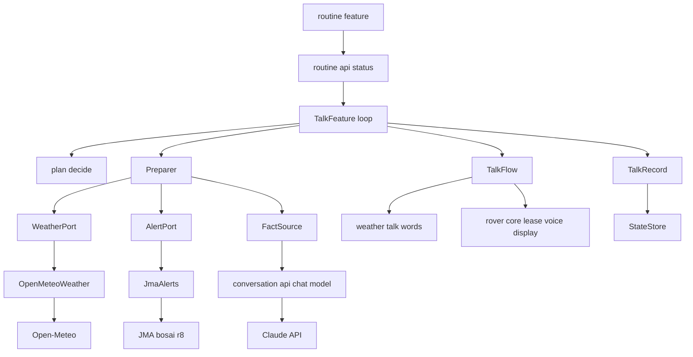
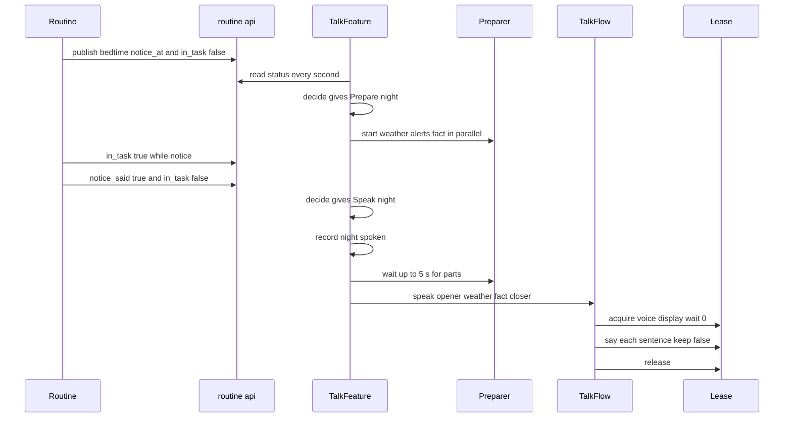
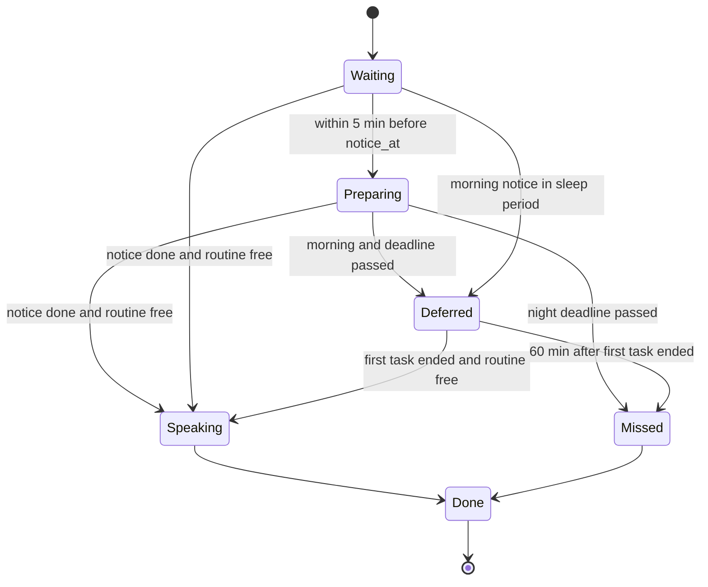

# Design Document: morning-night-talk（朝と夜のお話）

## Overview
朝と夜のお話は、日課の予告に続けて、天気と、子どもの好きなものの短い豆知識を声で話す機能です。夜は寝るタスクの予告の後に、あしたの天気を話します。朝は、その日の最初の時刻のタスクの予告の後に、今日の天気を話します。予告がおやすみモードの間に当たるときは、最初のタスクが終わってから話します。

利用者は 4 歳前後の子どもと保護者です。保護者が、現在地・好きなもの・夜と朝のどちらを使うかを設定します。天気は Open-Meteo（天気・気温・降水確率）と気象庁の防災情報（注意報・警報）から取ります。豆知識は、おしゃべりと同じ Claude のアダプタで作ります。呼び名は外へ送りません。現在地も、丸めた座標と市区町村のコードだけを天気の問い合わせに使います。

`rover-core` の機能を足す口に `talk` として登録します。基盤は書き換えません。日課とおしゃべりには、名前や言葉を出さない小さな公開の口（`api.py`）を足します。

### Goals
- 日課の予告に続けて、5 秒以内にお話を始める。天気と豆知識は前もって用意しておく
- 日課の声かけを遅らせない。おやすみモード中は話さない。ほかの機能が声を使っている間は待つ
- 夜と朝のお話は、それぞれ 1 日に 1 回。再起動しても繰り返さない
- 天気・豆知識・鍵のどれが使えなくても、話せる部分だけを話す。ロボット全体は止まらない
- 時刻の判定・お話の組み立て・失敗のときの扱いを、偽の時計・偽の天気・偽の会話の AI で CI で確かめる

### Non-Goals
- 声で頼まれたときに天気を答えること（`voice-gateway` の語句として、後で足す）
- 子どもがそばにいるかを確かめること（`presence`）
- 日課の予告・声かけ・おやすみモードの振る舞いを変えること
- 待機画面に天気を出し続けること、複数の場所、ニュース

## Boundary Commitments

### This Spec Owns
- 機能 `talk`（`features/talk/`）: 話す時の判定、前もっての用意、お話の流れ、1 日 1 回の記録、試しのお話のコマンド、self-check の項目 `talk.setup` と `talk.weather`
- 天気の組み立て: 天気の種類の分け方、気温・傘・上着・水・注意報や警報の言い方、LCD の天気の表示
- 天気のアダプタ: Open-Meteo の予報と、気象庁の `warning/data/r8` の注意報・警報。どちらも標準ライブラリの `urllib` で取る
- 豆知識の頼み方（system の文・送る言葉）と、好きなものの選び方
- 設定の節 `talk:`、手順書 `docs/talk.md`、README の出典の表記（Open-Meteo の CC BY 4.0、気象庁の出典）
- 日課の公開の口に足す型と値（`TaskMoment`、`RoutineStatus.wake_at`・`bedtime`・`first_task`）。計算は日課の中の `Scheduler` に足す
- おしゃべりの公開の口 `features/conversation/api.py`（会話の AI のポートと結果の型、Claude のアダプタを作る関数、鍵の確かめ、返事の整え、子ども向けの決まりの文）

### Out of Boundary
- 日課の予告・タスク・おやすみモードの振る舞い（`daily-routine`）。日課は、足した値を出すだけで、お話を知らない
- おしゃべりの返事の流れ・門・回数（`conversation`）。会話の決まりの文（`SYSTEM_PROMPT`）の中身は変えない
- 声の合成と再生、LCD、資源の調停、静かな状態、時計、保存の仕組み（`rover-core`）
- 鍵のファイルを作ること（`device-deployment` の初期設定の案内と人）

### Allowed Dependencies
- `osekkai.core`: `feature`（`FeatureSpec`・`FeatureContext`）、`config.FeatureConfig`、`types`（`Priority`・`Resource`・`Face`・`ResourceBusy`・`LeaseRevoked`・`SpeechFailed`・`DeviceUnavailable`）、`arbiter.Lease`、`storage.StateStore`、`clock.Clock`、`paths.Paths`、`lcd_text.center`、`selfcheck`
- `osekkai.features.routine.api`（`current_status`・`RoutineStatus`・`TaskMoment`）
- `osekkai.features.conversation.api`（下の Components で決める名前だけ）
- `osekkai.adapters.fake.console.typed_input_active`（PC で偽の天気と偽の豆知識を選ぶときだけ。`talk.feature` だけ）
- `osekkai.__main__`（試しのコマンド `talk.trial` だけ。日課の試しと同じ）
- 標準ライブラリの `urllib.request`・`json`: `features/talk/adapters/` の中だけ
- 依存の向き: `config`・`texts`・`model` → `weather_talk`・`plan`・`topics`・`record` → `prepare`・`flow` → `feature`・`trial`。`adapters/*` は `model` だけを読む。`checks` は `config`・`adapters`・`conversation.api` だけを読む

### Revalidation Triggers
- `RoutineStatus` の新しい項目の意味（特に `notice_said` と `ended_at`）や、日課の 1 秒ごとの更新の間隔が変わる
- 日課の設定の検証（寝るタスクは起床時刻より後の同じ日）が変わる。寝るタスクが 0 時を越えられるようになると、夜のお話の日付の判定が変わる
- `conversation.api` の名前や、`ChatModelPort.reply` の結果の型が変わる。Claude のモデルや effort の決まりが変わる
- 優先度の帯、または `BACKGROUND` より下の機能が増える
- Open-Meteo の利用条件・応答の形、気象庁の `r8` の JSON の形や URL が変わる（2026-05-28 に旧い URL が止まった前例がある）

## Architecture

### Existing Architecture Analysis
- 機能は `features/<name>/` に置き、`FeatureSpec` で名前・優先度・資源・設定のモデル・self-check を申告する。entry point `osekkai.features` で登録する
- 日課の公開の口は、今は `RoutineStatus(next_task_at, in_task, asleep, updated_at)` だけ。だるまさんがこれを読む前例がある
- ほかの機能を使うときは、その機能の `api.py` だけを読む（`tests/features/test_features_import_direction.py` で縛っている）。おしゃべりには `api.py` がまだない
- 外へ問い合わせる HTTP の道具は、まだどこにもない
- 試しのコマンドは、日課と同じく別のプロセスで動かす。単一起動のロック（`InstanceLock`）を取れなければ、機器に触らずに終わる

### Architecture Pattern & Boundary Map



- **Pattern**: ポートとアダプタ。話す時の判定（`plan.decide`）と言葉の組み立て（`weather_talk`）は純粋な関数にし、時計と日課の状況と記録を引数で受ける
- **New components rationale**: 天気・注意報・豆知識を別々のポートにし、1 つが失敗しても残りで話せるようにする（5.9、5.10、6.7）。用意（`Preparer`）を話す流れから分け、話し始めを待たせない（7.4）

### Technology Stack

| Layer | Choice / Version | Role in Feature | Notes |
|-------|------------------|-----------------|-------|
| 天気の予報 | Open-Meteo Forecast API `/v1/forecast`（鍵なし） | 日ごとの天気のコード・最高と最低の気温・降水確率 | `models` を渡さない（`jma_seamless` では降水確率が null）。非商用で無料、1 日 1 万回まで、CC BY 4.0 |
| 注意報・警報 | 気象庁 `https://www.jma.go.jp/bosai/warning/data/r8/{office}.json` | 市区町村の今の注意報・警報 | 公式の API ではない。2026-05-29 からの新しい形。旧い `warning/data/warning/` は 2026-05-28 から止まっている |
| HTTP | 標準ライブラリの `urllib.request` | 2 つの GET | 新しい依存はない。時間切れを必ず付ける |
| 豆知識 | `conversation.api` の Claude のアダプタ（`anthropic>=2.6,<3`、`claude-opus-5-5`、effort low） | 2 文・120 文字までの豆知識 | 依存はおしゃべりの extras のまま。呼び方はおしゃべりの設計で確かめた決まりに従う |
| 保存 | `StateStore`（基盤） | 1 日 1 回の記録と、直前の好きなもの | JSON、原子的に書く |
| 設定 | pydantic v2（`FeatureConfig`） | 節 `talk:` | `enabled` の既定は False（ラジコンと同じ） |

## File Structure Plan

### Directory Structure
```
src/osekkai/features/talk/
├── __init__.py          # TalkFeature を公開する（エントリーポイントの先）
├── __main__.py          # python -m osekkai.features.talk → trial.main
├── config.py            # TalkConfig、Location、WarningArea（1.1〜1.8）
├── model.py             # TalkKind、Condition、DayForecast、AlertKind、AlertsResult、WeatherResult、FactResult、Prepared
├── texts.py             # 決まった言葉（始まり・終わり・代わり）、天気の言い方の部品、LCD の文字、豆知識の system の文
├── weather_talk.py      # 天気の言葉と LCD の表示を組み立てる（5.1〜5.8）
├── topics.py            # 好きなものの選び方と、豆知識の頼み方（6.1〜6.6、9.3）
├── plan.py              # decide: 今、何をするか（2.x、3.x、4.1、8.5）
├── record.py            # TalkRecord（1 日 1 回、直前の好きなもの。読めなければ話した扱い）と NullTalkRecord
├── prepare.py           # Preparer: 天気・注意報・豆知識を並べて取り、締め切りで止める（7.4、7.5、10.2）
├── flow.py              # TalkFlow: 資源を借りて、文ごとに話し、中断と静かな状態を見る（7.x、8.1〜8.3、8.6）
├── feature.py           # TalkFeature: 登録、1 秒ごとの判定、用意と話すの起動、例外の囲い（10.3）
├── trial.py             # 試しのお話のコマンド（11.3〜11.5）
├── checks.py            # self-check の talk.setup・talk.weather（1.7、10.4、11.1、11.2）
└── adapters/
    ├── __init__.py
    ├── open_meteo.py    # OpenMeteoWeather（urllib、座標を 0.1 度に丸める）
    ├── jma_alerts.py    # JmaAlerts（urllib、r8 の形を読み、古い報は使わない）
    └── canned.py        # CannedWeather・CannedFacts（PC で偽の天気と豆知識）

src/osekkai/features/conversation/api.py   # 新しい公開の口（下の ConversationApi）

tests/features/talk/
├── talk_fakes.py                     # 偽の天気・偽の注意報・偽の会話の AI・状況の作り方
├── fixtures/                         # Open-Meteo と気象庁 r8 の応答の見本（公開のデータ。実機で取り直す）
├── test_talk_config.py
├── test_talk_weather_talk.py
├── test_talk_topics.py
├── test_talk_plan.py
├── test_talk_record.py
├── test_talk_prepare.py
├── test_talk_flow.py
├── test_talk_feature.py
├── test_talk_open_meteo.py
├── test_talk_jma_alerts.py
├── test_talk_checks.py
├── test_talk_trial.py
├── test_talk_registration.py
├── test_talk_import_direction.py
└── test_talk_journey.py              # 偽の時計で 1 日を進め、夜と朝のお話・再起動・失敗を通す

tests/features/conversation/test_conversation_api.py
docs/talk.md                          # 設定の書き方、地域のコードの調べ方、出典、データの扱い、実機確認
```

### Modified Files
- `src/osekkai/features/routine/api.py` — `TaskMoment` を足し、`RoutineStatus` に `wake_at`・`bedtime`・`first_task` を足す（既定は None。だるまさんはそのまま動く）
- `src/osekkai/features/routine/schedule.py` — `Scheduler.moments(now, records) -> DayMoments` を足す（今日の起床時刻、寝るタスク、朝の最初のタスク）
- `src/osekkai/features/routine/feature.py` — `_publish` で `moments` の値も出す（時刻が確かなときだけ）
- `tests/features/routine/test_routine_schedule.py`・`test_routine_feature.py` — 足した値の確かめ
- `src/osekkai/features/conversation/texts.py` — 子ども向けの決まりの部分を `KID_RULES` として取り出し、`SYSTEM_PROMPT` はそれを含めて**今と 1 文字も変わらない**文にする
- `src/osekkai/features/conversation/feature.py` — `choose_chat_model` の中の Claude を作る部分を `api.claude_chat_model` から呼ぶ（振る舞いは変えない）
- `pyproject.toml` — エントリーポイント `talk = "osekkai.features.talk:TalkFeature"`
- `config/osekkai.example.yaml`、`src/osekkai/core/example_config.yaml` — 節 `talk:`（`enabled: false`）を `remote:` の後、`routine` の節の前に足す。2 つは同じ内容
- `tests/test_cli_selfcheck.py` — `talk.setup`・`talk.weather` を名前の順で `ALL_NAMES` に足す
- `tests/features/test_features_import_direction.py` — `ENTRY_ALLOWLIST` に `osekkai.features.talk.trial`・`osekkai.features.talk.__main__`、`ADAPTER_ALLOWLIST` の `console` に `osekkai.features.talk.feature`
- `README.md` — 第三者の表記に Open-Meteo（CC BY 4.0）と気象庁（公共データ利用規約、出典の記載）を足す

## System Flows

### 夜のお話（予告に続けて）


- 借りられない（`ResourceBusy`）ときは、記録を付けずに 1 秒後に判定し直す。締め切り（寝るタスクの時刻）を過ぎたら「話さない」で記録する（2.4、8.4）
- 記録は、資源を借りた直後、最初の文を話す前に付ける。途中で中断しても、その回は話した扱い（4.4）

### 話す時の判定（`plan.decide`）


## Requirements Traceability

| Requirement | Summary | Components | Interfaces | Flows |
|-------------|---------|------------|------------|-------|
| 1.1 | 設定から読む | TalkConfig | 節 `talk:` | — |
| 1.2 | 既定は使わない | TalkConfig、基盤の登録 | `enabled: bool = False` | — |
| 1.3 | 一方だけ使う | TalkConfig, plan | `night`・`morning` | 判定 |
| 1.4 | 書き方の誤りは開始しない | TalkConfig、基盤 | pydantic の検証 | — |
| 1.5 | 現在地なしなら豆知識だけ | Preparer, TalkFlow | `WeatherResult.unavailable` | — |
| 1.6 | 好きなものなしなら天気だけ | Preparer, topics | `FactResult.unavailable` | — |
| 1.7 | 両方なしなら話さず self-check | TalkFeature, checks | `talk.setup` | — |
| 1.8 | 値をログに出さない | 全部品、checks | 固定の文言 | — |
| 2.1 | 予告を言い終えたら続けて | plan | `TaskMoment.notice_said`、`in_task` | 夜のお話 |
| 2.2 | 予告の言葉がなければ予告の時刻に | plan | `TaskMoment.has_notice`・`notice_at` | 判定 |
| 2.3 | 日課の最中は待つ | plan | `RoutineStatus.in_task` | 判定 |
| 2.4 | 寝るタスクの時刻まで | plan, TalkRecord | `Decision.Miss` | 判定 |
| 2.5 | 寝るタスク後・おやすみは話さない | plan | `RoutineStatus.asleep`、`bedtime.start` | 判定 |
| 2.6 | 寝るタスクがない日 | plan | `bedtime is None` | — |
| 3.1 | 予告に続けて朝のお話 | plan | `first_task`、`wake_at` | 判定 |
| 3.2 | 予告の言葉がなければ予告の時刻に | plan | `has_notice` | 判定 |
| 3.3 | おやすみ中の予告なら最初のタスクの後 | plan | `notice_at < wake_at`、`ended_at` | 判定 |
| 3.4 | 日課の最中は待つ | plan | `in_task` | 判定 |
| 3.5 | 間に合わなければタスクの後 | plan | `now >= first_task.start` → Deferred | 判定 |
| 3.6 | 終わって 60 分で諦める | plan | `ended_at + 60 min` | 判定 |
| 3.7 | 時刻のタスクがない日 | plan | `first_task is None` | — |
| 3.8 | 起床時刻に声を出さない | plan | 起床そのものは判定の契機にしない | — |
| 4.1 | それぞれ 1 日 1 回 | TalkRecord, plan | `TalkRecord.done(day, kind)` | — |
| 4.2 | 再起動しても繰り返さない | TalkRecord | `talk/record.json` | — |
| 4.3 | 読めなければ話した扱い | TalkRecord | `blocked` | — |
| 4.4 | 中断しても話した扱い | TalkFeature, TalkRecord | 話す前に記録 | 夜のお話 |
| 5.1 | 夜はあしたの天気 | Preparer, weather_talk | `target_day = today + 1` | — |
| 5.2 | 朝は今日の天気 | Preparer, weather_talk | `target_day = today` | — |
| 5.3 | 天気と最高・最低の気温 | weather_talk | `weather_sentences` | — |
| 5.4 | 降水確率で傘 | weather_talk | `rain_percent` | — |
| 5.5 | 寒ければ上着 | weather_talk | `cold_below` | — |
| 5.6 | 暑ければ水 | weather_talk | `hot_at_or_above` | — |
| 5.7 | 注意報・警報をやさしく | weather_talk, JmaAlerts | `AlertKind` | — |
| 5.8 | ロボットの中の言い方で組み立て | weather_talk, texts | 部品の文 | — |
| 5.9 | LCD に天気 | weather_talk, TalkFlow | `lcd_line` | — |
| 5.10 | 取れない・古いなら豆知識だけ | OpenMeteoWeather, Preparer | 対象の日の有無の確かめ | — |
| 5.11 | 注意報だけ取れなければ触れない | JmaAlerts, Preparer | `AlertsResult.unavailable` | — |
| 6.1 | 1 つ選んで豆知識 | topics | `choose_topic` | — |
| 6.2 | 直前と同じを続けない | topics, TalkRecord | `last_topic` | — |
| 6.3 | 4 歳向け、2 文以内、本当のこと | topics, texts | `fact_system(kind)` | — |
| 6.4 | 会話と同じ子ども向けの決まり | texts, ConversationApi | `KID_RULES` | — |
| 6.5 | 夜は落ち着いた豆知識 | topics | `fact_request(kind)` | — |
| 6.6 | 120 文字、絵文字や記号なし | ConversationApi | `shape_reply` | — |
| 6.7 | 作れなければ天気だけ | Preparer | `FactResult.unavailable` | — |
| 6.8 | 豆知識を残さない | TalkFlow, Preparer | `say(keep=False)`、用意を捨てる | — |
| 7.1 | 始まり・天気・豆知識・終わりの順 | TalkFlow, texts | `compose_lines` | 夜のお話 |
| 7.2 | 呼び名の差し込み | texts | `fill_name` | — |
| 7.3 | おおむね 60 秒以内 | weather_talk, ConversationApi, texts | 文の数と長さの上限 | — |
| 7.4 | 5 秒以内に話し始める | Preparer, plan | 5 分前の用意、`wait(5 s)` | 夜のお話 |
| 7.5 | 用意できた部分だけ | TalkFlow | `compose_lines` | — |
| 7.6 | どちらもなければ決まった短い言葉 | TalkFlow, texts | `SAY_FALLBACK_*` | — |
| 7.7 | 話す間の LCD | TalkFlow | `display.show` | — |
| 7.8 | 終えたら返して待機画面 | TalkFlow | `lease.release` | — |
| 8.1 | 日課が求めたら文の切れ目でやめる | TalkFlow | `on_preempt`、`LeaseRevoked` | — |
| 8.2 | おやすみの間は声も画面も出さない | plan, TalkFlow | `ctx.is_quiet` | — |
| 8.3 | 途中で静かになったらやめる | TalkFlow | `ctx.is_quiet` を文ごとに | — |
| 8.4 | ほかの機能が使っていれば待つ | TalkFeature, TalkFlow | 優先度 `BACKGROUND+5`、`ResourceBusy` | 判定 |
| 8.5 | 時刻が確かでなければ始めない | plan | `clock.is_synchronized()`、`moments` が None | — |
| 8.6 | モーターを動かさない | TalkFeature | 資源は VOICE・DISPLAY だけ | — |
| 8.7 | おしゃべりの上限に数えない | TalkFeature | おしゃべりの記録を使わない | — |
| 9.1 | 呼び名を送らない | topics, texts, TalkConfig | 呼び名は始まりと終わりの言葉だけに入る | — |
| 9.2 | 現在地を丸めて送る | OpenMeteoWeather, WarningArea | 0.1 度に丸める、市区町村のコード | — |
| 9.3 | 会話の AI に送るもの | topics | `fact_request` | — |
| 9.4 | 現在地・天気・豆知識をログに出さない | 全部品 | 固定の文言・種類だけ | — |
| 9.5 | 鍵は会話と同じ置き場所 | ConversationApi | `claude_chat_model`・`setup_problem` | — |
| 10.1 | つながらなくても止まらない | Preparer, adapters | 結果の型で返し、例外を出さない | — |
| 10.2 | 20 秒で問い合わせをやめる | adapters, Preparer | `fetch_timeout_seconds` | — |
| 10.3 | 思いがけない失敗はこの機能だけ止める | TalkFeature | 例外の囲い、`lease.release` | — |
| 10.4 | 鍵がなければ天気だけ、self-check | Preparer, checks | `setup_problem` | — |
| 11.1 | self-check の項目 | checks | `talk.setup`、`talk.weather` | — |
| 11.2 | 値を出さない | checks | 固定の理由 | — |
| 11.3 | 試しのお話 | trial | `--try night｜morning` | — |
| 11.4 | 試しは記録を変えない | trial | `NullTalkRecord` | — |
| 11.5 | おやすみ中は試しも話さない | trial | `ctx.is_quiet` と `ctx.was_quiet_before_restart`（試しは別のプロセスなので、保存した静かな状態も見る） | — |
| 12.1 | 偽物に差し替えて PC で | ports, adapters.canned | `WeatherPort`・`AlertPort`・`ChatModelPort` | — |
| 12.2 | 偽物なら外へ問い合わせない | adapters.canned, TalkFeature | `typed_input_active` | — |
| 12.3 | CI で確かめる | tests | 下の Testing Strategy | — |

## Components and Interfaces

| Component | Domain | Intent | Req Coverage | Key Dependencies | Contracts |
|-----------|--------|--------|--------------|------------------|-----------|
| RoutineApi の追加 | 日課（変更） | 今日の起床時刻・寝るタスク・朝の最初のタスクの時刻と状態 | 2.x, 3.x | Scheduler (P0) | State |
| ConversationApi | おしゃべり（新しい口） | 会話の AI の口と子ども向けの決まり | 6.3, 6.4, 6.6, 9.5, 10.4 | conversation の中 (P0) | Service |
| TalkConfig | 設定 | 節 `talk:` | 1.x, 5.4–5.6, 9.2, 10.2 | FeatureConfig (P0) | State |
| model | 型 | 天気・注意報・豆知識・用意の型 | 5.x, 6.x | — | State |
| weather_talk | 判定 | 天気の言葉と LCD | 5.1–5.9, 7.3 | texts (P1) | Service |
| topics | 判定 | 好きなものの選び方と頼み方 | 6.1–6.5, 9.1, 9.3 | texts (P1) | Service |
| plan | 判定 | 今、何をするか | 1.3, 2.x, 3.x, 4.1, 8.2, 8.5 | RoutineStatus (P0) | Service |
| TalkRecord | 記録 | 1 日 1 回と直前の好きなもの | 4.x, 6.2 | StateStore (P0) | State |
| Preparer | 流れ | 前もって並べて取る | 1.5, 1.6, 5.10, 5.11, 6.7, 7.4, 7.5, 10.1, 10.2 | ports (P0) | Service |
| TalkFlow | 流れ | 資源を借りて話す | 7.x, 8.1–8.3 | Lease (P0) | Service |
| TalkFeature | 機能 | 登録・1 秒ごとの判定・起動 | 1.7, 4.4, 8.4, 8.6, 8.7, 10.3, 12.2 | FeatureContext (P0), routine.api (P0) | Service |
| OpenMeteoWeather | アダプタ | 日ごとの予報 | 5.1–5.4, 5.10, 9.2, 10.2 | Open-Meteo (External, P0) | Service |
| JmaAlerts | アダプタ | 今の注意報・警報 | 5.7, 5.11, 10.2 | 気象庁 r8 (External, P1) | Service |
| CannedWeather / CannedFacts | アダプタ | PC の偽物 | 12.1, 12.2 | — | Service |
| trial | 入口 | 試しのお話 | 11.3–11.5 | osekkai.__main__ (P1) | Batch |
| checks | self-check | 設定・鍵・天気のつながり | 1.7, 10.4, 11.1, 11.2 | ConversationApi (P1) | Service |

### 日課（変更）

#### RoutineApi の追加

| Field | Detail |
|-------|--------|
| Intent | お話の判定に要る、今日の時刻と状態を、名前と言葉を出さずに公開する |
| Requirements | 2.1–2.6, 3.1–3.7 |

**Responsibilities & Constraints**
- 値は時刻と真偽値だけ。タスクの識別子・言葉・呼び名を入れない（今の `api.py` の決まり）
- 今日（`now` の日付）の値だけを出す。時刻が確かでないときは、3 つとも None
- 日課は、この値を誰が使うかを知らない

**Contracts**: State ☑

```python
@dataclass(frozen=True)
class TaskMoment:
    start: datetime            # タスクの時刻（今日）
    notice_at: datetime        # start - notice_min
    has_notice: bool           # 予告の言葉があるか
    notice_said: bool          # 今日、予告を言い終えたか（記録の notice_said）
    ended_at: datetime | None  # 今日の結果が付いた時刻（なければ None）

@dataclass(frozen=True)
class RoutineStatus:
    next_task_at: datetime | None
    in_task: bool
    asleep: bool
    updated_at: datetime
    wake_at: datetime | None = None         # 今日の起床時刻
    bedtime: TaskMoment | None = None       # 今日の寝るタスク（その種類の日になければ None）
    first_task: TaskMoment | None = None    # 今日の、寝るタスクを除く最も早い時刻のタスク
```

- `Scheduler.moments(now: datetime, records: DayRecordView) -> DayMoments` を足し、`_publish` が `RoutineStatus` に詰める。`first_task` は、起床時刻より前で始めないタスクを除く（`_before_wake` と同じ判定）
- `ended_at` は `records.ended_at(today, id)`、`notice_said` は `records.notice_said(today, id)` から取る
- 1 秒ごとの tick と、タスクと予告の始まりで出す（今と同じ時）。予告を言い終えた直後の tick で `notice_said` が真になる

### おしゃべり（新しい口）

#### ConversationApi（`features/conversation/api.py`）

| Field | Detail |
|-------|--------|
| Intent | ほかの機能が、会話の AI と子ども向けの決まりを、おしゃべりの中を読まずに使える口 |
| Requirements | 6.3, 6.4, 6.6, 9.5, 10.4 |

**Contracts**: Service ☑

```python
# 中のモジュールから選んで出すだけ。新しい振る舞いは足さない
from osekkai.features.conversation.ports import ChatModelPort, ChatResult, Failed, FailureKind, Refused, Replied, Turn
from osekkai.features.conversation.privacy import shape_reply          # 記号を除き、2 文・120 文字まで
from osekkai.features.conversation.texts import KID_RULES              # 子ども向けの決まりの文
from osekkai.features.conversation.envfile import SetupProblem

def setup_problem(paths: Paths) -> SetupProblem | None: ...            # 鍵が使えるか。値は返さない
def library_available() -> bool: ...                                    # anthropic が入っているか
def claude_chat_model(paths: Paths) -> ChatModelPort | None: ...       # 鍵とライブラリがあれば Claude のアダプタ
```

- `KID_RULES` は、今の `SYSTEM_PROMPT` の中の決まりの部分（怖い話をしない、うそをつかない、個人のことを聞かない、危ないことは家の人へ、など）。`SYSTEM_PROMPT` は `KID_RULES` を含めて組み立て、今の文と 1 文字も変わらないことをテストで縛る
- 鍵の値は、この口からも外へ出ない。`claude_chat_model` の中でアダプタに渡すだけ

### 判定と記録

#### TalkConfig

**Contracts**: State ☑

```python
class Location(BaseModel):
    latitude: float = Field(ge=-90, le=90)
    longitude: float = Field(ge=-180, le=180)

class WarningArea(BaseModel):
    office: str = Field(pattern=r"^[0-9]{6}$")    # 気象庁の府県予報区のコード（例: 130000）
    city: str = Field(pattern=r"^[0-9]{7}$")      # 市区町村のコード（area.json の class20s。例: 1311300）

class TalkConfig(FeatureConfig):
    enabled: bool = False
    call_name: str = ""                         # 始まりと終わりの言葉の {name}。外へ送らない
    night: bool = True
    morning: bool = True
    location: Location | None = None
    warning_area: WarningArea | None = None
    topics: list[Annotated[str, StringConstraints(strip_whitespace=True, min_length=1, max_length=20)]] = Field(default_factory=list, max_length=20)
    rain_percent: int = Field(default=50, ge=1, le=100)
    cold_below: int = Field(default=10, ge=-20, le=30)
    hot_at_or_above: int = Field(default=30, ge=20, le=45)
    fetch_timeout_seconds: float = Field(default=20.0, ge=5.0, le=60.0)
```

- 好きなものに `call_name` が含まれるときは設定の誤りにする（9.1 の守り。誤って名前を書いても外へ出ない）
- 誤りは pydantic の検証で、基盤の設定の誤りの表示に任せる（1.4）。メッセージに値を入れない

#### weather_talk

**Contracts**: Service ☑

```python
class Condition(Enum): SUNNY, CLOUDY, RAIN, SNOW, THUNDER, UNKNOWN

@dataclass(frozen=True)
class DayForecast:
    day: date
    condition: Condition
    t_max: int              # 四捨五入した度
    t_min: int
    rain_percent: int | None  # 降水確率の最大。null なら None

class AlertKind(Enum): HEAVY_RAIN, HEAVY_SNOW, STRONG_WIND, THUNDER, ROUGH_SEA

def weather_sentences(kind: TalkKind, forecast: DayForecast, alerts: frozenset[AlertKind] | None, config: TalkConfig) -> list[str]: ...
def lcd_line(kind: TalkKind, forecast: DayForecast) -> str: ...   # 例「ｱｼﾀ ﾊﾚ 18/9」、16 文字まで
```

- 文の順: 天気 → 気温（「いちばん あつい ときは 18ど、いちばん さむい ときは 9ど だよ」）→ 傘 → 上着 → 水 → 注意報・警報。最大 6 文
- 傘: `rain_percent >= config.rain_percent`。降水確率が None のときは、天気が RAIN・SNOW・THUNDER なら勧める
- UNKNOWN の天気は天気の文を省き、気温から話す
- 注意報・警報: 種類を「あめが たくさん」「かぜが つよく」のように並べ、「なる かも しれないよ。おうちの ひとと いっしょに きを つけようね」で結ぶ。「きけん」「さいがい」などの怖い言葉は使わない
- 夜は「あしたは」、朝は「きょうは」で始める
- WMO のコードの分け方: 0・1 → SUNNY、2・3・45・48 → CLOUDY、51〜67・80〜82 → RAIN、71〜77・85・86 → SNOW、95〜99 → THUNDER、それ以外 → UNKNOWN

#### topics

```python
def choose_topic(topics: Sequence[str], last_hash: str | None, rng: Random) -> str | None: ...
def topic_hash(topic: str) -> str: ...                    # sha256 の先頭 16 文字。記録に好きなものの文字を残さない
def fact_request(kind: TalkKind, topic: str, today: date) -> tuple[str, list[Turn]]: ...
```

- `choose_topic`: 2 つ以上あれば、`last_hash` と同じものを除いて乱数で選ぶ（6.2）。空なら None
- `fact_request` が送るのは、system に `KID_RULES` と豆知識の決まり（4 歳向け、2 文以内、よく知られた本当のことだけ、記号なし、夜なら落ち着いた話）、user に「すきな もの: {topic}」「よる｜あさ」「{月}がつ、{季節}」だけ（9.3）。呼び名・現在地・天気は入れない
- 季節は月から: 3〜5 春、6〜8 夏、9〜11 秋、12〜2 冬

#### plan

```python
class TalkKind(Enum): NIGHT, MORNING

@dataclass(frozen=True)
class Idle: ...
@dataclass(frozen=True)
class Prepare: kind: TalkKind; weather_day: date
@dataclass(frozen=True)
class Speak: kind: TalkKind; weather_day: date
@dataclass(frozen=True)
class Miss: kind: TalkKind
Decision = Idle | Prepare | Speak | Miss

def decide(now: datetime, synced: bool, quiet: bool, status: RoutineStatus | None,
           done: Callable[[TalkKind], bool], config: TalkConfig) -> list[Decision]: ...
```

- 夜と朝を別々に判定し、それぞれ多くても 1 つの Decision を返す。使わないと設定した方、記録で済んだ方は Idle
- 共通: `synced` が偽、`status` が None（日課が動いていない）、`quiet` が真なら、すべて Idle（8.2、8.5）
- **夜**（`b = status.bedtime`）:
  - `b` が None、または `status.asleep` → Idle（2.5、2.6）
  - `now >= b.start` → Miss（2.4、2.5）
  - `ready = now >= b.notice_at and (not b.has_notice or b.notice_said)`。`ready` かつ `not status.in_task` → Speak（2.1〜2.3）
  - `now >= b.notice_at - PREPARE_LEAD`（5 分）→ Prepare。それより前は Idle
  - 天気の日は `now.date() + 1`
- **朝**（`f = status.first_task`、`w = status.wake_at`）:
  - `f` が None または `status.asleep` → Idle（3.7、3.8）
  - 予告の道: `w is None or f.notice_at >= w`、かつ `now < f.start`。夜と同じ規則で Speak・Prepare・Idle（3.1、3.2、3.4）
  - 後の道: 予告の道でないとき（`f.notice_at < w`、または `now >= f.start`）。`f.ended_at` が None なら、`now >= f.start - PREPARE_LEAD` で Prepare（3.3、3.5）。`ended_at` があり、`now >= ended_at + 60 分` なら Miss（3.6）。それ以外で `not in_task` なら Speak
  - 天気の日は `now.date()`
- 起床時刻そのものは判定の契機にしない（3.8）

#### TalkRecord

**Contracts**: State ☑

- 保存先: `StateStore` の `record`（`<state_dir>/talk/record.json`）。`{"version": 1, "days": {"YYYY-MM-DD": {"night": "spoken"|"missed", "morning": ...}}, "last_topic": "<hash16>"|null}`。7 日より古い日は書くときに消す
- `done(day, kind) -> bool`、`mark(day, kind, outcome)`（話す前に呼ぶ。書けなければ `OSError` を上げ、呼んだ側は話さない）、`last_topic`・`set_last_topic(hash)`
- 読めない・形が違うときは `blocked` になり、その日は夜も朝も済んだ扱い（4.3）。次の日付から、新しい記録で始める
- `NullTalkRecord`（試し用）: 何も済んでおらず、書いても捨てる（11.4）

### 流れ

#### Preparer

| Field | Detail |
|-------|--------|
| Intent | 天気・注意報・豆知識を、話す前に並べて取っておく |
| Requirements | 1.5, 1.6, 5.10, 5.11, 6.7, 7.4, 7.5, 10.1, 10.2, 10.4 |

**Contracts**: Service ☑

```python
class WeatherPort(Protocol):
    def daily(self, day: date, timeout_s: float) -> DayForecast | WeatherUnavailable: ...
class AlertPort(Protocol):
    def active(self, timeout_s: float) -> frozenset[AlertKind] | AlertsUnavailable: ...
class FactSource(Protocol):  # 本物は ChatFactSource（ChatModelPort と topics.fact_request と shape_reply を包む）
    def fact(self, kind: TalkKind, topic: str, today: date, timeout_s: float) -> str | FactUnavailable: ...

@dataclass(frozen=True)
class Prepared:
    kind: TalkKind
    weather_day: date
    forecast: DayForecast | None
    alerts: frozenset[AlertKind] | None
    fact: str | None
    topic_hash: str | None

class Preparer:
    def start(self, kind: TalkKind, weather_day: date, today: date) -> None: ...  # 同じ種類と日なら何もしない
    def take(self, kind: TalkKind, weather_day: date, wait_s: float) -> Prepared: ...  # 最大 wait_s 待って、そろった分を返し、中身を手放す
    def discard(self) -> None: ...
```

- 3 つを別々のデーモンのスレッドで取る。各問い合わせは `fetch_timeout_seconds` で切る（10.2）。どれも例外を外へ出さない（10.1）
- 現在地がなければ天気と注意報を取らない（1.5）。`warning_area` がなければ注意報を取らない（5.11）。好きなもの・鍵・ライブラリがなければ豆知識を取らない（1.6、10.4）
- `take` は、まだ始めていなければその場で始め、`wait_s = 5` 秒だけ待つ（7.4、7.5）。返した後は中身を捨てる（6.8）。日付が変わったら捨てる
- 豆知識の空の返事（`shape_reply` で空）、`Refused`、`Failed` は、どれも豆知識なしにする（6.7）
- 好きなものは `Preparer.start` が `topics.choose_topic(config.topics, record.last_topic, rng)` で選び、`FactSource.fact` に渡す。豆知識が取れたら `Prepared.topic_hash = topic_hash(topic)`、取れなければ None
- ポートの型（`WeatherPort`・`AlertPort`・`FactSource`）と、取れなかった結果（`WeatherUnavailable`・`AlertsUnavailable`・`FactUnavailable`、それぞれ種類の Enum を持つ）は `model.py` に置く。アダプタは `model` だけを読む
- `ChatFactSource` は `prepare.py` に置く

#### TalkFlow

| Field | Detail |
|-------|--------|
| Intent | 資源を借りて、決まった順に文ごとに話す |
| Requirements | 7.1–7.3, 7.5–7.8, 8.1–8.3 |

```python
RESOURCES = frozenset({Resource.VOICE, Resource.DISPLAY})

def compose_lines(prepared: Prepared, config: TalkConfig) -> list[Line]: ...   # Line(text, lcd1, lcd2)
class TalkFlow:
    def speak(self, prepared: Prepared, on_started: Callable[[], None]) -> FlowOutcome: ...
```

- `compose_lines`: 始まり → 天気の文 → 豆知識 → 終わり（7.1）。天気も豆知識もなければ、`SAY_FALLBACK_NIGHT`・`SAY_FALLBACK_MORNING` の 1 文だけ（7.6）。`{name}` は呼び名、なければ「きみ」（7.2）
- LCD: 天気の文の間は `lcd_line` と `Face.NORMAL`、そのほかは「ｵﾊﾅｼ」と `Face.HAPPY`（7.7）。表示の前にバックライトを点ける
- `speak`: 静かな状態なら借りずに `QUIET` を返す。`acquire(RESOURCES, wait=0, on_preempt=preempted.set)`。`ResourceBusy` なら `BUSY` を返す（8.4）。借りたら `on_started()`（記録）を呼び、文ごとに `preempted`・`lease.preempt_requested`・`ctx.is_quiet` を確かめてから `voice.say(text, keep=False)`（8.1、8.3、6.8）。`LeaseRevoked`・`SpeechFailed`・`DeviceUnavailable` で止める。最後に必ず `release()`（7.8）
- `on_started` が `OSError` を上げたら、話さずに返して `RECORD_FAILED` を返す

#### TalkFeature

| Field | Detail |
|-------|--------|
| Intent | 登録と、1 秒ごとの判定から用意と話すを起動する |
| Requirements | 1.7, 4.4, 8.4, 8.6, 8.7, 10.3, 12.2 |

- `FeatureSpec(name="talk", priority=Priority.BACKGROUND + 5, resources=RESOURCES, config_model=TalkConfig, checks=TALK_CHECKS)`（`checks` は self-check の項目を作るまで空にしておく）
  - 優先度は `BACKGROUND + 5`（15）。おしゃべり・あそび・ラジコン・音声の入口・日課のどれが借りに来ても、こちらが譲る。こちらから借りるときは、`BACKGROUND` の見守り（あいさつ、10）より上なので、見守りの声だけを止めて話せる。ほかの機能が借りているときは `ResourceBusy` になり、次の秒に判定し直す（8.4）
  - DRIVE・NECK を申告しない（8.6）
- `run(stop)`: 1 秒ごとに `plan.decide(ctx.clock.now(), ctx.clock.is_synchronized(), ctx.is_quiet, routine.api.current_status(), record.done, config)`
  - `Prepare` → `preparer.start`
  - `Speak` → `prepared = preparer.take(..., 5.0)` → `flow.speak(prepared, on_started=record.mark(..., SPOKEN))`。`BUSY` なら次の秒へ。話したら好きなものの記録を更新する
  - `Miss` → `record.mark(..., MISSED)` と、用意を捨てる
- 現在地と好きなものの両方がないときは、判定をせずに待つだけにする（1.7。self-check で知らせる）
- 日課が動いていない（`current_status()` が None）ときは話さない。`talk.setup` は、設定の報告（`report.features["routine"]`、基盤の `FeatureConfig` の型としてだけ読む）で日課が無効のときに OK「日課がないので話さない」を出す（日課の `config` は読み込まない。読み込みの向きの決まりのため）
- 天気・注意報・豆知識の出どころは、`typed_input_active()`（PC で偽のハード）なら `CannedWeather`・`CannedFacts`、そうでなければ `OpenMeteoWeather`・`JmaAlerts`・`conversation.api.claude_chat_model`（12.2）
- 1 回の判定や話すで思いがけない例外が出たら、資源を返して種類だけを記録し、この機能だけを止める（10.3）
- おしゃべりの回数の記録を読まず、書かない（8.7）

### アダプタ

#### OpenMeteoWeather

| Field | Detail |
|-------|--------|
| Intent | 日ごとの予報を 1 回の GET で取る |
| Requirements | 5.1–5.4, 5.10, 9.2, 10.2 |

- GET `https://api.open-meteo.com/v1/forecast?latitude={lat:.1f}&longitude={lon:.1f}&daily=weather_code,temperature_2m_max,temperature_2m_min,precipitation_probability_max&timezone=Asia%2FTokyo&forecast_days=2`
- 座標は 0.1 度（約 10 km）に丸める（9.2）。`models` は渡さない
- `daily.time` に対象の日がなければ `WeatherUnavailable(STALE)`（5.10）。気温が null なら `WeatherUnavailable(INCOMPLETE)`。降水確率の null は None として通す
- HTTP の誤り・時間切れ・JSON の形の違いは `WeatherUnavailable(kind)`。応答の中身はログに出さない（9.4）

#### JmaAlerts

| Field | Detail |
|-------|--------|
| Intent | 市区町村の今の注意報・警報を取る |
| Requirements | 5.7, 5.11, 10.2 |

- GET `https://www.jma.go.jp/bosai/warning/data/r8/{office}.json`。応答は電文の種類ごとの報の配列で、全部をまとめて読む
- 各報の `warning.class20Items` から `areaCode == city` の `kinds` を集める。`status` が「解除」「発表警報・注意報はなし」のものは除く
- 報の `reportDatetime` が 24 時間より古ければ、その報は使わない（止まった URL が 200 を返し続けた前例のため）。全部が古ければ `AlertsUnavailable(STALE)`
- コードの対応（気象庁の 2026-05-29 からの体系）: 大雨 10・03・43・33 と土砂災害 29・09・49・39 → HEAVY_RAIN、大雪 12・06・36 → HEAVY_SNOW、強風・暴風・風雪・暴風雪 15・05・35・13・02・32 → STRONG_WIND、雷 14 → THUNDER、波浪・高潮 16・07・37・19・08・48・38 → ROUGH_SEA。それ以外（乾燥・濃霧・霜など）は話さない
- 氾濫の情報（別のデータ）は扱わない

#### CannedWeather / CannedFacts
- 決まった予報（はれ、18/9、降水確率 10%）と、決まった豆知識（好きなものの言葉を入れた 1 文）を返す。外へ問い合わせない（12.2）

### 入口と self-check

#### trial
- `python -m osekkai.features.talk --try night|morning [--fake-hardware] [--config PATH]`
- 日課の試しと同じく別のプロセスで動かす。単一起動のロックを取れなければ、機器に触らずに終了コード 75 で終わる
- `Runtime` に試し用の機能だけを登録し、`NullTalkRecord` を使う（11.4）。時刻と日課の状況を見ずに、その場で用意して話す（11.3）
- 静かな状態なら話さず、「おやすみモードなので はなしませんでした」と表示して 0 で終わる（11.5）

#### checks
- `talk.setup`（ハードなし、ネットワークなし）: 無効なら SKIPPED「無効」。設定が使えなければ SKIPPED。現在地と好きなものの両方がなければ OK「話すことがない」、片方なら OK「天気だけ」「豆知識だけ」、鍵やライブラリがなければ OK「鍵がないので天気だけ」（1.7、10.4）
- `talk.weather`（ネットワークあり、時間切れ 25 秒、`Check(..., hardware=True)`）: `--no-hardware`（CI）と、サービスが動いていてロックを取れないとき（配置の後の確かめ）は、基盤が動かさない。手で `--self-check` を実行したときだけ外へ問い合わせる。無効か現在地なしなら SKIPPED。予報を取れれば OK、取れなければ OK「天気を取れない」。注意報は「注意報を取れない」を足す
- どちらも FAILED にしない。ネットワークの都合で配置の確かめ（切り戻し）を起こさないため。理由は決まった文言だけで、値を出さない（11.2）

## Data Models

### Logical Data Model
- `talk/record.json`: 上の TalkRecord。日付ごとの `night`・`morning` の結果（`spoken`・`missed`）と、直前の好きなものの hash
- `Prepared`: メモリの中だけ。話し終えたら捨てる。豆知識の文字と天気はファイルに書かない
- 設定の節 `talk:`（見本）:

```yaml
talk:
  enabled: false
  call_name: ""                 # 始まりと終わりの言葉の呼び名。外には送らない。空なら「きみ」
  night: true                   # 寝るタスクの予告の後に話す
  morning: true                 # 朝の最初のタスクの予告の後（または、そのタスクの後）に話す
  # location: {latitude: 35.68, longitude: 139.69}   # 0.1 度に丸めて天気の問い合わせに使う
  # warning_area: {office: "130000", city: "1311300"} # 気象庁の地域のコード（docs/talk.md）
  topics: []                    # 好きなもの（例: ["きょうりゅう", "でんしゃ"]）
  rain_percent: 50
  cold_below: 10
  hot_at_or_above: 30
  fetch_timeout_seconds: 20.0
```

## Error Handling

### Error Strategy
- 外へのつながりの失敗は、例外でなく結果の型（`WeatherUnavailable`・`AlertsUnavailable`・`FactUnavailable`）で返し、話せる部分だけを話す
- 記録の読み書きは止める側に倒す。読めなければ話した扱い、書けなければ話さない

### Error Categories and Responses

| 起きたこと | 振る舞い | 要件 |
|-----------|---------|------|
| 予報が取れない・古い・欠けている | 天気の文を省く | 5.10 |
| 注意報だけ取れない・古い | 注意報の文だけ省く | 5.11 |
| 豆知識の失敗・拒否・空・時間切れ | 豆知識を省く | 6.7 |
| 天気も豆知識もない | 決まった短い言葉だけ | 7.6 |
| 鍵がない・ライブラリがない | 豆知識を省き、self-check で知らせる | 10.4 |
| 資源を借りられない | 記録せず、次の秒に判定し直す。締め切りで Miss | 8.4 |
| 途中で日課が借りに来た・静かになった | 文の切れ目でやめる。話した扱いのまま | 8.1, 8.3, 4.4 |
| 記録が読めない | その日は済んだ扱い | 4.3 |
| 記録が書けない | 話さない | 4.4 |
| 思いがけない例外 | 資源を返し、この機能だけ止める | 10.3 |

### Monitoring
- ログは決まった文言・種類（`NIGHT`/`MORNING`、`spoken`/`missed`、失敗の種類、かかった秒）だけ。現在地・天気の値・好きなもの・豆知識・呼び名は出さない（1.8、9.4）

## Testing Strategy

### Unit Tests
- `plan.decide`: 夜は予告を言い終えて日課が空いたら Speak、予告の言葉がなければ予告の時刻で Speak、寝るタスクの時刻で Miss、おやすみ中は Idle。朝は予告がおやすみの間なら Deferred の道、最初のタスクの時刻を過ぎたら後の道、終わって 60 分で Miss。時刻が確かでない・静か・日課が動いていないなら Idle
- `weather_talk`: WMO のコードの分け方、気温の四捨五入、傘（確率・None のときの天気）、上着と水のしきい値、注意報の言い方に怖い言葉がないこと、LCD の 16 文字と半角カタカナ
- `topics`: 直前と同じを続けない、1 つだけなら同じでよい、送る言葉に呼び名・現在地・天気が入らない（`HIDDEN_NAME` を入れた設定で確かめる）、季節の判定
- `TalkRecord`: 再起動の後も済んだまま、壊れたファイルで済んだ扱い、7 日より古い日を消す、hash だけを残す
- `TalkConfig`: 既定は無効、座標とコードの範囲、好きなものの空と長さ、呼び名を含む好きなものは誤り

### Integration Tests
- `Preparer`: 3 つの偽物の遅れと失敗の組み合わせで、5 秒以内にそろった分だけ返す。時間切れで止める。現在地なしで天気を問い合わせない
- `TalkFlow`: 偽の資源で、順序・LCD・`keep=False`、日課の優先度で借りられたら文の切れ目でやめる、静かになったらやめる、`ResourceBusy` で話さない、記録が書けないと話さない
- `OpenMeteoWeather`・`JmaAlerts`: 見本の応答（fixtures）で読み方を確かめる。`urlopen` を差し替え、時間切れ・HTTP の誤り・形の違い・対象の日がない・古い報・「解除」の除外
- 日課の `Scheduler.moments` と `_publish`: 寝るタスクのない日、起床時刻より前のタスクを除く、`notice_said` と `ended_at` の変わり方
- `ConversationApi`: `SYSTEM_PROMPT` が変わっていないこと、`claude_chat_model` が鍵なしで None

### E2E（偽の時計・偽の日課・偽の天気・偽の会話の AI）
- 1 日を進める: 夜の予告 → 夜のお話 → おやすみ → 起床（声なし）→ 朝の予告 → 朝のお話。それぞれ 1 回
- 再起動: 夜のお話の後に機能を作り直しても、もう一度話さない
- 失敗: 天気なし・豆知識なし・両方なしの 3 通りで、話す言葉が要件どおり
- 試しのお話: 記録を変えない、おやすみ中は話さない

### 実機確認（子どもが使っていない時間に、保護者の了承を得て）
- 実機から Open-Meteo と気象庁の `r8` を取り、朝の報（05 時・11 時）と夜の報の見本を `tests/features/talk/fixtures/` に取り直す
- `--try night`・`--try morning` で、声の長さ（60 秒以内）・LCD の表示・音量を確かめる
- 日課の試しの時刻をずらして、予告の後に続けて話すこと、日課の声かけが遅れないことを確かめる

## Security Considerations
- 呼び名は、ロボットの中で始まりと終わりの言葉にだけ入る。豆知識の問い合わせにも天気の問い合わせにも入らない。好きなものに呼び名を書いたら設定の誤りにする
- 現在地は、0.1 度に丸めた座標（Open-Meteo）と、市区町村のコード（気象庁）だけを外へ出す。設定の値はログと self-check に出さない
- 外への問い合わせは HTTPS の GET だけで、鍵も個人の値も送らない（Open-Meteo・気象庁）。Claude には `conversation` の鍵を使い、値はこの機能の中に置かない
- 出典: README と `docs/talk.md` に「Weather data by Open-Meteo.com（CC BY 4.0）」と「出典：気象庁ホームページ（加工して利用）」を書く

## Performance & Scalability
- 問い合わせは 1 日に多くても、予報 2 回・注意報 2 回・豆知識 2 回（self-check と試しを除く）。Open-Meteo の 1 日 1 万回の上限から十分に遠い
- 話し始めまで 5 秒以内（用意は予告の時刻の 5 分前から）。1 回のお話は、始まり 1 文・天気 6 文まで・豆知識 120 文字まで・終わり 1 文で、おおむね 60 秒以内
- 1 秒ごとの判定は、日課の状況を読むだけで、I/O をしない
