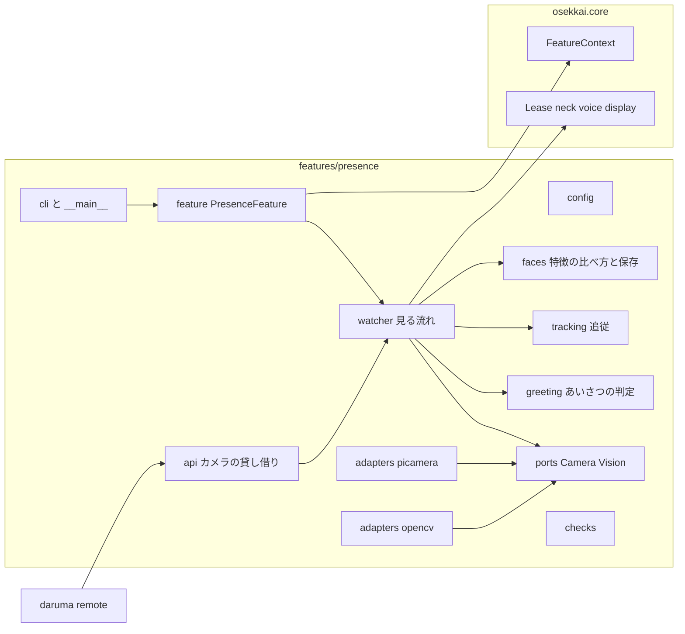
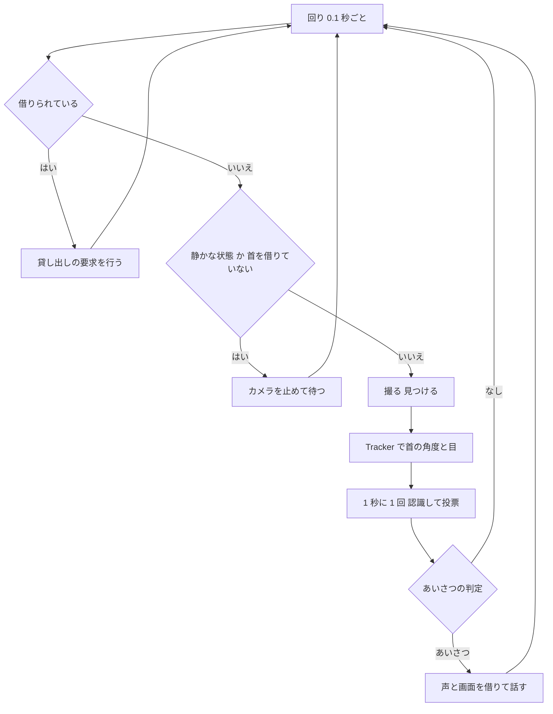

# Design Document

## Overview
**Purpose**: 見つけてあいさつ（Presence）は、首のカメラで顔を見つけて首と LCD の目を向け、覚えた人なら名前を呼んであいさつします。首のカメラの持ち主として、ほかの機能に動きの量・静止画・映像のフレームを貸します。

**Users**: 子どもは見つけてもらい、あいさつされます。保護者はコマンドで顔を覚えさせ、消します。だるまさん・ラジコンの機能は、カメラを借りて映像を使います。

**Impact**: `rover-core` の機能を足す口に `presence` を登録します。基盤は変えません。pip の依存も足しません（実機の OpenCV・picamera2・numpy は初期設定の apt で入っています）。

### Goals
- 見つけて向く・名前であいさつする振る舞いをサンプルと同じにする
- 画像を保存せず、顔の特徴だけを本人だけが読める形で保存し、コマンドで消せる
- 首とカメラを調停に従って使い、ほかの機能と取り合わない
- 判定を偽の検出結果で PC で確かめられる

### Non-Goals
- USB カメラ（C270）の映像、だるまさんの判定、ラジコンの配信と写真の保存（下流の機能）
- 代わりの検出（Haar）

## Boundary Commitments

### This Spec Owns
- 首のカメラの起動・停止・上下の反転（picamera2 のアダプタ）
- 顔の検出・認識・動きの量・JPEG にする処理（OpenCV のアダプタ）
- 追従（首の角度と目の向きの決め方）、認識の比べ方と投票、あいさつの判定（純粋な部品）
- 顔の特徴とあいさつの記録の保存（`ctx.store` の `faces` と `greetings`）
- カメラの貸し借りの口（`osekkai.features.presence.api`）
- 顔を覚える・消す・一覧・追従の確認・動きの量の確認のコマンド
- self-check の `presence.camera`・`presence.models`・`presence.faces`

### Out of Boundary
- 資源の調停、静かな状態、時刻の同期（`rover-core`）
- だるまさんの判定のしきい値、ラジコンの配信と写真の保存先（下流の機能）
- 初期設定でのモデルと apt の依存の取得（`device-deployment` がすでに持つ）

### Allowed Dependencies
- `osekkai.core` の公開の口（`feature`・`arbiter.Lease`・`config.FeatureConfig`・`selfcheck`・`clock`・`types`・`events.QuietChanged`・`storage`・`paths`・`lcd_text`）
- 実機のライブラリ: `cv2`・`numpy`（`presence/adapters/opencv.py` の中だけ、遅れて読み込む）、`picamera2`（`presence/adapters/picamera.py` の中だけ、遅れて読み込む）
- コマンドの入口（`presence/__main__.py`・`presence/cli.py`）だけは、日課の試しと同じく `osekkai.__main__.build_devices`・`core.runtime.Runtime`・`core.registry.FeatureRegistry`・`core.instance_lock`・`core.clock.SystemClock`・`core.config.ConfigLoader` を使ってよい
- 禁止: ほかの機能のパッケージ、`osekkai.adapters`（基盤のアダプタ）

依存の向き（左から右だけ）: `config`・`texts` → `faces`（特徴の比べ方と保存の形）→ `tracking`・`greeting`（純粋な判定）→ `ports` → `watcher`（見る流れ）→ `feature`・`api`・`checks` → `cli`・`__main__`。アダプタは `ports` の型だけを読む。

### Revalidation Triggers
- `api.py`（カメラを借りる口・動きの量・フレーム・静止画）の形を変えたとき: `daruma-game`・`remote-control` を確かめ直す
- 優先度（10）を変えたとき: ほかの機能との譲り方
- 顔の特徴の保存の形を変えたとき: 覚え直しが要るか（版の番号を上げ、読めない版は使わない）
- モデルのファイル名を変えたとき: 配置の道具の初期設定と self-check

## Architecture



- 1 本の見るスレッド（`watcher`）だけがカメラと首を触る。下流の機能のカメラの要求も、このスレッドが受けて行う（取り合いを避ける）
- 判定は純粋な部品。見る流れは、偽のカメラと偽の映像の処理で PC で動かせる

### Technology Stack

| Layer | Choice | Role | Notes |
|-------|--------|------|-------|
| カメラ | picamera2（apt） | 首のカメラの映像と静止画 | アダプタの中だけ |
| 映像の処理 | OpenCV 4.10（apt）、numpy（apt） | 検出（YuNet）・認識（SFace）・動きの量・JPEG | アダプタの中だけ。CI と開発 PC にはない |
| モデル | `face_detection_yunet_2023mar.onnx`（MIT）、`face_recognition_sface_2021dec.onnx`（Apache-2.0） | 検出と認識 | 初期設定が `~/.local/share/osekkai/models/` に置く |
| 保存 | `ctx.store`（JSON） | 顔の特徴・あいさつの記録 | 原子的、本人だけ |

## File Structure Plan

```
src/osekkai/features/presence/
├── __init__.py          # PresenceFeature を遅れて出す（api だけを読む機能に重さを持ち込まない）
├── config.py            # PresenceConfig（時間帯・しきい値・反転など）と model_paths(paths)
├── texts.py             # あいさつ・覚えるときの言葉と LCD の文字、呼び名の差し込み
├── faces.py             # FaceBook（人ごとの呼び名と見本、比べ方、保存と読み込み、消す）・Voting（3 回のうち 2 回）
├── tracking.py          # Tracker（顔の位置から首の角度と目の向きを決める。見失い・正面に戻る）
├── greeting.py          # GreetingPolicy（いつ・誰に・何と言うか）・GreetingRecords（朝と最後に見た時刻）
├── ports.py             # CameraPort・VisionPort・Frame・CameraUnavailable（FaceBox は tracking.py にあり、ここは読み込んで使う）
├── watcher.py           # Watcher（見る流れ: 撮る → 見つける → 追従 → 認識 → あいさつ、カメラの貸し出し）
├── feature.py           # PresenceFeature（資源・静かな状態・中断・見るスレッドの始めと終わり）
├── api.py               # borrow_camera・CameraLoan（motion・frame・still）・CameraBusy
├── checks.py            # self-check の presence.camera・presence.models・presence.faces
├── cli.py               # 覚える・消す・一覧・追従の確認・動きの量の確認
├── __main__.py          # cli の引数
└── adapters/
    ├── __init__.py
    ├── picamera.py      # PiCamera（Picamera2。開始・停止・撮る・静止画）
    └── opencv.py        # OpenCvVision（YuNet・SFace・動きの量・JPEG。反転はしない）

tests/features/presence/
├── presence_fakes.py    # FakeCamera・FakeVision（台本の顔の位置と特徴）
├── test_presence_config.py
├── test_presence_faces.py
├── test_presence_tracking.py
├── test_presence_greeting.py
├── test_presence_watcher.py
├── test_presence_feature.py
├── test_presence_api.py
├── test_presence_checks.py
├── test_presence_cli.py
├── test_presence_opencv.py      # cv2 と numpy を偽の module にして形を確かめる
├── test_presence_picamera.py    # picamera2 を偽の module にして形を確かめる
└── test_presence_import_direction.py
docs/presence.md          # 保護者の手順書（顔を覚える・消す・設定・確認のコマンド）
```

### Modified Files
- `pyproject.toml` — エントリーポイントに `presence = "osekkai.features.presence:PresenceFeature"`。mypy の `cv2.*`・`picamera2.*` を型を見ない対象に
- `config/osekkai.example.yaml`・`src/osekkai/core/example_config.yaml` — `presence:` の節（既定値。個人の値なし）
- `README.md` — 機能の表に presence、第三者の表は YuNet・SFace がすでにある
- 本物の機能の発見を使う既存のテスト（`tests/test_cli_selfcheck.py` など）— presence の項目が足される

## System Flows

### 見る流れ（Watcher の 1 回の回り）



- 首は `PresenceFeature` が借りたリース（NECK）で動かす。中断が来たら、見る流れを止めてリースを返し、2 秒ごとに借り直しを試す（`ResourceBusy` なら待つ）
- あいさつの声と画面は、その時だけ借りる（`wait=0.0`。借りられなければ、そのあいさつはしない。記録もしない）
- 下流の機能の要求（動きの量・フレーム・静止画）は、貸し出しの待ち行列に入り、見るスレッドが撮って返す

## Requirements Traceability

| Requirement | Components |
|-------------|------------|
| 1.1〜1.8 | Watcher, Tracker, ports, config |
| 2.1〜2.5 | FaceBook, Voting, Watcher |
| 3.1〜3.10 | GreetingPolicy, GreetingRecords, Watcher, texts |
| 4.1〜4.7 | PresenceFeature, Watcher |
| 5.1〜5.9 | cli（LearnFeature）, FaceBook |
| 6.1〜6.5 | FaceBook（保存の形）, 全体のログの決まり |
| 7.1〜7.8 | api（borrow_camera・CameraLoan）, Watcher, adapters |
| 8.1〜8.5 | PresenceConfig, checks |
| 9.1〜9.4 | cli（追従の確認・動きの量の確認）, 偽物（presence_fakes） |

## Components and Interfaces

### config
```python
class PresenceConfig(FeatureConfig):
    greet_hours: tuple[time, time] = (time(7, 0), time(20, 30))   # 日課・入口と同じ時刻の決まり
    away_minutes: int = Field(default=20, ge=1, le=600)            # 3.1
    okaeri_minutes: int = Field(default=120, ge=1, le=1440)        # 3.4
    morning_end: time = time(11, 0)                                # 3.3
    match_threshold: float = Field(default=0.38, ge=0.0, le=1.0)   # 2.3
    pan_reverse: bool = False
    tilt_reverse: bool = False
    gaze_reverse: bool = False
    flip: bool = False                                             # 映像の上下（180 度）
def model_paths(paths: Paths) -> tuple[Path, Path]: ...  # data_dir/models/<yunet>, <sface>
```

### faces（純粋）
```python
Embedding = tuple[float, ...]   # 128 個、L2 正規化済み

@dataclass(frozen=True)
class Person:
    person_id: str              # [a-z][a-z0-9_]*、32 文字まで
    call_name: str
    samples: tuple[Embedding, ...]

class FaceBook:
    @classmethod
    def load(cls, store: StateStore) -> FaceBook: ...   # 版が違う・壊れている → 空で readable=False（6.4）。StateStore.load が None のときは faces.corrupt-*.json の有無で壊れていたかを見分ける
    def people(self) -> tuple[Person, ...]: ...
    def best_match(self, emb: Embedding, threshold: float) -> str | None: ...   # 人ごとに見本の最大のコサイン（2.3）
    def put(self, person: Person) -> None: ...          # 同じ id は置き換える（5.4）
    def remove(self, person_id: str) -> bool: ...       # 5.6
    def clear(self) -> None: ...                        # 5.7
    def save(self) -> None: ...

class Voting:   # 2.2: 直近 3 回のうち 2 回（None も 1 票）
    def add(self, who: str | None) -> str | None: ...
    def reset(self) -> None: ...
```
- 保存の形（`faces.json`）: `{"version": 1, "people": {"<id>": {"call_name": "...", "samples": [[128 個], ...]}}}`
- 比べ方は Python の内積（128 × 見本の数 × 人数）。1 秒に 1 回なので十分速い

### tracking（純粋）
```python
@dataclass(frozen=True)
class FaceBox:
    x: float; y: float; size: float      # x, y は映像の真ん中から −1〜1、size は幅の割合

@dataclass(frozen=True)
class TrackOutput:
    pan: float; tilt: float; gaze: float; seen: bool; lost_for: float

class Tracker:
    def step(self, face: FaceBox | None, now: float) -> TrackOutput: ...
```
- 2 回続けて見つかったら採る（1.2）。|x| > 0.15 ならパン += 符号 × x × 8、|y| > 0.2 ならチルト −= 符号 × y × 6、範囲 ±40・−15〜30（1.3、1.7）
- 2.5 秒見失ったら seen=False（1.5）。5 秒を過ぎたら回りごとに 0.8 倍で正面へ（1.6）
- gaze = x × 0.6 + 符号 × パン / 40（−1〜1）。目の向きの反転は符号（1.4、1.8）

### greeting（純粋）
```python
UNKNOWN = "_unknown"

class GreetingKind(Enum):
    MORNING = "morning"; OKAERI = "okaeri"; HELLO = "hello"

@dataclass(frozen=True)
class GreetingDecision:
    kind: GreetingKind; who: str | None   # None は知らない人

class GreetingRecords:   # ctx.store の greetings。人ごと（知らない人は UNKNOWN）に最後に見た時刻と朝の日（3.7、3.9）
    def last_seen(self, key: str) -> datetime | None: ...
    def morning_done(self, key: str, day: date) -> bool: ...
    def mark_seen(self, key: str, now: datetime) -> None: ...
    def mark_greeted(self, decision: GreetingDecision, now: datetime) -> None: ...
    def forget(self, key: str | None) -> None: ...      # None ならすべて（5.6、5.7）

class GreetingPolicy:
    def decide(self, now: datetime, *, synced: bool, who: str | None, looked_for: float,
               waiting_recognition: float, has_known_people: bool,
               records: GreetingRecords) -> GreetingDecision | None: ...
        # waiting_recognition は、誰か分からないまま待った秒数（実装で bool から変えた）
    def phrase(self, decision: GreetingDecision, call_name: str | None) -> str: ...
```
- 判定の順（3.1〜3.6、3.10、4.5）: 時刻が確かでない・時間帯の外 → なし。見続けた時間 < 1 秒 → なし。覚えた人がいて、まだ誰か分からず、3 秒たっていない → 待つ（なし）。見えなかった時間（その人の鍵）< 20 分 → なし。朝（11 時より前でその日の朝がまだ）→ MORNING。見えなかった時間 ≥ 120 分か初めて → OKAERI。それ以外 → HELLO
- 言葉は texts の表から、HELLO は 3 つの中から選ぶ（選び方は差し替えられる。テストで決める）
- 最後に見た時刻は、見ている間ずっと更新する（あいさつの判定の後で）

### ports
```python
class Frame(Protocol): ...   # アダプタの映像（中身は見ない）

class CameraPort(Protocol):
    def start(self) -> None: ...
    def stop(self) -> None: ...
    def capture(self) -> Frame: ...          # 640×480
    def capture_still(self) -> bytes: ...    # 最大の大きさの JPEG
class VisionPort(Protocol):
    def detect(self, frame: Frame) -> Sequence[FaceBox]: ...
    def embed(self, frame: Frame, face: FaceBox) -> Embedding | None: ...   # 認識のモデルがなければ None
    def motion(self, before: Frame, after: Frame) -> float: ...            # 0〜1
    def to_jpeg(self, frame: Frame, max_width: int, quality: int) -> bytes: ...
class CameraUnavailable(Exception): ...
```
- 上下の反転はカメラのアダプタ（picamera）だけが当てる。libcamera の Transform（hflip と vflip）を映像と静止画の設定に入れる。OpenCV のアダプタは反転しない（二重に回さない。7.4、7.5）

### watcher
```python
class Watcher:
    def __init__(self, camera: CameraPort | None, vision: VisionPort | None, book: FaceBook,
                 records: GreetingRecords, policy: GreetingPolicy, tracker: Tracker,
                 clock: Clock, io: PresenceIO, log: logging.Logger) -> None: ...
    def run_once(self) -> None: ...                           # テストから 1 回ずつ回す
    def loan(self, request: LoanRequest) -> LoanResult: ...   # 見るスレッドで行う
```
- `PresenceIO`（首・目・あいさつの口）は feature がリースで実装し、テストは偽物にする（日課の RoutineIO と同じ考え方）

### feature
| Field | Detail |
|-------|--------|
| spec | name `presence`、priority `Priority.BACKGROUND`、resources `{NECK, VOICE, DISPLAY}`、config `PresenceConfig`、checks `PRESENCE_CHECKS` |
- `__init__(ctx, config, *, camera=None, vision=None)`: 既定は、picamera2 と cv2 を読み込めれば実機のアダプタ、なければカメラなし（何もしない。PC の `--fake-hardware`）
- `run(stop)`: 見るスレッド（この `run` のスレッド）で `Watcher` を回す。NECK を `wait=0.0` で借り、`ResourceBusy` なら 2 秒後に試す。中断の知らせで見るのをやめて返す（4.2、4.3）。静かな状態の間はカメラを止める（4.4）
- 例外は型の名前だけを記録して続ける。カメラが使えなければ、見ることを止める（8.5）

### api（カメラを借りる口）
```python
class CameraLoan(Protocol):
    def motion(self, seconds: float) -> float: ...                 # 7.3
    def frame(self, max_width: int = 640, quality: int = 70) -> bytes: ...   # JPEG（7.4）
    def still(self) -> bytes: ...                                  # 最大の大きさの JPEG（7.5）
    def release(self) -> None: ...

def borrow_camera(owner: str, *, alive: Callable[[], bool]) -> CameraLoan: ...
# 貸し出しの状態（借り手・2 つ目を断る・止まった借り手）は Watcher が持つ。api は、機能が始めに登録し終わりに外す置き場から
# 動いている Watcher を見つけ、要求を渡して待つ薄い層
class CameraBusy(Exception): ...         # ほかの機能が借りている
class CameraNotAvailable(Exception): ... # presence が動いていない・カメラがない（7.8）
```
- 借りられるのは 1 つの機能だけ。返した後・`alive` が偽の後の要求は断る（7.6、7.7）
- 要求は見るスレッドが行い、呼んだ側は結果を待つ（時間切れつき）

### checks
| 項目 | 確かめ | 結果 |
|------|--------|------|
| `presence.camera` | picamera2 を読み込め、カメラが 1 台以上ある（`Picamera2.global_camera_info()`。hardware=True） | よい／だめ「カメラが見つからない」 |
| `presence.models` | 2 つのモデルのファイルがある | よい／だめ「顔のモデルがない」 |
| `presence.faces` | `faces.json` が読める（なければよい） | よい／よいに理由を添える「覚えた顔を読めない」（版を戻しても直らないので、だめにしない） |
- 無効のとき・設定が使えないときは飛ばす。picamera2 か cv2 を読み込めない PC と CI では、`presence.camera` と `presence.models` を飛ばす（理由「カメラのライブラリがない」。開発 PC と CI の self-check をだめにしない）
- `presence.faces` は `faces.json` を自分で読むだけにする（`StateStore.load` は壊れたファイルを退避するので使わない）。退避された `faces.corrupt-*.json` が残っていれば「覚えた顔を読めない」を添える

### cli
- `python -m osekkai.features.presence --list`（ロック不要。名前と見本の数だけ。呼び名は出さない）
- `--learn-face <名前> --call-name <呼び名>`、`--forget-face <名前>`、`--forget-all`、`--watch-test [--seconds N]`、`--motion-test [--seconds N]`
- 覚える・消す・確認はロックを取り、取れなければ 75（5.8、9.3）。覚える・確認は `Runtime` を、その用の機能だけの登録で動かす（日課の試しと同じ形）

## Error Handling
- カメラが開けない・撮れない: 見ることを止めて記録（型の名前）。下流には `CameraNotAvailable`
- モデルがない: 見ることを止める（認識のモデルだけがなければ、全員を知らない人にする。2.5）
- 顔の特徴が読めない: 空として扱い、self-check でよいに理由を添える
- 1 回の回りの例外: 型の名前を記録して続ける

## Testing Strategy
- 純粋な部品: Tracker（不感帯・係数・範囲・見失い・正面に戻る・目の向き・反転）、Voting、FaceBook（比べ方・置き換え・消す・壊れた保存）、GreetingPolicy（時間帯・確かでない時刻・1 秒・3 秒の待ち・20 分・朝・120 分・知らない人の鍵が分かれること・再起動の後の記録）
- Watcher（偽のカメラと偽の映像）: 見つけて首と目を向ける、あいさつで声と画面を借りる、借りられなければあいさつも記録もしない、貸し出しの間は見ない、静かな状態でカメラを止める
- PresenceFeature（本物の調停役と静かな状態を偽のデバイスで）: 日課（85）が首を求めると見るのをやめて返す、返されたら借り直す、おやすみ中は止まる
- api: 借りる・返す・2 つ目は CameraBusy・止まった機能の貸し出しの終わり・presence が止まっていると CameraNotAvailable
- アダプタ: cv2・numpy・picamera2 を偽の module にして、呼び出しの形と反転を確かめる
- cli: 覚える（40 秒・半分で 1 回・10 個に届かなければ保存しない）、消す・すべて消す、一覧に呼び名が出ない、ロックで 75
- ログ: どのテストでも、呼び名・名前・あいさつの言葉がログに出ない
- 実機確認: 色・追従の向き・認識の確かさ・CPU の負荷・おやすみとの関係

## Security Considerations
- 顔の画像は保存しない。特徴だけを `ctx.store`（本人だけ）に置く。外部に送らない
- 呼び名と名前（識別子）は保存先と設定にだけ置き、ログ・self-check・一覧の表示（呼び名）に出さない
