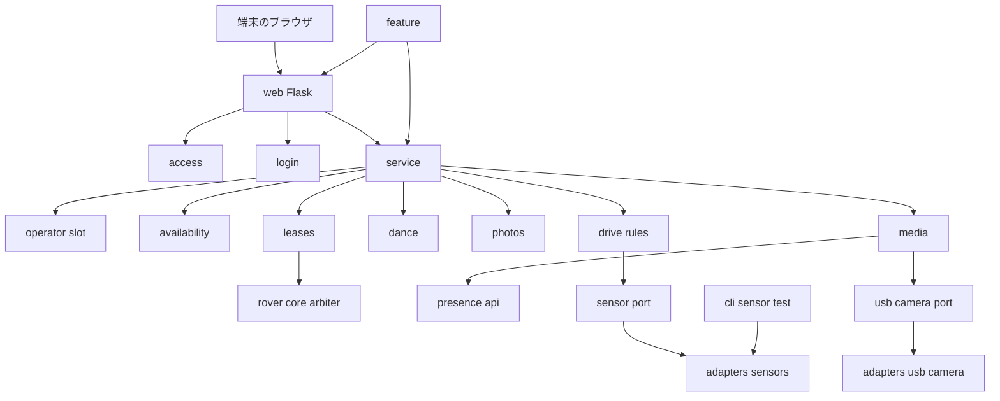
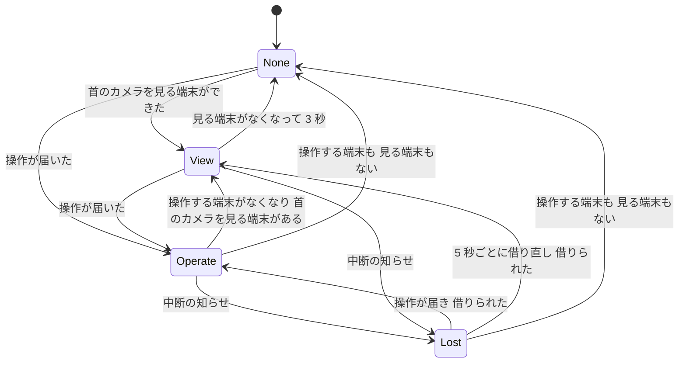
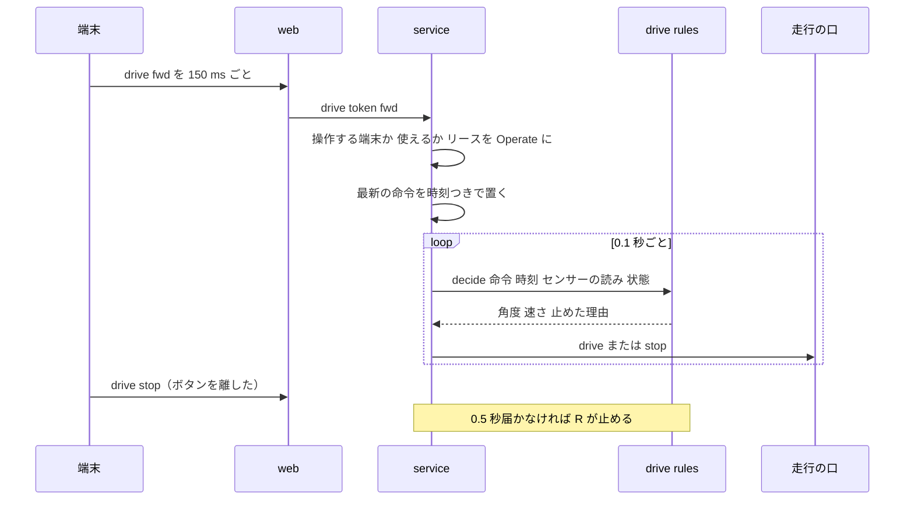
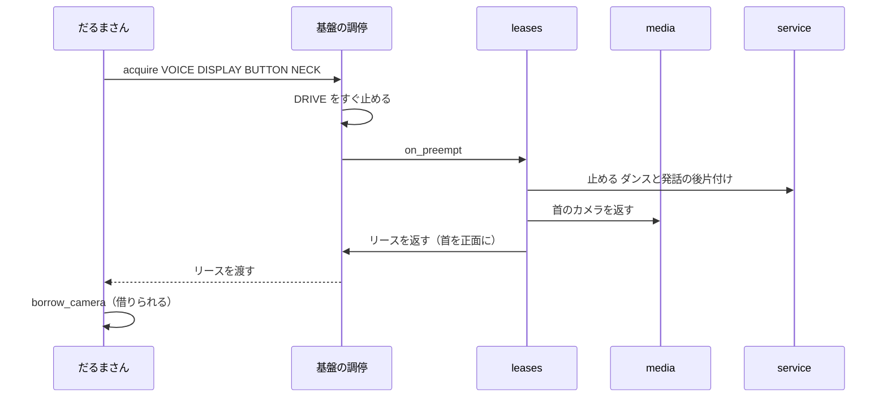

# Design Document: remote-control（スマホのラジコン）

## Overview
スマホのラジコンは、家の Wi-Fi の中のスマホやタブレットのブラウザから、ロボットを走らせて遊ぶ機能です。機能の中で小さな Web のサーバーを動かし、端末に操作の画面と 2 台のカメラの映像を出します。端末から届いた操作は、`rover-core` から借りた資源（走行・首・声・LCD）の口で行います。

利用者は 4 歳前後の子どもと保護者です。子どもは、押している間だけ走らせ、首を動かし、ブッブー・ダンス・写真・話させるで遊びます。保護者は、家の外から使えないこと、総当たりで pin を当てられないこと、前の物と段差で必ず止まること、決めた時間帯だけ使えること、日課を邪魔しないことを求めます。開発者は、安全の判定・時間帯・ログインの規則を、偽のセンサーと時計で PC と CI で確かめます。

`rover-core` の機能を足す口（エントリーポイント `osekkai.features`）に `remote` として登録します。基盤・`presence`・ほかの機能は書き換えません。超音波と床センサーと USB カメラは、この機能が自分のアダプタで読みます。

### Goals
- サンプルと同じ遊び方（6 方向の押している間だけ走る、首、ブッブー、ダンス、2 台の映像、写真、話させる、2 つの速さ）
- 走行は常に安全側に倒す: 命令が 0.5 秒途切れたら止まる。前の危険（読めないときも含む）で止まる。後退はゆっくり・2 秒まで。例外・時間帯の終わり・おやすみ・優先度の高い機能で止まる
- 家のネットワークの外から使えない。pin のまちがいは、どの端末からでも 1 つの数えで止める
- 操作できる端末は 1 台。映像は見るだけなら 3 台まで
- 安全の判定・後退の制限・時間帯・ログイン・操作する端末の交代・写真の整理を、偽のセンサー・時計・カメラで PC だけで確かめられる

### Non-Goals
- 家の外からの操作、通信の暗号化（HTTPS）
- 1 日に使える時間の上限（保護者の判断でなくした。11.6）
- 映像の保存、写真の一覧と端末からの削除、話させた言葉の記録
- ダンスでタイヤを動かすこと（基盤の `motion.allow_drive_in_dance` を使わない）
- 首のカメラの開け閉め（`presence`）、資源の調停（`rover-core`）

## Boundary Commitments

### This Spec Owns
- 端末向けの画面（ログイン・操作）と、操作・状態・映像・写真の要求の受け付け。Web のサーバーの起動と停止
- 家のネットワークの判定、ログインの状態（印の表）、pin のまちがいの数えと止める期限
- 操作する端末の決め方と交代、端末ごとの知らせ（`Availability`）
- 走行の判定（押している間だけ・途切れの停止・速さ・前の安全・後退の制限）と、0.1 秒ごとの走行の繰り返し
- 超音波と床センサーの読み取り（`SensorPort` と実機のアダプタ）、USB カメラ（`UsbCameraPort` と実機のアダプタ）
- 首の操作、ブッブー、首だけのダンス、写真の撮影と保存と整理、話させる
- この機能のリースの持ち方（操作・見るだけ・なし）と、中断の知らせを受けたときの止め方
- 設定の節 `remote:`、self-check の項目 `remote.setup`・`remote.sensors`・`remote.usb_camera`、手順書 `docs/remote.md`
- 道具 `python -m osekkai.features.remote --sensor-test`

### Out of Boundary
- 資源の調停、中断の知らせ、リースを返したときにモーターを止めて首を正面に戻すこと、首の角度の範囲、発話と LCD、静かな状態（おやすみ）、時刻が確かかどうか（`rover-core`）
- 首のカメラの開け閉め、画像の取り出し、貸している間に顔を探さないこと（`presence`）
- 日課のタスクの判定と、始めるときに資源を取り上げること（`daily-routine`）。このスペックは日課の状況を読まない
- 押下と聞き取り（`voice-gateway`）。このスペックは BUTTON を借りない
- 実機の初期設定と版の入れ替え（`device-deployment`）。このスペックは、配置の extras に `remote` を足すことだけを頼む

### Allowed Dependencies
- `osekkai.core`: `feature`（`FeatureSpec`・`FeatureContext`）、`config.FeatureConfig`、`types`（`Priority`・`Resource`・`Face`・`Glyph`・`ResourceBusy`・`LeaseRevoked`・`SpeechFailed`・`DeviceUnavailable`）、`arbiter.Lease`、`clock.Clock`、`events.QuietChanged`、`lcd_text`、`selfcheck`、`paths.Paths`（写真の保存先と `ensure_private_dir`）
- `osekkai.features.presence.api`（`borrow_camera`・`CameraLoan`・`CameraNotAvailable`・`CameraBusy`・`CameraNotBorrowed`）
- 外のライブラリ:
  - `flask`（`web.py` だけ）
  - `smbus2`・`lgpio`（`adapters/sensors.py` の関数の中だけ）
  - `cv2`・`numpy`（`adapters/usb_camera.py` の関数の中だけ）
- 道具（`cli.py`）だけ: `core.instance_lock.InstanceLock`、`core.config.ConfigLoader`、`core.logging_setup`、`core.clock.SystemClock`
- 依存の向き:
  - `texts`・`config` → `access`・`login`・`availability`・`drive_rules`・`dance`・`photos`・`ports`
  - → `operator_slot`・`leases`・`media`
  - → `service` → `web` → `feature` → `cli`
  - `adapters/*` は `ports` だけを読む
  - `checks` は `config`・`ports`・`adapters` の見つけ方の関数と `core.selfcheck` だけを読む
  - `web` は `feature` の `run()` の中で読む（Flask がない環境でも機能の読み込みが失敗しない）
  - `osekkai.adapters`・ほかの機能の `api`（`presence.api` 以外）は読まない。読み込みの向きのテストで縛る

### Revalidation Triggers
- `Priority` の帯の値、または日課・入口・おしゃべり・だるまさん・見つけてあいさつの優先度が変わり、ラジコン（30）との上下が入れ替わる
- 基盤が、リースを返したときにモーターを止めない・首を正面に戻さないようになる。中断の知らせのときに DRIVE をすぐ止めなくなる
- `DriveHandle.drive` の角度・速さの範囲（±30 度、−100〜100）が変わる。`NeckHandle.look` が範囲に収めなくなる
- `presence.api` の `borrow_camera`・`CameraLoan.frame`・`still` の形や例外、1 人にしか貸さない決まりが変わる
- だるまさんなど、`presence` のカメラを借りるほかの機能が、首（NECK）を借りずにカメラを借りるようになる（「首のリースでカメラを譲る」の前提）
- 基盤が HAT の ADC か GPIO の入力の口を持つようになる（このスペックのセンサーのアダプタを基盤の口に移すか決め直す）
- 配置の extras の決め方（`PIP_EXTRAS`）や、実機の Python・Flask の版が変わる

## Architecture

### Existing Architecture Analysis
- 機能は `Feature`（`__init__(ctx, config)`、`run(stop)`）を実装し、`run()` は専用のスレッドで動く。`stop` が立ったらすぐ戻る
- 資源はリースで借りる。借りるときに `on_preempt` を渡すと、優先度の高い機能が来たときに一度だけ呼ばれる。DRIVE を持つリースは、その時点で基盤が走行を止める。2 秒の猶予の後に取り上げられる
- リースを返すと、基盤がモーターを止め、首を正面に戻す
- `run()` が例外で終わると、基盤がこの機能のリースをすべて取り上げ（走行が止まる）、機能を止める。基盤は動き続ける
- 機能の補助のスレッドの名前は `osekkai-` で始めない（`osekkai-` で始まる、機能のスレッドではないスレッドの例外は、基盤の致命的な誤りとして扱われる）
- `presence.api.borrow_camera` は 1 人にだけ貸す。借りるのに首（NECK）は要らない。貸している間、`presence` は顔を探さない
- `FeatureContext` はデバイスを渡さない。センサーとカメラは、機能が自分のアダプタで開く（`presence` の `adapters/` と同じ形）

### Architecture Pattern & Boundary Map



**Architecture Integration**:
- **パターン**: ポートとアダプタ。判定（アクセス・ログイン・時間帯・走行・後退・写真の名前）は純粋な部品にする。Web・リース・カメラ・センサーは外側の部品にする
- **境界**:
  - `web` は HTTP の形（経路・クッキー・JSON）だけを持つ
  - 操作の意味は `service` が持つ
  - センサーとカメラの開け閉めは `adapters` だけが持つ
- **守る既存の形**: 機能の登録、リースの借り方と中断の知らせ、`presence` の口からのカメラ、設定の節と self-check の項目、道具の `InstanceLock`
- **steering**:
  - 子どもの安全を最優先にする（読めないセンサーは危険として扱う。後退を制限する）
  - 入れた文字・pin・端末のアドレスを出さない
  - 日課より低い優先度で借りる

### Technology Stack

| Layer | Choice / Version | Role in Feature | Notes |
|-------|------------------|-----------------|-------|
| Web | Flask `>=3.1,<3.2`（werkzeug 3.1） | 画面・API・映像の配信 | extras `remote`。`werkzeug.serving.make_server(threaded=True)` を補助のスレッドで動かす |
| 画面 | HTML・CSS・素の JavaScript | 押している間の命令の送信、映像、写真、話させる | 外のライブラリを使わない。`page.py` の文字列から返す |
| センサー | `smbus2`（apt `python3-smbus2`）、`lgpio`（apt `python3-lgpio`） | ADC（床センサー）の読み取り、超音波の時間の測定 | 関数の中だけで読み込む。基盤とは別の口を開く |
| USB カメラ | OpenCV 4.6 以上（apt `python3-opencv`） | C270 の MJPEG の読み取り | 関数の中だけで読み込む |
| 首のカメラ | `presence.api` | 映像の 1 枚ずつと、写真の静止画 | 首（NECK）のリースを持っている間だけ借りる |
| 保存 | ファイル（`Paths.data_dir/remote/photos`） | 写真だけ | 0700 のディレクトリ、0600 のファイル。`StateStore` は使わない |
| 実行 | 機能のスレッド＋補助のスレッド | Web・走行の繰り返し・カメラの読み取り・発話・ダンス | 補助のスレッドの名前は `remote-` で始める |

## File Structure Plan

### Directory Structure
```
src/osekkai/features/remote/
├── __init__.py          # RemoteFeature を外に出す
├── __main__.py          # python -m osekkai.features.remote（cli.main を呼ぶ）
├── config.py            # RemoteConfig（設定の節 remote:、既定値と範囲、pin の使えるかの判定）
├── texts.py             # 話す言葉・LCD の文字と顔・端末の知らせの文
├── access.py            # 家のネットワークのアドレスか（純粋）
├── login.py             # LoginGuard（pin とまちがいの数え）と Sessions（印の表）
├── availability.py      # 使えるかの判定（時間帯・おやすみ・時刻）と Availability
├── drive_rules.py       # 走行の判定（命令・途切れ・速さ・前の安全・後退の制限・危険の声の間隔）
├── dance.py             # 首だけのダンスの段と、段ごとに止める合図を見る進め方
├── photos.py            # PhotoStore（名前・保存・整理・返してよい名前か）
├── ports.py             # SensorPort・UsbCameraPort・SensorReading・FrameSource
├── operator_slot.py     # OperatorSlot（操作する端末は 1 台、10 秒で交代）
├── leases.py            # LeaseKeeper（操作・見るだけ・なしの 3 段のリース）
├── media.py             # FrameHub（カメラごとの読み取りのスレッド、最新の 1 枚、見る端末の数）
├── service.py           # RemoteService（操作の受け付け、走行の繰り返し、状態の知らせ）
├── page.py              # ログインと操作の画面の HTML・CSS・JavaScript（文字列）
├── web.py               # create_app（経路・クッキー・CSRF の確かめ）と WebServer（起動・停止）
├── feature.py           # RemoteFeature（登録の申告、部品の組み立て、run の繰り返し）
├── checks.py            # REMOTE_CHECKS（remote.setup・remote.sensors・remote.usb_camera）
├── cli.py               # --sensor-test
└── adapters/
    ├── __init__.py
    ├── sensors.py       # HatSensors（smbus2 で ADC、lgpio で超音波）。gpiochip の見つけ方
    ├── usb_camera.py    # UsbCamera（cv2 で C270、DHT の差し込み）。C270 の見つけ方
    └── fake.py          # ClearSensors・NoUsbCamera（開発 PC で使う）

tests/features/remote/
├── remote_fakes.py      # 偽のセンサー・偽の時計・偽のリース・偽のカメラ・偽の発話
├── test_remote_import_direction.py
├── test_remote_config.py / test_remote_texts.py
├── test_remote_access.py / test_remote_login.py / test_remote_availability.py
├── test_remote_drive_rules.py / test_remote_dance.py / test_remote_photos.py
├── test_remote_operator_slot.py / test_remote_leases.py / test_remote_media.py
├── test_remote_service.py / test_remote_web.py
├── test_remote_adapters.py   # DHT の差し込み、gpiochip の見つけ方、ADC の値の組み立て（偽の bus）
├── test_remote_checks.py / test_remote_feature.py / test_remote_registration.py / test_remote_cli.py
└── test_remote_journey.py    # 偽のハードの基盤＋見つけてあいさつ＋だるまさんと一緒に通しで
```

### Modified Files
- `pyproject.toml` — エントリーポイント `remote = "osekkai.features.remote:RemoteFeature"`。extras `remote = ["flask>=3.1,<3.2"]`。`[tool.setuptools.package-data]` は変えない（画面は `page.py` の文字列）
- `.github/workflows/*.yml` — CI の入れ方を `pip install -e '.[dev,remote]'` にする（Web の部品をテストするため）
- `deploy/rover_deploy/releases.py` と `tests/deploy/test_releases.py` — `PIP_EXTRAS` に `remote` を足す
- `src/osekkai/core/example_config.yaml`・`config/osekkai.example.yaml` — `remote:` の節（`enabled: false`、pin は書かない。手順書への案内）
- `tests/features/test_features_import_direction.py` — `ENTRY_ALLOWLIST` は変えない（`remote.cli` は `osekkai.__main__` を読まない）。`FEATURE_ADAPTER_LIBS` に `remote.adapters.sensors: {smbus2, lgpio}`、`remote.adapters.usb_camera: {cv2, numpy}` を足す
- `tests/test_cli_selfcheck.py` — `REMOTE_NAMES = ["remote.setup", "remote.sensors", "remote.usb_camera"]`（presence と routine の間）
- `docs/remote.md`（新規）、`docs/deploy.md`（extras の説明）、`README.md`（機能の表）
- `.kiro/steering/roadmap.md` — remote-control の行を、終わったら [x] にする

## System Flows

### リースの 3 段



- **None**: リースを持たない。
- **View**: NECK だけを持つ。首のカメラを借りる。
- **Operate**: DRIVE・NECK・VOICE・DISPLAY を持つ。走行の繰り返しを動かす。
- **Lost**: 中断の知らせを受けた後。カメラを返し、リースを返してある。端末には 12.2 の知らせを出す。
- 段が変わるときは、今のリースを返してから借り直す。返したとき、基盤がモーターを止め、首を正面に戻す（12.4）。
- 借り直しの待ちは 0 秒（`wait=0`）。借りられなければ `ResourceBusy` で、Lost のままにする（12.3）。
- 時間帯の外・おやすみ・時刻が確かでないときは、どの段にも上がらない（11.1〜11.4）。

### 走る命令から止まるまで



- 前に進む命令のときだけ、繰り返しの中でセンサーを読む（5.1）。読み取りは最長 0.1 秒で終わる（超音波の待ち 30 ms＋間隔）。
- 危険で止めたときの声は、`DangerVoice` が 10 秒に 1 回までにする（5.6）。発話は補助のスレッドで行い、繰り返しを止めない。

### 優先度の高い機能が来たとき



- `on_preempt` は基盤の短いスレッドで呼ばれる。止めるだけで、話さない・待たない（12.2）。
- 首のカメラの映像を見るだけの端末しかなくても NECK を持っているので、だるまさんはカメラを借りられる。

## Requirements Traceability

| Requirement | Summary | Components | Interfaces | Flows |
|-------------|---------|------------|------------|-------|
| 1.1, 1.2 | 家のネットワークだけ | access, web | `is_home_address`、`before_request` | — |
| 1.3, 1.4, 1.5 | 待ち受けの条件と理由 | config, feature, web, checks | `RemoteConfig.pin_usable`、`WebServer.start` | — |
| 2.1, 2.2, 2.3 | ログインの画面と結果 | login, web, page, texts | `LoginGuard.try_login`、`/login` | — |
| 2.4, 2.5 | まちがい 5 回で 5 分 | login | `LoginGuard`（1 つのロック） | — |
| 2.6, 2.7 | 起動・12 時間・おわる | login, web | `Sessions.check`・`end` | — |
| 2.8 | pin・アドレスを出さない | web, login, feature | 要求のログを出さないハンドラ | — |
| 3.1, 3.2, 3.3, 3.4 | 操作する端末は 1 台 | operator_slot, service | `OperatorSlot.claim`・`expire` | リースの 3 段 |
| 4.1, 4.2, 4.3 | 押している間だけ・離したら止まる | page, web, service, drive_rules | `/api/drive`、`decide` | 走る命令 |
| 4.4 | 0.5 秒の途切れ | drive_rules, service | `decide` | 走る命令 |
| 4.5, 4.6 | 2 つの速さ | drive_rules, service, config | `set_fast` | — |
| 4.7 | 走行の LCD | service, texts | `LcdState` | — |
| 4.8 | 走行のエラーからの戻り | service | 走行の繰り返しの例外の扱い | — |
| 5.1, 5.2, 5.3, 5.4 | 前の安全 | drive_rules, ports, adapters/sensors | `SensorPort.read`、`judge_front` | 走る命令 |
| 5.5, 5.6 | 止まったときの知らせと声の間隔 | service, drive_rules, texts | `DangerVoice` | — |
| 5.7 | 段差の判定の無効 | config, drive_rules | `cliff_stop` | — |
| 6.1, 6.2, 6.3 | 後退はゆっくり 2 秒まで | drive_rules, config | `BackState` | — |
| 6.4 | 後退の案内 | page, texts | — | — |
| 7.1, 7.2 | 首の操作 | service | `look` | — |
| 7.3 | ブッブー | service, texts | `act horn` | — |
| 7.4, 7.5, 7.6 | 首だけのダンスと止め方 | dance, service | `run_dance` | — |
| 8.1, 8.2 | 2 台の映像・3 端末まで | media, web | `FrameHub.viewer`、`/stream/<cam>` | — |
| 8.3 | 使えないカメラ | media, page, texts | `FrameHub.available` | — |
| 8.4 | 3 秒で返す | media, leases | `FrameHub` の閉じ方 | リースの 3 段 |
| 8.5 | 映像を保存しない | media | 最新の 1 枚はメモリだけ | — |
| 8.6 | 時間帯・おやすみ・ログインで止める | web, service | 配信の続けてよいかの確かめ | — |
| 9.1, 9.2, 9.3, 9.4 | 写真の撮影 | service, media, photos, texts | `take_photo` | — |
| 9.5, 9.6, 9.7 | 写真の保存・整理・返す範囲 | photos, web | `PhotoStore.save`・`prune`・`path_for` | — |
| 10.1, 10.2, 10.3, 10.4, 10.5 | 話させる | service, texts | `say_text` | — |
| 11.1, 11.2, 11.3, 11.4, 11.5, 11.6 | 時間帯とおやすみ | availability, service, config | `judge_availability`、`QuietChanged` | リースの 3 段 |
| 12.1 | 優先度 | feature | `FeatureSpec(priority=REMOTE)` | — |
| 12.2, 12.3 | 譲る・借り直す | leases, service, media | `on_preempt` | 高い機能が来たとき |
| 12.4 | 資源を返す | leases | 3 段の下がり方 | リースの 3 段 |
| 12.5 | 見つけてあいさつの首 | leases | REMOTE は BACKGROUND より上 | — |
| 12.6 | 予期しないエラー | feature, service | `run` の例外、補助のスレッドの例外 | — |
| 13.1, 13.2, 13.3 | 設定 | config, docs | `RemoteConfig` | — |
| 13.4, 13.5, 13.6 | self-check | checks | `REMOTE_CHECKS` | — |
| 14.1, 14.2, 14.3 | センサーを確かめる道具 | cli, adapters/sensors | `--sensor-test` | — |
| 15.1, 15.2 | PC で確かめる | 全体、adapters/fake | 偽の口 | — |

## Components and Interfaces

| Component | Domain | Intent | Req Coverage | Key Dependencies | Contracts |
|-----------|--------|--------|--------------|------------------|-----------|
| RemoteConfig | 設定 | 設定の節と pin の判定 | 1.3, 1.4, 4.5, 5.7, 6.2, 9.6, 11.5, 13.1, 13.2 | core.config (P0) | State |
| texts | 言葉 | 言葉・LCD・知らせの文 | 2.3, 2.4, 3.2, 4.7, 5.5, 6.4, 7.3, 8.2, 8.3, 9.1–9.3, 10.2–10.4, 11.1–11.3, 12.2 | core.types (P2) | — |
| access | 判定 | 家のネットワークか | 1.1, 1.2 | ipaddress (P0) | Service |
| login | 判定 | pin・まちがい・印の表 | 2.1–2.7 | clock (P0) | Service, State |
| availability | 判定 | 使えるか | 11.1–11.6 | clock (P0) | Service |
| drive_rules | 判定 | 走行の判定 | 4.2–4.6, 5.1–5.7, 6.1–6.3 | ports (P0) | Service, State |
| dance | 判定 | 首だけのダンス | 7.4–7.6 | — | Service |
| photos | 保存 | 写真の名前・保存・整理 | 9.5–9.7 | core.paths (P0) | Service |
| ports | 口 | センサーとカメラの口 | 5.1, 5.4, 8.1, 8.3 | — | Service |
| OperatorSlot | 状態 | 操作する端末は 1 台 | 3.1–3.4 | clock (P0) | State |
| LeaseKeeper | 資源 | 3 段のリース | 8.4, 12.2–12.5 | core.arbiter (P0) | State |
| FrameHub | 映像 | カメラの読み取りと配る | 8.1–8.5, 9.1 | presence.api (P0), UsbCameraPort (P1) | Service, State |
| RemoteService | 操作 | 操作の受け付けと走行の繰り返し | 3, 4, 5, 6, 7, 9, 10, 11.4, 12.2, 12.6 | 上のすべて (P0) | Service |
| web / page | 入口 | HTTP の形と画面 | 1.1–1.5, 2.1–2.8, 4.1, 4.3, 6.4, 8.1, 8.2, 8.6, 9.2, 9.7 | flask (P0) | API |
| HatSensors | アダプタ | 超音波と床センサー | 5.1, 5.4, 14.1 | smbus2, lgpio (P0) | Service |
| UsbCamera | アダプタ | C270 | 8.1, 8.3, 9.1 | cv2 (P0) | Service |
| RemoteFeature | 機能 | 申告・組み立て・繰り返し | 1.3–1.5, 11.4, 12.1, 12.6, 15.2 | core.feature (P0) | State |
| checks | self-check | 3 つの項目 | 13.4–13.6 | core.selfcheck (P0) | Batch |
| cli | 道具 | センサーを確かめる | 14.1–14.3 | HatSensors (P0) | Batch |

### 設定と言葉

#### RemoteConfig（`config.py`）

| Field | Detail |
|-------|--------|
| Intent | 設定の節 `remote:` の項目・既定値・範囲を持ち、pin が使えるかを判定する |
| Requirements | 1.3, 1.4, 4.5, 5.7, 6.2, 9.6, 11.5, 13.1, 13.2 |

##### State Management

| 項目 | 型 | 既定 | 範囲・決まり |
|------|----|------|--------------|
| `enabled` | bool | `false` | — |
| `pin` | `SecretStr` | 空 | 値の検証はしない（`pin_usable` で判定する。1.4） |
| `port` | int | 8080 | 1024〜65535 |
| `hours` | (HH:MM, HH:MM) | ("07:00", "20:00") | 始まりを含み終わりを含まない。同じ時刻は誤り（11.5） |
| `speed_slow` | int | 20 | 1〜100 |
| `speed_fast` | int | 35 | 1〜100、`speed_slow` 以上 |
| `stop_cm` | float | 20 | 5〜100 |
| `cliff_stop` | bool | `true` | — |
| `cliff_reference` | int | 500 | 0〜4095（値がこれ以下なら段差） |
| `back_max_seconds` | float | 2.0 | 0.5〜10 |
| `photo_days` | int | 30 | 1〜365 |
| `usb_camera` | str | 空 | 空なら C270 を自動で探す。空でなければ `/dev/` で始まる |

```python
class RemoteConfig(FeatureConfig):
    def pin_usable(self) -> bool: ...  # 4〜8 けたの ASCII の数字だけ
```
- `pin` は `SecretStr` で持ち、表示・例外・ログに値が出ない。
- `hours` の読み方（YAML の 60 進数の整数を含む）は、`conversation/config.py` と同じ規則を自分の中に写す（機能どうしで共有しない、という既存の決まり）。
- 範囲の外は、基盤の設定の読み込みが誤りとして扱い、この機能は開始しない（13.2）。

#### texts（`texts.py`）
- 話す言葉: ブッブーの 4 つ、危険の 2 つ、写真の 3 つ。
- LCD:
  - 走行: 「ﾗｼﾞｺﾝ」「ﾌﾞｰﾝ!」「ﾊﾞｯｸ」と笑顔
  - 「ｽﾄｯﾌﾟ!」と呼びかけの顔
  - 「ﾀﾞﾝｽ!」「ﾊｲ ﾁｰｽﾞ!」「ｵﾊﾅｼ ﾁｭｳ」
- 端末の知らせ:
  - ログイン: 「ばんごうが ちがうよ」「しばらく まってね」
  - 使えるか: 11.1・11.3・12.2・3.2 の文
  - 映像: 「いまは みられないよ」「カメラが つかえないよ」
  - 話させる: 「もじを いれてね」「いま おはなし ちゅう。ちょっと まってね」
  - 危険: 「まえに なにか あるよ」「だんさが あるよ！」
  - 後退の案内: 「うしろは みえないよ。ゆっくり さがるよ」
- すべて要件の文のとおり。テストは要件の文と突き合わせる。

### 判定（純粋な部品）

#### access（`access.py`）

##### Service Interface
```python
HOME_NETWORKS: Final[tuple[IPv4Network | IPv6Network, ...]]
# 10.0.0.0/8, 172.16.0.0/12, 192.168.0.0/16, 127.0.0.0/8, ::1/128, fc00::/7, fe80::/10

def is_home_address(remote_addr: str | None) -> bool: ...
```
- 前提:
  - `remote_addr` は接続の相手のアドレス（werkzeug の `REMOTE_ADDR`）。`X-Forwarded-For` は見ない。
  - `%` 以降（スコープ）は除く。IPv4 を写した IPv6 は IPv4 に直して判定する。
- 事後: 読めない値・`None`・範囲の外は `False`（1.2）。
- `ipaddress.is_private` は使わない（Python の版で範囲が違う）。

#### login（`login.py`）

##### Service Interface
```python
class LoginResult(Enum):
    OK = "ok"
    WRONG = "wrong"        # 2.3
    LOCKED = "locked"      # 2.4

class LoginGuard:
    MAX_FAILURES: Final = 5
    LOCK_SECONDS: Final = 300.0
    def __init__(self, pin: SecretStr, clock: Clock) -> None: ...
    def try_login(self, entered: str) -> LoginResult: ...

class Sessions:
    LIFETIME_SECONDS: Final = 12 * 3600.0
    def __init__(self, clock: Clock) -> None: ...
    def start(self) -> str: ...                 # 新しい印（secrets.token_urlsafe(32)）
    def check(self, token: str | None) -> bool: ...
    def end(self, token: str) -> None: ...      # 2.7
    def on_end(self, callback: Callable[[str], None]) -> None: ...  # 操作する端末の解除に使う
```
- `try_login` は 1 つのロックの中で:
  1. 止める期限の中なら、pin を確かめずに `LOCKED`。
  2. 入力が 4〜8 けたの ASCII の数字でないなら、まちがいとして数える（内部のエラーにしない。2.3）。
  3. 数字なら、`hmac.compare_digest` を bytes どうしで行う。
  4. まちがいが 5 回続いたら、そこから 5 分止める。同時の要求も 1 回ずつ数える（2.4）。
  5. 合えば、続いたまちがいの数を 0 にする（2.5）。
- `Sessions` はメモリだけで持ち、起動し直すと空になる（2.6）。`check` は、作ってから 12 時間を過ぎた印を消して `False` を返す。時間は `clock.monotonic()` で測る。
- どちらも pin・入力・印をログに出さない（2.8）。

#### availability（`availability.py`）

##### Service Interface
```python
class Availability(Enum):
    OK = "ok"
    OUT_OF_HOURS = "out_of_hours"   # 11.1
    QUIET = "quiet"                 # 11.2
    NO_CLOCK = "no_clock"           # 11.3
    BUSY = "busy"                   # 12.2（ほかの機能が使っている）
    OTHER_OPERATOR = "other"        # 3.2（その端末にとって）

def within_hours(now: time, hours: tuple[time, time]) -> bool: ...
def judge_availability(
    *, synced: bool, now: datetime | None, quiet: bool, hours: tuple[time, time]
) -> Availability: ...  # 時刻 → おやすみ → 時間帯 の順
```
- 1 日に使える時間の上限は持たない（11.6）。使った時間を数えない。
- 端末への知らせの文は `texts.MESSAGES[Availability]`。`QUIET` の文は `OUT_OF_HOURS` と同じ（11.2）。

#### drive_rules（`drive_rules.py`）

##### Service Interface
```python
class Move(Enum):
    FWD = "fwd"; LEFT = "left"; RIGHT = "right"
    BACK = "back"; BACK_LEFT = "back_left"; BACK_RIGHT = "back_right"
    STOP = "stop"

STEERING: Final[Mapping[Move, float]]  # LEFT・BACK_LEFT は −30、RIGHT・BACK_RIGHT は +30（4.2）
COMMAND_TIMEOUT_S: Final = 0.5         # 4.4

@dataclass(frozen=True)
class Command:
    move: Move
    at: float  # monotonic

class Danger(Enum):
    NONE = "none"; OBSTACLE = "obstacle"; EDGE = "edge"; UNKNOWN = "unknown"

def judge_front(reading: SensorReading, *, stop_cm: float,
                cliff_stop: bool, cliff_reference: int) -> Danger: ...

@dataclass(frozen=True)
class DriveState:
    back_since: float | None = None   # 後退を始めた時刻
    back_latched: bool = False        # 2 秒で止めて、離されるまで後退しない
    danger: Danger = Danger.NONE

@dataclass(frozen=True)
class Decision:
    steering: float
    speed: int                 # 0 は止まる。負は後退
    stopped_by: Danger | None  # 危険で止めたとき
    lcd: LcdState              # STOPPED / FORWARD / BACK

def decide(command: Command | None, now: float, reading: SensorReading | None,
           state: DriveState, *, fast: bool, speeds: tuple[int, int],
           back_max_s: float, stop_cm: float, cliff_stop: bool,
           cliff_reference: int) -> tuple[Decision, DriveState]: ...

class DangerVoice:
    INTERVAL_S: Final = 10.0
    def should_speak(self, now: float) -> bool: ...  # 5.6
```
- `decide` の決まり（上から順に）:
  1. 命令がない・`STOP`・`now - at > 0.5` → 止まる（4.3、4.4）。`back_latched` を解く（6.3）。
  2. 前に進む命令:
     - `judge_front` が `NONE` 以外 → 止まる。`stopped_by` を返す（5.2〜5.4）。
     - 前の判定が危険なら `danger` に持ち、前に進む命令は受け付けない（5.3）。後退の命令は判定を待たない。
  3. 後退の命令:
     - 速さは `speeds[0]`（ゆっくり）。選んだ速さにかかわらない（6.1）。
     - `back_latched` なら止まる。
     - `back_since` から `back_max_s` を過ぎたら、止めて `back_latched` にする（6.2）。
     - 後退から前に進む命令に変わったら `back_since` を空にする。
  4. それ以外は、選んだ速さで、決まった角度で走る（4.2、4.5、4.6）。
- `judge_front`:
  - 距離が `None`（読めない）、または床の値に `None` がある → `UNKNOWN`（5.4）。
  - 距離 < `stop_cm` → `OBSTACLE`。
  - `cliff_stop` で、床の値のどれかが `cliff_reference` 以下 → `EDGE`（5.7）。
  - 物と段差が同時なら `EDGE`（落ちる方を先に知らせる）。
- 前に進む命令のとき、この関数は 1 回の読み取りで止める（5.2）。間引きはしない。

#### dance（`dance.py`）

##### Service Interface
```python
@dataclass(frozen=True)
class DanceStep:
    pan: float
    tilt: float

DANCE_STEPS: Final[tuple[DanceStep, ...]]  # 6 段。pan は ±30 を交互、tilt は 15
STEP_SECONDS: Final = 0.25

def run_dance(look: Callable[[float, float], None], go: Callable[[], bool],
              sleep: Callable[[float], None], back_to: tuple[float, float]) -> bool: ...
```
- 段ごとに `go()` を確かめ、偽なら次の段に進まずに `False` を返す（7.6）。
- 最後まで踊れたら `back_to`（踊る前の首の向き）に戻して `True` を返す（7.4）。
- 止めたときは首を戻さない。この後、リースを返すと基盤が正面に戻す。
- 走行の口を使わないので、タイヤとステアリングは動かない（7.4）。

#### photos（`photos.py`）

##### Service Interface
```python
PHOTO_NAME: Final = re.compile(r"\d{8}-\d{6}-\d{2}-(neck|usb)\.jpg")

class PhotoStore:
    def __init__(self, directory: Path, clock: Clock) -> None: ...
    def save(self, camera: Literal["neck", "usb"], jpeg: bytes, taken_at: datetime) -> str: ...
    def path_for(self, name: str) -> Path | None: ...   # 9.7
    def prune(self, now: datetime, days: int) -> int: ...  # 9.6
```
- `save`:
  - 名前は `YYYYMMDD-HHMMSS-NN-<camera>.jpg`。NN はその秒の通し番号（00〜99）で、重ならない（9.5）。
  - 一時ファイルに書いてから置き換える。ファイルは 0600。
  - ディレクトリは `Paths().data_dir / "remote" / "photos"` で、0700（`ensure_private_dir`）。
- `path_for`: `PHOTO_NAME` に完全に合い、ディレクトリの中にある実在のファイルだけ。シンボリックリンクは返さない。
- `prune`:
  - 名前の日時が `now - days` より古いものを消す。消した数を返す。
  - `PHOTO_NAME` に合わないファイルには触らない。
  - 時刻が確かでないときは呼ばない（呼ぶ側が決める）。

#### ports（`ports.py`）

##### Service Interface
```python
@dataclass(frozen=True)
class SensorReading:
    distance_cm: float | None                 # None は読めない
    floor: tuple[int | None, int | None, int | None]  # A0〜A2。None は読めない
    far: bool = False                         # 物がない（echo が待ちの中で下がらない）

class SensorPort(Protocol):
    def read(self) -> SensorReading: ...      # 最長 0.1 秒
    def close(self) -> None: ...

class UsbCameraPort(Protocol):
    def open(self) -> bool: ...
    def read_jpeg(self) -> bytes | None: ...  # 1 枚。失敗は None
    def close(self) -> None: ...
```
- `far=True` のときは距離を `float("inf")` として扱い、危険にしない（研究: 物がないと echo が待ちの中で下がらない）。
- 「echo が上がらない」は読み取りの失敗（`distance_cm=None`）。

### 状態と資源

#### OperatorSlot（`operator_slot.py`）

##### State Management
```python
class ClaimResult(Enum):
    MINE = "mine"
    OTHER = "other"   # 3.2

class OperatorSlot:
    IDLE_SECONDS: Final = 10.0
    def __init__(self, clock: Clock) -> None: ...
    def claim(self, token: str) -> ClaimResult: ...   # 操作のたびに呼ぶ。最後の操作の時刻を更新（3.1）
    def holder(self) -> str | None: ...
    def expire(self) -> bool: ...    # 10 秒たったら空にして True（3.3）
    def drop(self, token: str) -> bool: ...  # ログインが無効になった（3.4）
```
- 1 つのロックで守る。映像を見る・状態を聞くは `claim` しない（「操作」に入らない）。

#### LeaseKeeper（`leases.py`）

##### State Management
```python
class Level(Enum):
    NONE = 0
    VIEW = 1      # {NECK}
    OPERATE = 2   # {DRIVE, NECK, VOICE, DISPLAY}

class LeaseKeeper:
    RETRY_SECONDS: Final = 5.0
    def __init__(self, ctx: FeatureContext, on_lost: Callable[[], None]) -> None: ...
    def want(self, level: Level) -> Level: ...   # 借りられた段を返す（借りられなければ下の段か NONE）
    @property
    def lease(self) -> Lease | None: ...
    @property
    def lost(self) -> bool: ...                  # 中断の知らせを受け、まだ借り直していない
    def release(self) -> None: ...
```
- `want`:
  - 今の段と違えば、今のリースを返してから、新しい資源で `ctx.acquire(..., wait=0, on_preempt=self._preempted)` を呼ぶ。
  - `ResourceBusy` なら NONE にして `lost` を保つ。
  - VIEW への借り直しは、前の失敗から 5 秒たつまで試さない。OPERATE は操作が届くたびに試す（12.3）。
- `_preempted`（基盤の短いスレッド）:
  1. `lost` を立てる。
  2. `on_lost()`（`RemoteService.halt` と `FrameHub.release_neck`）を呼ぶ。
  3. リースを返す。
  - 話さない・待たない（12.2）。
- 段を下げる・返すと、基盤がモーターを止め、首を正面に戻す（12.4）。
- REMOTE（30）は BACKGROUND（10）より上なので、借りている間、見つけてあいさつは首を動かせない（12.5）。

#### FrameHub（`media.py`）

##### Service Interface
```python
class Camera(Enum):
    NECK = "neck"
    USB = "usb"

class FrameHub:
    MAX_VIEWERS: Final = 3      # 8.2
    MAX_FPS: Final = 10.0       # 8.1
    IDLE_CLOSE_S: Final = 3.0   # 8.4
    def __init__(self, camera: Camera, source: FrameSource, clock: Clock) -> None: ...
    def viewer(self) -> ContextManager[Viewer | None]: ...  # 満員なら None（8.2）
    def available(self) -> bool: ...                        # 8.3
    def latest(self) -> bytes | None: ...
    def still(self) -> bytes | None: ...                    # 写真（首は still、USB は最新の 1 枚か 1 枚読む）
    def tick(self) -> None: ...                             # 見る端末がなくなって 3 秒で閉じる
    def close(self) -> None: ...

class Viewer(Protocol):
    def next_frame(self, timeout: float) -> bytes | None: ...  # まだ送っていない新しい 1 枚
```
- `FrameSource` は 2 つ:
  - `NeckSource`: `LeaseKeeper` が NECK を持っている間だけ `presence.api.borrow_camera("remote", alive=...)` で借り、`frame(max_width=480, quality=70)` を読む。返す合図（`release_neck`）で、すぐ返す。
  - `UsbSource`: `UsbCameraPort` を開く。
- 読み取りは、カメラごとに 1 つの補助のスレッド（`remote-cam-neck`・`remote-cam-usb`）で行う。最新の 1 枚だけをメモリに持ち、保存しない（8.5）。見る端末はカメラに触らない。
- 読み取りに失敗したら `available()` を偽にし、1 秒おいて試し直す（8.3）。もう一方のカメラと操作には影響しない。
- 首の映像を見る端末の数は、`LeaseKeeper` の段（VIEW）を決める。

### 操作

#### RemoteService（`service.py`）

| Field | Detail |
|-------|--------|
| Intent | 端末からの操作を受け、使えるか・操作する端末か・リースを確かめて、走行・首・ダンス・写真・話させるを行う |
| Requirements | 3.1–3.4, 4.2–4.8, 5.1–5.6, 6.1–6.3, 7.1–7.6, 9.1–9.4, 10.1–10.5, 11.4, 12.2, 12.3, 12.6 |

##### Service Interface
```python
class Reply(Enum):
    OK = "ok"; NOT_NOW = "not_now"; BUSY_SPEAKING = "busy_speaking"
    EMPTY = "empty"; IGNORED = "ignored"; FAILED = "failed"

@dataclass(frozen=True)
class Status:
    message: str | None          # 端末に出す知らせ（Availability・危険など）
    operator: Literal["me", "other", "none"]
    fast: bool
    cameras: Mapping[Camera, bool]
    dancing: bool

@dataclass(frozen=True)
class PhotoResult:
    names: tuple[str, ...]       # 撮れた写真の名前（首が先）
    reply: Reply

class RemoteService:
    def __init__(self, ctx: FeatureContext, config: RemoteConfig, sensors: SensorPort,
                 hubs: Mapping[Camera, FrameHub], photos: PhotoStore,
                 slot: OperatorSlot, leases: LeaseKeeper, rng: random.Random) -> None: ...
    def drive(self, token: str, move: Move) -> Reply: ...
    def look(self, token: str, way: Literal["up", "down", "left", "right", "center"]) -> Reply: ...
    def horn(self, token: str) -> Reply: ...
    def dance(self, token: str) -> Reply: ...
    def set_fast(self, token: str, fast: bool) -> Reply: ...
    def take_photo(self, token: str) -> PhotoResult: ...
    def say_text(self, token: str, text: str) -> Reply: ...
    def status(self, token: str) -> Status: ...
    def may_stream(self, token: str) -> bool: ...  # 8.6
    def tick(self) -> None: ...                    # run の繰り返しから 0.5 秒ごと
    def halt(self) -> None: ...                    # 中断の知らせ・時間帯の終わり・おやすみ
    def close(self) -> None: ...
```
- 操作の受け付けの順（どの操作も同じ）:
  1. `judge_availability` が OK でなければ `NOT_NOW`（11.1〜11.3）。
  2. `slot.claim(token)` が OTHER なら `NOT_NOW`（3.2）。
  3. `leases.want(OPERATE)` が OPERATE でなければ `NOT_NOW`（12.3）。
  4. 操作を行う。
- 走行:
  - `drive` は最新の命令を時刻つきで置くだけ。
  - 走行の繰り返し（補助のスレッド `remote-drive`、0.1 秒ごと）が `decide` を呼び、`lease.drive` に渡す。
  - 写真のボタン（9.1）とダンス（7.4）の前に、命令を STOP にする（4.3）。
  - 繰り返しは OPERATE の間だけ動く。
- 走行の繰り返しの例外:
  - `LeaseRevoked` は止める（中断の知らせの後）。
  - それ以外の例外は、型の名前だけをログに出し、`stop()` を試して、次の命令を受け付ける状態に戻る（4.8）。
  - 続けて 10 回失敗したら OPERATE を返す（12.6）。
- 首: 今の向き（pan・tilt）を持ち、15 度ずつ動かす。基盤が範囲に収める（7.1）。「まんなか」は `home()`（7.2）。
- 発話:
  - 自分の発話の印（1 つ）で、話している途中を判定する（7.3、10.4）。
  - 話すのは補助のスレッド（`remote-say`）。`say_text` は `keep=False`（10.5）、決まった言葉は `keep=True`。
  - 話させる文字は、制御文字を空白に変え、前後の空白を除き、120 文字に切る（10.1）。
- ダンス:
  - 補助のスレッド（`remote-dance`）で `run_dance` を動かす。
  - `go` は「リースが有効」「中断の知らせがない」「止める操作がない」「操作する端末がいる」のすべて（7.6）。
  - 踊っている間の走る命令とダンスの命令は `IGNORED`（7.5）。STOP の命令は、ダンスを止める合図になる。
- 写真:
  - 1 つのロックで、撮っている途中の次の要求を `IGNORED` にする（9.4）。
  - 順番: 走行を止める → LCD → 「はい、チーズ！」を話し終える → 首と USB を 1 枚ずつ → 保存 → 「とれたよ！」か「ごめんね、うまく とれなかった」。要求のスレッドで待つ（最長 8 秒）。
- `tick`（0.5 秒ごと）:
  - 時間帯の外・おやすみ・時刻が確かでないなら `halt` して、どの段のリースも返す（11.4）。
  - `slot.expire()` が真なら、走行を止め、段を下げる（3.3、3.4、12.4）。
  - VIEW の借り直し、カメラの閉じ方（`FrameHub.tick`）。
- `halt`:
  - 走行の命令を STOP にして `stop()` する。ダンスと写真に止める合図を出す。
  - 首のカメラを返す。話している途中の言葉は、基盤の決まりで言い終える。
- ログ: 操作の種類と結果の名前だけ。文字・pin・印・アドレスは出さない。

### 入口

#### web と page（`web.py`、`page.py`）

| Field | Detail |
|-------|--------|
| Intent | HTTP の経路・クッキー・CSRF の確かめ・配信を持ち、意味は `RemoteService` と `LoginGuard` に任せる |
| Requirements | 1.1–1.5, 2.1–2.8, 4.1, 4.3, 6.4, 8.1, 8.2, 8.6, 9.2, 9.7 |

##### API Contract

| Method | Endpoint | Request | Response | Errors |
|--------|----------|---------|----------|--------|
| GET | `/` | — | ログインしていれば操作の画面、していなければログインの画面 | 403 |
| GET | `/app.js`・`/app.css` | — | 画面の部品 | 403 |
| POST | `/login` | フォーム `pin` | 303 で `/`、またはログインの画面に「ばんごうが ちがうよ」「しばらく まってね」 | 403 |
| POST | `/logout` | JSON `{}` | `{ok}`。印を消す（2.7） | 401, 403 |
| GET | `/api/status` | — | `Status` の JSON | 401, 403 |
| POST | `/api/drive` | `{move}` | `{reply, ...Status}` | 400, 401, 403 |
| POST | `/api/look` | `{way}` | 同上 | 400, 401, 403 |
| POST | `/api/act` | `{name: horn\|dance\|fast\|slow}` | 同上 | 400, 401, 403 |
| POST | `/api/say` | `{text}`（文字数は 2000 まで受けて、120 に切る） | 同上 | 400, 401, 403, 413 |
| POST | `/api/photo` | `{}` | `{reply, photos: ["/photos/<name>"]}` | 401, 403 |
| GET | `/photos/<name>` | — | JPEG（9.7） | 401, 403, 404 |
| GET | `/stream/<neck\|usb>` | — | `multipart/x-mixed-replace; boundary=frame`（部分ごとに Content-Length） | 401, 403, 404, 503（満員） |

- 要求ごとの確かめの順（`before_request`）:
  1. `is_home_address(REMOTE_ADDR)` でなければ、本文なしの 403（1.2）。
  2. `/`・`/login`・`/app.*` 以外は、印（クッキー `remote_session`）を `Sessions.check` で確かめ、だめなら 401（2.1）。
  3. 状態を変える要求（POST）は、`Origin` が要求の `Host` と同じこと（`Origin` がなければ `Sec-Fetch-Site: same-origin`）を確かめ、だめなら 403。`/api/*` の POST は `Content-Type: application/json` だけを受ける。
- クッキー: `HttpOnly`、`SameSite=Strict`、`Path=/`。期限なし（ブラウザを閉じるまで）。サーバーの表で 12 時間に切る。`Secure` は付けない（HTTP のため）。
- 応答の見出し:
  - すべてに `Cache-Control: no-store`、`X-Frame-Options: DENY`、`X-Content-Type-Options: nosniff`。
  - `Content-Security-Policy: default-src 'self'; img-src 'self'; style-src 'self'; script-src 'self'; frame-ancestors 'none'`。
  - 画面の JavaScript と CSS は別の経路から返す（インラインにしない）。
- 配信:
  - `FrameHub.viewer()` で席を取り、`next_frame(timeout=0.5)` を繰り返す。
  - 毎回 `service.may_stream(token)` を確かめ、偽なら終える（8.6）。
  - 席は `finally` で返す。端末が切れると werkzeug が生成を閉じる。
- `WebServer`:
  - `start(host="0.0.0.0", port)` は `make_server(threaded=True, request_handler=QuietHandler)` を作り、補助のスレッド `remote-web` で `serve_forever()` する。ポートを使えなければ `OSError` を返し、機能は待ち受けずに理由をログに出す（1.5）。
  - `stop()` は配信に止める合図を出してから `shutdown()` する。
  - `QuietHandler` は werkzeug の要求のログ（アドレスと経路）を出さない（2.8）。
- 画面（`page.py`）:
  - 操作の画面: 6 つの走るボタンと「とめる」、首の 5 つ、ブッブー・ダンス・速さ、写真、話させる欄（120 文字）、「おわる」、2 つの映像の枠、知らせの欄。後退のボタンの近くに 6.4 の案内。
  - 押している間の送り方: `pointerdown` ですぐ送り、150 ms ごとに送る。`pointerup`・`pointercancel`・`lostpointercapture`・画面が隠れた（`visibilitychange`）・写真のボタンで STOP を送る（4.3）。
  - 1 秒ごとに `/api/status` を読み、知らせを出す。
  - 映像:
    - 満員（503）と使えないカメラは、枠に 8.2・8.3 の文を出す。
    - 画面が隠れたら `src` を空にし、戻ったら付け直す（Safari の対策）。
  - 撮った写真は重ねて出し、長押しかリンクで端末に保存できる（9.2）。
  - 端末の localStorage に、話させた文字を残さない。

### アダプタ

#### HatSensors（`adapters/sensors.py`）

##### Service Interface
```python
def sensors_available() -> bool: ...   # smbus2 と lgpio を読み込めるか（find_spec）
def find_gpiochip() -> str | None: ...  # sysfs の of_node/compatible か label pinctrl-rp1 で探す

class HatSensors:  # SensorPort
    TRIG_BCM: Final = 27   # D2
    ECHO_BCM: Final = 22   # D3
    ECHO_TIMEOUT_S: Final = 0.03
    MIN_INTERVAL_S: Final = 0.06
    ADC_ADDRESSES: Final = (0x14, 0x15)
    FLOOR_REGISTERS: Final = (0x17, 0x16, 0x15)  # A0〜A2
    def __init__(self, *, bus_number: int = 1) -> None: ...
    def read(self) -> SensorReading: ...
    def close(self) -> None: ...
```
- 超音波:
  - echo を両方の端の通知（`gpio_claim_alert`・`callback`）で受ける。trig に 10 µs のパルスを出す。
  - 上がりと下がりの端の時刻（ns）の差 × 343.3 m/s ÷ 2 で距離を出す。
  - 上がらない → 距離 `None`。上がったが 30 ms で下がらない → `far=True`。
  - 前の読みから 60 ms はあける。
- 床センサー:
  - チャンネルごとに、`[reg, 0, 0]` の書き込みと 2 バイトの読み取りを、1 回の `i2c_rdwr` で行う（基盤の書き込みと混ざらない）。
  - 値は `(msb << 8) | lsb`。0〜4095 の外は `None`。
- 開けない・読めないときは、例外を外に出さずに、読めない値（`None`）で返す。危険として扱われる（5.4）。開く失敗は、初めの 1 回だけ型の名前をログに出す。
- `smbus2` と `lgpio` は関数の中だけで読む。
- 基盤が持つ GPIO（25・26・5・追加のボタン）には触らない。

#### UsbCamera（`adapters/usb_camera.py`）

##### Service Interface
```python
C270_GLOB: Final = "/dev/v4l/by-id/usb-046d_0825_*-video-index0"
def usb_camera_available() -> bool: ...          # cv2 を読み込めるか
def find_usb_camera(configured: str) -> str | None: ...

class UsbCamera:  # UsbCameraPort
    def __init__(self, device: str) -> None: ...
```
- `open`:
  1. `cv2.VideoCapture(device, cv2.CAP_V4L2)` で開く。
  2. FOURCC を MJPG にしてから、640×480、バッファ 1、`CAP_PROP_CONVERT_RGB=0` にする。
- `read_jpeg`:
  - 生の JPEG（`FFD8`〜`FFD9`）を返す。DHT（`FFC4`）がなければ、標準の表を SOF の前に差し込む。
  - 3 チャンネルの画像で返る版では、`cv2.imencode(".jpg", quality=70)` を使う。
- 音声の入口のマイク（同じ C270）と同時に使う。

#### 開発 PC の偽物（`adapters/fake.py`）
- `ClearSensors`: いつも `distance_cm=100.0`、床は `(1000, 1000, 1000)`。
- `NoUsbCamera`: `open()` が偽。
- `RemoteFeature` は、`sensors_available()` が偽（ライブラリがない＝開発 PC と CI）のときだけ `ClearSensors` を使う。ライブラリがあるのに開けないときは `HatSensors` が読めない値を返し、前に進まない（安全側）。

### 機能

#### RemoteFeature（`feature.py`）

##### State Management
```python
class RemoteFeature:
    spec: ClassVar[FeatureSpec] = FeatureSpec(
        name="remote",
        priority=Priority.REMOTE,
        resources=frozenset({Resource.DRIVE, Resource.NECK, Resource.VOICE, Resource.DISPLAY}),
        config_model=RemoteConfig,
        checks=REMOTE_CHECKS,
    )
    def __init__(self, ctx: FeatureContext, config: RemoteConfig, *,
                 sensors: SensorPort | None = None, usb: UsbCameraPort | None = None,
                 photo_dir: Path | None = None, rng: random.Random | None = None) -> None: ...
    def run(self, stop: threading.Event) -> None: ...
```
- `run`:
  1. `enabled` が偽なら `stop.wait()` だけ。
  2. pin が使えない（1.4）、または Flask がない（`find_spec("flask")`）なら、理由をログに 1 回出して `stop.wait()`。
  3. 部品を組み立てる。時刻が確かなら写真を整理する（9.6）。
  4. `WebServer.start`。`OSError` なら理由をログに出して `stop.wait()`（1.5）。
  5. `QuietChanged` を購読し、おやすみになったら `service.halt()`（11.4）。
  6. `stop` が立つまで 0.5 秒ごとに `service.tick()`。日付が変わったら写真を整理する（9.6）。
  7. `finally` で、Web を止め、サービスを閉じ、カメラとリースを返し、センサーを閉じる。
- 補助のスレッドはすべて daemon で、名前は `remote-` で始める。補助のスレッドの中の例外は、自分で受けて型の名前だけをログに出す（12.6）。

### self-check

#### checks（`checks.py`）

##### Batch / Job Contract
- `remote.setup`（`hardware=False`）:
  - 無効なら「飛ばした」。
  - 次のどれかなら「だめ」: 設定の誤り、pin が使えない（「pin が 4〜8 けたの数字ではありません」）、Flask がない。
  - ロボットが止まっていてハードを触ってよいとき（`hardware_allowed`）は、ポートを一度開いて閉じ、使えなければ「だめ」（1.5）。動いているときはポートを確かめない。
- `remote.sensors`（`hardware=True`）:
  - 動いているときは、基盤が「飛ばした（ほかが動いている）」にする（13.5）。
  - 止まっているときは、1 回読み、距離と床の 3 つが読めれば「よい」。値は出さない。
- `remote.usb_camera`（`hardware=False`）: C270 のデバイスのファイルがあるか（カメラを開かない）。
- 理由の文は決まった文だけ。pin・アドレス・値を出さない（13.6）。

### 道具

#### cli（`cli.py`、`__main__.py`）

##### Batch / Job Contract
- `python -m osekkai.features.remote --sensor-test [--seconds N] [--fake-hardware] [--config PATH]`
- 流れ:
  1. `InstanceLock` を取る。取れなければ「ロボットが動いています。止めてから実行してください」を出して 75 で終える（14.2）。
  2. 設定を読む（`stop_cm`・`cliff_stop`・`cliff_reference`）。
  3. センサーを開き、N 秒（1〜600、既定 30）の間、0.5 秒ごとに `距離 23.4 cm  床 812 640 455  段差なし  ふつう` のように出す（14.1）。
- 基盤を起動しない。モーターとサーボに触らない（14.3）。
- `--fake-hardware` は `ClearSensors` を使う（PC で道具を確かめる）。
- 終了コード: 0 できた、1 センサーを開けない・設定の誤り、2 指定の誤り、75 ロボットが動いている。

## Data Models
- 保存するのは写真だけ（JPEG のファイル）。名前に撮った日時と通し番号とカメラを持つ。
- ログインの印・操作する端末・まちがいの数・速さの選択は、メモリだけで持つ。起動し直すと消える（2.6）。
- 1 日の使った時間は持たない（11.6）。

## Error Handling

### Error Strategy
- 走行に関わる誤りは、すべて止める側に倒す: 読めないセンサー、命令の途切れ、走行の繰り返しの例外、中断の知らせ、時間帯の終わり。
- Web の誤り（形の違う JSON、知らない値）は 400 にし、走行の命令は STOP として扱う。
- 機能の外に出る例外は、基盤がリースを取り上げて走行を止める（12.6）。

### Error Categories and Responses

| 誤り | 応え |
|------|------|
| 家の外のアドレス | 本文なしの 403（1.2） |
| ログインしていない | 401。画面はログインの画面に戻る |
| pin のまちがい・数字以外 | 「ばんごうが ちがうよ」（2.3） |
| まちがい 5 回 | 5 分「しばらく まってね」（2.4） |
| ほかの端末が操作中 | 3.2 の知らせ。映像は見られる |
| 時間帯の外・おやすみ・時刻 | 11.1〜11.3 の知らせ |
| ほかの機能が使っている | 12.2 の知らせ。次の操作で借り直す |
| カメラが使えない | 枠に 8.3 の文。もう一方と操作は続く |
| 映像の満員 | 503。枠に 8.2 の文 |
| センサーが読めない | 前に進まない（5.4）。危険の知らせ |
| 写真が撮れない | 9.3 の言葉と知らせ |
| ポートを使えない・pin が使えない・Flask がない | 待ち受けない。ログと self-check（1.4、1.5） |
| 設定の誤り | 開始しない。キーのパスと理由だけをログに（13.2） |

### Monitoring
- ログに出すのは、決まった文、操作の種類、結果の名前、例外の型の名前、数だけ。
- 出さないもの: pin、入れられた pin、印、端末のアドレス、話させた文字、写真の名前、設定の値（2.8、10.5、13.6）。
- 同じ誤りが続くときは、型の名前を 1 分に 1 回までにする（カメラ・センサー）。

## Testing Strategy

### Unit Tests
- `access`: 家の範囲の端（172.15.255.255 は外、172.16.0.0 は中）、IPv4 を写した IPv6、スコープ付きの fe80、読めない値、100.64.0.1 は外。
- `login`:
  - 4〜8 けたの数字だけを受ける。全角の数字・絵文字・空は「ちがう」で、例外にならない。
  - まちがい 5 回で 5 分止まり、その間は正しい pin も `LOCKED`。
  - 20 スレッドから同時に送っても、1 回ずつ数える。
  - 12 時間で印が切れる。`end` で切れる。
- `drive_rules`: 偽の時計と偽の読みで、次を確かめる。
  - 0.5 秒の途切れで止まる。
  - 1 回の危険で止まる。読めない値で止まる。`far` は進む。
  - 段差の判定を無効にすると距離だけで判定する。
  - 後退は速さを選んでもゆっくり。2 秒で止まり、離すまで後退しない。押し直すとまた下がる。
  - 前から後ろに変えたときの後退の時間の数え直し。
  - `DangerVoice` は 10 秒に 1 回。
- `availability`: 時間帯の境（始まりを含み、終わりを含まない）、日をまたぐ時間帯、時刻が確かでない、おやすみの順。
- `photos`: 同じ秒の写真が重ならない。30 日より古いものだけ消し、名前に合わないファイルに触らない。`../` や合わない名前は返さない。ファイルとディレクトリの権限。
- `dance`: 段の数と角度。途中で `go` が偽なら次の段に進まず、首を戻さない。
- `adapters`:
  - DHT の差し込み（表のない JPEG に入り、ある JPEG はそのまま）。
  - gpiochip の見つけ方（偽の sysfs）。
  - ADC の値の組み立てと範囲の外（偽の bus）。

### Integration Tests（偽のリース・偽のカメラ・偽の発話・Flask の test client）
- `LeaseKeeper`: 3 段の上がり下がり、中断の知らせでカメラとリースを返す、借りられないときの 5 秒の間隔。
- `RemoteService`:
  - 2 つの印で、操作する端末が 1 台になる。10 秒で交代し、そのとき走行が止まる。
  - 写真の途中の要求は無視される。話している途中は `BUSY_SPEAKING`。
- `web`:
  - 家の外のアドレスは、どの経路も本文なしの 403。
  - ログインの前は 401。「おわる」の後は 401。
  - `Origin` の違う POST は 403。`Content-Type` が JSON でない `/api/*` は 403。
  - 配信は満員で 503。端末が切れると席が返る。
  - 要求のログにアドレスと経路が出ない。
  - `/photos/` は写真の名前だけを返す。
- `checks`: 無効は飛ばす、pin が使えない・Flask がないは「だめ」、ポートを使えないは「だめ」、動いているときのセンサーは飛ばす。

### E2E（偽のハードの基盤＋見つけてあいさつ＋だるまさん）
- ログイン → 前に走る → 偽のセンサーを危険にする → 0.1 秒で止まり、声は 10 秒に 1 回 → 後退は 2 秒で止まる。
- 首のカメラの映像を見ている間にだるまさんを始めると、ラジコンが止まって首とカメラを返し、だるまさんがカメラを借りられる。終わった後、映像の枠に戻る。
- 時間帯の終わりと、おやすみ（`request_quiet`）で、走行が止まり、映像が止まり、知らせが出る。
- ログ・self-check の出力に、pin・アドレス・話させた文字（`hidden` のような偽の値）が出ない。

### 実機確認（子どもが使っていない時間に、保護者の了承を得て）
1. センサーを確かめる道具で、ADC の 1 回の転送の読み方が実機で答えるかを確かめる。物がないとき・近いとき・床の端で値を見る。
2. スマホ（Android と iPhone）で、ログイン・走る・止まる・後退の 2 秒・首・ダンス・写真・話させるを確かめる。
3. 机の端と壁で止まることを、低い速さで確かめる。
4. 映像を見ながら「だるまさん」を始め、だるまさんが遊べることを確かめる。

## Security Considerations
- 家のネットワークの判定は、接続の相手のアドレスだけで行い、決まった範囲の表を使う。
- ログインの状態はサーバーの表で持ち、印は 32 バイトの乱数。クッキーは `HttpOnly`・`SameSite=Strict`。
- 状態を変える要求は POST だけで、`Origin` か `Sec-Fetch-Site` と JSON の Content-Type を確かめる（同じ機械のほかのポートからの書き換えを防ぐ）。
- 総当たり: 5 回で 5 分止まる。4 けたの pin の 1 万通りを試すには、約 7 日かかる。手順書で、6 けた以上を勧める。
- 通信は暗号化しない（家のネットワークに限る判断。Non-Goals）。pin は家の Wi-Fi の中を平文で流れる。手順書に書く。
- 写真は保護者だけが読める場所に置き、名前の決まりに合うものだけを返す。
- 画面は外のスクリプトを読まない。CSP でインラインのスクリプトを止める。

## Performance & Scalability
- 走行の繰り返しは 0.1 秒ごと。センサーの読み取りは 1 回で最長 0.1 秒（超音波の待ち 30 ms と 60 ms の間隔）。前に進む命令から危険で止まるまで、0.2 秒以内を目安にする。
- 映像はカメラごとに 1 秒 10 枚まで、480×360（首）と 640×480（USB）。端末 1 つで 1 秒に 0.3〜0.9 MB。同じカメラは 3 端末まで。
- Web の要求のスレッドは、配信 2 つ＋状態の読み取り＋操作。端末 3 台でも 10 本ほど。
- 首のカメラの 1 枚の取り出しが 0.1 秒より遅いときは、1 秒の枚数が自然に下がる（読み取りのスレッドは前の 1 枚が終わるまで次を頼まない）。
