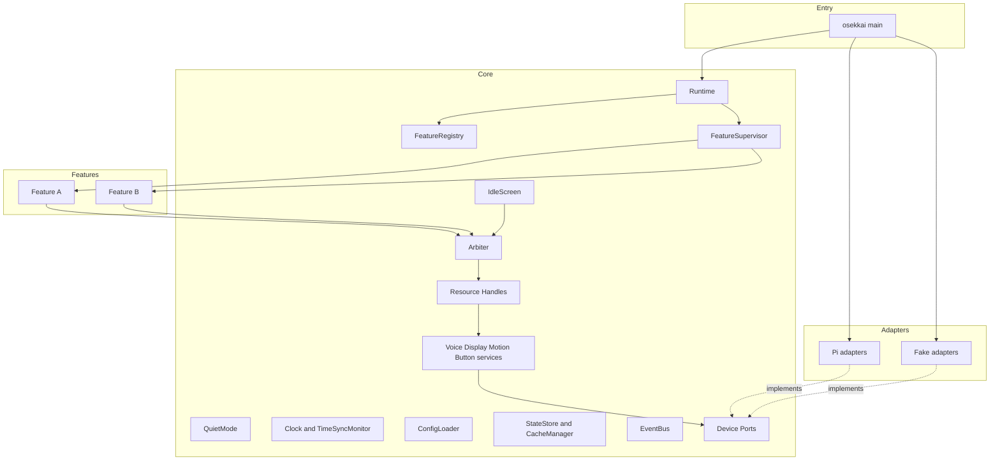
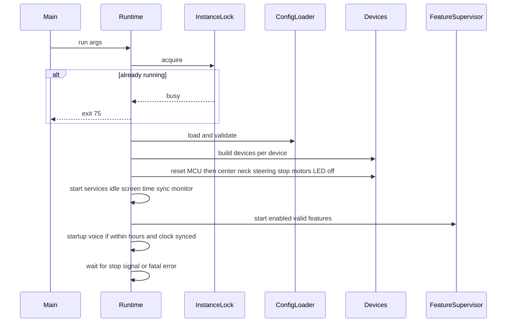
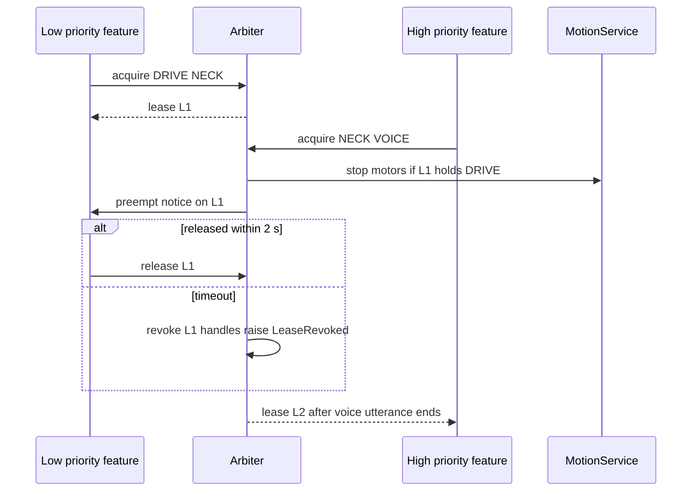
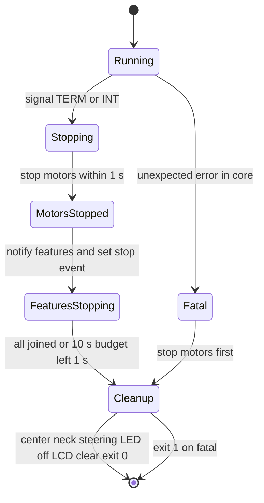

# Design Document: rover-core

## Overview
**Purpose**: Rover Core は、OsekkaiRover のすべての機能が共通して使う「ロボット本体の基盤」を提供する。
- 起動と停止を安全に行う
- 声・画面・LED・ボタン・首・走行を、機能が借りて使える形で提供する
- 資源の取り合いを優先度で調停する
- 設定と状態を、リポジトリの外に壊れにくく保存する

**Users**:
- 機能の開発者: Feature の契約と FeatureContext を通して基盤を使う
- 保護者: 設定ファイルで振る舞いを変える
- 子ども: 待機画面・声・動きとして基盤の振る舞いに触れる

**Impact**: 参照実装の `main.py` と `routine.tick()` に散らばっていた役割を置き換える。さらに次の問題を、構造で防ぐ。
- SIGTERM でモーターが止まらない
- スレッド同士がハードを取り合う
- ボタンの押下が残り続ける
- 記録が壊れる

### Goals
- どの止まり方（シグナル、基盤の異常、プロセスの強制終了）でも、モーターが止まる
- 機能は、エントリーポイントに登録するだけで加われる。基盤は機能の名前も優先順位も持たない
- 資源（VOICE・DISPLAY・LED・BUTTON・NECK・DRIVE）は、リースを持つ機能だけが操作できる
- 判定ロジックのすべてと、アダプタを除くすべてが、ハードのない環境で `pytest` で確かめられる

### Non-Goals
- 実機への配置、self-check、切り戻し（`device-deployment`）
- 音声の入力、カメラ、超音波と床センサー（`voice-gateway`、`presence`、`remote-control`）
- 個々の機能の振る舞いと、機能ごとの優先度の値
- 機能を動いたまま再読み込みすること、機能を自動で再起動すること

## Boundary Commitments

### This Spec Owns
- プロセスのライフサイクル:
  - 起動の順番
  - シグナル処理と安全な停止
  - 単一の実行の保証
  - 版の記録
  - 基盤の異常時の終了
  - 安全停止のコマンド（`ExecStopPost` 用）
- Feature の契約（`Feature`、`FeatureSpec`、`FeatureContext`）、エントリーポイント `osekkai.features` による発見、機能のスレッドの監督
- 資源の調停（`Arbiter`、`Lease`、`Resource`）と、資源の操作の口（`VoiceHandle`、`DisplayHandle`、`LedHandle`、`ButtonHandle`、`NeckHandle`、`DriveHandle`）
- デバイスのポート（Protocol）と、PiCar-X の実機アダプタ、模擬のアダプタ
- LCD の文字の変換（`to_lcd_codes`、`center`）、絵の文字、顔
- 首と体の基本の動き（正面に戻す、うなずく、見回す、ねむそう、ダンス）
- 待機画面、静かな状態、時刻と時刻の同期の判定、基盤のイベント
- 設定の読み込みと検証の仕組み（`core` の節と、機能の節の検証の枠組み）
- 状態の保存（`StateStore`）、キャッシュ（`CacheManager`）、XDG のパス
- systemd のユニット（`deploy/systemd/osekkai-rover.service`）、CI の lint・型・テストのジョブ、`pyproject.toml`

### Out of Boundary
- 実機への配置・初期設定（apt、リンガリング、`gpio` グループ、ユニットの登録）と self-check のコマンド（`device-deployment`）
- 音声の聞き取りと意図の振り分け（`voice-gateway`）。ボタンについては、待ち手として登録する口を提供するだけ
- カメラ、顔の検出と認識、超音波と床センサー（`presence`、`remote-control`）
- 機能ごとの設定の中身、優先度の値、保存する状態の形
- 日課・あいさつ・会話・遊び・ラジコンの振る舞い

### Allowed Dependencies
- Python 3.11 以上の標準ライブラリ、PyYAML、pydantic v2（PyPI）
- 実機アダプタだけ: smbus2、lgpio（apt の `python3-lgpio`）、numpy（apt）、外部コマンドの `open_jtalk`、`paplay`、`timedatectl`
- 依存の向き: `features/*` → `core`（契約とハンドル）。`core` → `core.ports`（Protocol）← `adapters/{pi,fake}`
  - `core` は `adapters` と `features` を読み込まない
  - アダプタの選択は、`osekkai/__main__.py`（組み立ての場所）だけが行う

### Revalidation Triggers
次の変更をしたら、下流の機能のスペックで、つなぎ目を確かめ直す。
- `Feature`・`FeatureSpec`・`FeatureContext`・`Lease`・各 Handle の形や意味の変更
- `Resource` の種類の追加と削除、優先度の規則、中断の猶予（2 秒）の変更
- イベント（`QuietChanged`、`TimeSynced`）の追加と変更
- 設定ファイルの構造（トップレベルのキーの規則、`enabled` の扱い）の変更
- 状態とキャッシュの保存先、`StateStore` の書式の変更
- 起動の前提の変更（Python の版、実機の依存、ユニットの設定）

## Architecture

### Architecture Pattern & Boundary Map



**Architecture Integration**:
- **Selected pattern**: ポートとアダプタに、資源のリースを組み合わせる
  - デバイスはポート（Protocol）の裏に隠す
  - 機能は `Arbiter` からリースを借り、リースから得た Handle でだけ操作する
- **Domain/feature boundaries**:
  - 機能同士は基盤を介して資源を共有し、互いを直接知らない
  - 待機画面も、優先度 0 の内部の持ち主として同じ調停に従う
- **Steering compliance**:
  - `tech.md`（ポートとアダプタ、時計の差し替え、ハードのライブラリの読み込みはアダプタだけ）
  - `structure.md`（`src/osekkai/core`、`adapters/{pi,fake}`）
  - `product.md`（安全 > 個人データ > 習慣 > 楽しさ）
- **Steering からの逸脱**:
  - `tech.md` は「robot_hat を使う」としていた。HAT の操作は smbus2 と lgpio の上の自前の部品で行う（理由は「Technology Stack」と `research.md` を参照）
  - このスペックの PR で、`tech.md` を更新する

**依存の向き（違反はエラーとして扱う）**:
`core.types` → `core.ports` → `core.config / core.paths / core.storage / core.cache / core.clock / core.events` → `core.arbiter` → `core.services（voice, display, motion, buttons）` → `core.idle / core.quiet` → `core.feature / core.registry / core.supervisor` → `core.runtime` → `osekkai.__main__`
- `adapters/*` は `core.ports` と `core.types` だけを読み込む
- `features/*` は `core.feature` と、それが公開する型だけを使う

### Technology Stack

| Layer | Choice / Version | Role in Feature | Notes |
|-------|------------------|-----------------|-------|
| CLI / Entry | Python 3.11–3.13、`argparse` | `python -m osekkai`、`--fake-hardware`、`--say`、`--config` | 実機は Trixie の 3.13 を推奨。3.11 でも動く |
| Config | PyYAML、pydantic 2.x（PyPI） | 設定の読み込みと検証 | Bookworm の apt の pydantic は v1 なので使わない |
| Data / Storage | 標準ライブラリ（`json`、`os.replace`、`fcntl`） | 状態の原子的な保存、単一の実行のロック | XDG のディレクトリを自前で読む |
| Hardware（実機のみ） | smbus2、lgpio（apt）、numpy（apt） | HAT の PWM・GPIO、LCD 1602、音量の正規化 | `robot_hat` と `picarx` は使わない |
| Speech（実機のみ） | `open_jtalk` 1.11（apt）、`paplay`（PipeWire） | 声の合成と再生 | 入力は 1 行まで。再生先は設定で選ぶ |
| Runtime | systemd のユーザーサービス | 常駐、停止、異常時の再起動、安全停止 | `KillMode=mixed`、`TimeoutStopSec=15s`、`ExecStopPost` |
| Dev / CI | pytest、ruff、mypy、GitHub Actions（3.11 と 3.13） | lint・型・テスト | 実機の依存なしで入るように extras を分ける |

## File Structure Plan

### Directory Structure
```
pyproject.toml                         # パッケージ、依存（extras: pi, dev）、エントリーポイント、ruff/mypy/pytest の設定
config/
└── osekkai.example.yaml               # 設定の見本（core の節と、機能の節の書き方の例）
deploy/
└── systemd/
    └── osekkai-rover.service          # ユーザーサービスのユニット（ExecStopPost の安全停止を含む）
src/osekkai/
├── __init__.py
├── __main__.py                        # 組み立ての場所: 引数の解析、アダプタの選択、Runtime の起動
├── version.py                         # 版の文字列（git describe、だめならパッケージの版）
├── core/
│   ├── __init__.py                    # 機能に公開する型の再公開（Feature、FeatureSpec、FeatureContext、Resource、Lease など）
│   ├── types.py                       # 共通の値の型（Resource、Face、Glyph、ButtonPress、FeatureId）と例外
│   ├── ports.py                       # デバイスのポート（Protocol）
│   ├── paths.py                       # XDG のパス（config、state、cache、data、runtime）
│   ├── config.py                      # ConfigLoader、CoreConfig、FeatureConfig、ConfigReport
│   ├── storage.py                     # StateStore（原子的な保存、壊れたファイルの退避、機能ごとの分離）
│   ├── cache.py                       # CacheManager（合計の上限、古いものから消す）
│   ├── clock.py                       # Clock（Protocol）、SystemClock、TimeSyncMonitor
│   ├── events.py                      # EventBus と、イベントの型（QuietChanged、TimeSynced）
│   ├── arbiter.py                     # Arbiter、Lease、資源の貸し出し・中断・取り上げ
│   ├── handles.py                     # リースから得る操作の口（VoiceHandle など）。取り上げ後は LeaseRevoked
│   ├── voice.py                       # VoiceService（合成、キャッシュ、再生、残さない指定、文章をログに出さない）
│   ├── lcd_text.py                    # to_lcd_codes、center、絵の文字の形、顔（純粋な関数）
│   ├── display.py                     # DisplayService、LedService
│   ├── motion.py                      # MotionService（範囲に収める、調整値、基本の動き、ダンスのタイヤの許可）
│   ├── buttons.py                     # ButtonRouter（チャタリング除去、リースへの配達、待ち手、捨てる）
│   ├── idle.py                        # IdleScreen（日付・時刻・顔・機能の短い情報）
│   ├── quiet.py                       # QuietMode（静かな状態、再起動をまたぐ保存）
│   ├── feature.py                     # Feature、FeatureSpec、FeatureContext
│   ├── registry.py                    # FeatureRegistry（エントリーポイントの発見、重複、無効）
│   ├── supervisor.py                  # FeatureSupervisor（機能ごとのスレッド、異常の隔離、停止の待ち）
│   ├── instance_lock.py               # InstanceLock（flock）
│   ├── logging_setup.py               # journal と端末のログ形式
│   ├── safety.py                      # SafetyStop（モーター停止・首の復帰・LED と LCD の消灯の手順）
│   ├── safe_stop.py                   # `python -m osekkai.core.safe_stop`（ExecStopPost 用の最小のモーター停止）
│   └── runtime.py                     # Runtime（起動の順番、シグナル、停止、終了コード）
└── adapters/
    ├── __init__.py
    ├── pi/
    │   ├── __init__.py                # build_pi_devices: デバイスごとに準備し、失敗を隔離する
    │   ├── i2c_bus.py                 # I2C バスの共有ロックと、失敗を例外にする書き込み
    │   ├── hat.py                     # HatMcu: PWM レジスタ、MCU リセット、HAT の版の判定
    │   ├── gpio.py                    # lgpio のピン（ボタン、LED、モーターの方向、スピーカーの有効化）
    │   ├── picarx.py                  # PiCarXBody: サーボ（P0/P1/P2）とモーター（P12/P13＋D4/D5）の割り当て
    │   ├── lcd1602.py                 # Lcd1602Display（HD44780 + PCF8574、絵の文字の登録）
    │   ├── openjtalk.py               # OpenJTalkSynth（1 行に整える、文で分ける、音量の正規化）
    │   ├── pipewire.py                # PaplayPlayer（再生先の指定）
    │   └── timesync.py                # TimedatectlTimeSync（同期の判定）
    └── fake/
        ├── __init__.py                # build_fake_devices
        ├── devices.py                 # テスト用の記録する偽物（FakeDisplay、FakeServo、FakeMotor など）
        ├── console.py                 # ハードなしの実行: 状態を端末に出し、Enter キーでボタンを模擬する
        └── clock.py                   # FakeClock（時刻を進められる、同期の状態を切り替えられる）
tests/
├── conftest.py                        # 偽物のデバイス一式、FakeClock、一時の XDG ディレクトリ
└── core/                              # src/osekkai/core と同じ構成（test_arbiter.py など）
```

### Modified Files
- `.github/workflows/ci.yml` — `test` ジョブ（Python 3.11 と 3.13 の行列で `ruff check`、`ruff format --check`、`mypy`、`pytest`）を追加する
- `.gitignore` — `.mypy_cache/`、`.pytest_cache/`、`.ruff_cache/`、`*.egg-info/` を追加する
- `README.md` — 開発の始め方（`pip install -e .[dev]`、`python -m osekkai --fake-hardware`）と設定ファイルの場所を追記する
- `.kiro/steering/tech.md` — HAT の操作は自前の部品で行うこと、pydantic v2、`ExecStopPost` の安全停止を反映する
- GitHub のルールセット「main を守る」 — 必須のチェックに `test` を追加する（リポジトリの設定。ファイルではない）

## System Flows

### 起動

- デバイスの準備は 1 つずつ行い、失敗したデバイスは `Unavailable` として扱う（1.6）。そのデバイスを使う Handle は、操作すると `DeviceUnavailable` を投げる
- 起動の声は、時刻が確かで、かつ `core.startup_voice_hours` の中のときだけ出す（1.3、1.4）。時刻が確かでないときは、夜の可能性があるので出さない

### 資源の貸し出しと中断

- 決まりごと:
  - 借りるときは、資源の集合を「全部か無しか」で借りる（行き詰まりを防ぐ）
  - 中断の通知は、高い方が借りに来たときに 1 回だけ出す
  - 中断を通知するとき、走行の資源があれば直ちにモーターを止める（4.5）。リースを 2 秒以内に返さなければ取り上げる（4.4）
  - VOICE は発話の途中で渡さない。VoiceService が発話の終わりまで持つロックで直列にする（4.6）
- 同じか高い優先度の機能が持っているとき（4.7）: `wait` の秒数を指定して待つ。`wait=0` なら直ちに `ResourceBusy` を投げる

### 停止

- シグナルハンドラの中では、モーターの停止（`MotionService.emergency_stop()`、ロックを待たずに PWM を 0 にする）と、停止の要求の記録だけを行う（2.1）
- 機能の停止は、全体で 8 秒まで待つ。応えない機能は待たずに片付けに進む（2.2、2.3）
- 基盤の異常（2.4）では、モーターを止めて首を戻し、終了コード 1 で終える（systemd が再起動する）
- systemd の `ExecStopPost=` が `python -m osekkai.core.safe_stop` を実行し、どんな終わり方の後でもモーターの PWM を 0 にする（多重の安全策）

## Requirements Traceability

| Requirement | Summary | Components | Interfaces | Flows |
|-------------|---------|------------|------------|-------|
| 1.1 | 起動時に正面・停止・消灯にしてから機能を開始 | Runtime, SafetyStop, HatMcu | `SafetyStop.neutral()` | 起動 |
| 1.2 | 待機画面を表示 | IdleScreen | `IdleScreen.start()` | 起動 |
| 1.3 | 時間帯の中なら起動を声で知らせる | Runtime, VoiceService, Clock | `CoreConfig.startup_voice_hours` | 起動 |
| 1.4 | 時間帯の外では知らせない | Runtime, Clock | 同上 | 起動 |
| 1.5 | 版をログに記録 | Runtime, version | `version.get_version()` | 起動 |
| 1.6 | デバイスの失敗を隔離 | build_pi_devices, Handles | `DeviceUnavailable` | 起動 |
| 1.7 | 2 つ目の起動を断る | InstanceLock, Runtime | `InstanceLock.acquire()`、終了コード 75 | 起動 |
| 2.1 | 停止の要求から 1 秒以内にモーター停止 | Runtime, MotionService | `emergency_stop()` | 停止 |
| 2.2 | 機能に停止を知らせ、片付けて 10 秒以内に終了 | Runtime, FeatureSupervisor, SafetyStop | `stop_all(timeout)` | 停止 |
| 2.3 | 応えない機能を待たない | FeatureSupervisor | 同上 | 停止 |
| 2.4 | 基盤の異常で安全に止めて終了 | Runtime, SafetyStop | 終了コード 1 | 停止 |
| 2.5 | 走行の持ち主がいなくなったらモーター停止 | Arbiter, MotionService | `Arbiter._on_released()` | 貸し出し |
| 3.1 | 名前・優先度・資源を受け付けて開始 | FeatureRegistry, FeatureSupervisor | `FeatureSpec` | 起動 |
| 3.2 | 基盤は機能の名前と優先順位を持たない | FeatureRegistry | エントリーポイント `osekkai.features` | — |
| 3.3 | 無効の機能は開始しない | FeatureRegistry, ConfigLoader | `FeatureConfig.enabled` | 起動 |
| 3.4 | 開始の失敗を隔離 | FeatureSupervisor | — | 起動 |
| 3.5 | 動作中の異常を隔離し、資源を取り戻す | FeatureSupervisor, Arbiter | `Arbiter.revoke_all(owner)` | — |
| 3.6 | 同じ名前の登録を断る | FeatureRegistry | — | 起動 |
| 4.1 | 資源を同時に 1 つの機能だけに使わせる | Arbiter | `acquire()` | 貸し出し |
| 4.2 | 空いている資源を貸す | Arbiter | `acquire()` | 貸し出し |
| 4.3 | 低い優先度の機能に中断を知らせて渡す | Arbiter | `Lease.preempt_requested`、`on_preempt` | 貸し出し |
| 4.4 | 2 秒で取り上げる | Arbiter | `LeaseRevoked` | 貸し出し |
| 4.5 | 中断の通知と同時にモーター停止 | Arbiter, MotionService | — | 貸し出し |
| 4.6 | 発話が終わってから渡す | VoiceService, Arbiter | 発話のロック | 貸し出し |
| 4.7 | 待つか諦めるかを選ばせる | Arbiter | `acquire(wait=...)`、`ResourceBusy` | 貸し出し |
| 4.8 | 首が空いたら正面に戻す | Arbiter, MotionService | `MotionService.home()` | 貸し出し |
| 4.9 | 資源を持たない操作を受け付けない | Handles | Handle はリースからだけ得られる | — |
| 5.1 | 押下をボタンの持ち主に 1 回知らせる | ButtonRouter, ButtonHandle | `ButtonHandle.wait_press()` | — |
| 5.2 | 持ち主がいなければ最も高い待ち手に知らせる | ButtonRouter | `FeatureContext.want_button_presses()` | — |
| 5.3 | 受け手がいなければ捨てる | ButtonRouter | — | — |
| 5.4 | チャタリングで重複させない | ButtonRouter | 50 ms の除去 | — |
| 6.1 | 声・高さ・速さで話し、終わりを知らせる | VoiceService, OpenJTalkSynth, PaplayPlayer | `VoiceHandle.say()` | — |
| 6.2 | 音量をそろえる | OpenJTalkSynth | 正規化 | — |
| 6.3 | 同じ文章はキャッシュを使う | VoiceService, CacheManager | — | — |
| 6.4 | 残さない指定 | VoiceService | `say(keep=False)` | — |
| 6.5 | 文章をログに出さない | VoiceService, logging_setup | — | — |
| 6.6 | 話せないときは知らせて動き続ける | VoiceService | `SpeechFailed` | — |
| 7.1 | 16 文字 × 2 行で表示 | DisplayService, lcd_text | `DisplayHandle.show()` | — |
| 7.2 | かなを半角カタカナに、表示できない文字は「?」 | lcd_text | `to_lcd_codes()` | — |
| 7.3 | 絵の文字と顔 | lcd_text, Lcd1602Display | `Glyph`、`Face` | — |
| 7.4 | 濁点も数える中央寄せ | lcd_text | `center()` | — |
| 7.5 | バックライト | DisplayService | `DisplayHandle.set_backlight()` | — |
| 7.6 | LED | LedService | `LedHandle.set()` | — |
| 8.1 | 首の向き（範囲に収める） | MotionService | `NeckHandle.look()` | — |
| 8.2 | 基本の動き | MotionService | `NeckHandle.home()`、`nod()`、`look_around()`、`sleepy()`、`dance()` | — |
| 8.3 | ダンスでタイヤを回さない（許可がなければ） | MotionService | `CoreConfig.motion.allow_drive_in_dance` | — |
| 8.4 | 走行 | MotionService, PiCarXBody | `DriveHandle.drive()` | — |
| 8.5 | 調整値（版の入れ替えで消えない） | MotionService, CoreConfig | `CoreConfig.motion.calibration` | — |
| 9.1 | 待機画面（日付・時刻・顔、更新） | IdleScreen | — | — |
| 9.2 | 機能の短い情報 | IdleScreen | `FeatureContext.set_idle_info()` | — |
| 9.3 | 待機画面の顔の向きと表情 | IdleScreen | `FeatureContext.set_idle_face()` | — |
| 9.4 | 静かな状態に入る・知らせる | QuietMode, IdleScreen, EventBus | `request_quiet()`、`QuietChanged` | — |
| 9.5 | 静かな状態を終える・知らせる | QuietMode, IdleScreen, EventBus | `end_quiet()`、`QuietChanged` | — |
| 9.6 | 再起動前の静かな状態を確かめられる | QuietMode, StateStore | `was_quiet_before_restart` | — |
| 10.1 | 時刻と、確かかどうか | Clock | `Clock.now()`、`is_synchronized()` | — |
| 10.2 | 確かでないときは「--:--」 | IdleScreen | — | — |
| 10.3 | 確かになったら知らせる | TimeSyncMonitor, EventBus | `TimeSynced` | — |
| 11.1 | リポジトリの外の設定ファイル | paths, ConfigLoader | `Paths.config_file` | — |
| 11.2 | ないときは見本から作る | ConfigLoader | — | 起動 |
| 11.3 | 誤りをログと LCD で示す | ConfigLoader, Runtime, DisplayService | `ConfigReport` | 起動 |
| 11.4 | 機能の設定だけ誤りなら、その機能だけ止める | ConfigLoader, FeatureRegistry | `ConfigReport.feature_errors` | 起動 |
| 11.5 | 既定値 | CoreConfig, FeatureConfig | pydantic の既定値 | — |
| 11.6 | 知らない項目は記録して続ける | ConfigLoader | `ConfigReport.warnings` | — |
| 11.7 | 機能が自分の設定を定める | FeatureSpec, FeatureConfig | `FeatureSpec.config_model` | — |
| 12.1 | リポジトリの外に保存 | paths, StateStore, CacheManager | — | — |
| 12.2 | 機能ごとに分ける | StateStore | `FeatureContext.store` | — |
| 12.3 | 電源断でも前か後の正しい状態 | StateStore | 原子的な書き込み | — |
| 12.4 | 壊れたファイルを退避して空で開始 | StateStore | `StateStore.load()` | — |
| 12.5 | デプロイで引き継ぐ | paths | XDG のディレクトリ | — |
| 12.6 | キャッシュの上限 | CacheManager | `CoreConfig.cache.max_mb` | — |
| 13.1 | ハードなしの実行と出力 | ConsoleDevices, `__main__` | `--fake-hardware` | — |
| 13.2 | ボタンの模擬 | ConsoleDevices | Enter キー | — |
| 13.3 | 時刻の差し替え | Clock, FakeClock | `Clock` Protocol | — |
| 13.4 | ハードのない環境でテスト | ports, adapters/fake, CI | `pytest` | — |
| 13.5 | 文章を話して終了 | `__main__`, VoiceService | `--say` | — |

## Components and Interfaces

| Component | Domain/Layer | Intent | Req Coverage | Key Dependencies (P0/P1) | Contracts |
|-----------|--------------|--------|--------------|--------------------------|-----------|
| Runtime | Lifecycle | 起動の順番、シグナル、停止、終了コード | 1.1–1.5, 1.7, 2.1–2.4, 11.3 | FeatureSupervisor (P0), SafetyStop (P0), InstanceLock (P0) | Service, State |
| SafetyStop / safe_stop | Lifecycle | 中立の姿勢への復帰とモーター停止。ExecStopPost 用の最小コマンド | 1.1, 2.1, 2.2, 2.4 | MotionService (P0), HatMcu (P0) | Service |
| InstanceLock | Lifecycle | 単一の実行 | 1.7 | paths (P1) | Service |
| FeatureRegistry | Features | エントリーポイントの発見、重複と無効の判定 | 3.1–3.3, 3.6, 11.4 | ConfigLoader (P0) | Service |
| FeatureSupervisor | Features | 機能ごとのスレッド、異常の隔離、停止の待ち | 2.2, 2.3, 3.1, 3.4, 3.5 | Arbiter (P0) | Service, State |
| Feature / FeatureSpec / FeatureContext | Features | 機能の契約と、機能に渡す道具 | 3.1, 3.2, 5.2, 9.2–9.6, 10.1, 11.7, 12.2 | Arbiter, StateStore, Clock, EventBus (P0) | Service |
| Arbiter / Lease | Resources | 資源の貸し出し、中断、取り上げ | 2.5, 3.5, 4.1–4.9 | MotionService (P0) | Service, State |
| Handles | Resources | リースから得る操作の口 | 4.9, 1.6 | 各 Service (P0) | Service |
| VoiceService | Services | 合成・キャッシュ・再生・発話の直列化 | 4.6, 6.1–6.6 | SpeechSynthPort, AudioPlayerPort, CacheManager (P0) | Service |
| DisplayService / LedService | Services | 2 行の表示、バックライト、LED | 7.1, 7.5, 7.6 | DisplayPort, LedPort (P0) | Service |
| lcd_text | Services | 文字の変換、中央寄せ、絵の文字、顔 | 7.2–7.4 | — | Service |
| MotionService | Services | 首と走行、範囲、調整値、基本の動き | 4.8, 8.1–8.5, 2.1 | ServoPort, MotorPort (P0) | Service |
| ButtonRouter | Services | 押下の配達 | 5.1–5.4 | ButtonPort (P0) | Service, Event |
| IdleScreen | Presentation | 待機画面 | 1.2, 9.1–9.3, 10.2 | Arbiter, Clock (P0) | State |
| QuietMode | Presentation | 静かな状態 | 9.4–9.6 | StateStore, EventBus (P0) | Service, Event, State |
| Clock / TimeSyncMonitor | Infra | 時刻と同期の判定 | 10.1–10.3, 13.3 | TimeSyncPort (P1) | Service, Event |
| EventBus | Infra | 基盤のイベントの配達 | 9.4, 9.5, 10.3 | — | Event |
| ConfigLoader / CoreConfig | Infra | 設定の読み込みと検証 | 11.1–11.7, 8.5, 3.3 | paths (P0), pydantic (P0) | Service |
| StateStore / CacheManager / paths | Infra | 保存とキャッシュとパス | 12.1–12.6, 6.3, 6.4 | — | Service, State |
| Pi adapters | Adapters | 実機のデバイス | 1.1, 1.6, 6.1, 6.2, 7.3, 8.4 | smbus2, lgpio, open_jtalk, paplay (P0) | Service |
| Fake / Console adapters | Adapters | テストと PC での実行 | 13.1–13.4 | — | Service |
| CLI（`__main__`） | Entry | 組み立てと引数 | 13.1, 13.5 | Runtime (P0) | Service |

### Features

#### Feature / FeatureSpec / FeatureContext

| Field | Detail |
|-------|--------|
| Intent | 機能が基盤に加わるための契約と、機能に渡す道具一式 |
| Requirements | 3.1, 3.2, 5.2, 9.2–9.6, 10.1, 11.7, 12.2 |

**Responsibilities & Constraints**
- 機能は `FeatureSpec`（名前・優先度・使う資源・設定のモデル）を持つクラスとして、エントリーポイント `osekkai.features` に登録する
- 優先度は 1 以上の整数。数が大きいほど優先する。0 は基盤の内部（待機画面）が使う
- `run()` は機能専用のスレッドで呼ばれる。`stop` のイベントが立ったら、速やかに戻る

**Contracts**: Service [x]

##### Service Interface
```python
class FeatureConfig(BaseModel):
    model_config = ConfigDict(extra="allow")   # 知らない項目は警告にする（11.6）
    enabled: bool = True

@dataclass(frozen=True)
class FeatureSpec:
    name: str                                   # 設定のトップレベルのキー、状態の保存先の名前
    priority: int                               # 1 以上
    resources: frozenset[Resource]              # 使う可能性のある資源（申告。acquire はこの中だけ）
    config_model: type[FeatureConfig] = FeatureConfig

class Feature(Protocol):
    spec: ClassVar[FeatureSpec]
    def __init__(self, ctx: "FeatureContext", config: FeatureConfig) -> None: ...
    def run(self, stop: threading.Event) -> None: ...

class FeatureContext(Protocol):
    name: str
    clock: Clock
    store: StateStore                           # この機能の保存先だけ（12.2）
    cache_dir: Path                             # この機能のキャッシュの置き場所（上限は CacheManager）
    log: logging.Logger
    def acquire(self, resources: Iterable[Resource], *, wait: float = 0.0,
                on_preempt: Callable[[], None] | None = None) -> Lease: ...
    def want_button_presses(self, callback: Callable[[ButtonPress], None]) -> Callable[[], None]: ...  # 戻り値で登録解除（5.2）
    def set_idle_info(self, text: str | None) -> None: ...          # 待機画面の短い情報（9.2）。最大 6 文字分
    def set_idle_face(self, face: Face, gaze: float = 0.0) -> None: ...  # gaze は -1.0〜1.0（9.3）
    def request_quiet(self) -> None: ...                            # 9.4
    def end_quiet(self) -> None: ...                                # 9.5
    @property
    def is_quiet(self) -> bool: ...
    @property
    def was_quiet_before_restart(self) -> bool: ...                 # 9.6
    def subscribe(self, event_type: type[E], callback: Callable[[E], None]) -> None: ...
```
- **Preconditions**:
  - `acquire()` の `resources` は、`spec.resources` の部分集合（でなければ `ValueError`）
  - `set_idle_info()` は、LCD の表示で 6 セル以内（超えたら切り詰める）
- **Postconditions**: `want_button_presses` の callback は ButtonRouter のスレッドで呼ばれる。callback は速やかに戻る（重い処理は自分のスレッドに渡す）
- **Invariants**:
  - FeatureContext は、ほかの機能の保存先・キャッシュ・リースに触れる手段を持たない
  - 静かな状態は、どれかの機能が `request_quiet()` すると入り、どれかの機能が `end_quiet()` すると終わる。誰が求めたかは数えない（単純な真偽値。最後の要求が勝つ）

**Implementation Notes**
- Integration: エントリーポイントの値は `"osekkai.features.routine:RoutineFeature"` の形。テストでは、Feature のクラスのリストを直接 `FeatureRegistry` に渡す
- Validation: `spec.name` は `^[a-z][a-z0-9_]*$`、`core` は予約。優先度は 1 以上
- Risks: 機能の作者が `stop` を見ない。FeatureSupervisor の停止の待ちに時間の上限を設けて対処する（2.3）

#### FeatureRegistry

| Field | Detail |
|-------|--------|
| Intent | 機能を発見し、開始してよいものを選ぶ |
| Requirements | 3.1, 3.2, 3.3, 3.6, 11.4 |

**Responsibilities & Constraints**
- `importlib.metadata.entry_points(group="osekkai.features")` から Feature のクラスを読み込む。読み込みに失敗した機能は、ログに残して除く（3.4）
- 同じ `spec.name` が 2 つあれば、後のものを除いてログに残す（3.6）
- 設定の検証結果（`ConfigReport`）に基づき、無効（3.3）と設定の誤り（11.4）の機能を除く

**Contracts**: Service [x]
```python
@dataclass(frozen=True)
class FeaturePlan:
    feature_cls: type[Feature]
    config: FeatureConfig

class FeatureRegistry:
    def __init__(self, discovered: Sequence[type[Feature]] | None = None) -> None: ...  # None ならエントリーポイントから
    def feature_classes(self) -> Sequence[type[Feature]]: ...
    def plan(self, report: ConfigReport) -> Sequence[FeaturePlan]: ...
```

#### FeatureSupervisor

| Field | Detail |
|-------|--------|
| Intent | 機能ごとのスレッドを動かし、異常を隔離し、停止を待つ |
| Requirements | 2.2, 2.3, 3.1, 3.4, 3.5 |

**Responsibilities & Constraints**
- 機能ごとに、デーモンでないスレッドを 1 本立て、`Feature(ctx, config)` を作って `run(stop)` を呼ぶ
- 機能の生成や `run` で例外が出たら、ログに残す（機能名と例外の型。メッセージに個人情報が混ざりうるので、traceback は DEBUG のときだけ）。続けて `Arbiter.revoke_all(owner)` で資源を取り戻す。その機能は再起動しない（3.4、3.5）
- `stop_all(timeout)` で全機能の `stop` を立て、合計 `timeout` 秒まで join する。残ったスレッドは見捨てる（デーモン化はできないため、Runtime は `os._exit` で終える）

**Contracts**: Service [x] / State [x]
```python
class FeatureState(Enum):
    STARTING = "starting"; RUNNING = "running"; FAILED = "failed"; STOPPED = "stopped"

class FeatureSupervisor:
    def start(self, plans: Sequence[FeaturePlan]) -> None: ...
    def states(self) -> Mapping[str, FeatureState]: ...
    def stop_all(self, timeout: float) -> Sequence[str]: ...   # 応えなかった機能の名前
```

### Resources

#### Arbiter / Lease

| Field | Detail |
|-------|--------|
| Intent | 資源の貸し出しと、優先度による中断・取り上げ |
| Requirements | 2.5, 3.5, 4.1–4.9 |

**Responsibilities & Constraints**
- 資源ごとに、持ち主（リース）を最大 1 つだけ持つ（4.1）
- `acquire(owner, resources, wait, on_preempt)` の流れ:
  1. 求めた資源がすべて空いていれば貸す（4.2）
  2. 持ち主がいる資源があり、その全員が求めた機能より優先度が低ければ、持ち主のリースに中断を通知する（4.3）。DRIVE を持つリースなら、直ちにモーターを止める（4.5）。そのうえで、空くのを待つ
  3. 同じか高い優先度の持ち主がいれば、`wait` 秒まで空くのを待つ。0 なら直ちに `ResourceBusy` を投げる（4.7）
- 中断を通知したリースが 2 秒以内に `release()` しなければ、取り上げる。取り上げたリースの Handle は、以後の操作で `LeaseRevoked` を投げる（4.4）
- VOICE は、取り上げても発話の途中では止めない。新しい持ち主の `say()` は、VoiceService の発話のロックで前の発話の終わりを待つ（4.6）
- リースが返されるか取り上げられたとき:
  - DRIVE の持ち主がいなくなったら、モーターを止める（2.5）
  - NECK の持ち主がいなくなったら、首を正面に戻す（4.8）
  - DISPLAY が空いたら、IdleScreen が借り直す（`resource_freed` のコールバック）
- `revoke_all(owner)` は、その持ち主のすべてのリースを直ちに取り上げる（3.5、停止時）

**Contracts**: Service [x] / State [x]
```python
class Resource(Enum):
    VOICE = "voice"; DISPLAY = "display"; LED = "led"; BUTTON = "button"; NECK = "neck"; DRIVE = "drive"

class ResourceBusy(Exception): ...
class LeaseRevoked(Exception): ...

class Lease:
    owner: str
    resources: frozenset[Resource]
    preempt_requested: threading.Event          # 中断の通知（4.3）
    @property
    def active(self) -> bool: ...
    @property
    def voice(self) -> VoiceHandle: ...         # 借りていない資源の Handle を求めたら ValueError
    @property
    def display(self) -> DisplayHandle: ...
    @property
    def led(self) -> LedHandle: ...
    @property
    def button(self) -> ButtonHandle: ...
    @property
    def neck(self) -> NeckHandle: ...
    @property
    def drive(self) -> DriveHandle: ...
    def release(self) -> None: ...              # 何度呼んでもよい
    def __enter__(self) -> "Lease": ...
    def __exit__(self, *exc: object) -> None: ...  # release()

class Arbiter:
    PREEMPT_GRACE_S: Final = 2.0
    def __init__(self, clock: Clock, motion: "MotionService") -> None: ...
    def acquire(self, owner: str, priority: int, resources: Iterable[Resource], *, wait: float = 0.0,
                on_preempt: Callable[[], None] | None = None) -> Lease: ...
    def revoke_all(self, owner: str) -> None: ...
    def on_resource_freed(self, resource: Resource, callback: Callable[[], None]) -> None: ...
    def holder(self, resource: Resource) -> str | None: ...
```
- **State model**: `Lease` は `ACTIVE → PREEMPT_REQUESTED → (RELEASED | REVOKED)`、または `ACTIVE → RELEASED`。終わったリースは再び有効にならない
- **Concurrency strategy**:
  - 状態は 1 つの `threading.Condition` で守る
  - `on_preempt` は Arbiter のロックの外で、短命のスレッドから呼ぶ（機能のコードで Arbiter が止まらないようにする）
  - 2 秒の取り上げは、`Clock.monotonic()` に基づく期限で判定する（テストでは FakeClock で進める）

**Implementation Notes**
- Integration: FeatureContext の `acquire()` は、`owner` と `priority` を自分の `FeatureSpec` から埋めて Arbiter に渡す
- Risks:
  - 待っている高い方の機能が、低い方の長い発話を待たされる（最長でその発話の長さ）。発話は短い文に分けることを、機能の作者への指針にする
  - DRIVE の中断で止めたモーターを、低い方の機能が取り上げまでの間に再び動かせないようにする。中断を通知した後の `DriveHandle.drive()` は、`LeaseRevoked` を投げる

#### Handles

| Field | Detail |
|-------|--------|
| Intent | リースを持つ機能だけに、資源の操作を許す |
| Requirements | 4.9, 1.6 |

**Responsibilities & Constraints**
- Handle は Lease の中でだけ作られ、操作のたびにリースが有効かを確かめる。無効なら `LeaseRevoked` を投げる
- デバイスが使えない（1.6）ときは `DeviceUnavailable` を投げる。機能はそれを捕まえて、機能を縮めて続けてよい

**Contracts**: Service [x]
```python
class VoiceHandle(Protocol):
    def say(self, text: str, *, keep: bool = True) -> None: ...   # 話し終わるまで戻らない。失敗は SpeechFailed（6.6）
class DisplayHandle(Protocol):
    def show(self, line1: str, line2: str = "") -> None: ...       # 各行 16 セルに収める（7.1）
    def set_backlight(self, on: bool) -> None: ...                 # 7.5
class LedHandle(Protocol):
    def set(self, on: bool) -> None: ...                           # 7.6
class ButtonHandle(Protocol):
    def clear(self) -> None: ...                                   # それまでの押下を忘れる
    def wait_press(self, timeout: float | None) -> bool: ...       # 押下を 1 つ消費する（5.1）
    def has_press(self) -> bool: ...
class NeckHandle(Protocol):
    def look(self, pan: float, tilt: float) -> None: ...           # 度。範囲の端に収める（8.1）
    def home(self) -> None: ...
    def nod(self, times: int = 2) -> None: ...
    def look_around(self) -> None: ...
    def sleepy(self) -> None: ...
    def dance(self, drive: "DriveHandle | None" = None) -> None: ...  # drive がないか、許可がなければタイヤを回さない（8.3）
class DriveHandle(Protocol):
    def drive(self, steering: float, speed: int) -> None: ...      # 度（±30）、速さ −100〜100（8.4）
    def stop(self) -> None: ...
```

### Services

#### VoiceService

| Field | Detail |
|-------|--------|
| Intent | 文章を声にして流す。発話を直列にし、キャッシュを管理する |
| Requirements | 4.6, 6.1–6.6 |

**Responsibilities & Constraints**
- `speak(text, keep)` の流れ:
  1. 改行を取り除く
  2. 文（「。」「！」「？」）の区切りで、1 行 300 文字以内に分ける（Open JTalk の 1 行の制限）
  3. 分けた単位ごとに合成し、続けて再生する
  4. 再生が終わったら戻る（6.1）
- キャッシュの鍵は「文章＋声の設定」のハッシュ。同じ鍵があれば合成を省く（6.3）。`keep=False` の文章は、キャッシュに入れず、再生後に一時ファイルを消す（6.4）
- 発話のロック（`threading.Lock`）で、発話を 1 つずつにする（4.6）
- ログには「話した（N 文字、キャッシュあり/なし）」だけを出し、文章を出さない（6.5）
- 合成や再生に失敗したら、`SpeechFailed` を投げてログに理由を残す（6.6）。VoiceService そのものは壊れない

**Dependencies**
- Outbound: SpeechSynthPort — 合成（P0）、AudioPlayerPort — 再生（P0）、CacheManager — キャッシュ（P0）

**Contracts**: Service [x]
```python
class SpeechFailed(Exception): ...

class VoiceService:
    def __init__(self, synth: SpeechSynthPort, player: AudioPlayerPort, cache: CacheManager,
                 settings: VoiceSettings) -> None: ...
    def speak(self, text: str, *, keep: bool = True) -> None: ...
```

#### DisplayService / LedService / lcd_text

| Field | Detail |
|-------|--------|
| Intent | 2 行の文字・絵の文字・バックライト・LED |
| Requirements | 7.1–7.6 |

**Responsibilities & Constraints**
- `lcd_text`（純粋な関数）:
  - `to_lcd_codes(text) -> list[int]`:
    - ひらがなをカタカナに変え、カタカナを半角カタカナに変える
    - 濁点と半濁点は別のセルにする
    - 半角カタカナは ROM の 0xA1〜0xDF に、ASCII の 0x20〜0x7D はそのままにする
    - 絵の文字（コード 0〜7）は通し、それ以外は「?」にする（7.2）
  - `center(text, width=16)`: 変換後のセル数で、左に空白を足す（7.4）
  - `Glyph`（EYE、EYE_HAPPY、EYE_CLOSED、SMILE、MOUTH_O、STAR、HEART、ZZZ。コード 0〜7）と、その 5×8 の形
  - `Face`（NORMAL、CALL、HAPPY、SLEEP）の文字列（7.3）
- `DisplayService.show(l1, l2)`: 各行を 16 セルに切り詰め、空白で埋める。変わった行だけをデバイスに送る（7.1）
- `LedService.set(on)`（7.6）

**Contracts**: Service [x]
```python
class Glyph(IntEnum):
    EYE = 0; EYE_HAPPY = 1; EYE_CLOSED = 2; SMILE = 3; MOUTH_O = 4; STAR = 5; HEART = 6; ZZZ = 7

GLYPH_PATTERNS: Final[Mapping[Glyph, tuple[int, ...]]]  # 5x8 の各行のビット（8 要素）

class Face(Enum):
    NORMAL = "normal"; CALL = "call"; HAPPY = "happy"; SLEEP = "sleep"
    def text(self) -> str: ...

def to_lcd_codes(text: str) -> list[int]: ...
def center(text: str, width: int = 16) -> str: ...
```

#### MotionService

| Field | Detail |
|-------|--------|
| Intent | 首と走行の操作。範囲、調整値、基本の動き |
| Requirements | 2.1, 4.8, 8.1–8.5 |

**Responsibilities & Constraints**
- 首の範囲は、設定の既定でパン −80〜80°、チルト −30〜60° とする。範囲の外の値は端に収める（8.1）
- ステアリングは ±30°、速さは −100〜100 に収める
- 調整値（`core.motion.calibration` の steering・pan・tilt のオフセットと、モーターの向き `[1, 1]`）を、すべての指令に加える（8.5）
- 基本の動き（参照実装と同じ）:
  - **home**: パン 0、チルト 0、ステアリング 0
  - **nod**: チルト −20 → 10 を 0.25 秒ずつ、指定の回数くり返し、home に戻る
  - **look_around**: パン −30 → 30 → 0 を 0.35 秒ずつ
  - **sleepy**: パン 0、チルト −30
  - **dance**: 6 拍、0.25 秒ずつ。パンは ±30、ステアリングは ∓25、チルトは 15。`allow_drive_in_dance` が真かつ DRIVE を借りているときだけ、速さ 20 で前後に動く。最後にモーターを止め、home に戻る（8.3）
- `emergency_stop()`:
  - ロックを待たずに、モーターの PWM を 0 にする
  - シグナルハンドラと Arbiter の中断から呼ぶ（2.1、4.5）
  - 何度呼んでもよく、例外を外に投げない

**Contracts**: Service [x]
```python
class MotionService:
    def look(self, pan: float, tilt: float) -> None: ...
    def home(self) -> None: ...
    def nod(self, times: int = 2) -> None: ...
    def look_around(self) -> None: ...
    def sleepy(self) -> None: ...
    def dance(self, *, wheels: bool) -> None: ...
    def drive(self, steering: float, speed: int) -> None: ...
    def stop(self) -> None: ...
    def emergency_stop(self) -> None: ...
```

**Implementation Notes**
- Integration: 時間を待つ動きは、`Clock.sleep()` を使う（テストで待たずに進めるため）
- Risks: HAT の書き込みの失敗は `DeviceUnavailable` に変える。`emergency_stop()` は失敗をログに残し、2 回まで再試行する

#### ButtonRouter

| Field | Detail |
|-------|--------|
| Intent | 押下を、正しい受け手に 1 回だけ届ける |
| Requirements | 5.1–5.4 |

**Responsibilities & Constraints**
- ButtonPort から立ち下がりの通知（時刻付き）を受ける。同じボタンで前の押下から 50 ms 以内の通知は捨てる（5.4）。USR ボタンと追加のボタンは、同じ「押下」として扱う
- 配達の順番:
  1. BUTTON のリースを持つ機能がいれば、そのリースの押下の待ち行列に 1 つ入れる（5.1）
  2. いなければ、`want_button_presses` で登録した待ち手のうち、最も優先度の高い機能の callback を呼ぶ（5.2）。同じ優先度なら先に登録した方
  3. どちらもいなければ捨てる（5.3）
- リースの押下の待ち行列は、リースが終わったら捨てる（次の持ち主に持ち越さない）

**Contracts**: Service [x] / Event [x]
- Published events: `ButtonPress(at: float, source: Literal["usr", "extra"])` を、リースか待ち手に届ける
- Ordering / delivery guarantees: 1 回の押下は、1 つの受け手に高々 1 回だけ届く

### Presentation

#### IdleScreen

| Field | Detail |
|-------|--------|
| Intent | 何もしていないときの画面 |
| Requirements | 1.2, 9.1, 9.2, 9.3, 10.2 |

**Responsibilities & Constraints**
- 優先度 0 の内部の持ち主 `core.idle` として、DISPLAY を借りる。中断の通知を受けたら直ちに返し、画面が空いたら借り直す
- 1 行目: `MM/DD HH:MM` と、機能の短い情報（右寄せ、6 セルまで）。時刻が確かでなければ `MM/DD --:--`（10.2）
- 2 行目: 顔（既定は NORMAL）。`set_idle_face(face, gaze)` の gaze に応じて、中央から ±4 セル動かす（9.3）
- 分が変わるたびに 1 行目を更新する（9.1）
- 静かな状態のあいだは、何も表示せずバックライトを消す（9.4）
- 短い情報は、最後に `set_idle_info` を呼んだ機能のものを出す（複数の機能が使う場合の並べ方は、必要になったときに決める）

**Contracts**: State [x]
- State model: `SHOWING | YIELDED | QUIET`
- Concurrency strategy: 専用のスレッドで、毎秒、分の変化を確かめる（`Clock` に基づく）

#### QuietMode

| Field | Detail |
|-------|--------|
| Intent | 静かな状態の切り替え、知らせ、再起動をまたぐ保存 |
| Requirements | 9.4, 9.5, 9.6 |

**Responsibilities & Constraints**
- `request_quiet()` で静かな状態に入る。IdleScreen を QUIET にし、`QuietChanged(quiet=True)` を出す（9.4）
- `end_quiet()` で終える。バックライトを点けて待機画面に戻し、`QuietChanged(quiet=False)` を出す（9.5）
- 状態が変わるたびに、基盤の StateStore（`core`）の `quiet` に原子的に保存する。起動時に読み、`was_quiet_before_restart` として出す（9.6）
- 起動時の状態は「静かでない」から始める。再起動の前の状態をもとに静かに戻すかどうかは、機能（例: 日課）が決める

**Contracts**: Service [x] / Event [x] / State [x]
- Published events: `QuietChanged(quiet: bool)`

### Infra

#### Clock / TimeSyncMonitor / EventBus

| Field | Detail |
|-------|--------|
| Intent | 差し替えられる時計、同期の判定、基盤のイベント |
| Requirements | 10.1, 10.2, 10.3, 13.3, 9.4, 9.5 |

**Contracts**: Service [x] / Event [x]
```python
class Clock(Protocol):
    def now(self) -> datetime: ...          # 地域の時刻（タイムゾーン付き）
    def monotonic(self) -> float: ...
    def sleep(self, seconds: float) -> None: ...
    def is_synchronized(self) -> bool: ...  # 10.1

@dataclass(frozen=True)
class TimeSynced: ...
@dataclass(frozen=True)
class QuietChanged:
    quiet: bool

class EventBus:
    def subscribe(self, event_type: type[E], callback: Callable[[E], None]) -> None: ...
    def publish(self, event: object) -> None: ...   # 専用のスレッドで、登録順に配る。callback の例外はログに残して続ける
```
- `SystemClock.is_synchronized()` は、TimeSyncPort（実機は `timedatectl show -p NTPSynchronized --value`。使えなければ `/run/systemd/timesync/synchronized` の有無）の結果を返す。一度 `True` になったら保つ
- `TimeSyncMonitor` は、同期するまで 30 秒ごとに確かめ、同期したら `TimeSynced` を 1 回出す（10.3）

#### ConfigLoader / CoreConfig

| Field | Detail |
|-------|--------|
| Intent | 設定ファイルの読み込み、見本からの作成、検証、報告 |
| Requirements | 3.3, 8.5, 11.1–11.7 |

**Responsibilities & Constraints**
- 場所は `Paths.config_file`（`$XDG_CONFIG_HOME/osekkai/config.yaml`、既定は `~/.config/osekkai/config.yaml`）。`--config` で上書きできる（11.1）
- ないときは、パッケージに同梱した見本（`config/osekkai.example.yaml` と同じ内容）をコピーして作り、場所をログに残す（11.2）
- 構造: トップレベルのキーは `core` と各機能の `spec.name`
  - `core` は `CoreConfig` で検証する
  - 機能の節は、その機能の `config_model` で検証する（11.7）
  - 節がなければ既定値を使う（11.5）
- 検証の結果は `ConfigReport` にまとめる
  - YAML の書き方の誤り、または `core` の誤り → `fatal_errors`。基盤は既定値で動き、機能は 1 つも開始しない。LCD の 1 行目に `ｾｯﾃｲ ｴﾗｰ` を出す（11.3）
  - 機能の節の誤り → `feature_errors[name]`。その機能だけを開始しない（11.4）。LCD に `ｾｯﾃｲ ｴﾗｰ` を 5 秒出してから、待機画面に戻る
  - 知らないトップレベルのキーと、各節の知らない項目 → `warnings`（11.6）
- ログには、誤りの場所（キーのパス）と理由を出す。値は出さない（名前や pin が含まれうるため）

**Contracts**: Service [x]
```python
class VoiceSettings(BaseModel):
    open_jtalk: str = "open_jtalk"
    dictionary: Path = Path("/var/lib/mecab/dic/open-jtalk/naist-jdic")
    htsvoice: Path = Path("~/.local/share/osekkai/voices/tohoku-f01-happy.htsvoice")
    pitch: float = Field(3.0, ge=-24, le=24)
    speed: float = Field(1.05, ge=0.5, le=2.0)
    sink: str = ""                                   # 空なら既定の再生先
class Calibration(BaseModel):
    steering: float = Field(0.0, ge=-20, le=20)
    pan: float = Field(0.0, ge=-20, le=20)
    tilt: float = Field(0.0, ge=-20, le=20)
    motor_direction: tuple[Literal[1, -1], Literal[1, -1]] = (1, 1)
class MotionSettings(BaseModel):
    allow_drive_in_dance: bool = False
    pan_range: tuple[float, float] = (-80.0, 80.0)
    tilt_range: tuple[float, float] = (-30.0, 60.0)
    calibration: Calibration = Calibration()
class HardwareSettings(BaseModel):
    lcd_address: int = Field(0x27, ge=0x03, le=0x77)
    extra_button_pin: str | None = None              # 例: "D0"
    motor_driver: Literal["auto", "pwm_dir", "dual_pwm"] = "auto"
    speaker_enable_pin: Literal["auto"] | int = "auto"
class CoreConfig(BaseModel):
    model_config = ConfigDict(extra="allow")
    startup_voice_hours: tuple[time, time] = (time(8, 0), time(20, 0))
    voice: VoiceSettings = VoiceSettings()
    motion: MotionSettings = MotionSettings()
    hardware: HardwareSettings = HardwareSettings()
    cache_max_mb: int = Field(200, ge=10, le=5000)

@dataclass(frozen=True)
class ConfigReport:
    core: CoreConfig
    features: Mapping[str, FeatureConfig]
    fatal_errors: Sequence[str]
    feature_errors: Mapping[str, Sequence[str]]
    warnings: Sequence[str]
    created_from_example: bool

class ConfigLoader:
    def __init__(self, paths: Paths, feature_specs: Sequence[FeatureSpec]) -> None: ...
    def load(self, override: Path | None = None) -> ConfigReport: ...
```

#### StateStore / CacheManager / Paths

| Field | Detail |
|-------|--------|
| Intent | リポジトリの外に、壊れにくく保存する |
| Requirements | 6.3, 6.4, 12.1–12.6 |

**Responsibilities & Constraints**
- `Paths`（12.1、12.5）:
  - `$XDG_CONFIG_HOME`、`$XDG_STATE_HOME`、`$XDG_CACHE_HOME`、`$XDG_DATA_HOME` を読み、未設定か相対パスなら既定値を使う
  - 置き場所:
    - 設定: `config/osekkai/`
    - 状態: `state/osekkai/<feature>/`
    - キャッシュ: `cache/osekkai/<feature>/`
    - データ（声・モデル）: `data/osekkai/`
    - ロック: `$XDG_RUNTIME_DIR/osekkai/`（なければ `/tmp/osekkai-<uid>/`）
  - どれもリポジトリの作業コピーの外にあるので、デプロイで版を入れ替えても残る
- `StateStore`（機能ごとに 1 つ。12.2）:
  - `load(key)`: JSON を読む。ファイルがなければ `None`
    - 読めない・壊れているときは、ファイルを `<key>.corrupt-<日時>.json` に移し、ログに残して `None` を返す（12.4）
  - `save(key, data)`: 原子的に書く（12.3）
    1. 同じディレクトリの一時ファイルに書く
    2. `fsync` してから `os.replace` で置き換える
    3. ディレクトリにも `fsync` する
  - `key` は `^[a-z0-9_-]+$` だけを受け付ける（パスの外に出ないようにする）
- `CacheManager`（12.6）:
  - キャッシュ全体（`cache/osekkai/`）の合計の上限を持つ（`core.cache_max_mb`）
  - `put` の後に上限を超えたら、最後に使った時刻（mtime を使うたびに更新）が古いものから消す
  - `remove(path)` は、`keep=False` の音声に使う（6.4）

**Contracts**: Service [x] / State [x]
```python
JsonValue = None | bool | int | float | str | list["JsonValue"] | dict[str, "JsonValue"]

class StateStore:
    def load(self, key: str) -> dict[str, JsonValue] | None: ...
    def save(self, key: str, data: Mapping[str, JsonValue]) -> None: ...

class CacheManager:
    def dir_for(self, owner: str) -> Path: ...
    def touch(self, path: Path) -> None: ...
    def enforce_limit(self) -> None: ...
    def remove(self, path: Path) -> None: ...
```

### Lifecycle

#### Runtime / SafetyStop / InstanceLock / safe_stop

| Field | Detail |
|-------|--------|
| Intent | 起動・停止・異常時の安全 |
| Requirements | 1.1–1.7, 2.1–2.5, 11.3 |

**Responsibilities & Constraints**
- `InstanceLock.acquire()`: `runtime/osekkai/rover.lock` に `flock(LOCK_EX | LOCK_NB)` をかけ、プロセスが続くあいだ保つ。取れなければ、ログと標準エラーに「すでに動いています」と出し、終了コード 75 で終える（1.7）。`--say` もこのロックを取る
- 起動の順番は「起動」の図のとおり
  - 版（`version.get_version()`）をログに出す（1.5）
  - 起動の声の文章は「おせっかいローバー、きどう！」（1.3）
- シグナル: `SIGTERM` と `SIGINT` のハンドラで、`MotionService.emergency_stop()` を呼び、停止の要求を立てる（2.1）。メインのスレッドは要求を待ち、「停止」の図の順に片付ける（2.2、2.3）
- 基盤の異常（Runtime と基盤のスレッドで捕まえなかった例外）: `SafetyStop.halt()` を呼び、終了コード 1 で終える（2.4）
- `SafetyStop`:
  - `neutral()`: モーター停止 → 首とステアリングを正面 → LED を消す（1.1）
  - `halt()`: `neutral()` → LCD を消してバックライトを消す（2.2、2.4）
  - 各段階の失敗はログに残し、次の段階に進む
- `safe_stop`（`python -m osekkai.core.safe_stop`）:
  - systemd の `ExecStopPost=` 用
  - 設定と機能を読まず、HAT のモーターの PWM（P12、P13）を 0 にし、方向ピンを Low にして終える
  - 実機のアダプタがなければ、何もせずに終える

**Contracts**: Service [x] / State [x]
```python
class ExitCode(IntEnum):
    OK = 0; FATAL = 1; ALREADY_RUNNING = 75

class Runtime:
    def __init__(self, devices: Devices, paths: Paths, clock: Clock,
                 registry: FeatureRegistry, *, config_override: Path | None = None) -> None: ...
    def run(self) -> ExitCode: ...
    def say_and_exit(self, text: str) -> ExitCode: ...   # 13.5
```

### Adapters

#### Device Ports

```python
class DisplayPort(Protocol):
    def write_line(self, row: int, codes: Sequence[int]) -> None: ...  # 16 コード
    def set_backlight(self, on: bool) -> None: ...
    def clear(self) -> None: ...
class LedPort(Protocol):
    def set(self, on: bool) -> None: ...
class ButtonPort(Protocol):
    def start(self, on_falling: Callable[[str, float], None]) -> None: ...  # (source, monotonic)
    def close(self) -> None: ...
class ServoPort(Protocol):
    def set_angle(self, channel: Literal["pan", "tilt", "steering"], degrees: float) -> None: ...
class MotorPort(Protocol):
    def set_speeds(self, left: int, right: int) -> None: ...       # -100..100（向きの補正は MotionService）
    def stop_now(self) -> None: ...                                 # ロックを待たない最速の停止
class SpeechSynthPort(Protocol):
    def synthesize(self, line: str, settings: VoiceSettings, out: Path) -> None: ...
class AudioPlayerPort(Protocol):
    def play(self, wav: Path, sink: str) -> None: ...
class TimeSyncPort(Protocol):
    def is_synchronized(self) -> bool: ...
class HatPort(Protocol):
    def reset(self) -> None: ...

@dataclass
class Devices:
    display: DisplayPort | Unavailable
    led: LedPort | Unavailable
    buttons: ButtonPort | Unavailable
    servos: ServoPort | Unavailable
    motors: MotorPort | Unavailable
    synth: SpeechSynthPort | Unavailable
    player: AudioPlayerPort | Unavailable
    timesync: TimeSyncPort
    hat: HatPort | Unavailable

@dataclass(frozen=True)
class Unavailable:
    device: str
    reason: str
```

#### Pi adapters

| Field | Detail |
|-------|--------|
| Intent | PiCar-X の実機のデバイス |
| Requirements | 1.1, 1.6, 6.1, 6.2, 7.3, 8.4 |

**Responsibilities & Constraints**
- `build_pi_devices(core_cfg)`: デバイスを 1 つずつ作り、例外が出たら `Unavailable(device, reason)` にする（1.6）。ハードのライブラリ（smbus2、lgpio、numpy）は、この関数と各モジュールの中でだけ読み込む
- `i2c_bus.py`: バス 1 の `SMBus` を 1 つだけ開き、1 つの `RLock` で HAT と LCD の書き込みを直列にする。書き込みの失敗は `OSError` のまま上に投げる（黙って捨てない）
- `HatMcu`（`hat.py`）:
  - アドレスは 0x14（だめなら 0x15、0x16 を試す）
  - PWM のチャンネルの値・プリスケーラ・周期のレジスタに 16 ビットで書く
  - `reset()` は BCM 5 を 10 ms Low にしてから High にし、0.2 秒待つ
  - HAT の版は `/proc/device-tree/` の `*hat*/uuid` で判定する（v5 は `9daeea78-0000-076e-0032-582369ac3e02`）
- `PiCarXBody`（`picarx.py`）:
  - 割り当て: パンは P0、チルトは P1、ステアリングは P2。サーボは 50 Hz、周期 4095、500〜2500 µs で −90〜90°。パンとチルトは符号を反転する
  - 左モーターは P13＋D4（BCM 23）、右モーターは P12＋D5（BCM 24）。PWM は周期 4095、プリスケーラ 10
  - 速さの変換: 速さ s を、デューティ `|s|/2 + 50` %（0 は 0 %）にする
  - モーターの方式: `motor_driver` が `auto` なら、HAT の版で `pwm_dir`（v4）か `dual_pwm`（v5）を選ぶ
  - `stop_now()` は、ロックの取得を 50 ms で諦め、それでも P12 と P13 に 0 を書く（シグナルハンドラから呼ぶため）
- `gpio.py`:
  - lgpio で gpiochip を開く（環境変数 `ROBOT_HAT_GPIOCHIP` があればその番号）
  - USR（BCM 25、プルアップ）と追加のボタン（`D0`〜`D16` の割り当て表）の立ち下がりを、callback で通知する
  - LED は BCM 26
  - スピーカーの有効化: v4 は BCM 20、v5 は BCM 12、または設定の値を High にする
- `Lcd1602Display`:
  - PCF8574 の 4 ビットモードで初期化し、`GLYPH_PATTERNS` を CGRAM の 0〜7 に登録する
  - `write_line` は DDRAM の 0x00 か 0x40 から 16 コードを書く
- `OpenJTalkSynth`:
  - `open_jtalk -x <dict> -m <voice> -fm <pitch> -r <speed> -ow <out>` に、標準入力で 1 行を渡す
  - 生成した WAV は numpy で、最大の振幅が 0.95 になるよう正規化する（6.2）
- `PaplayPlayer`: `paplay [--device=<sink>] <wav>` を実行し、終わるまで待つ
- `TimedatectlTimeSync`: `timedatectl show -p NTPSynchronized --value` を 2 秒の上限で実行する。失敗したら `/run/systemd/timesync/synchronized` があるかを見る

**Implementation Notes**
- Validation: 実機の確認の項目（`git-workflow.md` の実機確認）に、次を入れる
  - HAT の版とモーターの方式
  - サーボの向き
  - `kill -9` のあと、`ExecStopPost` でモーターが止まること
- Risks:
  - lgpio がスレッドから安全に使えるか不明なので、GPIO の書き込みも I2C のロックとは別の 1 つのロックで直列にする
  - Pi 5 の gpiochip の番号はカーネルで変わる。ラベル `pinctrl-rp1` で探す

#### Fake / Console adapters

| Field | Detail |
|-------|--------|
| Intent | ハードのない環境でのテストと実行 |
| Requirements | 13.1, 13.2, 13.3, 13.4 |

**Responsibilities & Constraints**
- `devices.py`: すべてのポートの偽物。呼ばれた操作を時刻付きで記録し、テストで確かめられるようにする。失敗を起こす設定（例: `FakeSynth(fail=True)`）を持つ
- `console.py`（`--fake-hardware`）:
  - LCD の 2 行・LED・首とステアリングの角度・モーターの速さが変わるたびに、端末に 1 行ずつ出す
  - 話す文章は `[声] ...` として端末に出す（開発者の画面への出力で、ログではない）
  - 標準入力の Enter キーを、USR ボタンの押下として通知する（13.2）
- `FakeClock`:
  - `now()` と `monotonic()` を、テストから進められる
  - `sleep()` は、時刻を進めて直ちに戻る
  - `set_synchronized()` で同期の状態を切り替えられる（13.3）

#### CLI（`osekkai/__main__.py`）

| Field | Detail |
|-------|--------|
| Intent | 組み立てと引数の解析 |
| Requirements | 13.1, 13.5 |

- 引数: `--fake-hardware`、`--config PATH`、`--say TEXT`、`--verbose`
- 組み立て:
  1. 引数を解析する
  2. ログを設定する
  3. `Paths` を作る
  4. アダプタを選ぶ（`build_pi_devices` か `build_fake_devices`）
  5. `FeatureRegistry()` を作る
  6. `Runtime(...).run()` を呼び、終了コードを `sys.exit` に渡す
- `--say` のときは、VoiceService だけを作って話し、終える（13.5）。機能は開始しない

## Data Models

### Logical Data Model
- **設定ファイル**（`config.yaml`）の構造:
```yaml
core:
  startup_voice_hours: ["08:00", "20:00"]
  voice: {pitch: 3, speed: 1.05, sink: ""}
  motion: {allow_drive_in_dance: false, calibration: {steering: 0, pan: 0, tilt: 0, motor_direction: [1, 1]}}
  hardware: {lcd_address: 0x27, extra_button_pin: D0, motor_driver: auto}
  cache_max_mb: 200
<feature_name>:            # 各機能の FeatureSpec.name
  enabled: true
  ...                      # 機能の config_model が定める
```
- **基盤の状態**（`state/osekkai/core/quiet.json`）: `{"quiet": bool, "changed_at": "ISO 8601"}`
- **機能の状態**: `state/osekkai/<feature>/<key>.json`。形は機能が決める
- **キャッシュ**: `cache/osekkai/core/tts/<sha256 の先頭 16 文字>.wav`。鍵は「文章＋声のファイル＋高さ＋速さ」

**Consistency & Integrity**:
- 1 つのファイルの書き込みは、原子的に置き換える（12.3）
- 複数のファイルにまたがる書き込みの一貫性は保証しない。機能は、まとめて変えるものを 1 つの key に入れる

## Error Handling

### Error Strategy
- **安全側に倒す**: どの異常でも、まずモーターを止める。続いて、その機能だけを止める。基盤は動き続ける（ただし基盤そのものの異常では終える）
- **縮めて続ける**: 準備に失敗したデバイスは `Unavailable` にし、そのデバイスを使う操作だけを失敗させる

### Error Categories and Responses
| 種類 | 例 | 応答 |
|------|----|------|
| 設定の誤り | YAML の書き方、範囲の外 | `ConfigReport` に入れ、ログ（場所と理由）と LCD の `ｾｯﾃｲ ｴﾗｰ` で示す。機能だけの誤りなら、その機能を除く（11.3、11.4） |
| デバイスの失敗 | LCD がない、HAT が応えない | `Unavailable`、Handle の操作で `DeviceUnavailable`（1.6） |
| 機能の異常 | `run()` の例外 | ログ、資源の取り上げ、モーター停止、その機能だけ停止（3.5） |
| 資源の競合 | 同じ優先度の持ち主 | `ResourceBusy`（4.7） |
| 取り上げ後の操作 | 中断の通知を無視した機能 | `LeaseRevoked`（4.4、4.9） |
| 声の失敗 | 合成・再生のコマンドの失敗 | `SpeechFailed`（6.6） |
| 保存の失敗 | ディスクの容量の不足 | `save()` が `OSError` を投げる。古い状態は残る（12.3） |
| 壊れた状態 | JSON が読めない | 退避して `None`（12.4） |
| 基盤の異常 | Runtime の予期しない例外 | `SafetyStop.halt()`、終了コード 1（2.4） |
| 2 つ目の起動 | ロックが取れない | 終了コード 75（再起動させない）（1.7） |

### Monitoring
- ログは標準エラーに出す
  - `$JOURNAL_STREAM` があれば `"%(levelname)s %(name)s: %(message)s"`、なければ時刻付きの形式にする
  - ロガーの名前は `osekkai.core.*` と `osekkai.features.<name>`
- 個人情報をログに出さない決まり（`tech.md`）を、基盤のコードで守る。話した文章、設定の値、例外のメッセージのうち利用者の入力を含みうるもの、がこれに当たる
- 起動時に、版、使えないデバイス、開始した機能と開始しなかった機能（と理由）をログに出す

## Testing Strategy

### Unit Tests
- `lcd_text`:
  - 「おはよう」→ 半角カタカナのコード
  - 「が」→ 2 セル
  - 漢字 → 「?」、「~」→ 「?」
  - 絵の文字のコード 0〜7 を通す
  - `center` が濁点を数える（7.2、7.4）
- `Arbiter`（FakeClock を使う）:
  - 空いている資源を貸す（4.2）
  - 同じ資源を 2 つ目に貸さない（4.1）
  - 高い優先度で中断を通知し、返されたら渡す（4.3）
  - 2 秒で取り上げ、`LeaseRevoked` になる（4.4）
  - DRIVE の中断で直ちに `stop_now`（4.5）
  - 同じ優先度で `ResourceBusy`、または `wait` で待つ（4.7）
  - NECK が空いたら home（4.8）
  - DRIVE が空いたら停止（2.5）
- `ButtonRouter`:
  - リースの持ち主に 1 回だけ（5.1）
  - 待ち手の最高の優先度に（5.2）
  - 誰もいなければ捨て、持ち越さない（5.3）
  - 50 ms 以内の重複を捨てる（5.4）
- `StateStore`:
  - `os.replace` の直前で例外を起こしても、前の内容が読める（12.3）
  - 壊れた JSON を退避して `None` を返す（12.4）
  - key でパスの外に出られない（12.2）
- `ConfigLoader`:
  - ファイルがなければ見本から作る（11.2）
  - YAML の誤りは `fatal_errors`（11.3）
  - 機能の範囲の外の値は `feature_errors` で、その機能だけ（11.4）
  - 既定値（11.5）
  - 知らない項目は `warnings`（11.6）
  - `enabled: false` で除く（3.3）
- `VoiceService`:
  - 同じ文章は合成 1 回（6.3）
  - `keep=False` でキャッシュに残らない（6.4）
  - ログに文章が出ない（caplog で確かめる。6.5）
  - 失敗で `SpeechFailed` を投げ、次の発話は動く（6.6）
  - 長い文章と改行を分ける
- `MotionService`:
  - 範囲の外の向きを端に収める（8.1）
  - 調整値を加える（8.5）
  - 許可がなければダンスでモーターに速さを出さない（8.3）

### Integration Tests
- Runtime の起動（偽のデバイス一式）:
  - 正面・停止・消灯 → 機能の開始の順（1.1）
  - 待機画面（1.2）
  - 起動の声が時間帯の中だけ、時刻が確かなときだけ出る（1.3、1.4）
  - 版のログ（1.5）
- デバイスの失敗の隔離: LCD が `Unavailable` でも、ほかの機能が開始する（1.6）
- 2 つ目の Runtime が終了コード 75 で終わる（1.7）
- 停止:
  - SIGTERM 相当の要求から 1 秒以内に `stop_now` が呼ばれる（2.1）
  - 応えない偽の機能がいても、10 秒以内（FakeClock）に片付けて終わる（2.2、2.3）
  - 基盤の異常で `halt` と終了コード 1（2.4）
- 機能の監督:
  - エントリーポイントの代わりに渡した機能が開始する（3.1）
  - 開始の失敗と動作中の例外が、ほかの機能に広がらず、資源が戻る（3.4、3.5）
  - 同じ名前を断る（3.6）
- 待機画面と静かな状態:
  - 分の変化で 1 行目が変わる（9.1）
  - 短い情報と顔（9.2、9.3）
  - `request_quiet` で消え、`QuietChanged` が届く（9.4）
  - `end_quiet` で戻る（9.5）
  - 再起動の後に `was_quiet_before_restart` が真（9.6）
- 時刻: 同期の前は `--:--`、同期で `TimeSynced` が 1 回届く（10.2、10.3）
- キャッシュ: 上限を超えると古いものから消える（12.6）

### E2E / 手元と実機の確認
- `python -m osekkai --fake-hardware` で、待機画面が端末に出る。Enter でボタンの押下がログに出る（13.1、13.2）
- `python -m osekkai --say こんにちは` で話して終わる（13.5）
- 実機:
  - 起動で正面・待機画面・起動の声が出る
  - `systemctl --user stop` でモーターが止まり、首が正面に戻る
  - 走行中に `kill -9` しても、`ExecStopPost` でモーターが止まる
  - USR ボタンの押下がログに出る

### CI
- GitHub Actions の `test` ジョブで、Python 3.11 と 3.13 の両方について次を実行する（13.4）
  - `ruff check .`
  - `ruff format --check .`
  - `mypy`
  - `pytest`
- 実機の依存（smbus2、lgpio、numpy）は入れない
- `adapters/pi` は mypy の対象にするが、テストでは読み込まない（実機の依存の型は stub か `ignore_missing_imports`）

## Security Considerations
- **公開リポジトリ**: 個人の設定・状態・キャッシュは、すべて XDG のディレクトリに置き、リポジトリの中には書かない。設定の見本には個人の値を入れない
- **ログ**: 話した文章、設定の値、利用者の入力を出さない。設定の誤りは、キーのパスと理由だけを出す
- **StateStore の key**: パスの区切りや `..` を受け付けない
- **ファイルの権限**: 状態とキャッシュのディレクトリは `0700` で作る

## Performance & Scalability
- 停止の要求から、モーターの PWM が 0 になるまで 1 秒以内（2.1）。シグナルハンドラから直接、ロックの待ちを 50 ms に限って書く
- 中断の通知から取り上げまで 2 秒（4.4）
- 声: キャッシュがあれば、話し始めまで 0.3 秒以内を目安にする（実機で測る）
- 待機画面の更新は分に 1 回。I2C の書き込みは、変わった行だけにする
