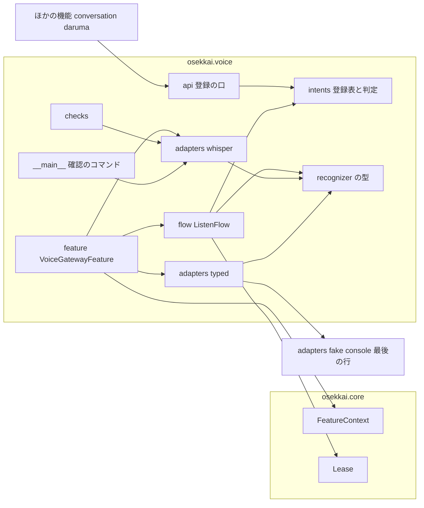
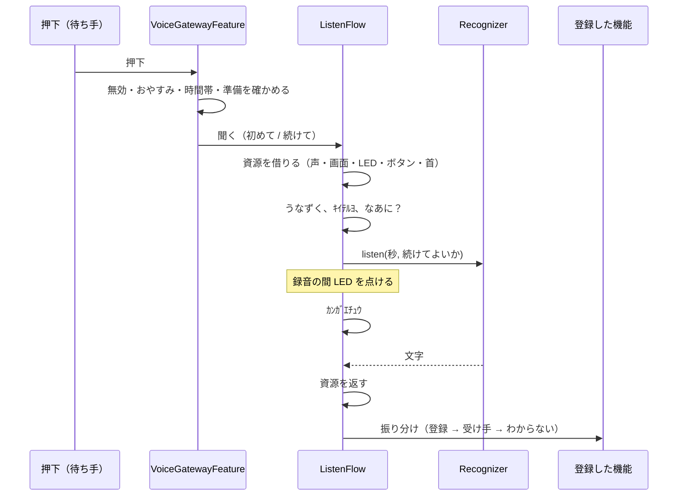
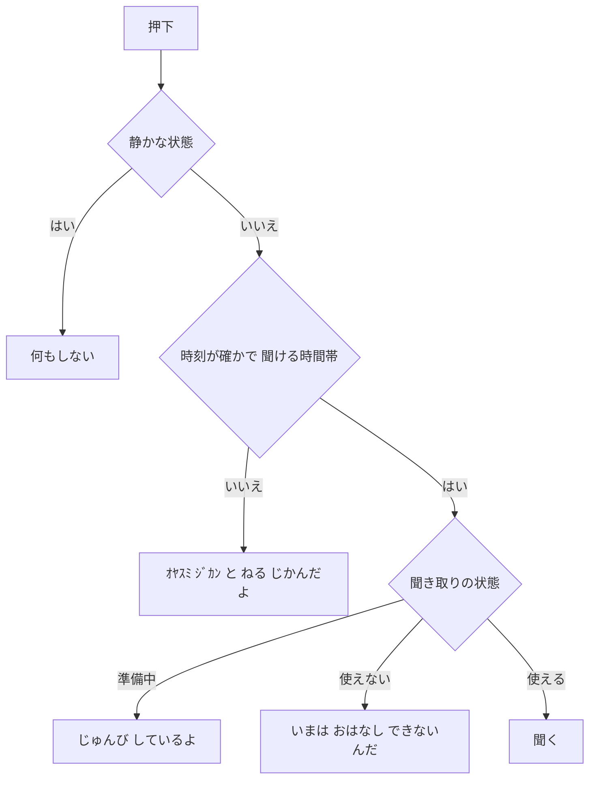

# Design Document

## Overview
**Purpose**: 音声の入口（Voice Gateway）は、ボタンを押して話した言葉を実機の中で文字にし、言葉を登録した機能へ渡す、すべての機能の共通の入口です。

**Users**: 子どもはボタンを押して話しかけます。保護者は設定でマイク・時間帯・モデルを決めます。開発者は、自分の機能の言葉を登録するだけで、声からその機能を呼べます。

**Impact**: `rover-core` の機能を足す口に、`voice` という機能を登録します。基盤の本体（`core`）は変えません。基盤の偽物（端末の版）に「最後に入れた行の文字」を渡す口を 1 つ足し、配置の道具の初期設定に聞き取りのモデルを足します。

### Goals
- ボタンの押下から、聞く姿勢・録音・文字にする・振り分けまでを、サンプルと同じ見た目と言葉で行う
- 機能が言葉を登録するだけで呼ばれ、入口は機能の中身を知らない
- 子どもの声と言葉を残さず、外に出さない
- 振り分けと流れを、聞き取りを偽物に替えて PC で確かめられる

### Non-Goals
- Claude との会話、会話の 1 日の利用上限（`conversation`）
- 呼びかけの言葉（ウェイクワード）
- マイクを基盤の共有の資源にすること（使う機能が入口だけのうちは作らない）

## Boundary Commitments

### This Spec Owns
- ボタンの押下を受けて聞く流れ（聞く姿勢の声・LCD・LED・首、録音、文字にする、振り分け、返事の言葉）
- 言葉の登録の口と、振り分けの判定（`osekkai.voice.api`、`osekkai.voice.intents`）
- 当てはまらない言葉の受け手の登録、続けて聞く
- 聞ける時間帯とおやすみモードの間の扱い
- 録音（`arecord`）と聞き取り（faster-whisper）のアダプタ、打った文字の聞き取り（ハードなし）
- `voice:` の設定、self-check の `voice.mic`・`voice.model`、開発用の聞き取りの確認のコマンド
- 子どもの言葉と声の扱い（残さない・出さない）

### Out of Boundary
- 押下を誰に届けるかの調停、資源の中断（`rover-core`）
- 会話の中身と上限（`conversation`）。各機能の言葉の中身と、受け取った後の振る舞い（各機能）
- USB カメラの映像（`presence`・`remote-control`）

### Allowed Dependencies
- `osekkai.core` の公開の口（`feature`・`arbiter.Lease`・`config.FeatureConfig`・`selfcheck`・`clock`・`types`・`events.QuietChanged`・`lcd_text`・`paths`）
- 外の依存: `faster-whisper>=1.1,<2`（extras の `voice`。`voice/adapters/whisper.py` の中だけで、遅れて読み込む）、`numpy`（同じアダプタの中だけ）、`arecord`（alsa-utils、サブプロセス）
- 打った文字の聞き取り（`voice/adapters/typed.py`）だけは、`osekkai.adapters.fake.console` の「最後に入れた行」の口を読んでよい
- 開発用のコマンド（`voice/__main__.py`）だけは、`osekkai.core.instance_lock`・`osekkai.core.config.ConfigLoader`・`osekkai.core.paths` を使ってよい
- 禁止: `osekkai.features.*` の読み込み（入口は機能の中身を知らない）。`voice` のアダプタ以外での faster-whisper・numpy・サブプロセスの使用

依存の向き（左から右だけ）: `texts`・`config` → `intents` → `api` → `recognizer` → `flow` → `feature`・`checks` → `__main__`。アダプタ（`voice/adapters/*`）は `recognizer`・`config`・`texts` を読む。`feature` と `checks` は、アダプタの補助（`whisper_available`・`mic_present`・`model_files_present`・`MODEL_FILES`）と聞き取りの実体を読む（実装で決めた）。

### Revalidation Triggers
- `osekkai.voice.api` の形（登録の口・`Heard`・`listen_again`）を変えたとき: `conversation`・`daruma-game`・`daily-routine` の言葉の登録を確かめ直す
- 優先度（55）を変えたとき: 押下の待ち手の順番（ほかの機能の待ち手）を確かめ直す
- 端末の偽物の「最後に入れた行」の口を変えたとき: rover-core の端末の偽物のテストと入口のテスト
- モデルの置き場所や名前を変えたとき: 配置の道具の初期設定と self-check

## Architecture

### Existing Architecture Analysis
- 押下は、BUTTON を借りている機能 → 待ち手の最も高い優先度 → 捨てる、の順に届く。日課はタスクの間だけ BUTTON を借りるので、それ以外の押下は入口が受ける
- 日課（85）が資源を求めると、入口（55）のリースに中断が知らされ、2 秒で返さなければ取り上げられる
- 静かな状態は `ctx.is_quiet`。ハードなしの実行かどうかを機能が知る口はない

### Architecture Pattern & Boundary Map



**Architecture Integration**:
- Selected pattern: 純粋な判定（`intents`）と、1 本のスレッドの流れ（`ListenFlow`）。聞き取りはポート（`Recognizer`）にして、実機・打った文字・テストの偽物を差し替える
- Steering compliance: ハードのライブラリはアダプタの中だけ。基盤に機能の名前を書かない。言葉をログに出さない

### Technology Stack

| Layer | Choice / Version | Role in Feature | Notes |
|-------|------------------|-----------------|-------|
| 聞き取り | faster-whisper 1.1 以上 2 未満（MIT）、ctranslate2 4.4 以上 5 未満 | 音声 → 文字 | extras の `voice`。CI と PC には入れない |
| モデル | `Systran/faster-whisper-base`（MIT、約 148 MB） | 日本語の聞き取り | 初期設定で置く。設定で small にできる |
| 録音 | `arecord`（alsa-utils） | 16 kHz・モノ・16 bit の録音 | サブプロセス。`plughw:CARD=U0x46d0x825,DEV=0` |
| 設定 | pydantic v2 | `voice:` の節 | `FeatureConfig` を継ぐ |

## File Structure Plan

### Directory Structure
```
src/osekkai/voice/
├── __init__.py            # VoiceGatewayFeature を外に出す（エントリーポイントの先）
├── texts.py               # 決まった言葉と LCD の文字（なあに？・ｷｲﾃﾙﾖ・ｶﾝｶﾞｴﾁｭｳ・ｵﾔｽﾐ ｼﾞｶﾝ・返事）
├── config.py              # VoiceConfig（マイク・録音の長さ・モデル・時間帯・続けて聞くの待ち・聞き取りの選び方）
├── intents.py             # normalize・IntentMatcher・KeywordMatcher・IntentRegistry・Registration
├── api.py                 # ほかの機能の口: register_words・register_fallback・listen_again・Heard
├── recognizer.py          # Recognizer（ポート）・RecognizerState・ListenCancelled
├── flow.py                # ListenFlow（押下から振り分けまで）・GatewayIO・LeaseGatewayIO
├── feature.py             # VoiceGatewayFeature（待ち手・準備・時間帯・おやすみ・続けて聞く）
├── checks.py              # self-check の voice.mic・voice.model
├── __main__.py            # 開発用の聞き取りの確認（--listen-once）
└── adapters/
    ├── __init__.py
    ├── whisper.py         # WhisperRecognizer（arecord と faster-whisper。遅れて読み込む）
    └── typed.py           # TypedRecognizer（端末の偽物の最後に入れた行）

tests/voice/
├── voice_fakes.py         # ScriptedRecognizer・ScriptedGatewayIO（テストの補助）
├── test_voice_config.py
├── test_voice_intents.py
├── test_voice_api.py
├── test_voice_flow.py
├── test_voice_feature.py
├── test_voice_whisper_adapter.py  # faster-whisper を偽の module に差し替えて形だけ確かめる
├── test_voice_typed.py
├── test_voice_checks.py
├── test_voice_cli.py
└── test_voice_import_direction.py
```

### Modified Files
- `pyproject.toml` — extras に `voice = ["faster-whisper>=1.1,<2", "ctranslate2>=4.4,<5"]`。エントリーポイントに `voice = "osekkai.voice:VoiceGatewayFeature"`。mypy の `faster_whisper.*`・`ctranslate2.*` を型を見ない対象に足す
- `src/osekkai/adapters/fake/console.py` — `ConsoleButtons` が、押下を知らせる前に行の文字（改行を除く）を取っておく。`take_typed_line() -> str | None`（取ったら消す）と `typed_input_active() -> bool`（`start` で立ち、EOF と `close` で消える）をモジュールの口として出す（rover-core の偽物への追加）
- `deploy/rover_deploy/releases.py` — `PIP_EXTRAS = "pi,voice"`
- `deploy/rover_deploy/provision.py` — `Asset` にサブディレクトリを置けるようにし、`faster-whisper-base` の 4 つのファイルを、版（コミット）と sha256 を固定して models に足す
- `config/osekkai.example.yaml`・`src/osekkai/core/example_config.yaml` — `voice:` の節の見本（既定値で動く。コメントで説明）
- `docs/voice.md`（新規）と `README.md` — 保護者と開発者の手順書（設定・言葉の登録の仕方・確認のコマンド）
- `docs/deploy.md` — 初期設定で聞き取りのモデルを置くこと

## System Flows

### ボタンを押して聞く（ListenFlow）



- 押下は待ち手の口（ボタンのスレッド）で受け、入口のスレッドの待ち行列に入れてすぐ戻る。聞いている間に来た押下は捨てる（1.6）
- 資源の中断（日課）が来たら、録音のサブプロセスを止め、文字にする処理の結果を捨て、すぐにリースを返す（1.7）
- 「わからない」と「きこえなかった」の返事は、資源を返す前に話す

### 押下を受けたときの判定（VoiceGatewayFeature）



## Requirements Traceability

| Requirement | Summary | Components | Interfaces |
|-------------|---------|------------|------------|
| 1.1, 1.2, 1.4 | 聞く姿勢 | ListenFlow, texts | `GatewayIO` |
| 1.3 | 録音の長さ | WhisperRecognizer, VoiceConfig | `Recognizer.listen` |
| 1.5 | 速さの目標と記録 | ListenFlow（かかった時間のログ）, 実機確認 | — |
| 1.6 | 重ねて始めない | VoiceGatewayFeature | 待ち行列 |
| 1.7 | 中断で捨てる | ListenFlow, WhisperRecognizer | `ListenCancelled` |
| 2.1, 2.2, 2.4, 2.6 | 登録と振り分け | IntentRegistry, api | `register_words` |
| 2.3 | 一致の正規化 | intents.normalize | — |
| 2.5 | 資源を返してから渡す | ListenFlow | — |
| 2.7 | 判定の差し替え | IntentMatcher | `IntentMatcher` |
| 3.1〜3.4 | 受け手 | IntentRegistry, api, ListenFlow | `register_fallback` |
| 4.1〜4.5 | 続けて聞く | api, VoiceGatewayFeature | `listen_again` |
| 5.1〜5.5 | 時間帯とおやすみ | VoiceGatewayFeature, VoiceConfig | `ctx.is_quiet`, `clock` |
| 6.1, 6.2 | 聞き取れない | ListenFlow | — |
| 6.3〜6.5 | 準備 | VoiceGatewayFeature, Recognizer | `RecognizerState` |
| 7.1〜7.5 | 言葉と声を守る | 全体（WhisperRecognizer・ListenFlow・ログ） | ログの決まり |
| 8.1〜8.3, 8.5 | 設定 | VoiceConfig, VoiceGatewayFeature | — |
| 8.4 | self-check | checks | `voice.mic`, `voice.model` |
| 9.1 | ハードなしの入力 | TypedRecognizer, 端末の偽物 | `take_typed_line` |
| 9.2 | PC でのテスト | Recognizer の偽物, ScriptedGatewayIO | — |
| 9.3, 9.4 | 確認のコマンド | __main__ | — |

## Components and Interfaces

| Component | Intent | Req Coverage | Key Dependencies |
|-----------|--------|--------------|------------------|
| VoiceConfig | 設定 | 1.3, 5.1, 8.1〜8.3 | pydantic |
| intents | 正規化・判定・登録表 | 2.1〜2.4, 2.6, 2.7, 3.1, 3.2 | — |
| api | ほかの機能の口 | 2.1, 3.1, 4.1 | intents |
| Recognizer | 聞き取りのポート | 1.3, 1.7, 6.3〜6.5 | — |
| WhisperRecognizer | 実機の録音と聞き取り | 1.3, 1.7, 7.1, 7.2 | arecord, faster-whisper |
| TypedRecognizer | ハードなしの入力 | 9.1 | 端末の偽物 |
| ListenFlow | 押下から振り分けまで | 1.x, 2.5, 3.3, 3.4, 6.1, 6.2, 7.3〜7.5 | GatewayIO, Recognizer, intents |
| VoiceGatewayFeature | 機能の本体 | 1.6, 4.2〜4.5, 5.x, 6.3〜6.5, 8.5 | FeatureContext |
| checks | self-check | 6.4, 8.4 | — |
| __main__ | 確認のコマンド | 9.3, 9.4 | WhisperRecognizer, InstanceLock |

### config

```python
RecognizerKind = Literal["auto", "whisper", "typed"]

class VoiceConfig(FeatureConfig):
    mic_device: str = "plughw:CARD=U0x46d0x825,DEV=0"   # arecord -L の名前
    listen_seconds: float = Field(default=5.0, ge=2.0, le=15.0)
    model: Literal["base", "small"] = "base"
    hours: tuple[time, time] = (time(7, 0), time(21, 30))  # 始めを含み、終わりを含まない
    follow_up_seconds: float = Field(default=30.0, ge=5.0, le=120.0)
    recognizer: RecognizerKind = "auto"
    max_gain: float = Field(default=20.0, ge=1.0, le=50.0)  # 小さい声を持ち上げる上限
```
- 時刻は日課と同じ書き方（`"07:00"`）。引用符なしの `7:00`（60 進の整数）も読み、0〜59 の整数と秒つきは誤り（日課の設定と同じ決まり。共通の補助は作らず、同じ規則を入口の中に書く）
- 始めと終わりが同じなら誤り（いつも聞けない設定は `enabled: false` で表す）
- モデルの置き場所は `paths.data_dir / "models" / f"faster-whisper-{model}"`（設定にしない）

### intents

```python
def normalize(text: str) -> str: ...
    # NFKC → カタカナをひらがなに → 空白・句読点・記号と長音の「ー」を除く（「だるまさーん」も一致する）
    # 漢字はかなにしない。機能は、かなと、聞き取りが出しそうな漢字の形の両方を登録する

class IntentMatcher(Protocol):
    def match(self, text: str, candidates: Sequence[WordsRegistration]) -> WordsRegistration | None: ...

class KeywordMatcher:   # 2.2〜2.4: 正規化した語句を含むもの。優先度の高い順、同じなら登録の順
    ...

@dataclass(frozen=True)
class Heard:
    text: str            # 文字にした言葉（受け取った機能だけが使う。ログに出さない）
    follow_up: bool      # 続けて聞いた言葉なら True

Handler = Callable[[Heard], None]   # すぐに戻る（自分のスレッドに仕事を渡す）

@dataclass(frozen=True)
class WordsRegistration:
    owner: str; priority: int; phrases: tuple[str, ...]; handler: Handler
    alive: Callable[[], bool]; order: int

class IntentRegistry:
    def add_words(...) -> WordsRegistration: ...
    def set_fallback(owner: str, handler: Handler, alive: Callable[[], bool]) -> FallbackRegistration: ...
        # すでにあれば FallbackTaken（3.2）
    def remove(registration) -> None: ...
    def route(text: str) -> Route: ...   # Words(reg) / Fallback(reg) / Nobody（2.2〜2.4、3.3、3.4）
    def hints() -> tuple[str, ...]: ...  # 生きている登録の語句（聞き取りのヒントに足す）
    def owner_alive(owner: str) -> bool: ...
```
- 表はロックで守る。`alive()` が偽の登録は、判定のときに外す（2.6）。受け手の `alive()` が偽なら空いている扱い
- 判定の口 `IntentMatcher` を差し替えても、登録の口は変わらない（2.7）

### api（ほかの機能の口）

```python
def register_words(owner: str, priority: int, phrases: Sequence[str], handler: Handler,
                   *, alive: Callable[[], bool]) -> Registration: ...
def register_fallback(owner: str, handler: Handler, *, alive: Callable[[], bool]) -> Registration: ...
def listen_again(owner: str) -> None: ...   # 続けて聞く（4.1）。owner の登録がなければ何もしない

class Registration(Protocol):
    def remove(self) -> None: ...
```
- 機能は `run(stop)` の始めに登録し、`alive=lambda: not stop.is_set()` を渡し、`finally` で `remove()` する。例外で止まっても `finally` で外れ、`alive` でも外れる（2.6）
- 語句は 1 つ以上で、空の語句（正規化して空）は ValueError
- 表はプロセスの中で 1 つ（`_REGISTRY`）。テストは `_reset_for_tests()` で空にする

### recognizer

```python
class RecognizerState(Enum):
    PREPARING = "preparing"; READY = "ready"; UNAVAILABLE = "unavailable"

class ListenCancelled(Exception): ...

class Recognizer(Protocol):
    @property
    def state(self) -> RecognizerState: ...
    def prepare(self) -> None: ...   # 起動のときに入口のスレッドで呼ぶ（6.5）。失敗は UNAVAILABLE
    def listen(self, seconds: float, *, hints: Sequence[str],
               should_continue: Callable[[], bool],
               on_recording: Callable[[bool], None]) -> str: ...
        # 録音（on_recording(True/False) で LED）→ 文字にする。空なら ""。
        # should_continue が偽になったら ListenCancelled。失敗は RecognitionFailed（型の名前だけを記録する）
```

### adapters/whisper（WhisperRecognizer）
- `prepare()`: `arecord -L`（短い時間で打ち切り）に `mic_device` があるかを確かめ（なければ UNAVAILABLE。押下で「おはなし できない」と答える。6.4）、`faster_whisper` を読み込み、`WhisperModel(model_dir, device="cpu", compute_type="int8", cpu_threads=3)` を作る。モデルのディレクトリがない・読み込めないなら UNAVAILABLE（型の名前だけを記録する）
- `listen()`:
  1. `arecord -q -D <mic_device> -f S16_LE -r 16000 -c 1 -d <秒> -t raw` を起動し、標準出力を読む。読む間に `should_continue` を 0.1 秒ごとに見て、偽ならプロセスを止めて `ListenCancelled`
  2. バイト列を numpy の float32（÷32768）にし、音量を `min(0.9 / 最大値, max_gain)` 倍にする
  3. `transcribe(audio, language="ja", beam_size=1, vad_filter=True, condition_on_previous_text=False, without_timestamps=True, initial_prompt=既定のヒント + 登録の語句)` の segments を回して文字をつなぐ。1 つの segment ごとに `should_continue` を見て、偽なら残りを回さずに `ListenCancelled`
  - CPU の取り合い: `cpu_threads=3` にして、日課の声（Open JTalk）と基盤のスレッドのために 1 つのコアを空ける。中断（日課）のときは残りの segment を計算しないので、日課の声かけが文字にする処理の終わりを長く待たない（短い録音と VAD で、1 つの segment は長くて 1〜2 秒）
  4. 声のバイト列と配列は関数の中だけに置き、ファイルに書かない（7.2）
- 既定のヒント: 「ローバー。おはよう。おやすみ。できたよ。なんで？あそぼう。すき。たのしい。」（サンプルと同じ）

### adapters/typed（TypedRecognizer）
- `state`: 端末の偽物が動いていれば（`typed_input_active()`）READY、なければ UNAVAILABLE
- `listen()`: `on_recording(True)` → `take_typed_line()` を取り出す（なければ ""）→ `on_recording(False)` → その文字を返す
- 端末で「だるまさん しよう」と打って Enter を押すと、押下と言葉が一緒に届く。Enter だけなら「きこえなかった」になる

### 聞き取りの選び方（feature の中）
- `whisper`: WhisperRecognizer。`typed`: TypedRecognizer
- `auto`: `faster_whisper` を読み込めれば WhisperRecognizer。読み込めず、端末の偽物が動いていれば TypedRecognizer。どちらもなければ UNAVAILABLE（ボタンで「いまは おはなし できないんだ」）

### flow（ListenFlow）

```python
class GatewayIO(Protocol):
    def show(self, line1: str, line2: str) -> None: ...   # 2 行とも中央に置く
    def led(self, on: bool) -> None: ...
    def say(self, text: str) -> None: ...
    def nod(self) -> None: ...

class ListenFlow:
    def __init__(self, recognizer: Recognizer, registry: IntentRegistry, clock: Clock,
                 log: logging.Logger) -> None: ...
    def run(self, io: GatewayIO, *, follow_up_owner: str | None, seconds: float,
            cancelled: Callable[[], bool], release: Callable[[], None]) -> ListenOutcome: ...
```
- 初めて（`follow_up_owner` が None）: `nod` → `show(LCD_LISTENING, CALL の顔)` → `say(「なあに？」)`。続けて: `show` → `say(「うん、なあに？」)`（うなずかない）
- 録音: `recognizer.listen(...)`。`on_recording` で LED を点けて消す（1.2）。終わったら `show(LCD_THINKING, NORMAL の顔)`（1.4）
- 結果:
  - `ListenCancelled` → 何も話さず、`release()` して DISCARDED（1.7）
  - `RecognitionFailed` または空 → `say(「ごめんね、きこえなかった…」)` → `release()`（6.1、6.2）
  - 続けて聞いた言葉 → `release()` → 続けて聞くを求めた機能の口へ（4.3）。その機能の登録が生きていなければ、6.1 と同じではなく「わからない」として扱う
  - 初めての言葉 → `registry.route(text)`: Words/Fallback → `release()` → 口へ（2.5、3.3）。Nobody → `say(「ごめんね、まだ わからないんだ」)` → `release()`（3.4）
- ログ: 「聞き取りを始めました」「振り分けました: <機能の名前>」「聞き取れませんでした」「聞き取りに失敗しました: <型の名前>」「かかった時間: 録音 <秒>、文字にする <秒>」だけ（1.5、7.4、7.5）。文字・語句・言葉の長さは出さない
- 口が例外を出したら、型の名前と機能の名前だけを記録する（入口は止めない）

### feature（VoiceGatewayFeature）

| Field | Detail |
|-------|--------|
| spec | name `voice`、priority `INTERACTIVE + 5`、resources `{VOICE, DISPLAY, LED, BUTTON, NECK}`、config `VoiceConfig`、checks `VOICE_CHECKS` |
| 状態 | `_jobs: queue.Queue[Job]`（押下・続けて聞く）、`_busy: bool`、`_follow_up: FollowUp | None`（owner と締め切り） |

- `__init__(ctx, config, *, recognizer: Recognizer | None = None, registry: IntentRegistry | None = None)`。テストは偽の聞き取りと新しい登録表を渡す
- `run(stop)`:
  1. 聞き取りを選び、`prepare()` を短命の別のスレッド（`voice-prepare`）で始める。入口のスレッドはすぐに 2 に進み、読み込みの間の押下には「じゅんび しているよ」と答える（6.3、6.5）。`state` は準備のスレッドだけが書き、入口のスレッドは読むだけ
  2. `ctx.want_button_presses(on_press)` で待ち手になる（`enabled: false` なら機能は開始されないので待ち手にならない。8.5）
  3. 待ち行列から仕事を取り出して 1 つずつ行う。`stop` が立てば戻る
- `on_press`（ボタンのスレッド）: `_busy` なら捨てる（1.6）。そうでなければ待ち行列に入れる
- 押下の判定（System Flows の図）: 静かな状態 → 何もしない（5.3）。時刻が確かでない・時間帯の外 → 「ｵﾔｽﾐ ｼﾞｶﾝ」と言葉（5.2、5.4）。準備中 → 6.3。使えない → 6.4。使える → 聞く
- 続けて聞く: `api.listen_again(owner)` は登録表に owner だけを記録する。入口はそれを取り出して `_follow_up` を「owner、締め切り = 今 + follow_up_seconds」にする（締め切りは入口だけが持つ）。締め切りまでに押下があれば、続けての聞き取りにする（4.2）。締め切り・時間帯の終わり・静かな状態・owner の登録が生きていない、のどれかで黙って終える（4.4、4.5、5.5）。入口は 1 秒ごとに締め切りを確かめる
- 資源の借り方: `ctx.acquire({VOICE, DISPLAY, LED, BUTTON, NECK}, wait=2.0, on_preempt=旗を立てる)`。借りられなければ（日課が使っている）その押下を捨てる。中断の旗は `cancelled()` として ListenFlow に渡し、立ったら直ちにリースを返す
- 返事の「ｵﾔｽﾐ ｼﾞｶﾝ」なども、資源を借りてから表示して話す

### checks

| 項目 | 確かめ | 結果 |
|------|--------|------|
| `voice.mic` | `arecord -L` の出力に設定の `mic_device` があるか（`hardware=True`、5 秒で打ち切り） | よい／だめ「マイクが見つからない」 |
| `voice.model` | `paths.data_dir/models/faster-whisper-<model>/` に `model.bin`・`config.json`・`tokenizer.json`・`vocabulary.txt` があるか | よい／だめ「聞き取りのモデルがない」 |
- 実際に使う聞き取りが打った文字のとき（`recognizer: typed`、または `auto` で faster_whisper を読み込めないとき）は、どちらも「飛ばした」（理由「打った文字の聞き取り」）。開発 PC と CI の self-check はこれで赤くならない
- device-deployment の確認は、だめが 1 つでもあると版を戻す。入口では次のように決める:
  - `voice.mic` はだめにする。基盤の LCD やボタンと同じく、ハードの不足として扱う
  - `voice.model` はだめにする。音声の入口を初めて含む版を入れる前に、初期設定（`rover-deploy provision`）でモデルを置く順番にする。手順書（`docs/deploy.md`・`docs/voice.md`）にこの順番を書く。初期設定を忘れた版は確認で戻るので、モデルのない版が普段の版になることはない

### __main__（開発用の確かめ）
- `python -m osekkai.voice --listen-once [--seconds N] [--config PATH]`
- 単一の実行のロックを取る。取れなければ「ロボットが動いています。止めてから試してください」を出して 75（9.4）
- 設定を読み、WhisperRecognizer を準備して 1 回録音し、文字とかかった時間（録音・文字にする）を標準出力にだけ出す（9.3）。ログには文字を出さない
- 声・画面・ボタンは使わない（基盤を起動しない）

## Data Models
- 入口は何も保存しない（記録も控えも持たない）。登録表と続けて聞くはメモリの中だけ
- 録音のバイト列と配列は `listen()` の中だけにあり、戻るときに捨てる

## Error Handling
- 聞き取りの準備の失敗: UNAVAILABLE にして、押下で「いまは おはなし できないんだ」。self-check でも知らせる
- 録音の失敗（arecord の終了コード・時間切れ）・文字にする処理の例外: RecognitionFailed にして「きこえなかった」。ログは型の名前だけ
- 口（登録した機能）の例外: 型の名前と機能の名前だけを記録し、入口は続ける
- 1 回の仕事の中のどの例外も捕まえて記録し、`run()` を終わらせない
- 声を出せない（SpeechFailed）: 記録して、表示だけで続ける

## Testing Strategy

### Unit Tests
- `normalize` と KeywordMatcher: 「ダルマさん しよう！」が「だるまさん」に一致、優先度と登録の順、空の語句は誤り（2.2〜2.4）
- IntentRegistry: 受け手は 1 つだけで 2 つ目は FallbackTaken、`alive` が偽の登録は外れる、`remove`、`hints`（2.6、3.1、3.2）
- VoiceConfig: 既定値、範囲の外・時間帯の書き方・始めと終わりが同じは誤りで、誤りの文言に値がない（8.1〜8.3）
- WhisperRecognizer: faster_whisper と arecord を偽物に替え、arecord の引数、音量の持ち上げの上限、transcribe の引数（language・vad_filter・initial_prompt にヒント）、取り消しでプロセスを止めること、一時ファイルを作らないこと（1.3、1.7、7.2）

### Integration Tests（偽の聞き取り + 台本の入出力）
- ListenFlow: なあに → LED の点灯と消灯 → ｶﾝｶﾞｴﾁｭｳ → 登録の機能へ、資源を返してから口を呼ぶ（1.1〜1.4、2.5）
- ListenFlow: 空 → きこえなかった、失敗 → きこえなかった、当てはまらず受け手なし → わからない、受け手あり → 受け手へ（3.3、3.4、6.1、6.2）
- ListenFlow: 中断で何も話さず、口を呼ばない（1.7）
- VoiceGatewayFeature（本物の Arbiter・QuietMode を偽のデバイスで組む）: 静かな状態の押下は何も出さない、時間帯の外は「ねる じかん」、時刻が確かでないときも同じ、準備中・使えないの返事、聞いている間の押下は捨てる、日課（85）が資源を求めると中断（1.6、1.7、5.2〜5.4、6.3、6.4）
- 続けて聞く: 30 秒の中の押下で「うん、なあに？」、振り分けずに同じ機能へ、締め切り・おやすみ・機能の停止で黙って終わる（4.2〜4.5、5.5）
- ログ: すべてのテストの流れで、話した言葉・語句がログに出ない（7.3〜7.5）

### E2E Tests
- エントリーポイントから `voice` が見つかり、模擬のデバイスの起動で開始される。端末の入力の 1 行が押下と言葉になり、登録した偽の機能に届く（9.1）
- 確認のコマンド: ロックがあれば 75、偽の WhisperRecognizer で文字とかかった時間が標準出力にだけ出る（9.3、9.4）
- self-check に `voice.mic`・`voice.model` が並ぶ。配置の道具の初期設定の段階に、モデルのファイルが足されている（道具のテスト）
- 読み込みの向き: `osekkai.voice` は `osekkai.features` を読まない。faster_whisper と numpy と subprocess はアダプタの中だけ

### 実機確認（device-deployment の手順で、使っていない時間帯に）
- 初期設定でモデルが置かれ、self-check がよい
- ボタン → なあに → 話す → 文字にするまでの時間を測る（5 秒の録音で 3 秒以内か。1.5）
- 夜（時間帯の外）とおやすみの間の押下

## Security Considerations
- 声は実機の中だけで文字にし、モデルは初期設定で置く（実行中に外へ繋がない）。録音はファイルに書かない
- 言葉はログ・記録・self-check・確認のコマンドのログに出さない。確認のコマンドの標準出力だけは、開発者が自分で見るために文字を出す（journal に入らない）
- 受け取った機能に渡す `Heard` の文字の扱いは、その機能の責任（会話は外部に送るが、名前は送らない。`conversation` の要件）

## Implementation Notes（実装で設計から足したこと）
- 開発用の確認のコマンドは `osekkai.core.logging_setup` も使う
- モデルの置き場所は `config.model_dir(paths, config)` が決める
- 登録表には `handler_for(owner)`・`request_follow_up(owner)`・`take_follow_up_request()` がある。api には入口のための `registry()` と、`FallbackTaken` の再輸出がある
- `RecognitionFailed(reason)` は決まった理由か例外の型の名前だけを持つ
- `ListenFlow.run` の結果は `ListenOutcome`（ROUTED(owner)・NOT_HEARD・NOT_UNDERSTOOD・DISCARDED・FAILED）
- 入口の機能は `acquire_wait`（既定 2.0 秒）と `job_poll`（既定 1.0 秒）をキーワードで受ける（テストで小さくする）。資源を借りた後に、静かな状態と時間帯をもう一度確かめる
- 続けて聞くの要求は、押下のときにも取り出す（求めた直後の押下を取りこぼさない）
- self-check は、無効のとき「無効」、入口の設定が使えないとき「入口の設定を使えない」で飛ばす
- 聞き取りのヒント（initial_prompt）は、既定のヒントの後に登録の語句を足し、200 文字までにする
- 言葉の正規化は長音の「ー」も除く（「だるまさーん」も一致する）
